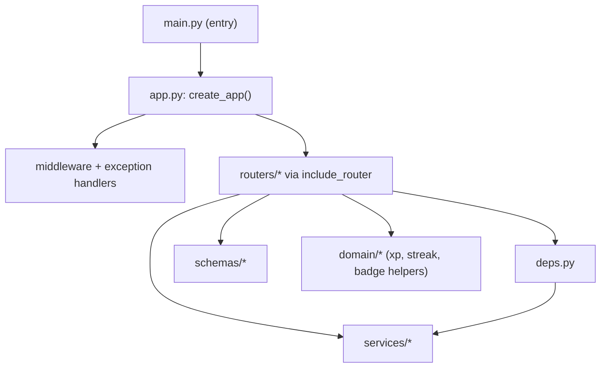

# Design Document

## Overview

This design decomposes the monolithic Python/FastAPI entry module (`main.py`, ~17,900 lines) into a
structured, maintainable package while preserving every externally observable endpoint behavior. The
refactor is strictly **behavior-preserving**: the OpenAPI schema, paths, methods, request/response
models, status codes, and auth requirements remain unchanged. It proceeds in small, independently
verifiable increments so the backend stays runnable and test-passing throughout.

This work is sequenced after the `security-hardening-remediation` fixes so those land against the
current monolith first; this refactor then reorganizes the resulting code.

### Design principles

- **Behavior preservation over cleverness.** Move code, do not rewrite logic.
- **Thin entry module.** `main.py` becomes app construction + router registration only.
- **Stable imports during transition.** Temporary re-exports keep external imports working until the move completes, then are removed.
- **Each increment is green.** Tests pass before the next increment begins.

## Architecture

### Target package layout

```
backend/
  app.py                 # FastAPI() construction, middleware, exception handlers, router includes
  deps.py                # get_db, get_current_user(_optional), role deps, feature/ownership deps
  schemas/               # Pydantic models grouped by domain
    auth.py  users.py  content.py  quests.py  progress.py  ...
  routers/               # APIRouter per domain
    auth.py  users.py  motifs.py  quizzes.py  urns.py  admin_*.py  live.py  ...
  services/              # existing services/ package (business logic) — unchanged location
  domain/                # pure helpers extracted from main.py (xp, ranks, streaks, badges)
```



### Decomposition order (dependency-safe)

1. Extract shared infrastructure first: `deps.py` (DB session, auth dependencies, role guards).
2. Extract `domain/` pure helpers (rank/XP/streak/badge/certificate functions) that routers call.
3. Extract `schemas/` Pydantic models by domain.
4. Extract `routers/` one domain at a time, each registered via `include_router`.
5. Reduce `main.py` to a thin shim that imports and runs `app.create_app()`.
6. Remove the empty `routes/` package and any temporary re-exports.

## Components and Interfaces

- **`create_app() -> FastAPI`** — builds the app, attaches middleware/exception handlers, includes all
  routers. `main.py` exposes `app = create_app()` for the ASGI server.
- **`deps.py`** — single home for `get_db`, `get_current_user`, `get_current_user_optional`,
  `get_staff_user`/`get_admin_user`/`get_super_admin_user`, `require_feature`, and any ownership deps.
- **Router modules** — each owns its route table and imports schemas/services/deps. No business logic
  is rewritten; functions are moved verbatim and re-pointed at shared modules.
- **Re-export shim (transitional)** — during migration, `main.py` may `from backend.routers.x import *`
  to keep any external imports resolving; removed once nothing depends on them.

## Data Models

No data-model changes. Pydantic schemas are relocated, not modified; their field sets, validators, and
serialization behavior are preserved exactly.

## Correctness Properties

### Property 1: Endpoint contract preservation
For every route present before the refactor, the modularized app exposes the same path, HTTP method, request model, response model, and status codes (i.e., the generated OpenAPI schema is unchanged).

**Validates: Requirements 2.1, 2.3**

### Property 2: Test-suite parity
Every test that passed against the pre-refactor backend passes against the modularized backend.

**Validates: Requirements 2.2**

### Property 3: Import resolvability
After modularization completes, importing and initializing the application resolves every internal import with no `ModuleNotFoundError` and no remaining temporary re-exports.

**Validates: Requirements 1.1, 4.3**

### Property 4: No monolith, no empty package
After completion, no single module co-locates routing, schemas, and persistence, and no empty `routes/` package remains.

**Validates: Requirements 1.3, 3.1, 3.2**

## Error Handling

Exception handlers (`AppError`, `StarletteHTTPException`, `RequestValidationError`) move into
`app.py`/`create_app()` and remain registered with identical behavior. No new error paths are introduced.

## Testing Strategy

- **OpenAPI snapshot test** — capture the schema before refactor and assert equality after (Property 1).
- **Existing suite** — run the full test suite after each increment (Property 2).
- **Import smoke test** — a test that imports `create_app()` and every router module, asserting no
  import errors (Property 3).
- **Structure assertions** — a test/lint that fails if `routes/` is empty-but-present or if `main.py`
  exceeds a line threshold after completion (Property 4).
- **Per-increment gate** — CI runs the suite on each increment; a failing increment blocks the next.

## Design Decisions and Rationale

- **Move-don't-rewrite** minimizes regression risk on a 17.9k-line module; logic changes are explicitly
  out of scope and belong to other specs.
- **Infrastructure-first ordering** ensures routers always have their dependencies available, avoiding
  circular-import churn.
- **OpenAPI snapshot as the contract oracle** gives an objective, automatable definition of
  "behavior preserved" without enumerating hundreds of endpoints by hand.
