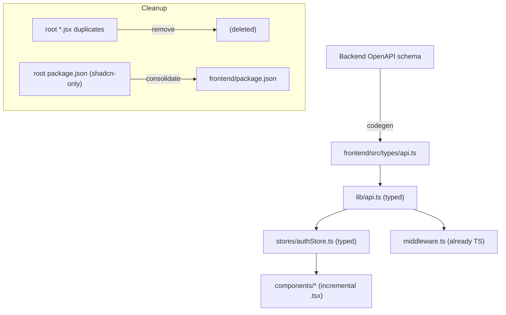

# Design Document

## Overview

This design consolidates the Next.js frontend into a single typed application: it introduces
TypeScript, generates typed API models from an authoritative OpenAPI source, migrates the
security-sensitive critical paths (API client, auth store, route guard) to `.ts`/`.tsx`, removes
orphaned root-level duplicate components, and corrects the package manifest so the build is
reproducible.

The narrow security behaviors (server-authoritative exam grading, route-guard token validity, the
i18n fix, and the route-matching regex) are handled in the `security-hardening-remediation` spec.
This spec is the broader typing and structural cleanup; it is sequenced after those fixes so the
migration moves already-correct code.

### Design principles

- **Incremental, allowJs migration.** Enable TypeScript alongside existing JS (`allowJs`) and convert
  files module by module so the app stays runnable.
- **Generated, not hand-typed, models.** API types derive from the backend OpenAPI schema to avoid drift.
- **Critical paths first.** Auth and request code get types before peripheral UI.
- **Single home per component.** No divergent root-level duplicates.

## Architecture

### Migration sequence

1. Add TypeScript tooling: `tsconfig.json` with `allowJs: true`, `strict: true`; replace
   `jsconfig.json`; add type-check to the build/CI.
2. Generate `src/types/api.ts` from the backend OpenAPI schema via a codegen tool.
3. Convert critical paths: `lib/api.js → lib/api.ts`, `stores/authStore.js → stores/authStore.ts`,
   typing requests/responses against the generated models.
4. Remove orphaned root-level `.jsx` duplicates and fix the manifest.
5. Incrementally convert remaining components/hooks to `.tsx`/`.ts`.

## Components and Interfaces

- **`src/types/api.ts`** — generated typed models for backend payloads; regenerated from OpenAPI on
  contract change.
- **`lib/api.ts`** — the typed fetch client; functions return `Promise<TypedModel>` and accept typed
  request bodies. `ApiError` keeps its shape with typed fields.
- **`stores/authStore.ts`** — typed Zustand store (`user: User | null`, `status: AuthStatus`, typed
  actions).
- **Codegen script** — an npm script (e.g. `gen:api`) that pulls the OpenAPI schema and emits
  `src/types/api.ts`.
- **Build gate** — `tsc --noEmit` (or Next type-check) wired into CI; failures on critical paths fail
  the build.

## Data Models

`src/types/api.ts` mirrors the backend response/request schemas (User, AuthMeResponse, Urn, Motif,
Quiz, Leaderboard, etc.). These are generated, not hand-authored, and are the single source of frontend
API typing.

## Correctness Properties

### Property 1: Generated models match the schema
For the committed OpenAPI schema, the generated `src/types/api.ts` reflects every response/request shape it describes, and can be regenerated deterministically from that schema.

**Validates: Requirements 1.1, 1.2, 1.3**

### Property 2: Critical-path type soundness
Type checking the migrated critical-path code (api client, auth store, route guard) reports zero type errors, and a type error on those paths fails the build.

**Validates: Requirements 2.1, 2.2, 2.3**

### Property 3: No orphaned duplicates
For every component maintained under `frontend/src/`, no copy exists at the repository root — divergent or identical.

**Validates: Requirements 3.1, 3.2**

### Property 4: Reproducible manifest
The frontend package manifest declares every build/runtime dependency the application imports, and no buildable component relies on a root manifest that declares only an unrelated devDependency.

**Validates: Requirements 4.1, 4.2**

## Error Handling

- Codegen failures (unreachable/invalid schema) fail the `gen:api` script and CI, rather than emitting
  partial types.
- The typed `lib/api.ts` preserves existing runtime error behavior (`ApiError`, refresh-on-401); typing
  is additive and does not change control flow.

## Testing Strategy

- **Type-check gate** — `tsc --noEmit` in CI verifies Property 2; a deliberate type error on a critical
  path is asserted to fail the check.
- **Codegen determinism test** — running `gen:api` twice produces identical output (Property 1).
- **Duplicate-scan test/lint** — fails if a root-level component duplicates one under `frontend/src/`
  (Property 3).
- **Manifest test** — asserts imported packages are declared in `frontend/package.json` and that the
  root shadcn-only manifest is not relied upon for the build (Property 4).
- **Regression** — existing Playwright e2e suite runs against the migrated app to confirm no behavior
  change.

## Design Decisions and Rationale

- **`allowJs` incremental migration** avoids a risky big-bang rewrite of a large client; files convert
  independently while the app keeps running.
- **OpenAPI-generated types** prevent the frontend/backend drift that hand-maintained types accumulate,
  and make contract changes a regeneration step.
- **Critical paths first** concentrates type safety where security matters most (auth/requests) before
  peripheral UI.
- **Sequenced after the security spec** so the migration relocates and types already-correct behavior
  rather than chasing a moving target.
