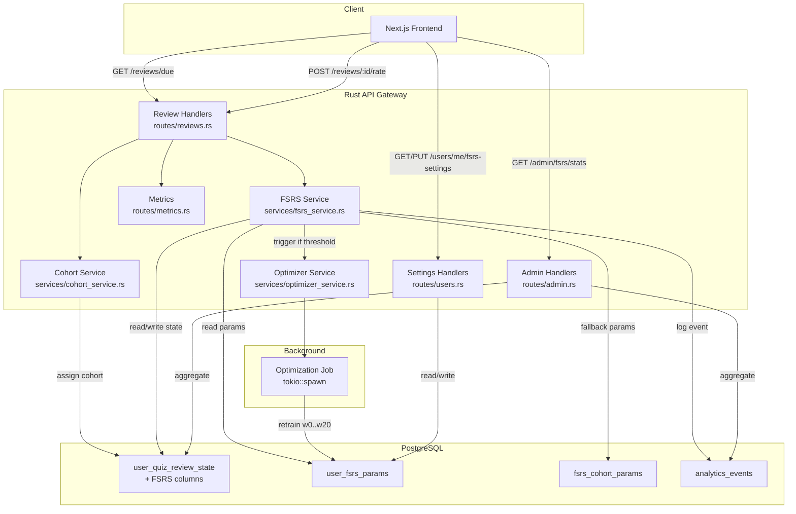
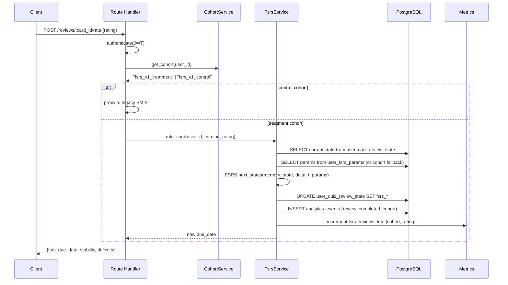

# Design Document — FSRS Spaced Repetition

## Overview

This design replaces the legacy SM-2 spaced repetition scheduling with the FSRS (Free Spaced Repetition Scheduler) algorithm, implemented natively in Rust using the `fsrs` crate. The system introduces:

- A new FSRS scheduling service that computes next review dates based on the DSR (Difficulty, Stability, Retrievability) model
- Per-user parameter optimization via background jobs
- A/B testing infrastructure (50/50 cohort split) using the existing analytics event pipeline
- An additive database migration that extends `user_quiz_review_state` with FSRS columns
- Admin KPI endpoints and Prometheus metrics for monitoring

The design follows the existing module patterns in `backend-rust/`: models in `src/models/`, services in `src/services/`, route handlers in `src/routes/`, with the `AuthState` pattern for authenticated endpoints and `AppError::Domain` for domain-specific errors.

**Key design decisions:**
1. Use the `fsrs` crate (v5.2.0, published as `fsrs` on crates.io) rather than `rs-fsrs` — the former is the actively maintained Rust implementation by the open-spaced-repetition org.
2. Cohort assignment uses a deterministic hash of `user_id` (no external experiment service needed) — sticky by construction.
3. Parameter optimization runs in `tokio::spawn` with a `JoinHandle` tracked per-user to prevent duplicate jobs.
4. The migration is purely additive (new columns only) so rollback is safe.

## Architecture



### Request Flow: POST /api/v1/reviews/:card_id/rate



## Components and Interfaces

### New Files

| File | Purpose |
|------|---------|
| `src/models/fsrs.rs` | FSRS domain DTOs, DB row types |
| `src/services/fsrs_service.rs` | Core FSRS scheduling logic |
| `src/services/cohort_service.rs` | Deterministic cohort assignment |
| `src/services/optimizer_service.rs` | Background parameter optimization |
| `src/routes/reviews.rs` | Review endpoint handlers |

### Modified Files

| File | Change |
|------|--------|
| `src/models/mod.rs` | Add `pub mod fsrs;` |
| `src/services/mod.rs` | Add `pub mod fsrs_service; pub mod cohort_service; pub mod optimizer_service;` |
| `src/routes/mod.rs` | Add `pub mod reviews;` |
| `src/routes/users.rs` | Add FSRS settings endpoints |
| `src/routes/admin.rs` | Add FSRS stats endpoint |
| `src/routes/metrics.rs` | Add FSRS-specific counters |
| `src/main.rs` | Mount new review routes |
| `Cargo.toml` | Add `fsrs = "=5.2.0"` |

### API Interfaces

#### GET /api/v1/reviews/due

```rust
// Query params
struct DueReviewsQuery {
    page: Option<u32>,      // default 1
    page_size: Option<u32>, // default 20, max 100
}

// Response
struct DueReviewsResponse {
    cards: Vec<DueCardOut>,
    total: i64,
    page: u32,
    page_size: u32,
}

struct DueCardOut {
    card_id: Uuid,
    question_id: Uuid,
    question_text: String,
    question_type: String,
    motif_name: String,
    fsrs_due_date: DateTime<Utc>,
    fsrs_stability: f64,
    fsrs_difficulty: f64,
    retrievability: f64,
}
```

#### POST /api/v1/reviews/:card_id/rate

```rust
// Request body
struct RateCardRequest {
    rating: FsrsRating, // "Again" | "Hard" | "Good" | "Easy"
}

// Response
struct RateCardResponse {
    card_id: Uuid,
    fsrs_due_date: DateTime<Utc>,
    fsrs_stability: f64,
    fsrs_difficulty: f64,
    fsrs_state: String,
    interval_days: f64,
}
```

#### GET /api/v1/users/me/fsrs-settings

```rust
struct FsrsSettingsResponse {
    optimal_retention: f64,
    recommended_range: [f64; 2], // [0.75, 0.97]
    last_optimized_at: Option<DateTime<Utc>>,
    review_count: i64,
    using_personal_params: bool,
}
```

#### PUT /api/v1/users/me/fsrs-settings

```rust
// Request body
struct UpdateFsrsSettingsRequest {
    optimal_retention: f64, // must be in [0.70, 0.97]
}

// Response: same as GET
```

#### GET /api/v1/admin/fsrs/stats

```rust
struct FsrsStatsResponse {
    cohorts: Vec<CohortStats>,
    experiment_started_at: DateTime<Utc>,
    total_users: i64,
}

struct CohortStats {
    cohort: String,
    user_count: i64,
    avg_reviews_per_day: f64,
    retention_rate_30d: f64,
    avg_interval_days: f64,
}
```

### Service Interfaces

```rust
// services/fsrs_service.rs
pub async fn get_due_cards(pool: &PgPool, user_id: Uuid, page: u32, page_size: u32) -> Result<DueReviewsResponse, AppError>;
pub async fn rate_card(pool: &PgPool, user_id: Uuid, card_id: Uuid, rating: FsrsRating) -> Result<RateCardResponse, AppError>;
pub fn map_score_to_rating(score: f64, easy_flag: bool) -> FsrsRating;

// services/cohort_service.rs
pub fn assign_cohort(user_id: &Uuid) -> Cohort;

// services/optimizer_service.rs
pub async fn maybe_trigger_optimization(pool: &PgPool, user_id: Uuid);
pub async fn run_optimization(pool: &PgPool, user_id: Uuid) -> Result<(), AppError>;
```

### Cohort Assignment Logic

```rust
use sha2::{Sha256, Digest};

pub enum Cohort {
    Treatment, // FSRS
    Control,   // SM-2
}

pub fn assign_cohort(user_id: &Uuid) -> Cohort {
    let mut hasher = Sha256::new();
    hasher.update(b"fsrs_v1_");
    hasher.update(user_id.as_bytes());
    let hash = hasher.finalize();
    // Use first byte: 0-127 = treatment, 128-255 = control
    if hash[0] < 128 {
        Cohort::Treatment
    } else {
        Cohort::Control
    }
}
```

## Data Models

### Extended: user_quiz_review_state (additive columns)

```sql
ALTER TABLE user_quiz_review_state
ADD COLUMN fsrs_state TEXT DEFAULT 'new',           -- 'new' | 'learning' | 'review' | 'relearning'
ADD COLUMN fsrs_difficulty DOUBLE PRECISION,         -- 1.0 to 10.0
ADD COLUMN fsrs_stability DOUBLE PRECISION,          -- days
ADD COLUMN fsrs_due_date TIMESTAMP WITH TIME ZONE,
ADD COLUMN fsrs_last_review TIMESTAMP WITH TIME ZONE;
```

### New: user_fsrs_params

```sql
CREATE TABLE user_fsrs_params (
    id UUID PRIMARY KEY DEFAULT gen_random_uuid(),
    user_id UUID NOT NULL UNIQUE REFERENCES users(id),
    parameters DOUBLE PRECISION[] NOT NULL DEFAULT '{}',  -- w0..w20 (21 elements)
    optimal_retention DOUBLE PRECISION NOT NULL DEFAULT 0.9,
    last_optimized_at TIMESTAMP WITH TIME ZONE,
    review_count_at_last_optimize INTEGER NOT NULL DEFAULT 0,
    created_at TIMESTAMP WITH TIME ZONE NOT NULL DEFAULT NOW(),
    updated_at TIMESTAMP WITH TIME ZONE NOT NULL DEFAULT NOW()
);

CREATE INDEX idx_user_fsrs_params_user_id ON user_fsrs_params(user_id);
```

### New: fsrs_cohort_params

```sql
CREATE TABLE fsrs_cohort_params (
    id UUID PRIMARY KEY DEFAULT gen_random_uuid(),
    cohort_name TEXT NOT NULL UNIQUE DEFAULT 'default',
    parameters DOUBLE PRECISION[] NOT NULL,  -- w0..w20 (21 elements, FSRS defaults)
    optimal_retention DOUBLE PRECISION NOT NULL DEFAULT 0.9,
    updated_at TIMESTAMP WITH TIME ZONE NOT NULL DEFAULT NOW()
);

-- Seed with FSRS default parameters
INSERT INTO fsrs_cohort_params (cohort_name, parameters)
VALUES ('default', ARRAY[0.4072,1.1829,3.1262,15.4722,7.2102,0.5316,1.0651,0.0589,1.5747,0.1070,1.0070,1.9523,0.1110,0.3255,2.2698,0.2315,2.9898,0.5163,0.6136,0.0000,0.0000]);
```

### Migration Strategy

The Alembic migration (Python, in `migrations/versions/`) will:

1. **Up**: Add FSRS columns to `user_quiz_review_state`, create `user_fsrs_params` and `fsrs_cohort_params` tables, backfill FSRS state from existing SM-2 data:
   - `fsrs_difficulty = 5.0` (mid-scale)
   - `fsrs_stability = interval_days` (approximate: SM-2 interval ≈ stability)
   - `fsrs_due_date = next_review_at` (preserve existing schedule)
   - `fsrs_state = 'review'` (all existing cards are in review state)

2. **Down**: Drop the new columns and tables.

### Rust Model Types

```rust
// models/fsrs.rs

#[derive(Debug, Clone, Copy, Serialize, Deserialize, PartialEq)]
#[serde(rename_all = "snake_case")]
pub enum FsrsRating {
    Again,
    Hard,
    Good,
    Easy,
}

#[derive(Debug, Clone, Copy, Serialize, Deserialize, PartialEq)]
#[serde(rename_all = "snake_case")]
pub enum CardState {
    New,
    Learning,
    Review,
    Relearning,
}

#[derive(Debug, sqlx::FromRow)]
pub struct ReviewStateRow {
    pub id: Uuid,
    pub user_id: Uuid,
    pub question_id: Uuid,
    pub fsrs_state: Option<String>,
    pub fsrs_difficulty: Option<f64>,
    pub fsrs_stability: Option<f64>,
    pub fsrs_due_date: Option<DateTime<Utc>>,
    pub fsrs_last_review: Option<DateTime<Utc>>,
    // existing SM-2 fields preserved
    pub interval_days: Option<i32>,
    pub next_review_at: Option<DateTime<Utc>>,
}

#[derive(Debug, sqlx::FromRow)]
pub struct UserFsrsParamsRow {
    pub id: Uuid,
    pub user_id: Uuid,
    pub parameters: Vec<f64>,
    pub optimal_retention: f64,
    pub last_optimized_at: Option<DateTime<Utc>>,
    pub review_count_at_last_optimize: i32,
}
```

## Correctness Properties

*A property is a characteristic or behavior that should hold true across all valid executions of a system — essentially, a formal statement about what the system should do. Properties serve as the bridge between human-readable specifications and machine-verifiable correctness guarantees.*

### Property 1: FSRS scheduling produces valid state transitions

*For any* valid card state (new, learning, review, relearning) with valid difficulty in [1.0, 10.0] and stability > 0, and *for any* rating (Again, Hard, Good, Easy), applying the FSRS scheduler SHALL produce an output where: fsrs_difficulty is in [1.0, 10.0], fsrs_stability > 0, fsrs_due_date > fsrs_last_review, and fsrs_state is one of the valid states.

**Validates: Requirements 1.2**

### Property 2: Score-to-rating mapping is consistent with thresholds

*For any* score value in [0.0, 1.0] with easy_flag = false, the mapping function SHALL return: Again if score < 0.6, Hard if 0.6 <= score < 0.9, Good if score >= 0.9. When easy_flag = true, the mapping SHALL always return Easy regardless of score.

**Validates: Requirements 1.3**

### Property 3: Due cards ordering invariant

*For any* set of cards belonging to a user where some have fsrs_due_date <= NOW() and some have fsrs_due_date > NOW(), the due cards query SHALL return only cards with fsrs_due_date <= NOW(), and the results SHALL be sorted in ascending order by fsrs_due_date.

**Validates: Requirements 1.4**

### Property 4: Parameter source threshold

*For any* user with N total reviews, the system SHALL use per-user optimized parameters if and only if N >= 50 and parameters have been trained. Otherwise, the system SHALL fall back to cohort-level default parameters. The threshold check is: reviews_since_last_optimize >= 50 triggers optimization; reviews_total < 50 uses cohort defaults.

**Validates: Requirements 2.2, 2.3**

### Property 5: Optimal retention validation boundary

*For any* f64 value v, the PUT /users/me/fsrs-settings endpoint SHALL accept v if and only if 0.70 <= v <= 0.97. Values outside this range SHALL be rejected with HTTP 400 and error code "INVALID_RETENTION".

**Validates: Requirements 3.2, 3.3**

### Property 6: Cohort assignment determinism and distribution

*For any* user_id (UUID), calling assign_cohort(user_id) multiple times SHALL always return the same cohort (deterministic/sticky). Furthermore, over a uniform distribution of UUIDs, the assignment SHALL produce approximately 50% treatment and 50% control (within statistical tolerance).

**Validates: Requirements 4.1**

### Property 7: Stats aggregation correctness

*For any* set of review events with known scores and timestamps, the stats computation SHALL produce: retention_rate_30d = (correct reviews / total reviews) over the last 30 days, and avg_reviews_per_day = (total reviews in period / days in period), both computed per-cohort.

**Validates: Requirements 6.1**

## Error Handling

All errors use the existing `AppError` envelope pattern:

| Scenario | Status | Code | Message |
|----------|--------|------|---------|
| Invalid rating value | 400 | `INVALID_RATING` | "Rating must be one of: Again, Hard, Good, Easy" |
| Optimal retention out of range | 400 | `INVALID_RETENTION` | "Optimal retention must be between 0.70 and 0.97" |
| Card not found | 404 | `CARD_NOT_FOUND` | "Review card not found" |
| Card not owned by user | 403 | `FORBIDDEN` | "You do not own this card" |
| No auth token | 401 | `HTTP_ERROR` | "Could not validate credentials" |
| DB unavailable | 503 | `HTTP_ERROR` | "Database unavailable" |
| Optimization job failure | — | (logged, not surfaced) | Background job logs error, does not affect user |

Error responses follow the existing shape:
```json
{
  "error": {
    "code": "INVALID_RETENTION",
    "message": "Optimal retention must be between 0.70 and 0.97",
    "details": {}
  }
}
```

The optimization job uses `tracing::error!` for failures and does not propagate errors to the user. A failed optimization simply means the user continues with their current (or cohort default) parameters until the next trigger.

## Testing Strategy

### Property-Based Tests

The feature uses the `proptest` crate (already compatible with the project's test infrastructure) for property-based testing. Each property test runs a minimum of 100 iterations.

**Library:** `proptest = "=1.5.0"` (dev-dependency)

**Properties to implement:**

1. **FSRS scheduling validity** — Generate random `(CardState, f64 difficulty, f64 stability, FsrsRating)` tuples, apply scheduling, verify output invariants.
   - Tag: `Feature: fsrs-spaced-repetition, Property 1: FSRS scheduling produces valid state transitions`

2. **Score-to-rating mapping** — Generate random `f64` in [0.0, 1.0] and `bool` easy_flag, verify mapping matches threshold rules.
   - Tag: `Feature: fsrs-spaced-repetition, Property 2: Score-to-rating mapping is consistent with thresholds`

3. **Due cards ordering** — Generate random sets of `(Uuid, DateTime)` pairs, apply filter + sort logic, verify only past-due cards returned in ascending order.
   - Tag: `Feature: fsrs-spaced-repetition, Property 3: Due cards ordering invariant`

4. **Parameter source threshold** — Generate random `(i32 total_reviews, i32 reviews_since_optimize)`, verify correct parameter source selection.
   - Tag: `Feature: fsrs-spaced-repetition, Property 4: Parameter source threshold`

5. **Optimal retention validation** — Generate random `f64` in [0.0, 1.5], verify accept/reject boundary at [0.70, 0.97].
   - Tag: `Feature: fsrs-spaced-repetition, Property 5: Optimal retention validation boundary`

6. **Cohort assignment determinism** — Generate random UUIDs, verify `assign_cohort` is idempotent and distribution is roughly 50/50.
   - Tag: `Feature: fsrs-spaced-repetition, Property 6: Cohort assignment determinism and distribution`

7. **Stats aggregation** — Generate random review event sets with known correct/total counts, verify computed retention rate matches expected.
   - Tag: `Feature: fsrs-spaced-repetition, Property 7: Stats aggregation correctness`

### Unit Tests (Example-Based)

- Endpoint returns 401 without token (all new endpoints)
- Endpoint returns 503 without DB pool
- GET /reviews/due returns empty list for user with no due cards
- PUT /fsrs-settings with exactly 0.70 and 0.97 (boundary acceptance)
- PUT /fsrs-settings with 0.69 and 0.98 (boundary rejection)
- Admin stats endpoint requires admin role
- Migration up/down roundtrip preserves schema

### Integration Tests

- Full review flow: create card → rate → verify due_date updated in DB
- Optimization trigger: insert 50 reviews → verify background job fires
- Cohort routing: control user gets SM-2 response shape, treatment user gets FSRS response shape
- Analytics event written with correct cohort on each review
- Prometheus metrics increment after review

### Performance Tests

- FSRS computation benchmark: < 5ms p99 over 10,000 iterations
- Optimization job: completes within 60s for 5,000 review history
- Memory: optimization job stays under 200 MB RSS
