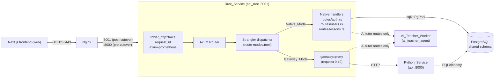
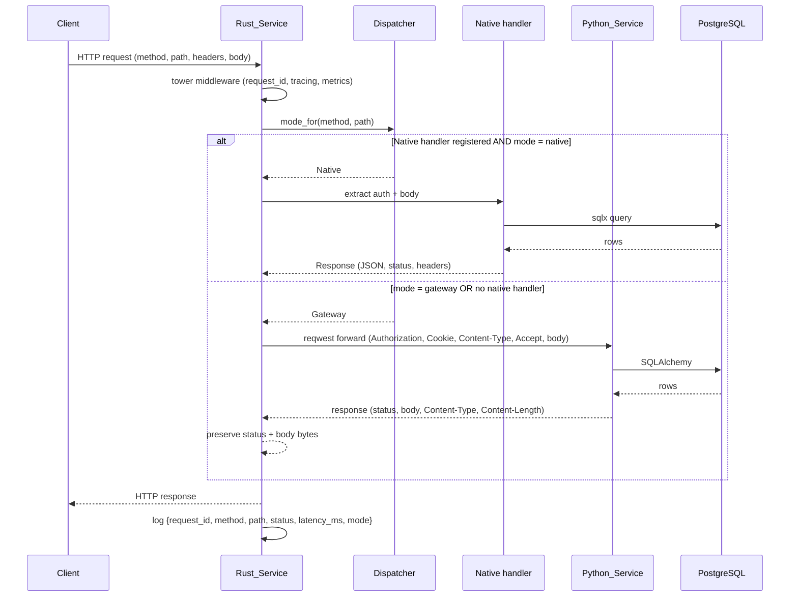
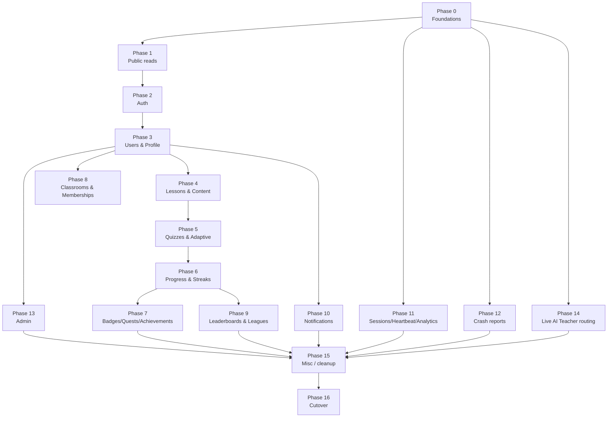
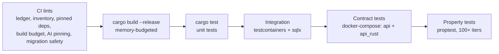

# Design Document

## Overview

This design replaces the existing standard-library TCP server in `backend-rust/src/main.rs`
with a production-grade Rust HTTP service built on **Axum 0.7 + Tokio 1.x + SQLx (Postgres)
+ Tower middleware**, and lays out the strangler-fig migration path that retires the Python
FastAPI service in `backend/` over 16 phases. The Rust service (`Rust_Service`) becomes the
only externally reachable HTTP backend at completion of the migration; the Python service
(`Python_Service`) remains in compose as a fallback target until the migration ledger is
fully checked, after which it is removed except for the live AI teacher worker
(`services/ai_teacher_agent/`), which stays in Python.

The design satisfies every numbered requirement in
`.kiro/specs/full-rust-backend-migration/requirements.md`. The key design decisions are:

- **Axum + Tower over hand-rolled HTTP.** The current `backend-rust/src/main.rs` parses HTTP
  by hand and uses one OS thread per connection. That was acceptable for a 7-route gateway,
  but with 290 endpoints across 47 service modules we need a real router, typed extractors,
  middleware composition, and an async runtime. Axum is the canonical Tokio-native HTTP
  framework, integrates cleanly with `tower` / `tower-http` for tracing and request-id
  middleware, and has first-class `axum-prometheus` and `axum::extract::Multipart` support.
- **SQLx with a `PgPool`.** The existing `backend-rust/src/pg.rs` speaks the Postgres wire
  protocol by hand including SCRAM-SHA-256. That is a maintenance liability. SQLx gives us
  a bounded connection pool, prepared statements, native types for UUID/Timestamp/JSONB,
  and async-safe query execution. We use **runtime `sqlx::query` / `query_as`** rather than
  the compile-time `sqlx::query!` macros so that the build does not require a live database
  (important under the constrained build host budget — see Requirement 11).
- **Strangler dispatcher driven by a hot-reloadable TOML map.** Every route in the
  inventory is dispatched to either a native handler or the gateway proxy, and the choice
  is per-route at runtime. Operators can flip a route back to gateway mode without a
  redeploy by editing `backend-rust/config/route-modes.toml` and sending `SIGHUP` (or just
  waiting up to 30 seconds for the poll). This is what makes Requirement 13 (rollback
  safety per phase) implementable.
- **Migration ledger as the source of truth for progress.** A single tracked markdown file
  at `docs/plan/full-rust-backend-migration-ledger.md` lists every phase and every route as
  nested checkboxes, ticked off as routes pass contract tests in production. The ledger is
  updated in the same pull request that lands a route — and is verified against the
  generated route inventory in CI.
- **Contract tests as the bar for "done".** No route reaches `Native_Mode` in production
  without a passing contract test that compares the Rust response to a captured snapshot of
  the Python response under a documented equivalence relation.

## Architecture

### System Architecture



The flow is unchanged from the user's perspective: nginx terminates TLS and forwards to the
Rust service. The Rust service either answers natively (via Axum handler + SQLx) or proxies
to the Python service via `reqwest`. The PostgreSQL database is shared by both services.

### Module Layout under `backend-rust/src/`

```text
backend-rust/
├── Cargo.toml                       # pinned exact versions (Req 11.4)
├── Dockerfile                       # multi-stage cargo-chef build
├── config/
│   └── route-modes.toml             # runtime route-mode map (Req 13)
├── docs/
│   ├── route-inventory.json         # generated; CI-enforced (Req 2)
│   ├── ai-tutor-routing.md          # AI tutor routing decisions (Req 9.2)
│   └── build-budget.md              # peak RSS per dep (Req 11)
├── tests/
│   └── contract/                    # contract tests vs Python (Req 4)
└── src/
    ├── main.rs                      # tokio runtime, axum::serve, signal handling
    ├── config.rs                    # Settings::from_env()
    ├── db.rs                        # sqlx::PgPool builder, health check
    ├── auth.rs                      # JWT verify/issue + password hash/verify
    ├── error.rs                     # AppError → JSON envelope (Req 3,5,6)
    ├── gateway.rs                   # reqwest client + proxy_to_python
    ├── dispatcher.rs                # route_modes.toml load + hot-reload
    ├── observability.rs             # tracing + request_id + metrics
    ├── inventory.rs                 # loads route-inventory.json + coverage
    ├── routes/                      # one module per Endpoint_Group
    │   ├── mod.rs
    │   ├── health.rs
    │   ├── auth.rs                  # Phase 2
    │   ├── users.rs                 # Phase 3
    │   ├── lessons.rs               # Phase 4
    │   ├── quizzes.rs               # Phase 5
    │   ├── progress.rs              # Phase 6
    │   ├── badges.rs                # Phase 7
    │   ├── classrooms.rs            # Phase 8
    │   ├── leaderboards.rs          # Phase 9
    │   ├── notifications.rs         # Phase 10
    │   ├── analytics.rs             # Phase 11
    │   ├── crash_reports.rs         # Phase 12
    │   ├── admin.rs                 # Phase 13
    │   ├── ai_tutor.rs              # Phase 14 (mostly gateway)
    │   └── internal.rs              # /api/v1/internal/route-coverage
    ├── models/                      # Serde DTOs mirroring backend/models.py
    │   ├── mod.rs
    │   ├── user.rs
    │   ├── lesson.rs
    │   └── ...
    └── services/                    # business logic (no HTTP types here)
        ├── mod.rs
        ├── auth_service.rs
        ├── lesson_service.rs
        └── ...
```

The `routes/` modules hold the Axum router wiring and HTTP-specific logic. The `services/`
modules hold pure business logic that takes a `&PgPool` and DTOs and is unit-testable
without an HTTP surface. This is the same separation that `backend/services/` has on the
Python side.

### Runtime composition (`main.rs`)

```rust
#[tokio::main]
async fn main() -> anyhow::Result<()> {
    let settings = Settings::from_env()?;
    observability::init(&settings);                       // tracing JSON + request_id
    let pool = db::pool(&settings).await?;                // sqlx::PgPool
    let dispatcher = Dispatcher::load(&settings).await?;  // route-modes.toml
    dispatcher.spawn_reload_task();                       // SIGHUP + 30s poll

    let app = routes::router(pool.clone(), dispatcher.clone(), settings.clone())
        .layer(observability::layer())
        .layer(axum_prometheus::PrometheusMetricLayer::new())
        .fallback(gateway::fallback_to_python);

    inventory::assert_full_coverage(&app, &dispatcher)?;   // Req 2.5

    let listener = tokio::net::TcpListener::bind(settings.bind_addr).await?;
    axum::serve(listener, app)
        .with_graceful_shutdown(shutdown_signal())
        .await?;
    Ok(())
}
```

### Strangler Dispatcher

The dispatcher decides, per `(method, path)` tuple, whether the request runs natively or is
proxied. It loads `backend-rust/config/route-modes.toml` at startup, watches it for SIGHUP,
and polls every 30 seconds (Requirement 13.4). The map is held behind an `ArcSwap` so reads
are lock-free and hot-reload does not need a restart.

A native handler is *registered* if `routes::router` adds it. The dispatcher's job is to
veto a registered handler when the operator pins the route to `gateway` for rollback. The
Axum router itself routes to a small wrapper:

```rust
async fn dispatch<H>(
    method_path: MethodPath,
    dispatcher: State<Dispatcher>,
    req: Request,
    handler: H,
) -> Response
where
    H: NativeHandler,
{
    match dispatcher.mode_for(method_path) {
        Mode::Native  => handler.call(req).await,
        Mode::Gateway => gateway::proxy_to_python(req).await,
    }
}
```

For routes whose native handler is not yet registered (most routes in early phases), the
Axum `fallback` is `gateway::fallback_to_python`, so the dispatcher only needs to be
consulted on registered routes.

### Request flow (native vs gateway)



### Connection pooling and database access

A single `sqlx::PgPool` is built at startup with `PgPoolOptions::max_connections(N)` where
`N` defaults to 10 and is overridable via env. The pool is shared via `axum::extract::State`
so handlers do not pull connections from a static. Every native handler uses runtime
`sqlx::query("...")` / `sqlx::query_as::<_, MyDto>("...")` with bound parameters and reads
results into Serde-friendly DTOs. We deliberately avoid the `sqlx::query!` macros so that
the build does not need `DATABASE_URL` access (Requirement 11.1, 11.3). Postgres-specific
column types (`uuid`, `timestamptz`, `jsonb`, arrays, enums) are decoded via `sqlx::types`
and `serde_json::Value`.

### Tracing, request ID, and metrics

`tower_http::trace::TraceLayer` wraps every request and emits a span per request. A small
`request_id` middleware reads `X-Request-Id` from the incoming request or mints a UUID, sets
it in the span, and writes it to the response. `tracing-subscriber` is configured for JSON
output with the fields enumerated in Requirement 12.3 (`request_id`, `method`, `path`,
`status`, `latency_ms`, `mode`). `axum-prometheus` exposes `/metrics` with per-route counts,
latency histograms, and error counts segmented by `mode = native | gateway`
(Requirement 12.5).

## Components and Interfaces

### `config.rs` — `Settings`

Replaces the current `Settings::from_env()` with an additive struct. Parses via `dotenvy` +
`std::env`. New fields:

- `database_url: String`
- `database_max_connections: u32`
- `legacy_api_host: String`, `legacy_api_port: u16` (already present)
- `jwt_secret_key: String`, `jwt_algorithm: String` (HS256)
- `access_token_expire_minutes: i64`, `refresh_token_expire_days: i64`
- `route_modes_path: PathBuf` (default `backend-rust/config/route-modes.toml`)
- `route_inventory_path: PathBuf` (default `backend-rust/docs/route-inventory.json`)
- `bind_addr: SocketAddr` (default `0.0.0.0:8001`)
- `uploads_dir: PathBuf`

### `db.rs` — Pool and health

```rust
pub async fn pool(s: &Settings) -> sqlx::Result<PgPool> {
    PgPoolOptions::new()
        .max_connections(s.database_max_connections)
        .acquire_timeout(Duration::from_secs(5))
        .connect(&s.database_url).await
}

pub async fn ping(pool: &PgPool) -> Result<(), sqlx::Error> {
    sqlx::query_scalar::<_, i32>("SELECT 1").fetch_one(pool).await.map(|_| ())
}
```

`GET /api/v1/internal/db-health` returns `{"status":"ok","database":"ok"}` on success and
HTTP 503 with `{"status":"error","database":"error"}` on failure (Requirement 12.2,
matching the existing shape in `pg::check_select_one`).

### `auth.rs` — JWT and password

Drop the hand-rolled HMAC-SHA256/Base64 in favor of vetted crates:

- **JWT**: `jsonwebtoken = "9"`. HS256 with the shared `JWT_SECRET_KEY` from env. Token
  payload exactly matches Python's claims (`backend/security.py::create_jwt_token`):

  ```json
  { "sub": "<user-uuid>", "iat": 1700000000, "exp": 1700003600,
    "role": "user", "type": "access" }
  ```

  Both services accept tokens issued by the other (Requirement 5.1, 5.2). Verification
  rejects tokens whose `type` does not match the expected use (`access` vs `refresh`).

- **Password**: `bcrypt = "0.15"` for verification and rehashing existing bcrypt hashes
  (Python's current scheme — see `backend/security.py::verify_password`). `argon2 = "0.5"`
  is wired in for forward-compatibility so that any argon2id hash already in the DB is
  accepted. The verify function dispatches by hash prefix:
  - `$2a$ / $2b$ / $2y$` → bcrypt
  - `$argon2id$` / `$argon2i$` → argon2

  On a successful match, the stored hash is **not** rehashed (Requirement 5.3). New
  registrations from `Rust_Service` use bcrypt with the same cost (`rounds=12`) Python
  uses today (Requirement 5.4); a future task may flip new registrations to argon2id but
  that is out of scope for this migration.

### `error.rs` — Typed errors and JSON envelope

A single `AppError` enum maps to the exact JSON envelope Python emits in
`backend/errors.py::app_exception_handler`:

```json
{ "error": { "code": "...", "message": "...", "details": {} } }
```

Variants:

- `AppError::Validation { details }` → 422, `code = "VALIDATION_ERROR"`,
  `details = {"errors": [...]}` (matches `validation_exception_handler`).
- `AppError::Http { status, message }` → `code = "HTTP_ERROR"`, `details = {}` (matches
  `http_exception_handler`).
- `AppError::Domain { status, code, message, details }` → for hand-thrown errors that mirror
  `AppError` in Python.
- `AppError::Unauthorized` → 401, `code = "HTTP_ERROR"`, `message = "Could not validate
  credentials"`, plus `WWW-Authenticate: Bearer` header. Matches the literal bytes the
  current `backend-rust/src/main.rs::write_unauthorized` produces.
- `AppError::UpstreamUnavailable` → 502, body
  `{"detail":"upstream unavailable"}` (Requirement 3.5; note this one uses the FastAPI
  `{"detail": ...}` shape because that is what Python returns).

`IntoResponse` is implemented for `AppError` so handlers can return
`Result<Json<T>, AppError>` and the envelope is generated for free.

### `gateway.rs` — Reqwest proxy

A long-lived `reqwest::Client` (HTTP/1.1 keep-alive, connection pooling enabled) is built at
startup and stored in app state. `proxy_to_python(req)`:

1. Rewrites the `Host` header to `legacy_api_host:legacy_api_port`.
2. Forwards `Authorization`, `Cookie`, `Content-Type`, `Accept`, plus any
   `X-Forwarded-*` and `X-Request-Id`.
3. Streams the request body (`reqwest::Body::wrap_stream`) so multipart uploads do not
   buffer in memory.
4. Streams the response body back to the client, preserving:
   - HTTP status code,
   - response body bytes (no transcoding),
   - `Content-Type` header,
   - `Content-Length` header (or `Transfer-Encoding: chunked` if Python streams).
5. On `reqwest::Error` (connect failure, timeout), returns
   `AppError::UpstreamUnavailable`.

The proxy does **not** alter `Set-Cookie` headers, so JWT cookies issued by Python remain
valid (Requirement 5.7).

### `routes/` — Handler modules

Each module exposes `pub fn router(state: AppState) -> Router`. The top-level
`routes::router` merges them all and applies dispatcher middleware. Routes are pinned to a
phase and an `Endpoint_Group`. The wiring for already-native routes (Phase 1) replaces the
hand-rolled string matching in the current `main.rs`:

```rust
pub fn router(state: AppState) -> Router {
    Router::new()
        .route("/health", get(health::healthz))
        .route("/api/v1/internal/db-health", get(health::db_health))
        .route("/api/v1/internal/route-coverage", get(internal::route_coverage))
        .route("/api/v1/content/ratings", get(content::ratings))
        .route("/api/v1/tags", get(content::tags))
        .route("/api/v1/badges", get(badges::list))
        .route("/api/v1/users/me/streak", get(users::streak))
        .route("/api/v1/ranks", get(content::ranks))
        // ... merged from routes::auth::router, routes::users::router, ...
        .with_state(state)
}
```

### `inventory.rs` — Coverage check and `/api/v1/internal/route-coverage`

Loads `backend-rust/docs/route-inventory.json` at startup. For every entry, asserts that
either:

- a native handler is registered for `(method, path)`, or
- `gateway::fallback_to_python` will match (any path).

If either invariant fails, `assert_full_coverage` returns an error and `main` exits non-zero
(Requirement 2.5).

`GET /api/v1/internal/route-coverage` returns the live coverage map (Requirement 2.4):

```json
{
  "routes": [
    { "method": "GET",  "path": "/api/v1/urns",           "group": "lessons",  "status": "native"  },
    { "method": "POST", "path": "/api/v1/auth/login",     "group": "auth",     "status": "native"  },
    { "method": "GET",  "path": "/api/v1/admin/abuse",    "group": "admin",    "status": "gateway" }
  ],
  "summary": { "total": 290, "native": 84, "gateway": 206 }
}
```

### `dispatcher.rs` — Hot-reloadable route modes

`backend-rust/config/route-modes.toml` (Requirement 13):

```toml
# Per-route override. Keys are "METHOD path". Values are "native" or "gateway".
# Missing entries default to whatever the router has wired (native if registered,
# else gateway via fallback).
[routes]
"GET /api/v1/urns"            = "native"
"POST /api/v1/auth/login"     = "native"
"GET /api/v1/admin/audit"     = "gateway"  # forced gateway during incident
```

The dispatcher exposes:

```rust
pub struct Dispatcher { /* ArcSwap<HashMap<MethodPath, Mode>> */ }

impl Dispatcher {
    pub async fn load(s: &Settings) -> Result<Self, ConfigError>;
    pub fn mode_for(&self, mp: MethodPath) -> Mode;
    pub fn spawn_reload_task(&self);  // SIGHUP + 30s tokio::time::interval
}
```

## Data Models

### Database schema reuse

The migration **does not** change the existing PostgreSQL schema (Requirement 6.2). Both
services read and write the same tables defined by SQLAlchemy in `backend/models.py`. Any
new index added to support a Rust-native query is additive and does not affect Python's
queries (Requirement 6.3).

### SQLx query strategy

We use **runtime queries** (`sqlx::query`, `sqlx::query_as`) rather than the compile-time
`sqlx::query!` macros, because:

1. The build host has constrained memory and no live database — compile-time macros require
   `DATABASE_URL` at build time (Requirement 11.1).
2. We do not need to introspect the schema at compile time; the schema is owned by Python
   and is stable for the duration of this migration (Requirement 6.2).
3. Runtime queries make migrations easier to test against fixtures without recompiling.

Postgres-specific types are decoded via `sqlx::types::{Uuid, JsonValue}`, `chrono::DateTime<Utc>`
for `timestamptz`, and `Vec<T>` for arrays. Custom enums in the schema are decoded into
Rust enums via `#[sqlx(rename_all = "snake_case")]` `#[derive(sqlx::Type)]`.

Example DTO + query:

```rust
#[derive(Debug, FromRow, Serialize)]
pub struct BadgeRow {
    pub id: Uuid,
    pub slug: String,
    pub name: String,
    pub name_en: Option<String>,
    pub description: Option<String>,
    pub icon_url: String,
    pub category: String,
    pub xp_bonus: i64,
}

pub async fn list_active_public(pool: &PgPool) -> sqlx::Result<Vec<BadgeRow>> {
    sqlx::query_as::<_, BadgeRow>(
        "SELECT id, slug, name, name_en, description, icon_url, \
         category::text AS category, COALESCE(xp_bonus, 0) AS xp_bonus \
         FROM badges WHERE is_active = true AND is_secret = false \
         ORDER BY name"
    )
    .fetch_all(pool)
    .await
}
```

### SQLAlchemy → Rust DTO mapping (per phase)

Only DTOs needed for the routes in a phase are introduced — there is no big-bang model
migration. The mapping rule is:

- SQLAlchemy column `Column(UUID(as_uuid=True))` → Rust `Uuid`
- `Column(String)` → `String` (or `Option<String>` if nullable)
- `Column(Text)` → `String`
- `Column(Integer)` / `BigInteger` → `i32` / `i64`
- `Column(Boolean)` → `bool`
- `Column(DateTime(timezone=True))` → `chrono::DateTime<Utc>`
- `Column(JSONB)` → `serde_json::Value`
- `Column(SAEnum(...))` → Rust enum with `#[derive(sqlx::Type)]`

The DTO for the API response often differs from the row DTO (some fields are computed,
joined, or omitted). Both are kept in `models/`, with the response DTO holding `#[derive(Serialize)]`
and a stable serde field order so JSON output matches Python byte-for-byte where Python's
output is itself deterministic (Requirement 4.5).

### Migration phase DAG



### Phase catalog

The 16 phases derived from `backend/services/` and the routes registered in `backend/main.py`.
For each phase: source service module(s), representative routes, dependencies, and contract
test fixtures path.

| # | Phase | Source service module(s) | Representative routes | Depends on | Contract fixtures |
|---|-------|--------------------------|-----------------------|------------|-------------------|
| 0 | **Foundations** | (none) — Axum scaffold, `sqlx::PgPool`, contract harness, route inventory generator, ledger seed | `GET /health`, `GET /api/v1/internal/db-health`, `GET /api/v1/internal/route-coverage` | — | `backend-rust/tests/contract/fixtures/foundations/` |
| 1 | **Public reads** (partly done) | `services/streak.py` (read-only), implicit content & ranks | `GET /health`, `GET /api/v1/content/ratings`, `GET /api/v1/ranks`, `GET /api/v1/tags`, `GET /api/v1/badges` (list), `GET /api/v1/users/me/streak` | 0 | `…/fixtures/public-reads/` |
| 2 | **Auth** | `backend/main.py` auth routes; `backend/security.py` | `POST /api/v1/auth/register`, `POST /api/v1/auth/login`, `POST /api/v1/auth/refresh`, `POST /api/v1/auth/logout`, `POST /api/v1/auth/forgot-password`, `POST /api/v1/auth/reset-password`, `POST /api/v1/auth/age-verify`, `GET /api/v1/auth/me` | 0 | `…/fixtures/auth/` |
| 3 | **Users & Profile** | `services/student_progress.py` (profile read), avatar upload routes | `PATCH /api/v1/users/me`, `POST /api/v1/users/me/avatar`, `POST /api/v1/users/me/change-password`, `GET /api/v1/users/{id}/public`, `POST /api/v1/users/me/starting-path`, `GET|POST /api/v1/users/me/onboarding` | 2 | `…/fixtures/users/` |
| 4 | **Lessons & Content** | `services/lesson_sequence.py`, `services/recommendations.py`, `services/learning_path.py` | `GET /api/v1/urns`, `GET /api/v1/urns/{id}`, `GET /api/v1/motifs`, `GET /api/v1/lessons/{id}/preview`, `GET /api/v1/lessons/{id}/cache-manifest`, `GET /api/v1/lessons/{id}/sequence`, `GET /api/v1/lessons/{id}/prerequisites` | 3 | `…/fixtures/lessons/` |
| 5 | **Quizzes & Adaptive** | `services/adaptive_quiz.py`, `services/quiz_hints.py`, `services/spaced_repetition.py` | `GET /api/v1/quizzes/{id}`, `POST /api/v1/quizzes/{id}/submit`, `GET /api/v1/quizzes/{id}/hints`, `POST /api/v1/quizzes/adaptive` | 4 | `…/fixtures/quizzes/` |
| 6 | **Progress & Streaks** | `services/student_progress.py`, `services/streak.py`, `services/hearts.py`, `services/daily_goal_settings.py`, `services/milestones.py` | `POST /api/v1/progress/unlock`, `GET|POST /api/v1/users/me/streak`, `GET|POST /api/v1/users/me/hearts`, `GET|PUT /api/v1/users/me/daily-goal`, `GET /api/v1/users/me/milestones` | 5 | `…/fixtures/progress/` |
| 7 | **Badges, Quests, Achievements** | `services/quest_assignments.py`, `services/weekly_quests.py`, `services/milestones.py` (achievements) | `POST /api/v1/badges/{id}/award`, `GET /api/v1/quests`, `POST /api/v1/quests/{id}/start`, `GET /api/v1/quests/weekly`, `GET /api/v1/missions/daily` | 6 | `…/fixtures/badges-quests/` |
| 8 | **Classrooms & Memberships** | `services/classroom.py`, `services/sharing.py` | `POST|GET /api/v1/classrooms`, `GET|PATCH|DELETE /api/v1/classrooms/{id}`, `GET|POST|DELETE /api/v1/classrooms/{id}/members`, `GET|POST /api/v1/classrooms/{id}/lessons`, `GET /api/v1/classrooms/{id}/analytics` | 3 | `…/fixtures/classrooms/` |
| 9 | **Leaderboards & Leagues** | `services/leaderboard.py`, `services/leagues.py` | `GET /api/v1/leaderboard`, `GET /api/v1/leaderboard/friends`, `GET /api/v1/leagues`, `GET /api/v1/leagues/me`, `GET /api/v1/leagues/{id}` | 6 | `…/fixtures/leaderboards/` |
| 10 | **Notifications** | `services/push_notifications.py`, `services/email_scheduler.py` (settings only) | `GET|PUT /api/v1/users/me/notification-settings`, `POST /api/v1/push/register`, `POST /api/v1/push/unregister`, `GET /api/v1/notifications/history`, `GET /api/v1/notifications/should-prompt-permission` | 3 | `…/fixtures/notifications/` |
| 11 | **Sessions, Heartbeat, Analytics events** | `services/analytics.py`, `services/analytics_funnels.py`, `services/funnel.py`, `services/retention.py`, `services/live_session_reporting.py` (HTTP face) | `POST /api/v1/sessions`, `POST /api/v1/sessions/heartbeat`, `POST /api/v1/analytics/events`, `POST /api/v1/analytics/batch` | 0 | `…/fixtures/sessions/` |
| 12 | **Crash reports** | crash report endpoints in `backend/main.py` | `POST /api/v1/crash-reports`, `GET /api/v1/admin/crash-reports` (admin face deferred to Phase 13) | 0 | `…/fixtures/crash-reports/` |
| 13 | **Admin** | `services/abuse_reports.py`, `services/audit.py`, `services/experiments.py`, `services/experiment_analytics.py`, `services/feature_flags.py`, `services/analytics_dashboard.py`, `services/ai_insights.py`, `services/embeddings.py` | `POST /api/v1/admin/push-broadcast`, `GET|POST /api/v1/admin/content/*`, `GET /api/v1/admin/analytics/*`, `GET /api/v1/admin/audit`, `GET|POST /api/v1/admin/abuse-reports`, `GET|POST /api/v1/admin/experiments`, `GET|POST /api/v1/admin/feature-flags` | 3 | `…/fixtures/admin/` |
| 14 | **Live AI Teacher routing** | `services/live_ai_teacher.py`, `services/live_sessions.py`, `services/live_voice.py`, `services/live_circuit_breaker.py`, `services/live_crypto.py`, `services/live_observability.py`, `services/live_rate_limits.py`, `services/ai_tutor.py` (proxy only) | All `/api/v1/live/*` and `/api/v1/ai-tutor/*` routes — **stays gateway** to `AI_Teacher_Worker`. The Rust route-modes for these are pinned `gateway` and documented in `backend-rust/docs/ai-tutor-routing.md`. | 0 | `…/fixtures/ai-tutor/` |
| 15 | **Misc / cleanup** | inventory diff | any inventory route not yet placed (e.g., `services/social.py`, sharing helpers, content helpers) | 7,9,10,11,12,13,14 | `…/fixtures/misc/` |
| 16 | **Cutover** | (none) | switch nginx upstream from `api` to `api_rust`; remove `api` from `docker-compose.yml`; verify `route-coverage` is 100% native | 15 | — |


## Correctness Properties

*A property is a characteristic or behavior that should hold true across all valid
executions of a system — essentially, a formal statement about what the system should do.
Properties serve as the bridge between human-readable specifications and machine-verifiable
correctness guarantees.*

PBT is a strong fit here because the migration's most important guarantees (gateway
byte-preservation, JWT interop, password verify across schemes, ledger atomicity,
route-mode dispatch) are universal claims over a large input space rather than fixed
examples. The properties below were derived via the prework analysis from the acceptance
criteria. Process-level criteria (e.g., "PR must update the ledger") are kept out of this
section and handled by CI lints in the Testing Strategy.

### Property 1: Ledger structural invariants

For any inventory of endpoint groups and routes, the rendered
`docs/plan/full-rust-backend-migration-ledger.md` contains exactly one top-level checkbox
per `Endpoint_Group` and exactly one nested checkbox per route under its owning group; and
when a group is marked completed, the rendered ledger contains a single line of the form
`Completed: <commit_sha> <YYYY-MM-DD>` immediately under that group's header.

**Validates: Requirements 1.1, 1.2, 1.5**

### Property 2: Ledger atomicity

For any phase, the phase-level checkbox is marked completed if and only if (a) every route
checkbox in that phase is marked completed, (b) every route in the phase has been flipped
to `Native_Mode` in `route-modes.toml`, and (c) every route's `Contract_Test` is passing in
the latest CI run referenced by the ledger. No partial state is permitted: the renderer
must reject any input where the phase header is checked but the conjunction does not hold.

**Validates: Requirements 1.4, 7.3**

### Property 3: Inventory coverage

For any inventory in `backend-rust/docs/route-inventory.json` and any registered set of
native handlers, startup succeeds if and only if every inventory route is either matched by
a native handler or by `gateway::fallback_to_python`; equivalently, every route exposed by
`Python_Service` appears in the inventory, and after `Cutover` every inventory route is
served natively without contacting `Python_Service`.

**Validates: Requirements 2.1, 2.3, 2.5, 10.3, 13.3**

### Property 4: Inventory generator determinism

For any FastAPI app state, two consecutive runs of the inventory generator produce
byte-identical `route-inventory.json` output.

**Validates: Requirements 2.2**

### Property 5: Route-coverage endpoint correctness

For any inventory and any dispatcher state, the JSON response of
`GET /api/v1/internal/route-coverage` lists every inventory route with `status` exactly
matching the dispatcher's current mode for that route (`native` if a native handler is
registered and not overridden to gateway, `gateway` otherwise).

**Validates: Requirements 2.4**

### Property 6: Native dispatch isolation

For any registered native route in `Native_Mode`, the gateway proxy client is not invoked
for any request to that route.

**Validates: Requirements 3.1**

### Property 7: Gateway response preservation

For any request routed in `Gateway_Mode` and any HTTP response that `Python_Service`
produces (status, body bytes, `Content-Type`, `Content-Length`), the response that
`Rust_Service` returns to the client has identical status, identical body bytes, identical
`Content-Type`, and identical `Content-Length` (or the same chunked-transfer behavior if
Python streams the body).

**Validates: Requirements 3.2, 3.4, 7.5**

### Property 8: Gateway header forwarding

For any request whose headers include any subset of `{Authorization, Cookie, Content-Type,
Accept}`, the request received by `Python_Service` upstream contains every header from that
subset with byte-identical values.

**Validates: Requirements 3.3**

### Property 9: Upstream-unavailable error shape

For any request routed in `Gateway_Mode` where `Python_Service` is unreachable (connect
refused, connect timeout, read timeout), `Rust_Service` returns HTTP 502 with a
`Content-Type: application/json` response whose body is exactly
`{"detail":"upstream unavailable"}`.

**Validates: Requirements 3.5**

### Property 10: Per-request structured log

For every request served by `Rust_Service`, exactly one structured log line is emitted at
or below the `info` level whose JSON payload contains the fields `request_id`, `method`,
`path`, `status`, `latency_ms`, and `mode`, where `mode ∈ {"native", "gateway"}` matches
the dispatch outcome for that request.

**Validates: Requirements 3.6, 12.3**

### Property 11: Contract equivalence for native routes

For any native route and any valid input, the response from `Rust_Service` is equivalent to
the response from `Python_Service` under the documented equivalence relation:

- HTTP status codes are equal.
- `Content-Type` headers are equal.
- Response JSON bodies are structurally equal modulo the per-route ignore-list (e.g.,
  `server_time`, `request_id`).
- Where `Python_Service` returns a deterministically ordered array, `Rust_Service` returns
  the same order.

**Validates: Requirements 4.2, 4.3, 4.4, 4.5**

### Property 12: Bidirectional JWT interop

For any well-formed claim set `(sub, role, type, iat, exp)`, a token signed with the shared
HS256 secret by either `Python_Service` or `Rust_Service` is accepted by the other service
under the same secret. The claims decoded by either side are equal modulo `iat` (which is
the issuing time and may differ within tolerance).

**Validates: Requirements 5.1, 5.2, 5.5**

### Property 13: Password verify across schemes; new-hash format parity

For any password and any matching stored hash that begins with a known prefix
(`$2a$ / $2b$ / $2y$` for bcrypt or `$argon2id$ / $argon2i$` for argon2), `verify_password`
returns true and the stored hash is unchanged. For any new password registered through
`Rust_Service`, the produced hash has the same algorithm prefix and cost parameters as a
hash produced by `Python_Service` for the same password.

**Validates: Requirements 5.3, 5.4**

### Property 14: Auth-error envelope parity

For any expired, malformed, or unknown-key `Auth_Token` presented to `Rust_Service`, the
response is HTTP 401 with a JSON body and headers byte-equal to what `Python_Service`
produces for the same condition under the same route.

**Validates: Requirements 5.6**

### Property 15: Database write parity and constraint-violation status parity

For any valid input row written by a `Native_Mode` handler, the resulting row in the shared
PostgreSQL `Database` is equal to the row that `Python_Service` would have written for the
same input under the same business rules and the same database state, ignoring fields that
are database-assigned (auto-increment IDs, server-side timestamps). For any input that
triggers a database constraint violation, `Rust_Service` returns the same HTTP status code
that `Python_Service` returns for the same violation on the same route. As a sibling
invariant, no schema migration introduced by this feature alters, drops, or renames any
existing table, column, index, or constraint owned by `Python_Service`; only additive
migrations (e.g., new indexes) are permitted.

**Validates: Requirements 6.2, 6.3, 6.4, 6.5**

### Property 16: Upload parity

For any `multipart/form-data` upload on a migrated upload route, `Rust_Service` accepts the
upload if and only if `Python_Service` would accept the same upload (matching field name,
file size limit, MIME type rules), the resulting on-disk path and public URL match the
pattern that `Python_Service` produces for the same input, and any rejection (size limit
exceeded, MIME type rejected) returns the same HTTP status code and JSON error body as
`Python_Service`.

**Validates: Requirements 8.1, 8.2, 8.3, 8.4**

### Property 17: Route-mode dispatcher and AI tutor pinning

For any route and any value `m ∈ {"native", "gateway"}` written into
`backend-rust/config/route-modes.toml`, after at most 30 seconds (or immediately on
`SIGHUP`) every new request to that route is dispatched in mode `m`. Any request already
in flight at the moment the map is re-read completes under the mode it began with — the
re-read does not abort or migrate in-flight handlers. Additionally, every route in the
`AI_Teacher_Worker` group is pinned to `gateway` for the duration of this feature.

**Validates: Requirements 9.1, 13.1, 13.2, 13.4**

### Property 18: 5xx error logging

For every HTTP response with status in the 500–599 range emitted by `Rust_Service`, exactly
one structured log line is emitted at the `error` level whose JSON payload contains the
fields `request_id`, route (`method` + `path`), and an error chain (`error.kind` plus the
chained `source` messages).

**Validates: Requirements 12.4**

### Property 19: Metrics emission per request

For every request served by `Rust_Service`, the corresponding `axum-prometheus` counter
labeled by `(method, path, status, mode)` is incremented exactly once, and the latency
histogram for the same labels records exactly one observation whose value falls within the
per-request elapsed time.

**Validates: Requirements 12.5**

### Property 20: Pinned dependency versions

For every entry in `backend-rust/Cargo.toml` `[dependencies]`, the version specifier is an
exact version (no leading `^`, `~`, `*`, or `>=`).

**Validates: Requirements 11.4**

## Error Handling

### Error envelope

Every error path returns the same JSON envelope that `Python_Service` returns today
(`backend/errors.py::app_exception_handler`):

```json
{ "error": { "code": "<CODE>", "message": "<HUMAN_TEXT>", "details": {} } }
```

Mapping:

| Source | Code | Status | Notes |
|--------|------|--------|-------|
| Domain validation (Serde + `validator`) | `VALIDATION_ERROR` | 422 | `details.errors` mirrors FastAPI/Pydantic error list |
| `AppError::Http { status, message }` | `HTTP_ERROR` | as set | Matches `http_exception_handler` |
| `AppError::Domain { code, .. }` | as set (e.g., `USER_NOT_FOUND`) | as set | One-to-one with Python `AppError` codes |
| Auth failure | `HTTP_ERROR` | 401 | Body `{"error":{"code":"HTTP_ERROR","message":"Could not validate credentials","details":{}}}` + `WWW-Authenticate: Bearer` |
| Upstream unreachable in gateway | n/a (FastAPI shape) | 502 | Body exactly `{"detail":"upstream unavailable"}` to match Python's `HTTPException` shape (Requirement 3.5) |
| `sqlx::Error::Database` (constraint) | maps to Python's status (typically 409 or 422) | as Python | Status-code parity is the contract; body is generated to match |
| Panic in handler | `INTERNAL_SERVER_ERROR` | 500 | `tower_http::catch_panic`; logged at `error` level (Property 18) |

### Specific failure modes

- **Database connection lost.** `db::ping` fails → `/api/v1/internal/db-health` returns
  503; live handlers return 503 only when the failure is detected on the request path.
  Background reconnect is automatic via `sqlx::PgPool`.
- **Python upstream unavailable.** `gateway::proxy_to_python` returns
  `AppError::UpstreamUnavailable` → 502 + `{"detail":"upstream unavailable"}`. This is the
  only error path that intentionally diverges from the standard envelope, because it
  matches what FastAPI itself would have returned and existing clients expect that shape.
- **Token expired or invalid.** `auth::verify_access_token` returns
  `Err(AuthError::Expired | AuthError::Malformed | AuthError::BadSignature)` →
  `AppError::Unauthorized` → 401 with the exact body Python uses (Property 14).
- **Route-modes file unreadable.** Startup fails fast; subsequent reload failures keep the
  previous map in place and emit a `warn`-level log (the dispatcher must never serve from
  an empty map).
- **Inventory coverage gap.** Detected at startup by `inventory::assert_full_coverage` →
  process exits non-zero. After `Cutover`, this is the trip-wire that prevents shipping a
  build with an unrouted inventory entry (Requirement 2.5).

## Testing Strategy

### Layers

1. **Unit tests (`cargo test`)** for pure functions: `auth::verify_access_token`,
   `auth::verify_password`, `error::AppError → IntoResponse`, `dispatcher::mode_for`,
   `inventory::assert_full_coverage`, JSON renderers in `models/`. These run with no
   database and no network.

2. **Integration tests with `testcontainers`**. Spins up a PostgreSQL container, runs
   `sqlx` against it, exercises `routes::*` handlers via `axum::Router::oneshot`. These
   verify SQL-level behavior (row shape parity, constraint-violation status — Property 15)
   without needing the Python service.

3. **Contract tests (`backend-rust/tests/contract/`)** against both services. The harness
   uses `reqwest` to call (a) a snapshot fixture or (b) a live Python service running
   beside the Rust service in CI via `docker-compose`. JSON equivalence is computed with a
   per-route ignore-list config (e.g., `tests/contract/ignore.toml`):

   ```toml
   [routes."GET /api/v1/auth/me"]
   ignore_fields = ["server_time", "request_id"]
   ignore_arrays_unordered = []
   ```

   Snapshots are captured by `scripts/testing/capture_python_snapshots.py` which exercises
   the Python service with a deterministic seed corpus and writes
   `backend-rust/tests/contract/fixtures/<group>/<route>/<case>.json`. The capture script
   runs against a freshly migrated test database so fixtures are reproducible.

4. **Property-based tests (`proptest`)** for the universal claims in Properties 1–20 above:

   - Property 7 (gateway preservation): `proptest` generates random `(status, body, headers)`
     tuples, a fake Python service returns them, and the test asserts the Rust response is
     byte-identical.
   - Property 12 (JWT interop): `proptest` generates random claim sets, signs with the
     `jsonwebtoken` crate, and round-trips through both Python (`jose`) and Rust verifiers.
   - Property 13 (password verify): `proptest` generates random passwords; bcrypt and
     argon2id reference hashes are produced via the Python implementation; the Rust verifier
     accepts both without rehashing.
   - Property 17 (route-mode dispatcher): `proptest` generates random `(route, mode)`
     mutation sequences and asserts (a) eventual consistency within 30s, and (b) atomicity
     for in-flight requests.
   - Property 11 (contract equivalence): `proptest` is the harness for the contract suite;
     each property test runs a minimum of 100 generated inputs per route.

   Each property test is configured for at least 100 iterations and is tagged in source
   comments using the format **`Feature: full-rust-backend-migration, Property N: <text>`**
   so traceability back to this design is mechanical.

5. **CI lints** for the process-level requirements that are not runtime properties:

   - Ledger sync lint: blocks a PR that flips a route to native in `route-modes.toml`
     without ticking the matching ledger checkbox (Requirement 1.3).
   - Inventory drift lint: regenerates `route-inventory.json` and fails CI if the diff is
     non-empty (Requirement 2.3, 1.6).
   - Pinned-deps lint: scans `Cargo.toml` for unpinned versions (Property 20).
   - Build-budget lint: parses `backend-rust/docs/build-budget.md` and fails if any direct
     dep added to `Cargo.toml` is missing a peak-RSS entry (Requirement 11.2).
   - AI tutor pinning lint: asserts every route in `ai-tutor-routing.md`'s gateway list is
     pinned `gateway` in `route-modes.toml` (Property 17).
   - Migration safety lint: parses any new `*.sql` migration file and rejects
     `DROP TABLE | DROP COLUMN | ALTER COLUMN | RENAME` against existing tables
     (Requirement 6.2, sibling of Property 15).

### CI pipeline



## Build and Deployment

### Dockerfile (multi-stage with `cargo-chef`)

```Dockerfile
# syntax=docker/dockerfile:1.6
FROM rust:1.81-slim AS chef
RUN cargo install --locked cargo-chef@0.1.67
WORKDIR /work

FROM chef AS planner
COPY backend-rust/ .
RUN cargo chef prepare --recipe-path recipe.json

FROM chef AS builder
COPY --from=planner /work/recipe.json recipe.json
RUN cargo chef cook --release --recipe-path recipe.json
COPY backend-rust/ .
ENV CARGO_BUILD_JOBS=1
ENV CARGO_PROFILE_RELEASE_CODEGEN_UNITS=1
ENV CARGO_PROFILE_RELEASE_LTO=thin
RUN cargo build --release --bin luuniensuki-api

FROM debian:bookworm-slim AS runtime
RUN apt-get update && apt-get install -y --no-install-recommends ca-certificates \
    && rm -rf /var/lib/apt/lists/*
WORKDIR /app
COPY --from=builder /work/target/release/luuniensuki-api /usr/local/bin/luuniensuki-api
COPY backend-rust/config/ /app/config/
COPY backend-rust/docs/route-inventory.json /app/route-inventory.json
EXPOSE 8001
CMD ["luuniensuki-api"]
```

Notes:

- `cargo-chef` separates dependency build from source build so layer caching survives
  source changes — critical for the constrained build host (Requirement 11.1).
- `CARGO_BUILD_JOBS=1` and `codegen-units = 1` keep peak RSS within the host budget; the
  measured peak is recorded in `backend-rust/docs/build-budget.md` for every dep added.
- All direct deps in `Cargo.toml` are pinned exactly (Requirement 11.4).

### Dependency budget (`backend-rust/docs/build-budget.md`)

The file is a markdown table with one row per direct dep:

| Crate | Version | Peak RSS (release build, MiB) | Notes |
|-------|---------|-------------------------------|-------|
| tokio | 1.39.x | … | runtime |
| axum | 0.7.x | … | router |
| sqlx | 0.7.x | … | postgres + chrono + uuid + json |
| reqwest | 0.12.x | … | gateway |
| serde / serde_json | 1.0.x | … | DTOs |
| jsonwebtoken | 9.x | … | auth |
| bcrypt | 0.15.x | … | password verify |
| argon2 | 0.5.x | … | password verify |
| validator | 0.18.x | … | request validation |
| tracing / tracing-subscriber | 0.1 / 0.3 | … | logs |
| tower / tower-http | 0.5 / 0.5 | … | middleware |
| axum-prometheus | 0.6.x | … | /metrics |
| anyhow / thiserror | 1.0 | … | errors |
| dotenvy / config | 0.15 / 0.14 | … | settings |
| arc-swap / notify | 1.x / 6.x | … | hot-reload |
| proptest / testcontainers | 1.x / 0.20 | … | tests |

(Exact pinned versions are written into `Cargo.toml` and updated in lockstep with this
table — the build-budget lint enforces parity.)

### Compose changes

Pre-cutover compose (already shipped, kept):

```yaml
services:
  api:
    # Python FastAPI on :8000 (current upstream)
  api_rust:
    image: luuniensuki-api-rust
    environment:
      - DATABASE_URL=...
      - JWT_SECRET_KEY=...
      - LEGACY_API_HOST=api
      - LEGACY_API_PORT=8000
    ports:
      - "8001:8001"
  nginx:
    # upstream → api:8000  (until cutover)
```

Cutover compose:

```yaml
services:
  api_rust:
    # unchanged
  nginx:
    # upstream → api_rust:8001
  # api: <removed>
```

`AI_Teacher_Worker` (`ai_teacher_agent`) stays in compose either way; it has its own
deployment lifecycle and is out of scope (Requirement 10.4, 9.4).

### Cutover procedure

1. Verify `GET /api/v1/internal/route-coverage` reports every route as `native`
   (Requirement 10.1, Property 3).
2. Run the full contract suite green against production-like data.
3. Update nginx upstream from `api` to `api_rust` and reload nginx (zero-downtime via
   `nginx -s reload`).
4. Observe the `axum-prometheus` `/metrics` for one hour. If error rate exceeds the
   pre-cutover baseline by more than 1 percentage point on a 15-minute rolling window,
   roll back per Requirement 10.6.
5. Once stable, remove the `api` service from `docker-compose.yml` in a follow-up commit
   that also flips every route in `route-modes.toml` to `native` (no more `gateway`
   overrides allowed post-cutover; the dispatcher will refuse to start if a `gateway`
   value is present without an `api` upstream — Requirement 13.3).

## Migration Plan and Ledger

### `docs/plan/full-rust-backend-migration-ledger.md` structure

```markdown
# Full Rust Backend Migration — Ledger

Source of truth for migration progress. One top-level checkbox per phase, nested
checkboxes per route. Updated in the same PR that lands a route.

## Summary

- Total routes (from inventory): <N>
- Native: <N_native> / <N>
- Gateway: <N_gateway> / <N>
- Phases complete: <P_done> / 16

---

- [ ] Phase 0 — Foundations
  - [ ] GET /health _(commit, date)_
  - [ ] GET /api/v1/internal/db-health _(commit, date)_
  - [ ] GET /api/v1/internal/route-coverage _(commit, date)_

- [x] Phase 1 — Public reads
  - [x] GET /api/v1/content/ratings _(abc1234, 2026-05-15)_
  - [x] GET /api/v1/ranks _(abc1234, 2026-05-15)_
  - [x] GET /api/v1/tags _(abc1234, 2026-05-15)_
  - [x] GET /api/v1/badges _(def5678, 2026-05-16)_
  - [x] GET /api/v1/users/me/streak _(def5678, 2026-05-16)_
  Completed: def5678 2026-05-16

- [ ] Phase 2 — Auth
  - [ ] POST /api/v1/auth/register
  - [ ] POST /api/v1/auth/login
  - [ ] POST /api/v1/auth/refresh
  - [ ] POST /api/v1/auth/logout
  - [ ] POST /api/v1/auth/forgot-password
  - [ ] POST /api/v1/auth/reset-password
  - [ ] POST /api/v1/auth/age-verify
  - [ ] GET  /api/v1/auth/me

…(phases 3–16 follow the same pattern)…
```

Rendering rules (enforced by Property 1 and Property 2):

- Each route line is a nested `- [ ]` (or `- [x]` when complete) with method and path.
- When ticked, append `_(commit_sha, YYYY-MM-DD)_` (italic markdown).
- When every route in a phase is ticked, tick the phase header and append a single
  `Completed: <commit_sha> <YYYY-MM-DD>` line under the phase block.
- The "Summary" section is regenerated on every render from the rest of the document.

### `backend-rust/docs/route-inventory.json` schema

```json
[
  {
    "method": "GET",
    "path": "/api/v1/urns",
    "group": "lessons",
    "status": "native"
  },
  {
    "method": "POST",
    "path": "/api/v1/auth/login",
    "group": "auth",
    "status": "native"
  },
  {
    "method": "GET",
    "path": "/api/v1/admin/audit",
    "group": "admin",
    "status": "gateway"
  }
]
```

Constraints:

- Top-level value is an array of objects.
- Required fields: `method` (uppercase string from `{GET, POST, PUT, PATCH, DELETE,
  OPTIONS, HEAD}`), `path` (FastAPI path including any path params in `{name}` form),
  `group` (one of the 16 phase group identifiers), `status` (`"native"` or `"gateway"`).
- The file is generated by a Python script that imports `backend.main:app` and walks
  `app.routes`; the same script writes the file in deterministic order
  (sorted by `(group, path, method)`) so diffs are minimal (Property 4).

### `backend-rust/config/route-modes.toml` schema

```toml
# Per-route runtime override. Missing entries default to whatever
# the router has wired (native if registered, else gateway via fallback).
#
# Keys are "<METHOD> <PATH>". Values are "native" or "gateway".

[routes]
"GET /api/v1/urns"            = "native"
"POST /api/v1/auth/login"     = "native"
"GET /api/v1/auth/me"         = "native"
"GET /api/v1/admin/audit"     = "gateway"   # forced gateway during incident
"POST /api/v1/live/sessions"  = "gateway"   # AI tutor — pinned gateway

# Optional defaults section.
[defaults]
# When true, an unknown route in the inventory defaults to "gateway".
# Production must set this true until cutover (Requirement 13.3).
unknown_routes = "gateway"
```

The dispatcher rejects values other than `"native"` or `"gateway"` and refuses to start
when the file is missing or unparseable. Hot-reload is triggered by SIGHUP (immediate) or
the 30-second poll, with `notify` watching the file for atomic-rename writes.

### `GET /api/v1/internal/route-coverage` response shape

```json
{
  "routes": [
    {
      "method": "GET",
      "path": "/api/v1/urns",
      "group": "lessons",
      "status": "native",
      "native_handler_registered": true,
      "override": null
    },
    {
      "method": "GET",
      "path": "/api/v1/admin/audit",
      "group": "admin",
      "status": "gateway",
      "native_handler_registered": false,
      "override": null
    },
    {
      "method": "POST",
      "path": "/api/v1/auth/login",
      "group": "auth",
      "status": "gateway",
      "native_handler_registered": true,
      "override": "gateway"
    }
  ],
  "summary": {
    "total": 290,
    "native": 84,
    "gateway": 206,
    "groups_complete": 1,
    "groups_total": 16,
    "ready_for_cutover": false
  }
}
```

`status` is always the **effective** mode (post-override). `native_handler_registered`
exposes the underlying router state, and `override` exposes the value from
`route-modes.toml` for that route (`null` if absent). `ready_for_cutover` is `true` only
when `native == total` and no `override == "gateway"` exists.

## Rollback

### Per-route rollback

The primary rollback mechanism is the route-mode flip. To revert a problematic route to
the Python implementation:

1. Edit `backend-rust/config/route-modes.toml`:

   ```toml
   "POST /api/v1/lessons/{id}/sequence" = "gateway"
   ```

2. `kill -HUP $(pidof luuniensuki-api)` (or wait up to 30 s for the poll).
3. Verify via `GET /api/v1/internal/route-coverage` that the route now reports
   `"status": "gateway"` and `"override": "gateway"`.

In-flight requests started in `Native_Mode` complete in `Native_Mode`; new requests after
the re-read pick up the `Gateway_Mode` path (Property 17).

### Whole-phase rollback

A failed phase is rolled back by setting every route in that phase to `gateway` in
`route-modes.toml`. This is one TOML edit and one SIGHUP. The native handlers remain
compiled in but unreachable; the contract tests still run against the gateway path
(which trivially passes equivalence with itself), and the ledger row is reverted
(checkboxes unticked) in the rollback PR.

### Pre-cutover safety net

The Python `api` service stays in `docker-compose.yml` until the ledger is fully checked
(Requirement 10.5). As long as it is reachable, every inventory route can fall back to
`Gateway_Mode` without a Rust redeploy. This is the contract we rely on for any "panic
button" rollback during the migration.

### Post-cutover rollback

After `Cutover`, rolling back to the Python service requires (a) re-adding the `api`
service to `docker-compose.yml`, (b) updating nginx upstream back to `api:8000`, and
(c) flipping `unknown_routes = "gateway"` in `route-modes.toml`. This is captured as a
runbook step in the cutover PR. It is intentionally heavier-weight than per-route rollback
because the design's intent at cutover is that `Rust_Service` owns 100% of HTTP traffic.
