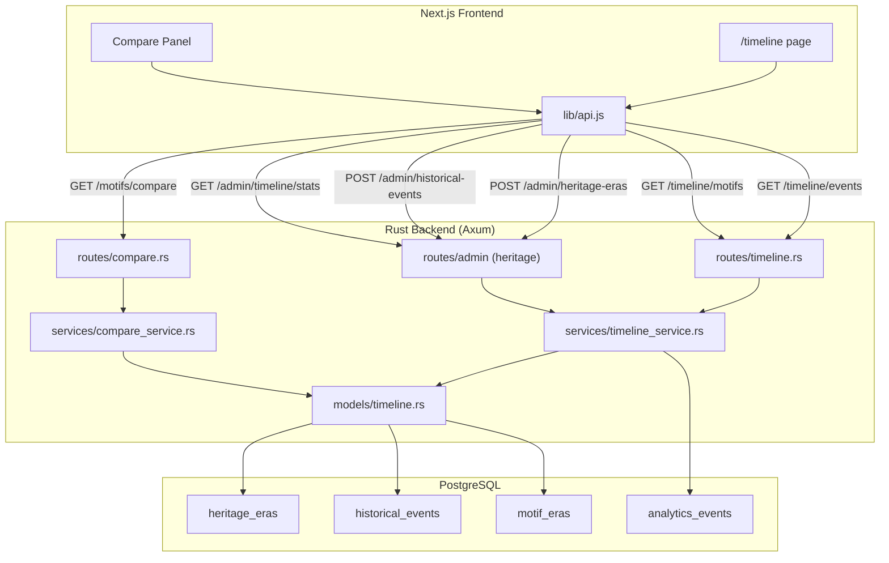

# Design Document — Heritage Time-Lapse

## Overview

This feature adds a temporal/historical dimension to the Cửu Đỉnh heritage content by introducing eras, historical events, motif-era tagging, a compare endpoint, and a frontend timeline page. The backend exposes new REST endpoints under the existing Axum 0.7 service following the established module pattern (models → services → routes). The frontend adds a `/timeline` route with a horizontal scrollable timeline built with React 19 and Tailwind CSS.

### Design Decisions

1. **No new crate dependencies** — the existing `sqlx`, `chrono`, `uuid`, `serde` stack covers all needs for the new tables and endpoints.
2. **Alembic migrations** — consistent with the project's existing Python-based migration tooling (no Rust migration tool).
3. **AuthState reuse** — new routes share the existing `AuthState` (pool + settings) pattern used by all other route groups.
4. **Cache-Control via middleware layer** — a thin Axum middleware sets the header on timeline GET responses rather than embedding caching logic in handlers.
5. **Analytics via existing ingest path** — the frontend calls the existing `/api/v1/analytics/events` endpoint; the admin stats endpoint aggregates from `analytics_events`.

## Architecture



## Components and Interfaces

### Backend Modules

#### `models/timeline.rs`

DTOs for heritage eras, historical events, motif-era associations, and compare responses.

#### `services/timeline_service.rs`

Business logic for:
- Listing events with optional year-range filter
- Listing motifs by era
- Admin CRUD for eras and events
- Stats aggregation from `analytics_events`

#### `services/compare_service.rs`

Business logic for:
- Fetching two motifs with full lesson content, eras, and comparison axes
- Delegating content-rating checks to existing `lesson_service::get_motif_detail` logic

#### `routes/timeline.rs`

Handlers for:
- `GET /api/v1/timeline/events` — public, cached
- `GET /api/v1/timeline/motifs?era=<slug>` — public
- `POST /api/v1/admin/heritage-eras` — admin-only
- `POST /api/v1/admin/historical-events` — admin-only
- `GET /api/v1/admin/timeline/stats` — admin-only

#### `routes/compare.rs`

Handler for:
- `GET /api/v1/motifs/compare?ids=<uuid>,<uuid>` — authenticated

### Frontend Components

#### `src/app/timeline/page.jsx`

Server component that fetches initial timeline data and renders the timeline layout.

#### `src/components/timeline/TimelineTrack.jsx`

Client component: horizontal scrollable track with era-colored segments and event markers. Handles keyboard navigation (arrow keys) and ARIA roles.

#### `src/components/timeline/EventPanel.jsx`

Side panel that opens when a marker is clicked, showing event description and linked motif/urn.

#### `src/components/timeline/CompareModal.jsx`

Modal for side-by-side motif comparison, triggered from the timeline or motif pages.

### API Contracts

#### `GET /api/v1/timeline/events`

Query params: `from` (optional, int year), `to` (optional, int year)

Response:
```json
{
  "events": [
    {
      "id": "uuid",
      "slug": "string",
      "name_vi": "string",
      "name_en": "string",
      "occurred_on": "YYYY-MM-DD",
      "description_vi": "string",
      "description_en": "string",
      "importance": 1,
      "era": { "id": "uuid", "slug": "string", "name_vi": "string", "color_hex": "#RRGGBB" },
      "motif": { "id": "uuid", "name": "string", "thumbnail_url": "string" } | null,
      "urn": { "id": "uuid", "slug": "string", "name": "string" } | null
    }
  ],
  "meta": { "min_year": 1802, "max_year": 1945, "total_count": 12 }
}
```

Headers: `Cache-Control: public, max-age=300`

#### `GET /api/v1/timeline/motifs?era=<slug>`

Response:
```json
{
  "era": { "id": "uuid", "slug": "string", "name_vi": "string", "name_en": "string", "start_year": 1802, "end_year": 1841 },
  "motifs": [
    { "id": "uuid", "name": "string", "name_en": "string", "category": "string", "rarity": "string", "thumbnail_url": "string", "urn": { "id": "uuid", "slug": "string", "name": "string" } }
  ]
}
```

#### `GET /api/v1/motifs/compare?ids=<uuid>,<uuid>`

Response:
```json
{
  "motifs": [
    { "id": "uuid", "name": "string", "category": "string", "rarity": "string", "eras": [...], "lesson": {...} },
    { "id": "uuid", "name": "string", "category": "string", "rarity": "string", "eras": [...], "lesson": {...} }
  ],
  "comparison_axes": ["category", "rarity", "era", "urn"]
}
```

Error (non-2 IDs):
```json
{ "error": { "code": "INVALID_COMPARE_PAIR", "message": "Exactly 2 motif IDs are required" } }
```

#### `POST /api/v1/admin/heritage-eras`

Request body:
```json
{ "slug": "string", "name_vi": "string", "name_en": "string", "start_year": 1802, "end_year": 1841, "color_hex": "#D4AF37", "sort_order": 1 }
```

Response: HTTP 201 with created era object.

#### `POST /api/v1/admin/historical-events`

Request body:
```json
{ "era_id": "uuid", "slug": "string", "name_vi": "string", "name_en": "string", "occurred_on": "1835-01-01", "description_vi": "string", "description_en": "string", "motif_id": "uuid|null", "urn_id": "uuid|null", "importance": 2 }
```

Response: HTTP 201 with created event object.

#### `GET /api/v1/admin/timeline/stats`

Response:
```json
{
  "weekly_views": [ { "week_start": "2025-01-06", "count": 142 } ],
  "top_compared_pairs": [ { "motif_a_id": "uuid", "motif_b_id": "uuid", "motif_a_name": "string", "motif_b_name": "string", "count": 37 } ]
}
```

## Data Models

### `heritage_eras` table

| Column | Type | Constraints |
|--------|------|-------------|
| id | UUID | PK, default gen_random_uuid() |
| slug | VARCHAR(100) | UNIQUE, NOT NULL |
| name_vi | VARCHAR(200) | NOT NULL |
| name_en | VARCHAR(200) | NOT NULL |
| start_year | INT | NOT NULL |
| end_year | INT | NOT NULL, CHECK(end_year >= start_year) |
| color_hex | VARCHAR(7) | NOT NULL, CHECK(color_hex ~ '^#[0-9A-Fa-f]{6}$') |
| sort_order | INT | NOT NULL, DEFAULT 0 |
| created_at | TIMESTAMPTZ | NOT NULL, DEFAULT now() |

### `historical_events` table

| Column | Type | Constraints |
|--------|------|-------------|
| id | UUID | PK, default gen_random_uuid() |
| era_id | UUID | NOT NULL, FK → heritage_eras(id) |
| slug | VARCHAR(100) | UNIQUE, NOT NULL |
| name_vi | VARCHAR(300) | NOT NULL |
| name_en | VARCHAR(300) | NOT NULL |
| occurred_on | DATE | NOT NULL |
| description_vi | TEXT | NOT NULL |
| description_en | TEXT | NOT NULL |
| motif_id | UUID | NULLABLE, FK → motifs(id) |
| urn_id | UUID | NULLABLE, FK → urns(id) |
| importance | INT | NOT NULL, DEFAULT 1, CHECK(importance BETWEEN 1 AND 5) |
| created_at | TIMESTAMPTZ | NOT NULL, DEFAULT now() |

Index: `idx_historical_events_occurred_on` on `occurred_on` for range queries.

### `motif_eras` table

| Column | Type | Constraints |
|--------|------|-------------|
| motif_id | UUID | NOT NULL, FK → motifs(id) |
| era_id | UUID | NOT NULL, FK → heritage_eras(id) |

Primary key: `(motif_id, era_id)`

### Seed Data

3 eras:
- `gia-long-minh-mang` (1802–1841, #D4AF37)
- `thieu-tri-tu-duc` (1841–1883, #8B4513)
- `phap-thuoc-bao-dai` (1883–1945, #2F4F4F)

12+ historical events covering the Cửu Đỉnh casting (1835–1837), including:
- Minh Mạng ra chiếu đúc Cửu Đỉnh (1835)
- Khởi công đúc tại Huế (1835)
- Hoàn thành 9 đỉnh (1837)
- Đặt tên cho từng đỉnh (1837)
- Events for individual urn castings and motif selections

## Correctness Properties

*A property is a characteristic or behavior that should hold true across all valid executions of a system — essentially, a formal statement about what the system should do. Properties serve as the bridge between human-readable specifications and machine-verifiable correctness guarantees.*

### Property 1: Era creation round-trip

*For any* valid era creation payload (with valid slug, name_vi, name_en, start_year ≤ end_year, valid color_hex, sort_order), calling `POST /api/v1/admin/heritage-eras` SHALL return HTTP 201 and a response object whose fields match the input payload.

**Validates: Requirements 1.2**

### Property 2: Event creation round-trip

*For any* valid event creation payload (with valid era_id reference, slug, names, occurred_on date, descriptions, and optional motif_id/urn_id), calling `POST /api/v1/admin/historical-events` SHALL return HTTP 201 and a response object whose fields match the input payload.

**Validates: Requirements 1.3**

### Property 3: Timeline events ordering and meta correctness

*For any* set of historical events in the database, calling `GET /api/v1/timeline/events` SHALL return events sorted by `occurred_on` in ascending order, and the `meta.min_year` SHALL equal the year of the earliest event and `meta.max_year` SHALL equal the year of the latest event.

**Validates: Requirements 2.1, 2.2**

### Property 4: Timeline year-range filter correctness

*For any* year range `[from, to]` and any set of historical events, calling `GET /api/v1/timeline/events?from=X&to=Y` SHALL return only events whose `occurred_on` year is within `[X, Y]` inclusive, and SHALL not omit any event that falls within that range.

**Validates: Requirements 2.3**

### Property 5: Motif era filter correctness

*For any* era slug that exists in the database, calling `GET /api/v1/timeline/motifs?era=<slug>` SHALL return exactly the set of motifs that are tagged with that era in `motif_eras`, and no motifs that are not tagged with that era.

**Validates: Requirements 3.2**

### Property 6: Compare endpoint returns complete data for valid pairs

*For any* two valid, accessible motif IDs, calling `GET /api/v1/motifs/compare?ids=A,B` SHALL return a response containing both motifs with their lesson content, eras, and a non-empty `comparison_axes` array.

**Validates: Requirements 4.1**

### Property 7: Compare endpoint rejects invalid ID counts

*For any* list of motif IDs where the count is not exactly 2 (0, 1, 3, 4, ...), calling `GET /api/v1/motifs/compare?ids=...` SHALL return HTTP 400 with error code `INVALID_COMPARE_PAIR`.

**Validates: Requirements 4.2**

### Property 8: Compare endpoint enforces content-rating gating

*For any* motif with a restricted content rating and any user whose role does not grant access to that rating, calling `GET /api/v1/motifs/compare` with that motif's ID SHALL return HTTP 403.

**Validates: Requirements 4.3**

### Property 9: Timeline stats aggregation correctness

*For any* set of `analytics_events` with `event_name = 'timeline_viewed'` distributed across multiple weeks, calling `GET /api/v1/admin/timeline/stats` SHALL return `weekly_views` where each week's count equals the actual number of matching events in that ISO week, and `top_compared_pairs` SHALL be ordered by descending frequency with at most 10 entries.

**Validates: Requirements 6.3**

## Error Handling

All errors follow the existing `AppError` envelope: `{"error": {"code": "...", "message": "...", "details": {}}}`.

| Scenario | Status | Code | Message |
|----------|--------|------|---------|
| Missing `era` query param on `/timeline/motifs` | 400 | `VALIDATION_ERROR` | "Query parameter 'era' is required" |
| Non-existent era slug | 404 | `HTTP_ERROR` | "Era not found" |
| Compare with != 2 IDs | 400 | `INVALID_COMPARE_PAIR` | "Exactly 2 motif IDs are required" |
| Compare with non-existent motif | 404 | `HTTP_ERROR` | "Motif not found" |
| Compare with restricted motif | 403 | `HTTP_ERROR` | "You do not have access to this content. Please verify your age." |
| Non-admin calling admin endpoints | 403 | `HTTP_ERROR` | "Admin access required" |
| Unauthenticated request to admin endpoints | 401 | `HTTP_ERROR` | "Could not validate credentials" |
| Database unavailable | 503 | `HTTP_ERROR` | "Database unavailable" |
| Invalid era payload (end_year < start_year) | 422 | `VALIDATION_ERROR` | Validation details |
| Invalid color_hex format | 422 | `VALIDATION_ERROR` | Validation details |

## Testing Strategy

### Property-Based Tests (Rust)

Library: **proptest** (pinned to exact version in `[dev-dependencies]`)

Each property test runs a minimum of 100 iterations. Tests are tagged with comments referencing the design property:

```rust
// Feature: heritage-time-lapse, Property 3: Timeline events ordering and meta correctness
```

Properties to implement:
1. Era creation round-trip (Property 1)
2. Event creation round-trip (Property 2)
3. Timeline ordering + meta (Property 3)
4. Year-range filter (Property 4)
5. Motif era filter (Property 5)
6. Compare valid pairs (Property 6)
7. Compare invalid ID counts (Property 7)
8. Compare content-rating gating (Property 8)
9. Stats aggregation (Property 9)

### Unit Tests (Rust)

- Validation logic for era payloads (color_hex regex, year range)
- Validation logic for event payloads (importance bounds)
- `comparison_axes` generation logic
- Cache-Control header presence on timeline responses
- Missing `era` param returns 400
- Admin auth rejection for non-admin users

### Integration Tests

- Full request cycle through Axum test harness with real PgPool (test database)
- Seed data verification (3 eras, 12+ events, motif_eras backfill)
- Analytics event insertion on timeline/compare access

### Frontend Tests (Playwright)

- `/timeline` page renders with markers
- Keyboard navigation (ArrowLeft/ArrowRight) moves focus between markers
- Click marker opens side panel with correct content
- Compare modal displays two motifs side-by-side
- ARIA labels present on all interactive elements

### Dev-Dependencies Addition

```toml
proptest = "=1.4.0"
```
