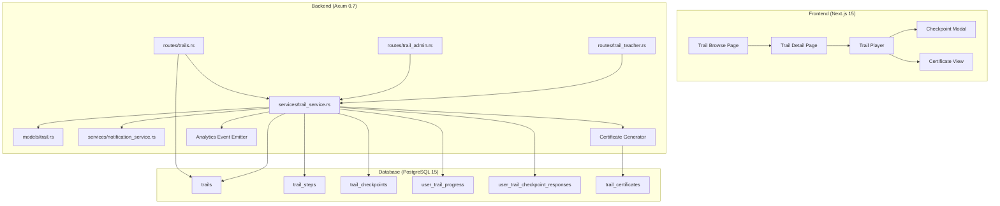

# Design Document — Heritage Trail Mode

## Overview

Heritage Trail Mode adds a narrative-driven learning experience where users progress through curated sequences of 5–15 motifs (called "trails") with story checkpoints, adjustable pacing, and completion certificates. The feature spans admin trail management, public browsing, user progression, pace-based reminders, PDF certificate generation, teacher-curated trails, and KPI analytics.

The implementation follows the existing Axum + SQLx module pattern: new `trail` model, service, and route modules integrate with the current `AuthState`, `AppError` envelope, and JWT middleware. Database changes are delivered via an Alembic migration. Certificate hashing uses the existing `sha2` crate; PDF rendering uses a new lightweight templating dependency.

## Architecture



### Key Design Decisions

1. **Single service module** (`trail_service.rs`) handles all trail business logic (admin, public, teacher, progression). Route modules are thin dispatchers.
2. **Slug-based public API** — trails are identified by slug in user-facing endpoints, by UUID in admin endpoints.
3. **Position-based progression** — `current_position` in `user_trail_progress` is the source of truth for where a user is in a trail. Checkpoints are keyed by `after_position`.
4. **Deterministic certificates** — SHA-256 hash from `(user_id, trail_id, completed_at_unix)` ensures the same completion always produces the same hash, enabling idempotent certificate generation.
5. **Graceful PDF failure** — certificate row is always inserted; PDF rendering is best-effort with background retry.
6. **Existing notification queue** — pace reminders insert into `push_notifications` via the existing notification worker; no new queue infrastructure needed.

## Components and Interfaces

### Route Modules

#### `routes/trails.rs` — Public & User Endpoints

| Method | Path | Auth | Description |
|--------|------|------|-------------|
| GET | `/api/v1/trails` | JWT (any) | List published public trails, paginated |
| GET | `/api/v1/trails/:slug` | JWT (any) | Trail detail + user progress |
| POST | `/api/v1/trails/:slug/start` | JWT (any) | Start or resume a trail |
| POST | `/api/v1/trails/:slug/step/:position/complete` | JWT (any) | Complete current step |
| POST | `/api/v1/trails/:slug/checkpoint/:idx` | JWT (any) | Submit checkpoint response |
| PUT | `/api/v1/users/me/trails/:trail_id/pace` | JWT (any) | Set pace preference |
| GET | `/api/v1/certificates/:hash/verify` | None | Public certificate verification |

#### `routes/trail_admin.rs` — Admin Endpoints

| Method | Path | Auth | Description |
|--------|------|------|-------------|
| POST | `/api/v1/admin/trails` | JWT (admin) | Create draft trail |
| PATCH | `/api/v1/admin/trails/:id` | JWT (admin) | Update trail / publish |
| POST | `/api/v1/admin/trails/:id/promote` | JWT (admin) | Promote classroom trail to public |
| GET | `/api/v1/admin/trails/:id/analytics` | JWT (admin) | Trail KPI analytics |

#### `routes/trail_teacher.rs` — Teacher Endpoints

| Method | Path | Auth | Description |
|--------|------|------|-------------|
| POST | `/api/v1/teacher/trails` | JWT (teacher) | Create classroom-bound trail |
| POST | `/api/v1/teacher/trails/:id/submit-for-promotion` | JWT (teacher) | Submit trail for admin review |

### Service Module

`services/trail_service.rs` exposes these public functions:

```rust
// Admin
pub async fn create_trail(pool: &PgPool, admin_id: Uuid, payload: &CreateTrailRequest) -> Result<TrailOut, AppError>;
pub async fn update_trail(pool: &PgPool, trail_id: Uuid, payload: &UpdateTrailRequest) -> Result<TrailOut, AppError>;
pub async fn publish_trail(pool: &PgPool, trail_id: Uuid) -> Result<TrailOut, AppError>;
pub async fn promote_trail(pool: &PgPool, trail_id: Uuid) -> Result<TrailOut, AppError>;
pub async fn get_trail_analytics(pool: &PgPool, trail_id: Uuid) -> Result<TrailAnalyticsOut, AppError>;

// Public
pub async fn list_trails(pool: &PgPool, page: i32, per_page: i32) -> Result<TrailListResponse, AppError>;
pub async fn get_trail_detail(pool: &PgPool, slug: &str, user_id: Uuid) -> Result<TrailDetailOut, AppError>;

// Progression
pub async fn start_trail(pool: &PgPool, slug: &str, user_id: Uuid) -> Result<TrailStartResponse, AppError>;
pub async fn complete_step(pool: &PgPool, slug: &str, position: i32, user_id: Uuid) -> Result<StepCompleteResponse, AppError>;
pub async fn submit_checkpoint(pool: &PgPool, slug: &str, idx: i32, user_id: Uuid, response: &str) -> Result<CheckpointResponse, AppError>;
pub async fn set_pace(pool: &PgPool, user_id: Uuid, trail_id: Uuid, pace: Pace) -> Result<(), AppError>;

// Teacher
pub async fn create_teacher_trail(pool: &PgPool, teacher_id: Uuid, payload: &CreateTeacherTrailRequest) -> Result<TrailOut, AppError>;
pub async fn submit_for_promotion(pool: &PgPool, teacher_id: Uuid, trail_id: Uuid) -> Result<TrailOut, AppError>;

// Certificate
pub async fn verify_certificate(pool: &PgPool, hash: &str) -> Result<CertificateVerifyOut, AppError>;
```

### Certificate Generator

```rust
// In services/trail_service.rs or a dedicated helper module

/// Generate deterministic certificate hash.
pub fn generate_certificate_hash(user_id: Uuid, trail_id: Uuid, completed_at_unix: i64) -> String {
    use sha2::{Sha256, Digest};
    let input = format!("{}:{}:{}", user_id, trail_id, completed_at_unix);
    let hash = Sha256::digest(input.as_bytes());
    hex::encode(hash)
}

/// Render certificate PDF (best-effort, returns None on failure).
pub async fn render_certificate_pdf(
    user_display_name: &str,
    trail_title: &str,
    issued_at: DateTime<Utc>,
    hash: &str,
) -> Option<String> { /* ... */ }
```

### Notification Integration

Pace reminders reuse the existing `push_notifications` table and notification worker. The trail service inserts a row with `notification_type = 'trail_pace_reminder'` when the user's next scheduled reminder time arrives. A Tokio background task (spawned at startup) polls for due reminders every minute.

## Data Models

### Database Tables (Migration 0043)

```sql
-- trails: the main trail entity
CREATE TABLE trails (
    id UUID PRIMARY KEY DEFAULT gen_random_uuid(),
    slug TEXT UNIQUE NOT NULL,
    title_vi TEXT NOT NULL,
    title_en TEXT NOT NULL,
    description_vi TEXT,
    description_en TEXT,
    narrator_intro TEXT,
    narrator_outro TEXT,
    difficulty TEXT NOT NULL DEFAULT 'beginner',
    estimated_minutes INT NOT NULL DEFAULT 30,
    created_by_user_id UUID NOT NULL REFERENCES users(id),
    status TEXT NOT NULL DEFAULT 'draft',  -- draft|published|pending_review|archived
    visibility TEXT NOT NULL DEFAULT 'public',  -- public|classroom|private
    classroom_id UUID REFERENCES classrooms(id),
    published_at TIMESTAMPTZ,
    created_at TIMESTAMPTZ NOT NULL DEFAULT NOW(),
    updated_at TIMESTAMPTZ NOT NULL DEFAULT NOW(),
    CONSTRAINT trails_status_check CHECK (status IN ('draft','published','pending_review','archived')),
    CONSTRAINT trails_visibility_check CHECK (visibility IN ('public','classroom','private'))
);

-- trail_steps: ordered motifs within a trail
CREATE TABLE trail_steps (
    id UUID PRIMARY KEY DEFAULT gen_random_uuid(),
    trail_id UUID NOT NULL REFERENCES trails(id) ON DELETE CASCADE,
    motif_id UUID NOT NULL REFERENCES motifs(id),
    position INT NOT NULL,
    created_at TIMESTAMPTZ NOT NULL DEFAULT NOW(),
    UNIQUE (trail_id, position)
);

-- trail_checkpoints: reflection prompts after specific positions
CREATE TABLE trail_checkpoints (
    id UUID PRIMARY KEY DEFAULT gen_random_uuid(),
    trail_id UUID NOT NULL REFERENCES trails(id) ON DELETE CASCADE,
    after_position INT NOT NULL,
    prompt_vi TEXT NOT NULL,
    prompt_en TEXT,
    created_at TIMESTAMPTZ NOT NULL DEFAULT NOW(),
    UNIQUE (trail_id, after_position)
);

-- user_trail_progress: tracks each user's position in a trail
CREATE TABLE user_trail_progress (
    id UUID PRIMARY KEY DEFAULT gen_random_uuid(),
    user_id UUID NOT NULL REFERENCES users(id),
    trail_id UUID NOT NULL REFERENCES trails(id),
    current_position INT NOT NULL DEFAULT 1,
    pace TEXT DEFAULT 'daily',  -- daily|2x_week|weekly
    started_at TIMESTAMPTZ NOT NULL DEFAULT NOW(),
    completed_at TIMESTAMPTZ,
    last_activity_at TIMESTAMPTZ NOT NULL DEFAULT NOW(),
    next_reminder_at TIMESTAMPTZ,
    UNIQUE (user_id, trail_id),
    CONSTRAINT pace_check CHECK (pace IN ('daily','2x_week','weekly'))
);

-- user_trail_checkpoint_responses: user answers to checkpoint prompts
CREATE TABLE user_trail_checkpoint_responses (
    id UUID PRIMARY KEY DEFAULT gen_random_uuid(),
    user_id UUID NOT NULL REFERENCES users(id),
    checkpoint_id UUID NOT NULL REFERENCES trail_checkpoints(id),
    response_text TEXT NOT NULL,
    created_at TIMESTAMPTZ NOT NULL DEFAULT NOW(),
    UNIQUE (user_id, checkpoint_id)
);

-- trail_certificates: completion certificates with verifiable hash
CREATE TABLE trail_certificates (
    id UUID PRIMARY KEY DEFAULT gen_random_uuid(),
    user_id UUID NOT NULL REFERENCES users(id),
    trail_id UUID NOT NULL REFERENCES trails(id),
    hash TEXT UNIQUE NOT NULL,
    issued_at TIMESTAMPTZ NOT NULL DEFAULT NOW(),
    pdf_url TEXT,
    UNIQUE (user_id, trail_id)
);

-- Indexes for common queries
CREATE INDEX idx_trails_status_visibility ON trails(status, visibility) WHERE status = 'published';
CREATE INDEX idx_trail_steps_trail_id ON trail_steps(trail_id, position);
CREATE INDEX idx_user_trail_progress_user ON user_trail_progress(user_id);
CREATE INDEX idx_user_trail_progress_reminder ON user_trail_progress(next_reminder_at) WHERE completed_at IS NULL AND next_reminder_at IS NOT NULL;
CREATE INDEX idx_trail_certificates_hash ON trail_certificates(hash);
```

### Rust DTOs (`models/trail.rs`)

```rust
use chrono::{DateTime, Utc};
use serde::{Deserialize, Serialize};
use uuid::Uuid;
use validator::Validate;

#[derive(Debug, Clone, Copy, Serialize, Deserialize, PartialEq)]
#[serde(rename_all = "snake_case")]
pub enum TrailStatus {
    Draft,
    Published,
    PendingReview,
    Archived,
}

#[derive(Debug, Clone, Copy, Serialize, Deserialize, PartialEq)]
#[serde(rename_all = "snake_case")]
pub enum TrailVisibility {
    Public,
    Classroom,
    Private,
}

#[derive(Debug, Clone, Copy, Serialize, Deserialize, PartialEq)]
#[serde(rename_all = "snake_case")]
pub enum Pace {
    Daily,
    #[serde(rename = "2x_week")]
    TwiceWeek,
    Weekly,
}

#[derive(Debug, Deserialize, Validate)]
pub struct CreateTrailRequest {
    pub slug: String,
    #[validate(length(min = 1, max = 200))]
    pub title_vi: String,
    #[validate(length(min = 1, max = 200))]
    pub title_en: String,
    pub description_vi: Option<String>,
    pub description_en: Option<String>,
    pub narrator_intro: Option<String>,
    pub narrator_outro: Option<String>,
    pub difficulty: Option<String>,
    pub estimated_minutes: Option<i32>,
    pub steps: Vec<TrailStepInput>,
    pub checkpoints: Vec<TrailCheckpointInput>,
}

#[derive(Debug, Deserialize)]
pub struct TrailStepInput {
    pub motif_id: Uuid,
    pub position: i32,
}

#[derive(Debug, Deserialize)]
pub struct TrailCheckpointInput {
    pub after_position: i32,
    pub prompt_vi: String,
    pub prompt_en: Option<String>,
}

#[derive(Debug, Serialize)]
pub struct TrailOut {
    pub id: Uuid,
    pub slug: String,
    pub title_vi: String,
    pub title_en: String,
    pub description_vi: Option<String>,
    pub description_en: Option<String>,
    pub narrator_intro: Option<String>,
    pub narrator_outro: Option<String>,
    pub difficulty: String,
    pub estimated_minutes: i32,
    pub status: String,
    pub visibility: String,
    pub step_count: i32,
    pub checkpoint_count: i32,
    pub created_at: DateTime<Utc>,
}

#[derive(Debug, Serialize)]
pub struct TrailDetailOut {
    pub trail: TrailOut,
    pub progress: Option<UserTrailProgressOut>,
}

#[derive(Debug, Serialize)]
pub struct UserTrailProgressOut {
    pub current_position: i32,
    pub started_at: DateTime<Utc>,
    pub completed_at: Option<DateTime<Utc>>,
    pub pace: String,
}

#[derive(Debug, Serialize)]
pub struct TrailStartResponse {
    pub progress: UserTrailProgressOut,
    pub first_motif: serde_json::Value,
}

#[derive(Debug, Serialize)]
#[serde(tag = "type")]
pub enum StepCompleteResponse {
    #[serde(rename = "next_motif")]
    NextMotif { position: i32, motif: serde_json::Value },
    #[serde(rename = "checkpoint")]
    Checkpoint { checkpoint_id: Uuid, prompt_vi: String, prompt_en: Option<String> },
    #[serde(rename = "completed")]
    Completed { outro: String, certificate_url: Option<String> },
}

#[derive(Debug, Serialize)]
pub struct CertificateVerifyOut {
    pub user_display_name: String,
    pub trail_title: String,
    pub issued_at: DateTime<Utc>,
    pub valid: bool,
}

#[derive(Debug, Serialize)]
pub struct TrailAnalyticsOut {
    pub unique_starts: i64,
    pub average_days_to_complete: Option<f64>,
    pub completion_rate: f64,
    pub top_skipped_checkpoints: Vec<SkippedCheckpointOut>,
}

#[derive(Debug, Serialize)]
pub struct SkippedCheckpointOut {
    pub checkpoint_id: Uuid,
    pub after_position: i32,
    pub prompt_vi: String,
    pub null_response_count: i64,
}

#[derive(Debug, Deserialize)]
pub struct SetPaceRequest {
    pub pace: Pace,
}

#[derive(Debug, Deserialize)]
pub struct CreateTeacherTrailRequest {
    pub slug: String,
    pub title_vi: String,
    pub title_en: String,
    pub description_vi: Option<String>,
    pub description_en: Option<String>,
    pub narrator_intro: Option<String>,
    pub narrator_outro: Option<String>,
    pub difficulty: Option<String>,
    pub estimated_minutes: Option<i32>,
    pub classroom_id: Uuid,
    pub steps: Vec<TrailStepInput>,
    pub checkpoints: Vec<TrailCheckpointInput>,
}

#[derive(Debug, Deserialize)]
pub struct CheckpointSubmitRequest {
    pub response: String,
}
```

## Correctness Properties

*A property is a characteristic or behavior that should hold true across all valid executions of a system — essentially, a formal statement about what the system should do. Properties serve as the bridge between human-readable specifications and machine-verifiable correctness guarantees.*

### Property 1: Trail creation produces a draft

*For any* valid trail creation payload (with valid slug, titles, steps, and checkpoints), calling the create_trail service function SHALL return a trail with `status = 'draft'` and all fields matching the input payload.

**Validates: Requirements 1.2**

### Property 2: Publish validation enforces step count boundaries

*For any* trail with N steps, attempting to publish SHALL succeed if and only if 5 ≤ N ≤ 15 AND narrator_intro is non-empty AND narrator_outro is non-empty. Otherwise it SHALL return a TRAIL_VALIDATION error.

**Validates: Requirements 1.3, 1.4**

### Property 3: Trail listing returns only published public trails in order

*For any* set of trails with mixed statuses and visibilities, the list endpoint SHALL return only those with `status = 'published'` AND `visibility = 'public'`, ordered by `published_at` descending.

**Validates: Requirements 2.1**

### Property 4: Trail detail hides motif sequence before start

*For any* trail and any user who has not started that trail, the detail response SHALL contain step_count and checkpoint_count but SHALL NOT contain any motif IDs or motif content.

**Validates: Requirements 2.2, 2.3**

### Property 5: Start trail is idempotent

*For any* user and any published trail, calling start_trail multiple times SHALL always return the same `user_trail_progress` row with `current_position` unchanged after the first call, and SHALL return the motif at the user's current position.

**Validates: Requirements 3.1**

### Property 6: Trail advancement state machine

*For any* trail with steps and checkpoints, and any user at position P:
- If P is not the final position and no checkpoint exists at `after_position = P`, completing step P SHALL advance `current_position` to P+1 and return the next motif.
- If a checkpoint exists at `after_position = P`, completing step P SHALL return the checkpoint prompt (position does not advance until checkpoint is submitted).
- If P is the final position, completing step P SHALL set `completed_at`, generate a certificate, and return the trail outro.

**Validates: Requirements 3.2, 3.3, 3.4**

### Property 7: Pace setting accepts only valid enum values

*For any* string value, setting pace SHALL succeed if and only if the value is one of `{daily, 2x_week, weekly}`. Invalid values SHALL be rejected with a validation error.

**Validates: Requirements 4.1**

### Property 8: Notification schedule computation

*For any* pace value and reference timestamp, the computed `next_reminder_at` SHALL be: daily → +24h, 2x_week → +84h (3.5 days), weekly → +168h (7 days) from the reference time.

**Validates: Requirements 4.2**

### Property 9: Certificate hash determinism

*For any* `(user_id, trail_id, completed_at_unix)` tuple, `generate_certificate_hash` SHALL always produce the same SHA-256 hex string. For any two distinct tuples, the hashes SHALL differ.

**Validates: Requirements 5.1**

### Property 10: Certificate verification returns correct data

*For any* valid certificate hash in the database, the verify endpoint SHALL return the correct `user_display_name`, `trail_title`, and `issued_at`. For any hash not in the database, it SHALL return HTTP 404.

**Validates: Requirements 5.3**

### Property 11: Teacher trail creation requires classroom ownership

*For any* user with `role = 'teacher'` and any classroom, creating a trail bound to that classroom SHALL succeed if and only if the teacher is the classroom owner. Non-owners SHALL receive HTTP 403.

**Validates: Requirements 6.1**

### Property 12: Submit-for-promotion state transition

*For any* trail owned by the requesting teacher, `submit_for_promotion` SHALL succeed if and only if the trail's current status is `'draft'`. On success, status SHALL become `'pending_review'`.

**Validates: Requirements 6.2**

### Property 13: Admin promote state transition

*For any* trail in `'pending_review'` status, promoting it SHALL set `status = 'published'`, `visibility = 'public'`, and preserve the original `created_by_user_id`.

**Validates: Requirements 6.3**

### Property 14: Analytics aggregation correctness

*For any* trail with a set of user_trail_progress rows, the analytics endpoint SHALL return:
- `unique_starts` = count of distinct user_ids with progress rows
- `completion_rate` = (rows with completed_at NOT NULL) / unique_starts
- `average_days_to_complete` = mean of (completed_at - started_at) in days for completed rows
- `top_skipped_checkpoints` = top 5 checkpoints ordered by count of users who have progress past that checkpoint but no response row

**Validates: Requirements 7.2**

## Error Handling

All errors use the existing `AppError` envelope pattern:

| Scenario | Status | Code | Message |
|----------|--------|------|---------|
| Trail not found | 404 | `HTTP_ERROR` | "Trail not found" |
| Publish validation fails | 422 | `TRAIL_VALIDATION` | Dynamic (e.g., "Trail must have 5-15 steps") |
| Step not at current position | 409 | `TRAIL_POSITION_MISMATCH` | "Cannot complete step {n}, current position is {m}" |
| Motif lesson not completed | 422 | `PREREQUISITE_NOT_MET` | "Complete the motif lesson before advancing" |
| Invalid pace value | 422 | `VALIDATION_ERROR` | "Invalid pace value" |
| Teacher not classroom owner | 403 | `HTTP_ERROR` | "You do not have permission to manage this classroom" |
| Trail not in draft (submit) | 409 | `INVALID_STATE_TRANSITION` | "Trail must be in draft status to submit for promotion" |
| Trail not in pending_review (promote) | 409 | `INVALID_STATE_TRANSITION` | "Trail must be in pending_review status to promote" |
| Certificate hash not found | 404 | `HTTP_ERROR` | "Certificate not found" |
| PDF rendering failure | — | — | Certificate row inserted with `pdf_url = NULL`; background retry queued |

### Graceful Degradation

- **PDF rendering failure**: The certificate row is always created. If PDF rendering fails, `pdf_url` remains NULL and a background task retries up to 3 times with exponential backoff (1min, 5min, 30min).
- **Notification queue failure**: If inserting a pace reminder fails, the error is logged but does not block the user's pace setting response.
- **Analytics query timeout**: The analytics endpoint uses a 10-second query timeout; on timeout, returns partial results with a `"partial": true` flag.

## Testing Strategy

### Property-Based Tests (PBT)

**Library**: `proptest` (Rust) — pinned at exact version in `[dev-dependencies]`.

**Configuration**: Minimum 100 iterations per property test (`PROPTEST_CASES=100`).

**Tag format**: `// Feature: heritage-trail-mode, Property {N}: {title}`

Properties 1–14 from the Correctness Properties section will each be implemented as a single property-based test in `backend-rust/tests/trail_properties.rs`. Key generators:

- `arb_trail_payload()` — generates valid `CreateTrailRequest` with 1–20 steps
- `arb_pace()` — generates one of the three valid pace values
- `arb_user_trail_state()` — generates a trail + user progress at a random position
- `arb_certificate_inputs()` — generates `(Uuid, Uuid, i64)` tuples

### Unit Tests

Located in `backend-rust/src/services/trail_service.rs` (inline `#[cfg(test)]` module):

- `test_generate_certificate_hash_deterministic` — same inputs produce same hash
- `test_generate_certificate_hash_format` — output is 64-char hex string
- `test_pace_to_duration` — each pace maps to correct Duration
- `test_publish_validation_messages` — specific error messages for each failure mode

### Integration Tests

Located in `backend-rust/tests/trail_integration.rs`:

- Full trail lifecycle: create → add steps → publish → start → advance → complete → verify certificate
- Teacher trail: create classroom trail → submit for promotion → admin promotes
- Analytics: seed progress data → verify computed metrics
- PDF failure: mock renderer failure → verify certificate row with NULL pdf_url → verify retry

### Frontend Tests

Playwright E2E tests in `frontend/tests/trails/`:

- Trail browse page renders published trails
- Trail detail shows step count but not motif content before start
- Trail player advances through steps and checkpoints
- Certificate page displays verification data

### New Dev Dependencies

```toml
# In [dev-dependencies]
proptest = "=1.4.0"
```
