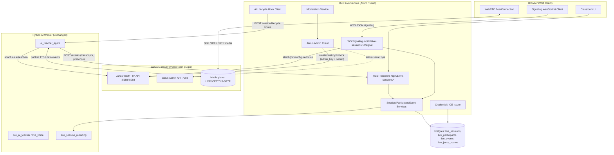
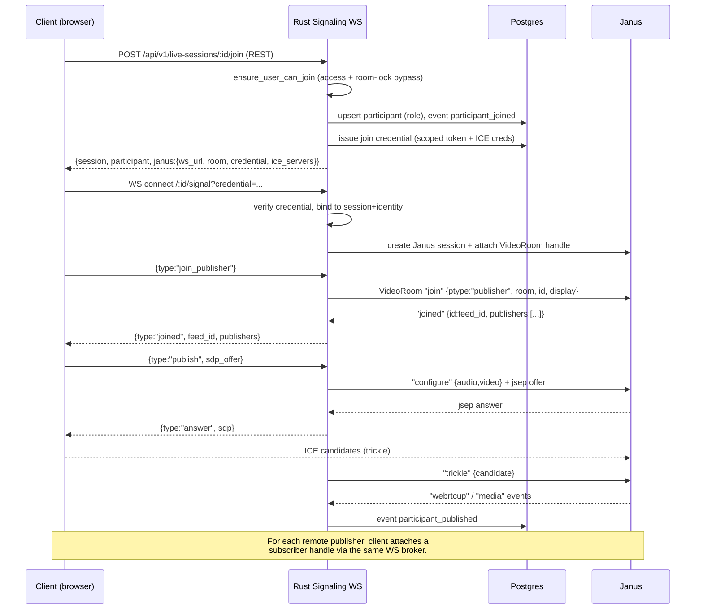
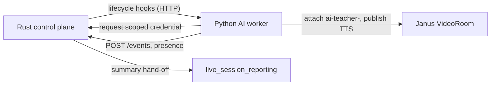

# Design Document: Live Room — Rust + Janus Migration

## Overview

The live virtual-classroom layer currently runs as a Python (FastAPI + SQLAlchemy)
service (`backend/services/live_sessions.py` + the `/api/v1/live-sessions/*` and
`/api/v1/live/*` routes) backed by a self-/cloud-hosted **LiveKit** SFU. Session
lifecycle, participant roster, moderation, event recording, and **LiveKit JWT
issuance** all live in Python today, and the live routes are pinned `gateway` in
the in-progress full-rust-backend-migration (see `backend-rust/docs/ai-tutor-routing.md`).

This migration moves the **signaling and session/control plane** to a native Rust
service (Axum/Tokio, sqlx runtime queries) and replaces the **media plane** with a
self-hosted **Janus WebRTC Gateway** running the **VideoRoom** plugin. The Rust
server owns: WebSocket signaling, Janus room/session lifecycle, the participant
roster, moderation, join credential/token issuance, and `live_events` recording.

The **AI Teacher stays in Python.** The Python `ai_teacher_agent` worker (and
`live_ai_teacher.py`, `live_voice.py`, `live_circuit_breaker.py`,
`live_observability.py`, `live_crypto.py`, `live_session_reporting.py`) continues
to run unchanged. It joins each room as a participant with the existing identity
scheme `ai-teacher-<sessionid16>`, consuming media from Janus and publishing its
TTS audio / data events back into the room. Rust notifies the Python worker of
session lifecycle over an internal HTTP hook; the LLM/AI-tutor routes remain
`gateway`-pinned.

The migration is **behavior-preserving**: authorization rules, idempotent session
creation, room-lock semantics, the role model (host/cohost/learner/ai_teacher),
the state machine (scheduled → live → ended), and the `live_events` audit log are
mirrored exactly from the Python implementation. Database changes are **additive
only** (new nullable columns + one new table), and LiveKit and Janus **coexist
behind a feature flag** during a phased cutover so rollback is a config flip.

### Goals

- Native Rust handlers for the live session control plane, replacing the
  `gateway`-pinned Python live routes with `native` route-modes entries.
- Self-hosted Janus VideoRoom SFU as the media plane, added as a new
  `janus-gateway` docker-compose service alongside `livekit`.
- A Rust WebSocket signaling endpoint brokering Janus attach/join/offer/answer/
  trickle between browser and Janus.
- A Rust **Janus admin client** that maps the LiveKit RoomService operations
  (CreateRoom / DeleteRoom / ListParticipants / MutePublishedTrack /
  RemoveParticipant) onto Janus VideoRoom admin requests.
- Preserve authorization parity, idempotent creation, room-lock enforcement,
  roster consistency, token/credential scoping, event-log completeness, and
  state-machine validity.
- Keep the AI Teacher in Python via a well-defined integration boundary.
- A safe deployment story for a disk- and memory-constrained production host.

### Non-Goals

- Rewriting the AI Teacher / LLM orchestration in Rust. `ai_teacher_agent`,
  STT/TTS, circuit breaker, observability, crypto, and reporting **stay Python**.
- Changing the client-facing semantics of session/participant/event objects
  (the JSON DTOs remain compatible so the existing web client keeps working).
- Replacing Postgres, the auth scheme (shared HS256 JWT), or the AppError envelope.
- Building a custom TURN server (we reuse the existing TURN/coturn deployment and
  issue short-lived ICE credentials).
- Multi-region / clustered Janus. Single-node Janus is in scope; horizontal
  scaling is future work.

---

## Architecture



### Plane separation

| Plane | Owner | Transport | Responsibility |
|-------|-------|-----------|----------------|
| Control plane | Rust REST | HTTPS JSON | create/list/get/end session, roster, moderation, settings, events feed, credential issuance |
| Signaling plane | Rust WebSocket | WSS JSON | proxy Janus attach/join/offer/answer/trickle, reconnection, leave |
| Media plane | Janus | UDP (ICE/DTLS-SRTP) | actual audio/video forwarding (SFU) |
| AI plane | Python worker | internal HTTP + Janus participant | AI teacher media + LLM/STT/TTS + reporting |

### Why a Rust signaling broker in front of Janus

The browser never talks to Janus directly. The Rust signaling WebSocket:

1. Authenticates the WS upgrade with the existing access JWT (parity with REST).
2. Enforces authorization + room-lock **before** any Janus join.
3. Holds the Janus **admin secret / room secrets** server-side so they are never
   exposed to clients (parity with LiveKit `api_secret` never reaching the browser).
4. Records `live_events` for join/leave/publish, keeping the audit log complete.
5. Maps Janus `feed`/`handle` IDs back to `participant_identity` for roster sync.

---

## Sequence Diagrams

### Session creation + room provisioning

```mermaid
sequenceDiagram
    participant C as Client
    participant R as Rust REST
    participant DB as Postgres
    participant J as Janus
    participant AI as Python AI Worker

    C->>R: POST /api/v1/live-sessions {classroom_id, idempotency_key, ...}
    R->>R: authenticate JWT, can_manage_classroom
    R->>DB: SELECT by (classroom_id, idempotency_key)
    alt existing row
        DB-->>R: existing session
        R-->>C: 200 existing session (idempotent)
    else new
        R->>DB: INSERT live_sessions (status, room_name, metadata)
        R->>J: VideoRoom "create" {room, secret, publishers, ...}
        J-->>R: {videoroom: "created", room: <janus_room_id>}
        R->>DB: INSERT live_janus_rooms (janus_room_id, secret_ref); event session_created
        opt ai_enabled
            R->>AI: POST /internal/ai/session.created {live_session_id, janus_room_id}
        end
        R-->>C: 201 session
    end
```

### Join + WebRTC publish/subscribe (signaling over Rust WS)



### End session + cleanup

```mermaid
sequenceDiagram
    participant C as Client (host)
    participant R as Rust REST
    participant DB as Postgres
    participant J as Janus
    participant AI as Python AI Worker

    C->>R: POST /api/v1/live-sessions/:id/end
    R->>R: ensure_user_can_manage
    R->>DB: status=ended, ended_at; event session_ended
    R->>J: VideoRoom "destroy" {room, secret}
    alt destroy fails
        J-->>R: error
        R->>DB: event room_close_failed {error}
    end
    R->>AI: POST /internal/ai/session.ended {live_session_id}
    R->>DB: hand off to reporting (summary generation)
    R-->>C: 200 ended session
```

---

## Components and Interfaces

The Rust code lives under `backend-rust/src/` following existing conventions:
route modules in `src/routes/`, service modules in `src/services/`, row/response
DTOs in `src/models/`. New modules:

```
src/routes/live.rs            # REST + WS handlers for live sessions
src/services/live_session_service.rs
src/services/live_participant_service.rs
src/services/live_event_service.rs
src/services/live_moderation_service.rs
src/services/live_credential_service.rs   # join credential + ICE issuance
src/services/janus_admin.rs               # Janus VideoRoom admin client
src/services/janus_signaling.rs           # per-connection Janus session broker
src/services/ai_hook_client.rs            # notifies Python AI worker
src/models/live.rs                        # row + DTO structs
```

### Component 1: Live REST Handlers (`routes/live.rs`)

**Purpose**: Native Axum handlers replacing the Python `/api/v1/live-sessions/*`
routes. Mirrors the auth pattern in `routes/classrooms.rs` (`authenticate`,
`require_pool`, `AuthState`).

**Interface**:

```rust
// All handlers take HeaderMap + State<AuthState> and return Result<_, AppError>.
pub async fn create_session(headers, State<AuthState>, Json<CreateSessionRequest>) -> Result<impl IntoResponse, AppError>;
pub async fn list_sessions(headers, State<AuthState>, Query<ListSessionsQuery>) -> Result<Json<Vec<LiveSessionOut>>, AppError>;
pub async fn get_session(headers, State<AuthState>, Path<Uuid>) -> Result<Json<LiveSessionOut>, AppError>;
pub async fn end_session(headers, State<AuthState>, Path<Uuid>) -> Result<Json<LiveSessionOut>, AppError>;
pub async fn join_session(headers, State<AuthState>, Path<Uuid>) -> Result<Json<LiveSessionJoinOut>, AppError>;
pub async fn issue_credential(headers, State<AuthState>, Path<Uuid>) -> Result<Json<LiveCredentialOut>, AppError>;
pub async fn leave_session(headers, State<AuthState>, Path<Uuid>) -> Result<StatusCode, AppError>; // 204
pub async fn list_participants(headers, State<AuthState>, Path<Uuid>) -> Result<Json<Vec<LiveParticipantOut>>, AppError>;
pub async fn list_events(headers, State<AuthState>, Path<Uuid>, Query<EventsQuery>) -> Result<Json<Vec<LiveEventOut>>, AppError>;
pub async fn append_event(headers, State<AuthState>, Path<Uuid>, Json<AppendEventRequest>) -> Result<(StatusCode, Json<LiveEventOut>), AppError>;
pub async fn update_participant_role(headers, State<AuthState>, Path<(Uuid, Uuid)>, Json<UpdateRoleRequest>) -> Result<Json<LiveParticipantOut>, AppError>;
pub async fn update_settings(headers, State<AuthState>, Path<Uuid>, Json<UpdateSettingsRequest>) -> Result<Json<LiveSessionOut>, AppError>;
pub async fn mute_all(headers, State<AuthState>, Path<Uuid>, Json<MuteAllRequest>) -> Result<Json<ModerationActionOut>, AppError>;
pub async fn remove_participant(headers, State<AuthState>, Path<Uuid>, Json<RemoveParticipantRequest>) -> Result<Json<ModerationActionOut>, AppError>;
pub async fn signal_ws(ws: WebSocketUpgrade, headers, State<AuthState>, Path<Uuid>, Query<SignalQuery>) -> Result<Response, AppError>;
```

**Responsibilities**: extract + verify JWT, enforce authorization, delegate to
services, map errors to the `AppError` envelope (`Domain`/`Http`/`Validation`).

### Component 2: Session Service (`services/live_session_service.rs`)

**Purpose**: Session lifecycle and the scheduled→live→ended state machine. Direct
port of `create_live_session`, `end_live_session`, `get_live_session`,
`list_live_sessions_for_classroom`, `update_live_session_settings`.

**Interface**:

```rust
pub async fn create_session(pool: &PgPool, janus: &JanusAdmin, ai: &AiHookClient, actor: &Actor, req: &CreateSessionRequest) -> Result<LiveSession, AppError>;
pub async fn list_sessions(pool: &PgPool, classroom_id: Uuid, limit: i64) -> Result<Vec<LiveSession>, AppError>;
pub async fn get_session(pool: &PgPool, id: Uuid) -> Result<Option<LiveSession>, AppError>;
pub async fn end_session(pool: &PgPool, janus: &JanusAdmin, ai: &AiHookClient, session: &LiveSession, ended_by: Option<Uuid>) -> Result<LiveSession, AppError>;
pub async fn update_settings(pool: &PgPool, session: &LiveSession, patch: &SettingsPatch, actor: Uuid) -> Result<LiveSession, AppError>;
```

### Component 3: Participant Service (`services/live_participant_service.rs`)

**Purpose**: Roster management. Ports `upsert_participant_join`,
`mark_participant_left`, `ensure_ai_teacher_participant`, `update_participant_role`,
`participant_identity_for_user`, `ai_teacher_identity_for_session`, and roster
reconciliation against Janus' participant list.

```rust
pub async fn upsert_join(pool, session, user, identity, display_name) -> Result<LiveParticipant, AppError>;
pub async fn mark_left(pool, session, user_id, identity: Option<&str>) -> Result<Option<LiveParticipant>, AppError>;
pub async fn ensure_ai_teacher(pool, session, display_name, identity, conn_meta) -> Result<LiveParticipant, AppError>;
pub async fn update_role(pool, session, participant, role, actor) -> Result<LiveParticipant, AppError>;
pub async fn reconcile_with_janus(pool, janus, session) -> Result<RosterDiff, AppError>;
pub fn identity_for_user(user_id: Uuid) -> String;                 // "user-<uuid>"
pub fn ai_teacher_identity(session_id: Uuid) -> String;            // "ai-teacher-<id16>"
```

### Component 4: Event Service (`services/live_event_service.rs`)

**Purpose**: Append-only audit log. Ports `record_live_event`, `list_live_events`,
`find_live_session_by_room_name`. Also triggers the reporting hand-off.

```rust
pub async fn record(pool, &EventInsert) -> Result<LiveEvent, AppError>;
pub async fn list(pool, session_id, limit, since: Option<DateTime<Utc>>) -> Result<Vec<LiveEvent>, AppError>;
```

### Component 5: Janus Admin Client (`services/janus_admin.rs`)

**Purpose**: Map LiveKit RoomService operations onto Janus VideoRoom admin
requests. Holds the admin secret + per-room secret. This is the single point that
talks to the Janus management surface.

| LiveKit RoomService | Janus VideoRoom equivalent |
|---------------------|----------------------------|
| `CreateRoom` | `{"request":"create","room":<id>,"secret":...,"publishers":N,"bitrate":...,"audiolevel_event":true}` |
| `DeleteRoom` | `{"request":"destroy","room":<id>,"secret":...}` |
| `ListParticipants` | `{"request":"listparticipants","room":<id>}` |
| `RemoveParticipant` (kick) | `{"request":"kick","room":<id>,"secret":...,"id":<feed_id>}` |
| `MutePublishedTrack` (mute) | `{"request":"moderate","room":<id>,"secret":...,"id":<feed_id>,"mute_audio":true}` |
| (room existence) | `{"request":"exists","room":<id>}` |

```rust
pub struct JanusAdmin { http: reqwest::Client, base_url: String, admin_secret: String, retry: RetryPolicy }

impl JanusAdmin {
    pub async fn create_room(&self, room: i64, opts: &RoomOpts) -> Result<(), JanusError>;
    pub async fn destroy_room(&self, room: i64, secret: &str) -> Result<(), JanusError>; // allow_not_found
    pub async fn list_participants(&self, room: i64) -> Result<Vec<JanusParticipant>, JanusError>;
    pub async fn kick(&self, room: i64, secret: &str, feed_id: i64) -> Result<(), JanusError>;
    pub async fn moderate_mute(&self, room: i64, secret: &str, feed_id: i64, mute_audio: bool) -> Result<(), JanusError>;
    pub async fn room_exists(&self, room: i64) -> Result<bool, JanusError>;
}
```

**Retry / idempotency**: mirrors the Python `_livekit_room_service_request`
behavior — exponential backoff, treat 4xx "no such room" / "already exists" as
success-equivalent for create/destroy (`allow_not_found`).

### Component 6: Signaling Broker (`services/janus_signaling.rs`)

**Purpose**: One Rust task per browser WebSocket. Creates a Janus session +
VideoRoom handle, relays SDP/ICE, translates Janus async events into client
messages, records publish/subscribe events, and tears down the Janus session on
disconnect.

```rust
pub struct SignalingSession { client_ws: WebSocket, janus: JanusConnection, ctx: SignalingCtx }
impl SignalingSession {
    pub async fn run(self) -> Result<(), AppError>; // event loop until either side closes
}
```

### Component 7: Credential / ICE Issuer (`services/live_credential_service.rs`)

**Purpose**: Replaces `issue_livekit_token`. Issues a short-lived **join
credential** (an HS256 JWT scoped to one session+identity, signed with the shared
secret) plus **ICE/TURN credentials** (time-limited HMAC username/password per
RFC 5766 long-term-credential / coturn `static-auth-secret`). The Janus admin
secret and room secret are NEVER part of the credential returned to the client.

```rust
pub fn issue_join_credential(session: &LiveSession, identity: &str, role: &str, ttl_min: i64, secret: &str) -> Result<(String, DateTime<Utc>), AppError>;
pub fn issue_ice_credentials(turn_secret: &str, ttl_sec: i64) -> IceServers;  // coturn TURN REST API style
```

### Component 8: Moderation Service (`services/live_moderation_service.rs`)

**Purpose**: Ports `mute_all_participants` and `remove_participant`, calling the
Janus admin client instead of LiveKit. Mute targets audio of non-host
participants (cohosts optional); kick removes a feed and marks `left_at`.

### Component 9: AI Lifecycle Hook Client (`services/ai_hook_client.rs`)

**Purpose**: The Rust → Python integration boundary. Notifies the Python AI worker
of session lifecycle changes over an internal HTTP endpoint so the worker can
attach/detach its AI-teacher participant. Fire-and-forget with retry; failures are
logged as `ai_hook_failed` events and never block the control plane.

```rust
pub async fn session_created(&self, p: &AiSessionPayload) -> Result<(), AiHookError>;
pub async fn session_ended(&self, session_id: Uuid) -> Result<(), AiHookError>;
pub async fn ai_toggled(&self, session_id: Uuid, enabled: bool) -> Result<(), AiHookError>;
```

---

## AI Teacher Integration Boundary

The AI Teacher remains entirely in Python. The boundary has three channels:

1. **Rust → Python control (lifecycle hooks).** When a session is created, ended,
   or AI is toggled, Rust POSTs to an internal endpoint on the AI worker, e.g.
   `POST {AI_WORKER_URL}/internal/ai/session.created` with
   `{live_session_id, classroom_id, janus_ws_url, janus_room_id, ai_teacher_identity, grade_level, ai_cost_ceiling_usd}`.
   The hook is gated on `session_metadata.ai_enabled`. This replaces any implicit
   coupling that existed when session creation lived inside the Python service.

2. **Python → Janus media.** The AI worker attaches to the Janus VideoRoom as a
   publisher with identity `ai-teacher-<sessionid16>` using a join credential it
   requests from Rust (`POST /api/v1/live-sessions/:id/ai-teacher/credential`,
   service-authenticated). It subscribes to learner audio for STT and publishes
   its TTS audio track + data-channel events (questions, captions). Janus is the
   single media broker for both humans and AI.

3. **Python → Rust events/roster.** The worker keeps using the existing
   `POST /api/v1/live-sessions/:id/events` and the AI-teacher presence endpoint to
   record transcripts/presence. `ensure_ai_teacher_participant` semantics are
   preserved (idempotent, `event_source="ai_agent"`). The LLM/STT/TTS endpoints
   (`/api/v1/live/chat`, `/api/v1/ai-tutor/*`, `.../ai-teacher/stt|tts|reply`)
   remain `gateway`-pinned to Python per `ai-tutor-routing.md`.



**Service authentication** for the internal channel: a shared `LIVE_INTERNAL_TOKEN`
(separate from user JWTs) is required on `/internal/ai/*` (Python side) and on the
AI-teacher credential endpoint (Rust side). This token never reaches browsers.

---

## Data Models

The migration **reuses** the existing tables `live_sessions`, `live_participants`,
`live_events` (migrations 0038/0039) without breaking changes. Janus-specific
state is added via **additive columns** and **one new table**. The next migration
number after `0045` is **`0046`** (project convention: additive Alembic
migrations, sequential numbering). Note: schema changes are owned by the shared
Alembic chain; Rust reads the same tables via sqlx runtime queries (`query_as`,
not the compile-time `query!` macro, matching existing service modules).

### Existing tables (reused, unchanged)

```
live_sessions(id, classroom_id, created_by_id, room_name, title,
  status['scheduled'|'live'|'ended'], starts_at, ended_at,
  idempotency_key, session_metadata JSONB{lock_room, ai_enabled,
  grade_level, ai_cost_ceiling_usd}, created_at, updated_at)
  UNIQUE(room_name); UNIQUE(idempotency_key)

live_participants(id, live_session_id, user_id NULL, participant_identity,
  display_name, role['host'|'cohost'|'learner'|'ai_teacher'], is_ai,
  joined_at, left_at, connection_metadata JSONB)
  UNIQUE(live_session_id, participant_identity)
  UNIQUE(live_session_id, user_id)

live_events(id, live_session_id, event_type, event_source, participant_identity,
  participant_user_id, payload JSONB, created_at)
```

### Additive changes (migration `0046_live_janus_signaling`)

New nullable columns on `live_participants` (Janus feed/handle binding):

```
live_participants.janus_feed_id    BIGINT NULL   -- VideoRoom publisher feed id
live_participants.janus_handle_id  BIGINT NULL   -- Janus plugin handle id
```

New table `live_janus_rooms` (maps a session to its Janus VideoRoom and holds the
server-side room secret reference — the secret itself is stored as a reference to
a value held in env/secret store, not in plaintext in the DB):

```sql
CREATE TABLE live_janus_rooms (
    id                UUID PRIMARY KEY,
    live_session_id   UUID NOT NULL REFERENCES live_sessions(id) ON DELETE CASCADE,
    janus_room_id     BIGINT NOT NULL,          -- numeric VideoRoom id
    room_secret_ref   VARCHAR(191) NOT NULL,    -- reference/key, not the secret value
    pin_ref           VARCHAR(191) NULL,
    media_state       VARCHAR(20)  NOT NULL DEFAULT 'provisioned', -- provisioned|active|destroyed
    created_at        TIMESTAMPTZ  NOT NULL DEFAULT now(),
    updated_at        TIMESTAMPTZ  NOT NULL DEFAULT now(),
    UNIQUE (live_session_id),
    UNIQUE (janus_room_id)
);
CREATE INDEX idx_live_janus_rooms_session ON live_janus_rooms(live_session_id);
```

Transient SDP/ICE signaling state is **not** persisted (it is per-connection and
ephemeral) — it lives only in the in-memory `SignalingSession`. Only durable
bindings (feed/handle/room ids) hit Postgres, keeping write volume low for the
disk-constrained host.

### Rust DTOs (`models/live.rs`)

```rust
#[derive(sqlx::FromRow)]
pub struct LiveSession {
    pub id: Uuid, pub classroom_id: Uuid, pub created_by_id: Option<Uuid>,
    pub room_name: String, pub title: Option<String>, pub status: String,
    pub starts_at: DateTime<Utc>, pub ended_at: Option<DateTime<Utc>>,
    pub idempotency_key: Option<String>, pub session_metadata: serde_json::Value,
    pub created_at: DateTime<Utc>, pub updated_at: DateTime<Utc>,
}

#[derive(Serialize)]
pub struct LiveCredentialOut {
    pub janus_ws_url: String,      // public Janus WS URL for the browser
    pub janus_room_id: i64,
    pub identity: String,
    pub credential: String,        // scoped HS256 JWT (NOT the room/admin secret)
    pub expires_at: DateTime<Utc>,
    pub ice_servers: Vec<IceServer>,
}

#[derive(Serialize)]
pub struct LiveSessionJoinOut { pub session: LiveSessionOut, pub participant: LiveParticipantOut, pub janus: LiveCredentialOut }
```

---

## WebRTC Signaling Flow (Low-Level)

Signaling messages are JSON over the Rust WebSocket. The Rust broker owns one
Janus session per WS connection and one VideoRoom handle per publisher/subscriber.

### Client → Rust message types

```rust
#[serde(tag = "type", rename_all = "snake_case")]
pub enum ClientSignal {
    JoinPublisher { display_name: String },
    Publish { sdp_offer: String, audio: bool, video: bool },
    Subscribe { feed_id: i64 },
    Answer { feed_id: i64, sdp_answer: String },  // for subscriber handles
    Trickle { candidate: Option<IceCandidate> },  // None = end-of-candidates
    Unpublish,
    Leave,
}
```

### Rust → Client message types

```rust
#[serde(tag = "type", rename_all = "snake_case")]
pub enum ServerSignal {
    Joined { feed_id: i64, publishers: Vec<PublisherInfo> },
    Answer { sdp: String },                 // publisher answer
    Offer { feed_id: i64, sdp: String },    // subscriber offer
    Publishers { publishers: Vec<PublisherInfo> },
    Trickle { feed_id: Option<i64>, candidate: Option<IceCandidate> },
    Leaving { feed_id: i64 },
    Error { code: String, message: String },
}
```

### Join → publish algorithm

```rust
// PRECONDITIONS:
//   - WS upgrade carried a valid join credential scoped to (session_id, identity)
//   - session.status != "ended"
//   - participant row exists (created by POST /join) OR will be upserted here
// POSTCONDITIONS:
//   - a Janus VideoRoom publisher handle is attached and bound to identity
//   - participant.janus_feed_id / janus_handle_id are persisted
//   - a participant_published event is recorded once webrtcup fires
async fn handle_join_publisher(ctx, display_name) -> Result<(), AppError> {
    let jsession = ctx.janus.create_session().await?;          // Janus "create"
    let handle   = jsession.attach("janus.plugin.videoroom").await?;
    let joined   = handle.request(json!({
        "request": "join", "ptype": "publisher",
        "room": ctx.janus_room_id, "id": ctx.numeric_id(),
        "display": display_name,
    })).await?;                                                // -> "joined" {id, publishers}
    ctx.feed_id = joined.id;
    persist_feed_binding(ctx.pool, ctx.participant_id, joined.id, handle.id).await?;
    send(ServerSignal::Joined { feed_id: joined.id, publishers: joined.publishers });
    Ok(())
}

async fn handle_publish(ctx, sdp_offer, audio, video) -> Result<(), AppError> {
    let answer = ctx.handle.request_with_jsep(
        json!({"request":"configure","audio":audio,"video":video}),
        jsep_offer(sdp_offer),
    ).await?;                                                   // Janus returns jsep answer
    send(ServerSignal::Answer { sdp: answer.jsep.sdp });
    Ok(())
}
```

### ICE trickle

```rust
// Bidirectional. Client candidates are forwarded to Janus "trickle";
// Janus candidates (rare in SFU mode) are forwarded to the client.
async fn handle_trickle(ctx, candidate: Option<IceCandidate>) -> Result<(), AppError> {
    let body = match candidate {
        Some(c) => json!({"janus":"trickle","candidate":c}),
        None    => json!({"janus":"trickle","candidate":{"completed":true}}),
    };
    ctx.handle.send(body).await
}
```

### Reconnection

- The join credential TTL (default 30 min, configurable) outlives transient
  network drops, so a client can reconnect the WS and re-`JoinPublisher` without a
  new REST round-trip while the credential is valid.
- On WS close, the broker keeps the participant row `joined` for a **grace period**
  (`LIVE_RECONNECT_GRACE_SECONDS`, default 20s). If the client reconnects within
  the window, the existing roster row is reused; otherwise `mark_left` runs and a
  `participant_left` event is recorded.
- Janus `keepalive` pings are sent on the broker↔Janus session every 25s to keep
  the Janus session alive independent of the browser PeerConnection.

### Leave / cleanup

```rust
// On ClientSignal::Leave OR WS disconnect past grace period:
//   1. handle.request({"request":"leave"})        // VideoRoom leave
//   2. jsession.destroy()                          // Janus session teardown
//   3. mark_participant_left(...); record participant_left
// On end_session: Janus "destroy" room removes all feeds at once.
```

---

## API Surface (Native Rust Endpoints)

These replace the Python live routes. The route-modes entries flip from `gateway`
to `native` (see Deployment). Paths preserve the existing `/api/v1/live-sessions/*`
shape so the web client is unchanged. All responses use the `AppError` envelope on
failure: `{"error":{"code","message","details"}}`.

| Method | Path | Auth | Replaces |
|--------|------|------|----------|
| POST | `/api/v1/live-sessions` | manage classroom | `create_live_session` |
| GET | `/api/v1/live-sessions?classroom_id=` | access classroom | `list_live_sessions_for_classroom` |
| GET | `/api/v1/live-sessions/:id` | access | `get_live_session_detail` |
| POST | `/api/v1/live-sessions/:id/end` | manage | end session route |
| POST | `/api/v1/live-sessions/:id/token` | join (access + lock) | `issue_livekit_access_token` → join credential |
| POST | `/api/v1/live-sessions/:id/join` | join | `join_live_session_room` |
| POST | `/api/v1/live-sessions/:id/leave` | access | `leave_live_session_room` (204) |
| GET | `/api/v1/live-sessions/:id/participants` | access | `list_live_session_participants` |
| GET | `/api/v1/live-sessions/:id/events?limit=&since=` | access | events list |
| POST | `/api/v1/live-sessions/:id/events` | access | append event (201) |
| PATCH | `/api/v1/live-sessions/:id/participants/:pid/role` | moderate | `update_participant_role` |
| POST | `/api/v1/live-sessions/:id/host/settings` | manage | `update_live_session_settings` |
| POST | `/api/v1/live-sessions/:id/host/mute-all` | moderate | `mute_all_participants` |
| POST | `/api/v1/live-sessions/:id/host/remove-participant` | moderate | `remove_participant` |
| GET (WS) | `/api/v1/live-sessions/:id/signal?credential=` | join credential | **new** signaling broker |
| POST | `/api/v1/live-sessions/:id/ai-teacher/credential` | internal token | **new** AI worker credential |
| POST | `/api/v1/janus/webhook` | shared secret | replaces `/api/v1/livekit/webhook` (optional; Janus events mostly arrive via the broker) |

The LLM/AI routes (`/api/v1/live/chat`, `/api/v1/ai-tutor/*`, `.../ai-teacher/stt|tts|reply`)
stay `gateway`-pinned to Python.

### Representative request/response shapes

```jsonc
// POST /api/v1/live-sessions
// request
{ "classroom_id": "uuid", "title": "Algebra review", "starts_at": "2026-05-01T09:00:00Z",
  "idempotency_key": "abc123",
  "session_metadata": { "lock_room": false, "ai_enabled": true,
                        "grade_level": "middle_school", "ai_cost_ceiling_usd": 3.0 } }
// 201 response
{ "id": "uuid", "classroom_id": "uuid", "room_name": "lms-live-1a2b3c4d-9f8e7d6c5b",
  "title": "Algebra review", "status": "scheduled", "starts_at": "...", "ended_at": null,
  "session_metadata": { ... }, "participant_count": 0 }

// POST /api/v1/live-sessions/:id/join
// 200 response (LiveSessionJoinOut)
{ "session": { ...LiveSessionOut },
  "participant": { "id":"uuid","participant_identity":"user-<uuid>","role":"learner","is_ai":false,
                   "display_name":"Alice","joined_at":"...","left_at":null },
  "janus": { "janus_ws_url":"wss://host/janus", "janus_room_id": 178231,
             "identity":"user-<uuid>", "credential":"<scoped-jwt>",
             "expires_at":"...", "ice_servers":[{ "urls":["turn:host:3478"],
             "username":"169...:user-<uuid>","credential":"<hmac>" }] } }

// POST /api/v1/live-sessions/:id/host/mute-all  { "include_cohosts": false }
// 200 (ModerationActionOut) — mirrors Python (processed/failed counts)
{ "action": "mute_all", "processed": 7, "failed": 0, "detail": null }
```

---

## Janus Integration Details

- **Plugin**: `janus.plugin.videoroom`. Rooms are created on session creation, one
  Janus room per `LiveSession` (numeric `janus_room_id` mapped in `live_janus_rooms`).
- **Transport**: Rust↔Janus uses the Janus WebSocket API (`:8188`) for signaling
  brokering and the Janus HTTP API (`:8088`) / Admin API (`:7088`) for admin ops.
  Browser↔Janus is media-only (ICE/DTLS-SRTP over the UDP range).
- **Secrets**: the Janus **admin secret** (`admin_secret` / `JANUS_ADMIN_SECRET`)
  and per-room `secret`/`pin` are server-side only. Clients receive a scoped
  credential + ICE creds, never a Janus secret. This is the parity invariant with
  the LiveKit `api_secret` never reaching the browser.
- **Room options** on create: `publishers` (max simultaneous publishers),
  `bitrate`, `audiolevel_event` (for talk detection), `notify_joining`,
  `require_pin=false` (we gate at the Rust layer instead). Room destroy on
  `end_session` removes all feeds.
- **Moderation mapping**: mute = VideoRoom `moderate {mute_audio:true}` on the
  target feed; kick = VideoRoom `kick`. Both require the room `secret`, which the
  Rust moderation service supplies from `live_janus_rooms`.
- **Event ingestion**: most participant lifecycle is observed inline by the Rust
  broker (it sees `joined`/`leaving`/`webrtcup`). An optional
  `POST /api/v1/janus/webhook` (Janus event handler plugin) is supported for
  out-of-band media events and is authenticated with a shared secret, mirroring
  `process_livekit_webhook_event` semantics (`webhook.<event>` events, room→session
  lookup by `room_name`/`janus_room_id`).

---

## Authorization Parity

The Rust authorization layer is a direct port of the Python predicates. Roles and
membership are resolved from `users`, `classes`, `class_members`, and the live
participant roster.

| Predicate (Python) | Rust port | Rule |
|--------------------|-----------|------|
| `ADMIN_ROLES` | `is_admin(role)` | `{admin, super_admin}` |
| `STAFF_ROLES` | `is_staff(role)` | admin set + `teacher` |
| `can_manage_classroom` | `can_manage_classroom` | admin OR (teacher AND owns class) |
| `can_access_classroom` | `can_access_classroom` | manager OR class member |
| `can_user_moderate_live_session` | `can_moderate` | manager OR active participant with role host/(cohost if allowed) |
| `_can_user_bypass_room_lock` | `can_bypass_room_lock` | moderator OR has host/cohost role history in session |
| `ensure_user_can_join_live_session` | `ensure_can_join` | access AND (not locked OR can_bypass) |

```rust
// PRECONDITION: session loaded; user authenticated
// POSTCONDITION: returns Ok iff Python ensure_user_can_join_live_session would not raise
async fn ensure_can_join(pool, user, session) -> Result<(), AppError> {
    ensure_can_access(pool, user, session).await?;                       // 403 if not member/manager
    if is_room_locked(session) && !can_bypass_room_lock(pool, user, session).await? {
        return Err(AppError::Domain { status: FORBIDDEN, code: "ROOM_LOCKED".into(),
            message: "This live room is currently locked by host".into(), details: json!({}) });
    }
    Ok(())
}
```

`session_metadata` accessors (`is_room_locked`, `is_ai_enabled` defaulting to true)
are ported exactly, including defaults.

---

## Correctness Properties

For later property-based testing (`proptest`). Each is a universally-quantified
invariant over generated inputs/sequences. The `Validates: Requirements` tags
below are forward references to the requirements that will be derived from this
design in the next phase of the design-first workflow.

### Property 1: Authorization parity

∀ (user, session), `rust.ensure_can_join` succeeds ⟺ the Python
`ensure_user_can_join_live_session` would not raise. Likewise for the access /
manage / moderate / bypass predicates.

**Validates: Requirements 1.1** (authorization parity with the Python live service)

### Property 2: Idempotent session creation

∀ (classroom, key≠∅), creating twice with the same `(classroom_id,
idempotency_key)` returns the same session id and creates exactly one Janus room
and one `session_created` event.

**Validates: Requirements 2.1** (idempotent session creation)

### Property 3: Participant roster consistency

∀ session, for every active (`left_at IS NULL`) non-AI participant, `janus_feed_id`
is set after publish, and `reconcile_with_janus` produces an empty diff when the
broker and Janus agree; any divergence yields a recorded reconciliation event.

**Validates: Requirements 3.1** (participant roster consistency vs Janus)

### Property 4: Room-lock enforcement

∀ (locked session, user without host/cohost history and not a manager), join is
rejected with `ROOM_LOCKED`; hosts/cohosts/managers always bypass.

**Validates: Requirements 4.1** (room-lock enforcement)

### Property 5: Credential scoping

∀ issued credential, it decodes to exactly one `(session_id, identity)` pair, is
rejected after `expires_at`, cannot be used for another session, and never contains
the Janus admin/room secret.

**Validates: Requirements 5.1** (token/credential scoping & secret isolation)

### Property 6: Event-log completeness

∀ lifecycle transition (create, join, publish, leave, settings update, mute_all,
remove, end), exactly the expected `live_events` row(s) with the correct
`event_type`/`event_source` are appended (no missing, no duplicates for a single
transition).

**Validates: Requirements 6.1** (event-log completeness)

### Property 7: State-machine validity

∀ session, status only moves scheduled→live→ended (never backward); `end_session`
is idempotent (second call is a no-op returning the ended session); `ended_at` is
set exactly once.

**Validates: Requirements 7.1** (session state-machine validity)

### Property 8: Moderation invariants

∀ mute_all, hosts (and cohosts when `include_cohosts=false`) and AI participants are
never targeted; processed+failed equals the number of filtered targets.

**Validates: Requirements 4.2** (moderation invariants)

---

## Error Handling

All handler errors map to the existing `AppError` envelope.

| Scenario | Condition | Response | Recovery |
|----------|-----------|----------|----------|
| Session not found | unknown id | `Http{404,"Live session not found"}` | client refresh |
| Not authorized | access/manage/moderate fails | `Domain{403, code, msg}` | none (parity with Python 403) |
| Room locked | locked + no bypass | `Domain{403,"ROOM_LOCKED"}` | host unlocks |
| Session ended | join/token after ended | `Http{400,"Live session has ended"}` | start new session |
| Janus create fails on create_session | admin error | rollback DB insert, `Http{503}` | retry (idempotent) |
| Janus destroy fails on end | admin error | proceed, record `room_close_failed` event | reconciler retries destroy |
| Rate limit exceeded | bucket over limit | `Domain{429,"RATE_LIMITED"}` | backoff |
| Signaling: bad credential | invalid/expired | WS close 4401 + `ServerSignal::Error` | re-issue via REST join |
| AI hook failure | worker unreachable | log `ai_hook_failed` event, continue | background retry; AI joins late |

Key parity rule: when Janus room **destroy** fails during `end_session`, the
session is still marked ended and a `room_close_failed` event is recorded (exactly
as the Python code does with LiveKit), so ending never blocks on the media plane.

---

## Testing Strategy

### Unit testing
- Authorization predicates, `session_metadata` accessors/defaults, identity
  builders (`user-<uuid>`, `ai-teacher-<id16>`), Janus request body construction,
  credential issuance/verification, state-machine transitions.

### Property-based testing
- **Library**: `proptest`, pinned to an exact version per project convention
  (`proptest = "=1.5.0"` in `[dev-dependencies]`, recorded in
  `docs/build-budget.md` like other pinned deps).
- Cover correctness properties 1–8. Generators produce random role/membership
  combinations, metadata, event sequences, and create/join/leave/end orderings.
- Janus is faked at the admin-client trait boundary (`JanusAdmin` behind a trait)
  so property tests run without a live SFU.

### Integration testing
- Spin up a **Janus test instance** (the `janus-gateway` image) in CI; run the
  signaling broker against it with a headless WebRTC client to validate
  attach/join/offer/answer/trickle and room destroy. These tests are gated behind a
  `JANUS_TEST_URL` env so they are skipped where the SFU is unavailable, mirroring
  how the Python suite guards LiveKit-dependent tests on
  `LIVEKIT_URL/API_KEY/API_SECRET`.
- Contract tests assert the native Rust JSON responses match the existing Python
  DTOs (extend `backend-rust/tests/contract/`).

---

## Performance Considerations

- The Rust broker is async (Tokio); each WS connection is a lightweight task. The
  media plane (CPU/bandwidth-heavy) is entirely in Janus, written in C, which is
  far more memory-efficient than the Python+LiveKit path on the constrained host.
- Only durable bindings are persisted; transient SDP/ICE stays in memory, keeping
  Postgres write volume low (important given the disk-full incident history).
- `live_events` is append-only and already indexed by `(live_session_id, created_at)`;
  the events feed uses the existing `since`/`limit` bounds (clamped 1..200).
- Janus `bitrate` caps and `publishers` limits per room bound media memory/CPU.

## Security Considerations

- **Signaling auth**: the WS upgrade requires a valid scoped join credential
  (HS256, shared `JWT_SECRET_KEY`); REST handlers reuse the existing access-token
  `authenticate` helper. No anonymous signaling.
- **Secret isolation**: Janus admin secret + per-room secret never leave the Rust
  process. Clients get only a short-lived credential + ICE creds. CI lint can assert
  no handler serializes `room_secret`/`admin_secret`.
- **TURN/ICE**: time-limited TURN credentials (coturn REST API HMAC, default TTL
  5–10 min) reusing the existing TURN deployment used by LiveKit.
- **Rate limiting**: reuse the DB-backed `live_rate_limits` pattern
  (`check_and_record`) for `token`/`join` buckets, ported to a Rust
  `live_rate_limit_service` over the existing `live_rate_limit_logs` table; the
  in-memory `rate_limit.rs` token bucket guards the unauthenticated WS upgrade.
- **Internal channel**: `/internal/ai/*` and the AI-teacher credential endpoint
  require `LIVE_INTERNAL_TOKEN`, never exposed to browsers.
- **Network exposure**: the Janus admin (`:7088`) and signaling (`:8188`) ports are
  bound to the internal docker network only; only the media UDP range and the
  reverse-proxied public WS path are reachable externally.

---

## Deployment, Migration & Rollback

### New docker-compose service (`janus-gateway`)

Added alongside the existing `livekit` service (coexistence). Mirrors the LiveKit
port/cert layout; the admin/signaling ports stay internal.

```yaml
  janus-gateway:
    image: canyanio/janus-gateway:1.2.4   # pinned, like livekit v1.8.3
    command: ["/usr/local/bin/janus", "-F", "/opt/janus/etc/janus"]
    environment:
      JANUS_ADMIN_SECRET: ${JANUS_ADMIN_SECRET:?set in prod}
      JANUS_API_SECRET:   ${JANUS_API_SECRET:?set in prod}
    ports:
      - "8188:8188"                 # WS signaling (internal/reverse-proxied)
      - "8088:8088"                 # HTTP API (internal)
      - "7088:7088"                 # Admin API (internal only)
      - "20000-20100:20000-20100/udp"  # media (UDP range; non-overlapping with LiveKit 50000-50100)
    volumes:
      - ./janus/etc:/opt/janus/etc:ro
      - ./certbot/conf:/etc/letsencrypt:ro
    restart: unless-stopped
    deploy:
      resources:
        limits: { memory: 512m }    # bound RSS on the memory-constrained host
```

New env (Rust `Settings` additions, all defaulted so dev starts without them):
`JANUS_WS_URL`, `JANUS_PUBLIC_WS_URL`, `JANUS_HTTP_URL`, `JANUS_ADMIN_URL`,
`JANUS_ADMIN_SECRET`, `JANUS_API_SECRET`, `LIVE_MEDIA_BACKEND` (`livekit|janus`),
`LIVE_RECONNECT_GRACE_SECONDS`, `LIVE_INTERNAL_TOKEN`, `LIVE_JOIN_CREDENTIAL_TTL_MINUTES`,
`TURN_STATIC_AUTH_SECRET`.

### Feature flag & coexistence

- A `LIVE_MEDIA_BACKEND` flag (per-deployment; can be per-classroom in
  `session_metadata` for canary) selects `janus` vs `livekit`. Both compose
  services run during rollout. Sessions created under each backend carry the
  backend in metadata so in-flight LiveKit sessions are unaffected by the flip.
- Route-modes flip is gradual: the `route-modes.toml` entries for the live control
  routes move from `gateway` → `native` one at a time (hot-reloaded via SIGHUP /
  30s poll), so a single route can be rolled back instantly by editing the TOML.
  AI/LLM routes stay `gateway` (CI `ai-tutor-pinning` lint must be updated to scope
  enforcement to the AI routes, not the control routes that are now native).

### Phased cutover

1. **Phase A — Deploy passive**: add `janus-gateway` (no traffic), ship Rust live
   modules behind `LIVE_MEDIA_BACKEND=livekit`. Run migration `0046` (additive,
   zero-downtime). Verify integration tests against the Janus test instance.
2. **Phase B — Native control, LiveKit media**: flip read-only/control routes
   (`GET` list/get/participants/events) to `native`; media still LiveKit. Validate
   parity via contract tests + shadow logging.
3. **Phase C — Janus canary**: set `LIVE_MEDIA_BACKEND=janus` for one pilot
   classroom; flip `join`/`token`/`signal` to native Janus path. Monitor RSS, disk,
   and event-log completeness.
4. **Phase D — Full Janus**: default `janus` for all new sessions; existing LiveKit
   sessions drain naturally (they end normally).
5. **Phase E — Decommission LiveKit**: once no active LiveKit sessions remain and a
   bake period passes, remove the `livekit` compose service and its UDP port
   mappings, reclaiming disk/memory.

### Rollback

- **Media**: set `LIVE_MEDIA_BACKEND=livekit` — new sessions use LiveKit again;
  no schema rollback needed (0046 is additive and unused columns are harmless).
- **Routes**: revert the affected `route-modes.toml` entries to `gateway`
  (hot-reloaded), restoring the Python handlers immediately.
- **Service**: `janus-gateway` can be stopped without touching `livekit`.

### Disk / memory considerations (constrained prod host)

- The host is ~90% disk-full with prior disk-full incidents. Mitigations: pin the
  Janus image and pre-pull during a low-traffic window; cap container logs
  (`json-file` with `max-size`/`max-file`); `memory: 512m` limit on Janus; keep the
  Rust release profile (`lto=thin`, `codegen-units=1`, `strip=true`) so the added
  binary footprint is minimal; do not persist SDP/ICE to disk; reuse the existing
  TURN/cert volumes rather than adding new ones. Removing LiveKit in Phase E nets a
  reduction in both image footprint and reserved UDP port ranges.

---

## Dependencies

- **Existing (reused)**: `axum =0.7.7`, `tokio =1.40.0`, `sqlx =0.7.4`,
  `reqwest =0.12.7` (Janus HTTP/admin client + AI hook), `jsonwebtoken =9.3.0`
  (credential issuance), `serde`/`serde_json`, `chrono`, `uuid`, `thiserror`,
  `anyhow`, `tracing`. All exact-pinned per Requirement 11.4.
- **New (to add, exact-pinned, RSS recorded in `docs/build-budget.md`)**:
  - `tokio-tungstenite = "=0.23.1"` — WebSocket client to the Janus WS API
    (browser↔Rust uses axum's built-in `ws` feature; Rust↔Janus needs a WS client).
    Add `axum` feature `ws`.
  - `hmac = "=0.12.1"` + `sha1 = "=0.10.6"` — coturn TURN REST credential HMAC.
  - `proptest = "=1.5.0"` (dev) — property-based tests.
- **External services**: Janus Gateway (VideoRoom plugin); existing Postgres;
  existing TURN/coturn; Python `ai_teacher_agent` worker (unchanged).
