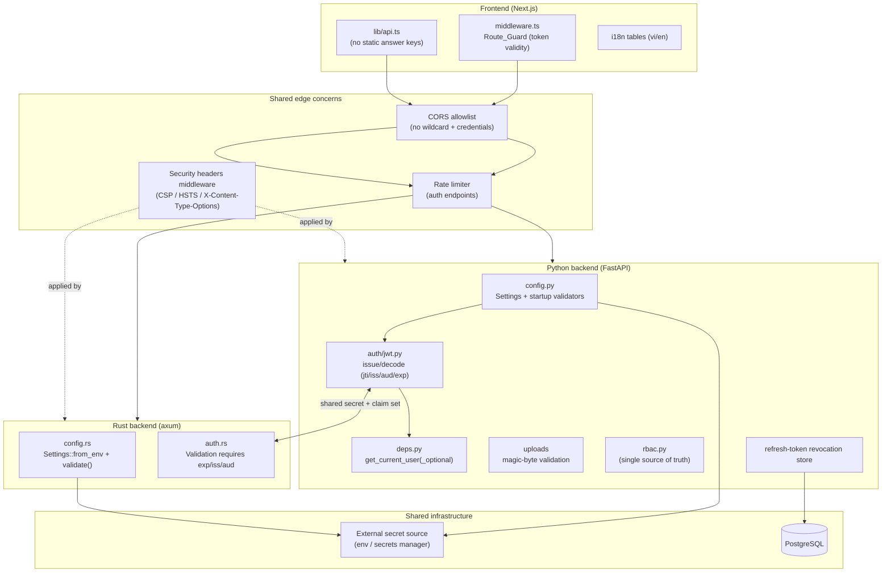
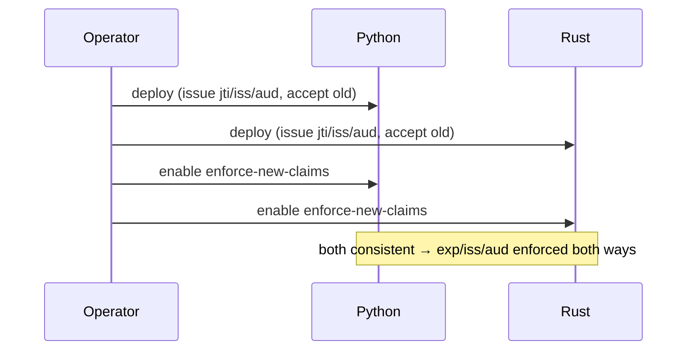

# Design Document

## Overview

This design implements the security- and quality-remediation requirements for the
**luuniensuki-lms** monorepo across three components: the Python/FastAPI backend (repo root +
`main.py`), the Rust/axum backend (`backend-rust/`), and the Next.js frontend (`frontend/`).

The work is grouped into seven workstreams ordered by severity and risk:

1. **Secrets & startup hardening** (Req 1, 2, 5, 28) — fail-closed configuration validation.
2. **Transport & CORS** (Req 3, 6, 25) — credentialed-CORS allowlist, secure cookies, security headers.
3. **JWT contract** (Req 8, 17, 26) — required `exp`, `jti`/`iss`/`aud`, revocation, cross-backend compatibility.
4. **Assessment integrity** (Req 4) — server-authoritative exam grading.
5. **Input validation & uploads** (Req 10, 11, 14) — content-based upload validation, path consistency, safe error envelopes.
6. **Authorization & correctness** (Req 9, 12, 13, 15, 18, 19, 20) — rate limiting, RBAC consolidation, IDOR, analytics session isolation, XP null-guard.
7. **Frontend safety fixes** (Req 13, 22, 23) — route-guard validity, i18n, regex.

The two large structural efforts (Req 16 monolith decomposition, Req 21 frontend typing) are tracked
in the `backend-modularization` and `frontend-consolidation-typing` specs respectively and are out of
scope here. This design is deliberately ordered so that none of the in-scope fixes depend on those
refactors; every change below applies cleanly to the current monolithic `main.py` and untyped client.

### Design principles

- **Fail closed, not open.** Configuration validation halts startup rather than running with weak defaults.
- **Single source of truth.** Secrets, role definitions, and token-decode logic each live in exactly one place.
- **Backward-compatible JWT contract.** Claim additions are coordinated across both backends behind a versioned, dual-validation transition.
- **Behavior-preserving.** No endpoint contract changes except the deliberate security tightening (exam payloads, error envelopes, auth responses).
- **Test-first per remediation.** Each requirement gets at least one CI test that fails on unfixed code and passes after the fix (Req 27).

## Architecture



## Components and Interfaces

### Workstream 1 — Secrets & startup hardening (Req 1, 2, 5, 28)

**Python (`config.py`).** Remove usable secret defaults and add a post-load validator that runs
during `get_settings()` (before the app or any DB engine is constructed), so validation precedes
component startup (Req 5.5).

```python
SENTINELS = {"", "CHANGE_ME_IN_PRODUCTION"}

class Settings(BaseSettings):
    jwt_secret_key: str = ""          # no usable default
    environment: str = "development"  # explicit prod indicator

    @property
    def is_production(self) -> bool:
        return self.environment.lower() == "production"

    @model_validator(mode="after")
    def _validate_secrets(self) -> "Settings":
        if self.is_production:
            problems = []
            if self.jwt_secret_key in SENTINELS:
                problems.append("JWT_SECRET_KEY")
            if self.cors_allow_credentials and "*" in self.cors_origins_list:
                problems.append("CORS_ORIGINS (wildcard with credentials)")
            if problems:
                # message names the offending keys, never their values (Req 1.4)
                raise RuntimeError(f"Insecure production config: {', '.join(problems)}")
        return self
```

`is_production` is changed from the fragile log-level heuristic to an explicit `environment` field.

**Rust (`config.rs`).** Add a `validate(&self) -> anyhow::Result<()>` invoked at the top of `main()`
immediately after `Settings::from_env()` and before the DB pool, router, or job scheduler are built
(Req 5.5). Validation checks `jwt_secret_key`, `janus_admin_secret`, `janus_api_secret`,
`live_internal_token` against the `CHANGE_ME_*` sentinel set and `turn_static_auth_secret` against
empty, only when `APP_ENV=production`.

**Secrets management (Req 28).** No secret retains a working default in source. Dev/test supply
values via `.env`/local config. A `docs/SECRETS.md` (rollout doc) enumerates the required externally
supplied secrets per backend.

| Secret | Python | Rust | Prod-required |
|---|---|---|---|
| `JWT_SECRET_KEY` | ✓ | ✓ (shared) | yes |
| `JANUS_ADMIN_SECRET` / `JANUS_API_SECRET` | | ✓ | yes |
| `LIVE_INTERNAL_TOKEN` | | ✓ | yes |
| `TURN_STATIC_AUTH_SECRET` | | ✓ | yes |

### Workstream 2 — Transport & CORS (Req 3, 6, 25)

- **CORS (Req 3):** the wildcard+credentials combination is rejected at startup (Workstream 1). At
  runtime, `CORSMiddleware` is configured with the explicit allowlist; origins absent from it are
  never reflected, and exact matches are echoed back.
- **Secure cookies (Req 6):** `cookie_secure` resolves to `True` when `is_production` and the operator
  has not explicitly overridden it. `_set_auth_cookies` refuses to issue a cookie if `secure` is
  required but cannot be applied (Req 6.3).
- **Security headers (Req 25):** a Python middleware and a Rust `tower` layer inject CSP, HSTS, and
  X-Content-Type-Options uniformly on every response.

### Workstream 3 — JWT contract (Req 8, 17, 26)

A shared, versioned claim set keeps both backends compatible (Req 26).

- **Required `exp` (Req 8):** Rust `auth.rs` stops calling `required_spec_claims.clear()`; instead it
  sets `validation.set_required_spec_claims(&["exp", "iss", "aud"])`. Python decode adds
  `options={"require": ["exp"]}` and `issuer`/`audience` parameters.
- **Identity claims + revocation (Req 17):** both backends add `jti` (UUID), `iss`, `aud` on issue.
  Refresh-token `jti`s are persisted; a revoked `jti` is rejected on refresh. Access tokens stay
  stateless (short-lived); revocation targets refresh tokens.
- **Rollout (Req 26.4):** a transition flag `JWT_VALIDATE_NEW_CLAIMS` lets both backends *issue* the
  new claims first while still *accepting* old tokens; once all issuers are upgraded, enforcement is
  enabled on both. During a rolling deploy with inconsistent contract versions, cross-backend
  validation of the new claims is gated off until both report the consistent version.



### Workstream 4 — Assessment integrity (Req 4)

- The exam-questions endpoint response model **excludes** `correct_answer`/`explanation` until after
  submission (Req 4.2).
- The frontend `getUrnExamFromStatic` / client-side grading fallback in `lib/api` is **removed**; the
  static answer-key JSON files are no longer shipped (Req 4.3, 4.4). On a server error the client
  surfaces it and does not grade.
- `submitUrnExam` always posts to the server; the server computes the score from server-held answers
  (Req 4.1, 4.5).

### Workstream 5 — Input validation & uploads (Req 10, 11, 14)

- **Avatar upload (Req 10):** read magic bytes (Pillow `Image.open` + `verify()` or `python-magic`),
  derive the true type, and reject if the content-derived type is not allowed **or** does not match
  the client-declared type. Content-format validation and allowed-type authorization are distinct
  steps with distinct error codes (Req 10.5, 10.6).
- **RAG upload:** decode with `errors="strict"`; on `UnicodeDecodeError` reject with 400 rather than
  substituting replacement characters; fail closed when `content_type` and extension are both absent.
- **Avatar path consistency (Req 11):** a single `settings.avatar_dir` is both the write target and
  the static-mount source; the served URL is derived from that base so writes and reads resolve to
  the same file.
- **Error envelope (Req 14):** the validation handler returns field locations + messages only, never
  echoes submitted values, redacts fields flagged sensitive, and `AppError.details` is typed
  `Optional[dict]`.

### Workstream 6 — Authorization & correctness (Req 9, 12, 13, 15, 18, 19, 20)

- **XP null-guard (Req 9):** `_apply_xp_boost` coerces `multiplier = user.xp_boost_multiplier or 0`
  before comparison and wraps the application so no exception escapes.
- **Rate limiting (Req 12):** introduce `slowapi` (or equivalent) driven by the existing
  `rate_limit_*` settings, applied to `/api/v1/auth/*`; over-limit returns HTTP 429.
- **RBAC single source (Req 15):** `main.py` imports `STAFF_ROLES`/`ADMIN_ROLES` and dependencies
  from `rbac.py`; local duplicates are deleted; `can_manage_user` special-cases `super_admin` to
  match its docstring.
- **Consolidated current-user (Req 18):** a shared `_decode_access_token(raw) -> UUID | None` backs
  both `get_current_user` and `get_current_user_optional`; temporary duplication allowed only during
  migration.
- **Analytics session isolation (Req 19):** `_record_analytics_event` uses a nested transaction
  (`begin_nested`) or a dedicated session so it never commits the request's shared session.
- **IDOR/BOLA (Req 20):** a reusable ownership dependency `require_owner_or_authorized(resource)` is
  applied to endpoints taking `{user_id}`/`{content_id}`/`{session_id}`; unauthorized access returns a
  generic 404 (no existence disclosure).

### Workstream 7 — Frontend safety fixes (Req 13, 22, 23)

- **Route guard (Req 13):** `middleware.ts` verifies token validity (signature + `exp`) rather than
  mere cookie presence; absent/expired/malformed → redirect to login; additional checks may still deny.
  (Edge-compatible JWT verification, e.g. `jose`.)
- **i18n (Req 22):** populate the `en` table with real English strings, separate from `vi`; `t()` uses
  optional chaining `translations[lang]?.[key] ?? key`.
- **Regex (Req 23):** fix `.replace(/\\.json$/, "")` → `.replace(/\.json$/, "")`.

## Data Models

- **RevokedRefreshToken** (new table): `jti UUID PK`, `user_id UUID`, `revoked_at timestamptz`,
  `expires_at timestamptz` (rows purged after `expires_at`). Backs Req 17.2.
- **JWT claim set** (shared contract): `{ sub, iat, exp, role, type, jti, iss, aud }`. `iss` and `aud`
  are fixed configured constants shared by both backends.
- No changes to existing domain tables; exam answer keys move from shipped static assets to
  server-only data (already present server-side).

## Correctness Properties

These executable properties anchor the property-based and example tests (Req 27).

### Property 1: No-forge
For any token signed with a key ≠ the configured secret, every decode path rejects it.

**Validates: Requirements 1.1, 2.1**

### Property 2: Expiry-required
Any token lacking `exp`, or with `exp` in the past, is rejected by both backends.

**Validates: Requirements 8.2**

### Property 3: CORS-allowlist
For any Origin O, the response reflects O **iff** O ∈ allowlist; never when credentials are on and allowlist is wildcard (startup refuses that config).

**Validates: Requirements 3.3**

### Property 4: Cross-backend acceptance
A token issued by backend A under the consistent contract validates on backend B for all standard-valid tokens, and is rejected by B whenever standard validation fails.

**Validates: Requirements 26.2**

### Property 5: Exam-integrity
For any exam fetch response R, R contains no `correct_answer`; the client computes no score; the submitted score equals the server-computed score.

**Validates: Requirements 4.2**

### Property 6: Upload-soundness
An upload is persisted **iff** its content-derived type is allowed **and** matches the declared type; otherwise no file is written.

**Validates: Requirements 10.5**

### Property 7: Ownership
For any resource-scoped endpoint and any authenticated user U and resource r, the operation succeeds **iff** U owns r or is explicitly authorized; otherwise the response is a generic 404.

**Validates: Requirements 20.1**

### Property 8: XP-total
Applying XP never raises; with a null multiplier the awarded XP equals the base XP.

**Validates: Requirements 9.1**

### Property 9: Idempotent secret validation
In production, startup completes **iff** all required secrets are non-sentinel and non-empty; otherwise it halts before any component initializes.

**Validates: Requirements 1.1, 5.5**

### Property 10: Roundtrip i18n
For every nav key k that differs by language, `t_en(k) ≠ t_vi(k)`, and `t(lang)(missing) === missing`.

**Validates: Requirements 22.1**

## Error Handling

- **Startup:** secret/CORS misconfiguration raises a fatal error naming the offending keys (never values) and aborts before serving.
- **Auth:** invalid/absent/expired tokens → 401 with the existing `Could not validate credentials` envelope; revoked refresh → 401.
- **Authorization:** ownership failure → generic 404 (Req 20.2).
- **Rate limit:** over-limit → 429 with a stable error code.
- **Uploads:** type/format failure → 400 with distinct codes for content-format vs type-authorization.
- **Validation:** 422 with field locations/messages only, sensitive fields redacted.

## Testing Strategy

Per Req 27, every in-scope requirement gets ≥1 CI test that fails on unfixed code and passes after.

- **Python:** `pytest` + `hypothesis` for properties 1–9; `TestClient` for CORS reflection, cookie
  `Secure`, security headers, upload validation, IDOR (generic-404), rate-limit 429, exam payload
  exclusion, and startup-validation (monkeypatched prod env with sentinel secrets asserting startup
  raises).
- **Rust:** extend `auth.rs` unit tests for `exp`/`iss`/`aud` requirement and the no-`exp` rejection;
  add `config.rs` tests asserting `validate()` errors on sentinel/empty secrets under prod env.
- **Frontend:** Playwright/unit tests for route-guard redirect on expired token, exam flow surfacing
  server errors without local grading, i18n EN≠VI, and the `.json` strip regex.
- **Cross-backend:** a contract test issues a token in one backend and validates it in the other under
  the consistent contract (property 4).

## Design Decisions and Rationale

- **Explicit `environment` field over log-level heuristic** — the previous `is_production` derived
  from `debug`/`log_level` was fragile and could misclassify; an explicit indicator makes fail-closed
  behavior deterministic.
- **Refresh-token-only revocation** — keeps access-token validation stateless/fast while still
  enabling logout/compromise response; a full access-token blacklist would add a hot-path DB lookup.
- **Versioned claim transition** — adding `exp`/`iss`/`aud` enforcement simultaneously to two
  independently deployed services would break tokens mid-deploy; the issue-then-enforce flag sequence
  preserves availability (Req 26.4).
- **Generic 404 for IDOR** — avoids resource-existence disclosure, a stricter posture than a 403.
- **Splitting modularization and frontend typing into their own specs** — isolates large, higher-risk
  refactors from the bounded security fixes so the critical items can ship and be verified first.
