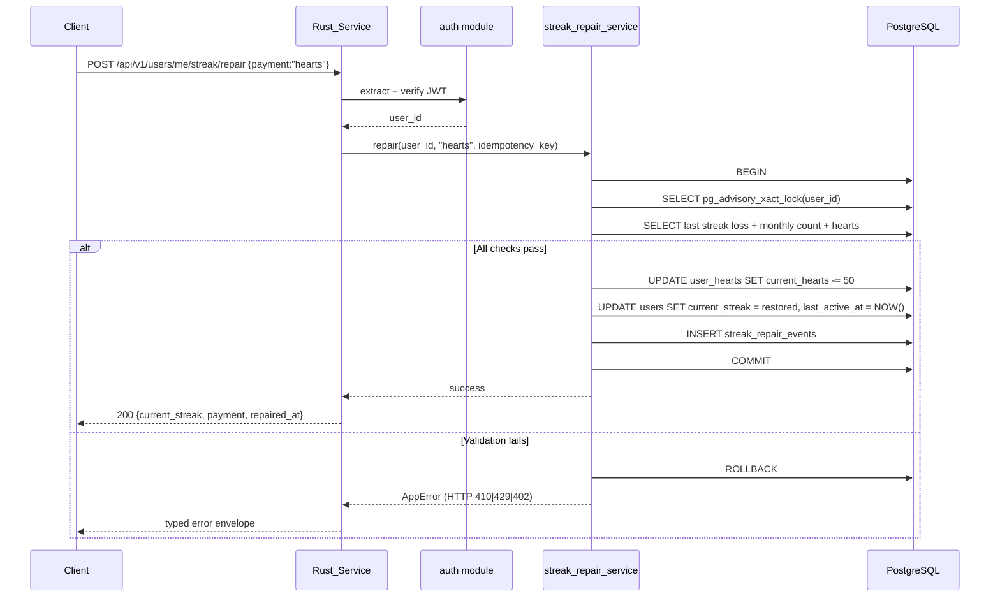

# Design Document — Streak Repair Economy

## Overview

This design extends the existing Rust backend (`backend-rust/`) with five new streak-related mechanics. It adds **6 new tables** (additive migrations only), **~14 new HTTP endpoints**, and **2 background jobs**. No existing tables are modified; no existing endpoints change behavior.

Architecture sticks to the established patterns:

- Axum 0.7 + SQLx 0.7 + JWT auth via `jsonwebtoken`
- Per-feature module split: `routes/streak_repair.rs`, `services/streak_repair_service.rs`, `models/streak_repair.rs`
- Reuse existing `auth::extract_token`, `require_pool`, `AppError` envelope
- All migrations go through Alembic (Python) since the schema is shared with legacy code

## Architecture

### Module layout under `backend-rust/src/`

```text
backend-rust/src/
├── routes/
│   ├── streak_repair.rs        # POST /repair, GET /repair-options
│   ├── streak_friend.rs        # GET /friend-streaks, GET /:other_id/friend-streak
│   ├── streak_comeback.rs      # GET /comeback-status
│   ├── streak_admin.rs         # admin endpoints (grant, BRB, stats)
│   └── streak_insurance.rs     # GET /streak-insurance
├── services/
│   ├── streak_repair_service.rs
│   ├── streak_friend_service.rs
│   ├── streak_comeback_service.rs
│   ├── streak_admin_service.rs
│   └── streak_rollover_service.rs   # extends existing rollover with history capture
├── models/
│   └── streak_economy.rs       # all DTOs and row types
└── jobs/
    └── streak_rollover_job.rs  # nightly 00:10 UTC + friend streak 00:05 UTC
```

### Request flow (Streak Repair)



## Components and Interfaces

### `streak_repair_service`

```rust
pub async fn repair(
    pool: &PgPool,
    user_id: Uuid,
    payment: PaymentMethod,
    idempotency_key: Option<&str>,
) -> Result<RepairResponse, AppError>;

pub async fn get_repair_options(
    pool: &PgPool,
    user_id: Uuid,
) -> Result<RepairOptions, AppError>;
```

Algorithm in `repair()`:

1. `BEGIN` transaction with `SET LOCAL lock_timeout = '5s'`
2. `SELECT pg_advisory_xact_lock(hashtextextended(user_id::text, 0))` — per-user serialization
3. If `idempotency_key` present, check `streak_repair_events` for matching key in last 24h → return cached response if found
4. Find latest row in `user_streak_history` with `streak_ended_at > NOW() - INTERVAL '48 hours'`. If none → return `REPAIR_WINDOW_EXPIRED`
5. Count `streak_repair_events` for this user in current month. If ≥ 1 (or ≥ 3 with active insurance) → return `REPAIR_LIMIT_REACHED`
6. Check payment: hearts (`SELECT current_hearts FROM user_hearts WHERE user_id = $1`) or XP (`SELECT total_xp FROM users WHERE id = $1`)
7. If sufficient: deduct (`UPDATE user_hearts SET current_hearts = current_hearts - 50` or `UPDATE users SET total_xp = total_xp - 200`)
8. Restore: `UPDATE users SET current_streak = $restored, last_active_at = NOW()`
9. Insert `streak_repair_events` row with `idempotency_key`
10. `COMMIT`

### `streak_friend_service`

```rust
pub async fn increment_friend_streak(
    pool: &PgPool,
    user_a: Uuid,
    user_b: Uuid,
) -> Result<(), AppError>;

pub async fn list_my_friend_streaks(pool: &PgPool, user_id: Uuid)
    -> Result<Vec<FriendStreakOut>, AppError>;
```

The increment uses a canonical key `(min(user_a, user_b), max(user_a, user_b))` to avoid duplicate rows. Idempotency: `ON CONFLICT (user_a_id, user_b_id) DO UPDATE` with a guard `WHERE last_increment_date < CURRENT_DATE`.

### `streak_admin_service`

```rust
pub async fn big_red_button(
    pool: &PgPool,
    actor_user_id: Uuid,
    reason: &str,
    duration_minutes: i32,
    effective_from: DateTime<Utc>,
) -> Result<BrbResult, AppError>;

pub async fn grant_repair(
    pool: &PgPool,
    target_user_id: Uuid,
    actor_user_id: Uuid,
    reason: &str,
) -> Result<(), AppError>;
```

BRB algorithm:

1. Rate-limit check: count `streak_protection_events` from this admin in last 24h. If ≥ 5 → HTTP 429
2. Generate `event_id = Uuid::new_v4()`
3. `INSERT INTO streak_protection_events (id, user_id, event_id, ...)` for every user where `current_streak > 0` AND `last_active_at >= effective_from - INTERVAL '24 hours'` AND `last_active_at <= effective_from + INTERVAL 'duration_minutes minutes'`
4. `UPDATE users SET streak_freezes = streak_freezes + 1` for the same set (treated as `protected_freeze` via the protection event)
5. Return count of affected users + event_id

### `streak_rollover_service` (extends existing logic)

The existing `update_streak` in `services/lesson_service.rs` already handles per-request streak increment. This design adds:

```rust
// Called from existing update_streak when streak is about to reset to 0
pub async fn capture_streak_loss_to_history(
    tx: &mut Transaction<'_, Postgres>,
    user_id: Uuid,
    streak_value: i32,
    streak_started_at: DateTime<Utc>,
) -> sqlx::Result<()>;

// Nightly job at 00:10 UTC
pub async fn nightly_streak_rollover(pool: &PgPool) -> Result<RolloverStats, AppError>;
```

The nightly job picks up users who did not make a request in the previous UTC day:

```sql
SELECT id, current_streak, streak_freezes, last_active_at
FROM users
WHERE current_streak > 0
  AND (last_active_at IS NULL OR last_active_at::date < CURRENT_DATE - 1)
FOR UPDATE SKIP LOCKED
```

For each row:
- If `streak_freezes > 0`: consume one freeze, preserve streak
- Else: insert into `user_streak_history`, reset `current_streak = 0`

## Data Models

### New tables (Alembic migrations)

```sql
-- migration 0042_streak_repair_economy.py

CREATE TABLE streak_repair_events (
    id uuid PRIMARY KEY DEFAULT gen_random_uuid(),
    user_id uuid NOT NULL REFERENCES users(id) ON DELETE CASCADE,
    payment_method text NOT NULL CHECK (payment_method IN ('hearts','xp','admin_grant')),
    payment_amount integer NOT NULL DEFAULT 0,
    streak_before_loss integer NOT NULL,
    streak_restored_to integer NOT NULL,
    lost_at timestamptz NOT NULL,
    repaired_at timestamptz NOT NULL DEFAULT NOW(),
    idempotency_key text,
    notes text,
    created_at timestamptz NOT NULL DEFAULT NOW(),
    UNIQUE (user_id, idempotency_key) WHERE idempotency_key IS NOT NULL
);
CREATE INDEX idx_streak_repair_user ON streak_repair_events(user_id);
CREATE INDEX idx_streak_repair_repaired_at ON streak_repair_events(repaired_at DESC);

CREATE TABLE streak_protection_events (
    id uuid PRIMARY KEY DEFAULT gen_random_uuid(),
    event_id uuid NOT NULL,                -- groups all rows from one BRB press
    user_id uuid NOT NULL REFERENCES users(id) ON DELETE CASCADE,
    actor_user_id uuid NOT NULL REFERENCES users(id) ON DELETE SET NULL,
    reason text NOT NULL,
    effective_from timestamptz NOT NULL,
    effective_to timestamptz NOT NULL,
    applied_at timestamptz NOT NULL DEFAULT NOW(),
    created_at timestamptz NOT NULL DEFAULT NOW()
);
CREATE INDEX idx_streak_protection_event ON streak_protection_events(event_id);
CREATE INDEX idx_streak_protection_user ON streak_protection_events(user_id);

CREATE TABLE friend_streaks (
    id uuid PRIMARY KEY DEFAULT gen_random_uuid(),
    user_a_id uuid NOT NULL REFERENCES users(id) ON DELETE CASCADE,
    user_b_id uuid NOT NULL REFERENCES users(id) ON DELETE CASCADE,
    current_count integer NOT NULL DEFAULT 0,
    longest_count integer NOT NULL DEFAULT 0,
    last_increment_date date,
    created_at timestamptz NOT NULL DEFAULT NOW(),
    updated_at timestamptz NOT NULL DEFAULT NOW(),
    CONSTRAINT canonical_pair CHECK (user_a_id < user_b_id),
    UNIQUE (user_a_id, user_b_id)
);
CREATE INDEX idx_friend_streaks_a ON friend_streaks(user_a_id);
CREATE INDEX idx_friend_streaks_b ON friend_streaks(user_b_id);

CREATE TABLE user_streak_history (
    id uuid PRIMARY KEY DEFAULT gen_random_uuid(),
    user_id uuid NOT NULL REFERENCES users(id) ON DELETE CASCADE,
    streak_value integer NOT NULL,
    streak_started_at timestamptz NOT NULL,
    streak_ended_at timestamptz NOT NULL DEFAULT NOW(),
    phoenix_awarded boolean NOT NULL DEFAULT false,
    created_at timestamptz NOT NULL DEFAULT NOW()
);
CREATE INDEX idx_streak_history_user ON user_streak_history(user_id);
CREATE INDEX idx_streak_history_ended_at ON user_streak_history(streak_ended_at DESC);

CREATE TABLE user_comeback_bonuses (
    id uuid PRIMARY KEY DEFAULT gen_random_uuid(),
    user_id uuid NOT NULL REFERENCES users(id) ON DELETE CASCADE,
    multiplier numeric(4,2) NOT NULL DEFAULT 2.0,
    started_at timestamptz NOT NULL DEFAULT NOW(),
    expires_at timestamptz NOT NULL,
    history_row_id uuid REFERENCES user_streak_history(id) ON DELETE SET NULL,
    created_at timestamptz NOT NULL DEFAULT NOW()
);
CREATE INDEX idx_comeback_active ON user_comeback_bonuses(user_id) WHERE expires_at > NOW();

CREATE TABLE streak_insurance_subscriptions (
    id uuid PRIMARY KEY DEFAULT gen_random_uuid(),
    user_id uuid NOT NULL REFERENCES users(id) ON DELETE CASCADE,
    status text NOT NULL CHECK (status IN ('active','cancelled','expired','pending')),
    started_at timestamptz NOT NULL,
    expires_at timestamptz NOT NULL,
    provider text NOT NULL,
    provider_subscription_id text,
    auto_brb_enabled boolean NOT NULL DEFAULT true,
    created_at timestamptz NOT NULL DEFAULT NOW(),
    updated_at timestamptz NOT NULL DEFAULT NOW()
);
CREATE UNIQUE INDEX idx_insurance_active ON streak_insurance_subscriptions(user_id)
    WHERE status = 'active';
```

### Phoenix badge seed

A one-time data migration ensures the `badges` table contains:

```sql
INSERT INTO badges (id, slug, name, name_en, description, icon_url, category, is_active, is_secret, xp_bonus)
VALUES (
  gen_random_uuid(), 'phoenix', 'Phượng Hoàng Tái Sinh', 'Phoenix Reborn',
  'Quay lại sau khi mất chuỗi 30 ngày trở lên và học 3 ngày liên tiếp',
  '/assets/badges/phoenix.svg', 'comeback', true, false, 100
) ON CONFLICT (slug) DO NOTHING;
```

## Endpoints summary

| Method | Path | Auth | Description |
|--------|------|------|-------------|
| POST | `/api/v1/users/me/streak/repair` | learner+ | Spend hearts/xp to restore streak |
| GET | `/api/v1/users/me/streak/repair-options` | learner+ | Show eligibility + cost |
| GET | `/api/v1/users/me/friend-streaks` | learner+ | List all friend streaks |
| GET | `/api/v1/users/:other_id/friend-streak` | learner+ | One specific friend streak |
| GET | `/api/v1/users/me/streak/comeback-status` | learner+ | Phoenix progress + active bonus |
| GET | `/api/v1/users/me/streak-insurance` | learner+ | Subscription status |
| GET | `/api/v1/admin/streak-repair-events` | admin | Audit log |
| POST | `/api/v1/admin/users/:id/streak/grant-repair` | admin | Manual repair |
| POST | `/api/v1/admin/streak/big-red-button` | admin | BRB |
| GET | `/api/v1/admin/streak/big-red-button/events` | admin | BRB history |
| GET | `/api/v1/admin/streak-economy/stats` | admin | Aggregate KPIs |
| POST | `/api/v1/admin/users/:id/streak-insurance/grant` | admin | Manual insurance grant |

## Error Handling

All errors follow the existing `AppError` envelope:

```json
{"error": {"code": "...", "message": "...", "details": {}}}
```

New error codes:

- `REPAIR_WINDOW_EXPIRED` (410)
- `REPAIR_LIMIT_REACHED` (429)
- `INSUFFICIENT_HEARTS` (402)
- `INSUFFICIENT_XP` (402)
- `BRB_RATE_LIMIT` (429)
- `NO_STREAK_TO_REPAIR` (404)
- `INSURANCE_ALREADY_ACTIVE` (409)

Every transaction uses `pg_advisory_xact_lock` to prevent double-spending under retry.

## Testing Strategy

1. **Unit tests** per service (`#[cfg(test)] mod tests`): mock `PgPool` is not available in sqlx, so these test pure logic (validation, payment selection, idempotency key handling).
2. **Integration tests** with `testcontainers-rs`: spin up Postgres 16, run migration, exercise the full repair flow end-to-end.
3. **Property-based tests** with `proptest`: for the canonical pair invariant (`user_a_id < user_b_id`), idempotency under retry, and friend-streak monotonicity.
4. **Contract tests**: capture Python responses for any overlapping route shape (e.g., `/api/v1/users/me/streak`) and assert byte-equivalent Rust responses.
5. **Manual smoke** on production-like data: run all admin endpoints with a test admin account, verify audit rows appear.

## Background jobs

Two new tokio tasks spawned at startup:

```rust
// in main.rs after axum::serve setup but before .await
tokio::spawn(jobs::streak_rollover_job::run(pool.clone()));
tokio::spawn(jobs::friend_streak_job::run(pool.clone()));
```

Each task runs `tokio::time::interval` at 00:10 UTC and 00:05 UTC respectively, with `MissedTickBehavior::Skip` to avoid catch-up storms.

## Migration plan

1. Land Alembic migration `0042_streak_repair_economy.py` (additive; safe to roll back by dropping the new tables)
2. Land Rust code behind feature flag `streak_repair_v1` (default off in route-modes.toml)
3. Enable for 5% of users via `Experiment` infrastructure
4. Watch KPI dashboard for 7 days
5. If primary metric (30-day retention) is non-negative within 95% CI, ramp to 25% → 50% → 100% over two weeks

## Rollback

- All new endpoints can be flipped to `gateway` mode in `route-modes.toml` (they will return 404 from Python since they don't exist there — accept this for rollback)
- New tables remain populated; no data is lost
- Migration is reversible: drop the 6 new tables in reverse order
