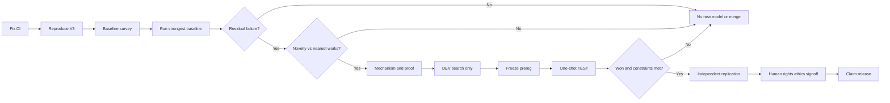

# Implementation and Release Gates — V4.2

## Root cause first: V3 CI false green
Current V3 workflow `python -m pytest ... | tee` can print failures but return 0. Replace with:

```bash
set -euo pipefail
python -m pytest -q -rs tests/research_v3 2>&1 | tee v3_pytest.log
```

Machine-validate `pytest` exit and test summary, not only `grep "passed"`. Missing `private_data/` must not become ERROR in public CI: test only dedicated minimal fixtures in public runner, emit explicit `SKIPPED DATA_UNAVAILABLE` for raw integration, and fail strict licensed-private integration if required raw data absent. Remove hard-coded `/home/clue/Documents` from stress parity. Repair P03 missing hashes, P09 entity snapshots, P07 Smithsonian rights snapshot, P04 rights expectations. Run negative canary that intentionally fails a test and asserts workflow fails. CI greens become evidence only for exercised code; not a submission verdict.

## Immutable V4.2 stage DAG


## Data API and contracts
- `v42.dataset_card`: rights, license hashes, task ontology, label availability, group IDs, timestamps, file hashes, allowed use.
- `v42.baseline_card`: original repo source/weights, license, prereg eligibility and all trial receipts.
- `v42.failure_card`: V3 predicted/gold IDs, suspected mechanism, diagnosed root causes, stratified baseline errors.
- `v42.novelty_card`: 3 closest works, direct overlaps, formal counterexample, N1..N7, independent human signoff.
- `v42.method_card`: I/O features, objective, complexity, assumptions, active constraints, expected changed failure slices.
- `v42.win_card`: baseline champion, one-shot test hash, metric and δ, CIs, p_adjusted, safety invariants, replication and claim tier.

## Automated release validators (new code required)
- `python -m research_v4_2.gates.test_exit` ensures nonzero pytest fail always blocks merge.
- `python -m research_v4_2.gates.preregister` rejects mutable prereg, posttest method hashes and changed champion.
- `python -m research_v4_2.gates.novelty` checks reference matrix and signoff presence, but cannot AUTOMATICALLY judge originality.
- `python -m research_v4_2.gates.baseline_parity` rejects denominator/case-ID/label/horizon mismatch.
- `python -m research_v4_2.gates.statistical_claims` recomputes from predictions+gold, correct clustered CI/multiplicity.
- `python -m research_v4_2.gates.integrity` recomputes content SHA, checks no stale metrics/duplicate test trial.
- `python -m research_v4_2.gates.license_ethics` refuses absent real approvals.
- `python -m research_v4_2.gates.cross_paper` compares independent primary outcomes/unique contributions.

Paths above are TARGET INTERFACES, **not pre-existing commands**. They must be implemented before use.

## Publication grades
`ENGINEERING_ONLY`: valid pipeline, no scientific result. `FORMAL_CHECKED`: rigorously proved property under assumptions. `SINGLE_DATASET_WIN`: statistical improvement on one legitimate test, narrow claim. `REPLICATED_WIN`: independently reproduced improvement. `SCIENTIFIC_PARTIAL`: null, incomplete C2, or construct limitation. `HUMAN_BLOCKED`: missing real approval. `SUBMISSION_READY`: all relevant gates passed, never auto-generated.

## Failure outcomes are explicitly valid
If 2/3 candidate families do not beat DEV strongest baseline, stop chasing architecture names. If three families fail, choose null/benchmark, new scientifically justified future dataset, or merge/drop paper. No endless test rerun. A negative result can support a good benchmark/measurement paper, but never call it a model win.
