# V3.C1: research factory deep specification

> **Nguồn:** Trích không lược bỏ từ `LUU_NIEN_V5_PRODUCTION_COMPLETION_AND_NEW_FEATURES_GEMINI_FLASH_FULL_MASTER_SPEC.md` (`V3.C1`). **Nhận định mã nguồn trong V5 là audit tĩnh, chưa chứng minh production hoạt động.**
> **Dùng cho Gemini:** Chỉ mở tài liệu này với một ticket và tối đa 3–8 file source tương ứng.

## C1. Agent orchestration contract — 10 concurrent subagents cho từng phase

### C1.1. Phạm vi “phase” và “subagent”

- `Run`: job của 1 corpus/1 urn/1 relief hoặc batch theo phạm vi; chứa `run_id`, `scope_id`, `subject_refs`, `input_release`, `configuration_version`.
- `Phase`: một trong **P00–P11**, có `phase_id`, `phase_run_id`, 10 `agent_jobs`, input immutable, barrier/gate, output immutable, cost budget.
- `Subagent`: worker có `agent_id`, role, instructions pinned, model+tool allowlist, ephemeral context, task shard, output schema, retry policy; không có quyền xuất bản hoặc edit nội dung đã duyệt.
- `Wave`: 10 agent jobs phát lệnh **cùng một thời điểm logical** bằng `TaskGroup`/queue fan-out; barrier fan-in đợi đủ 10 terminal results trước reducer. Tách `10 dispatched` khỏi `10 provider sessions actually active` trong telemetry.
- `Shard`: phase P01 có thể phân theo loại nguồn, phase P04 theo loại claim, phase P07 theo loại content. Không để 10 agent viết cùng một row; mỗi agent ghi `agent_artifact` riêng, reducer duy nhất commit.
- `Reducer`: hàm xác định version và loại bỏ trùng, phát hiện bất đồng; không bỏ bớt kết quả lỗi/không có nguồn; bảo toàn minority observations và raw evidence.
- `Gate`: deterministic checks + critical human sign-off. Chỉ gate thành công mới tạo `phase_output_snapshot` và cho chuyển sang phase kế tiếp.

### C1.2. Trình tự bắt buộc (barrier tuần tự, fan-out 10 / fan-in 10)

```mermaid
flowchart TB
 A[Research subject + approved policy] --> P0[P00 Planning: 10 agents concurrently]
 P0 --> G0{Gate 00}
 G0 --> P1[P01 Source discovery: 10 agents concurrently]
 P1 --> G1{Gate 01}
 G1 --> P2[P02 Source verification and rights: 10 agents concurrently]
 P2 --> G2{Gate 02}
 G2 --> P3[P03 Extraction OCR Han Nom: 10 agents concurrently]
 P3 --> G3{Gate 03}
 G3 --> P4[P04 Quotes atomic claims: 10 agents concurrently]
 P4 --> G4{Gate 04}
 G4 --> P5[P05 Triangulation: 10 agents concurrently]
 P5 --> G5{Gate 05}
 G5 --> P6[P06 Evidence dossier: 10 agents concurrently]
 P6 --> G6{Gate 06}
 G6 --> P7[P07 Full content: 10 agents concurrently]
 P7 --> G7{Gate 07}
 G7 --> P8[P08 Independent QA: 10 agents concurrently]
 P8 --> G8{Gate 08}
 G8 --> P9[P09 Human editorial: 10 agents concurrently]
 P9 --> HUMAN{Signed human approval}
 HUMAN --> P10[P10 Release preparation: 10 agents concurrently]
 P10 --> ATOM{Atomic publish gate}
 ATOM --> P11[P11 Monitoring and correction: 10 agents concurrently]
 P11 --> REVIEW{Change requires new immutable run?}
 REVIEW -->|Yes| P1
 REVIEW -->|No| P11
```



- `Gate NO` => `BLOCKED`, gửi review queue; không auto skip. `P09` 10 agent **không thay thế người duyệt**. `P10` 10 agent tạo artifact đồng thời nhưng **chỉ coordinator publish pointer duy nhất** sau khi tất cả preflight OK.
- Pipeline không chạy liên tục vô hạn: P11 làm schedule watch độc lập theo ngày/tuần, mỗi tick gồm 10 agent nhưng **mỗi tick vẫn có budget**. Nếu thay đổi chỉ ảnh hưởng một nguồn, tạo rerun tập con với data dependency graph; không tái tạo 162 hồ sơ mỗi ngày.
- Pipeline có chế độ `DRY_RUN`, `PILOT_3_RELIEFS`, `NINE_URNS_ALL`, `REVALIDATE_DIFF`; production cấm chế độ skip gates.

### C1.3. Agent identity, quyền và ranh giới tin cậy

| Principal | Được | Không được |
|---|---|---|
| `research_scout` | search qua connector allowlist, lưu candidate metadata | scrape không phép, đọc survey/student data |
| `source_acquirer` | tải tài liệu permitted theo domain policy/robot, hash snapshot | vượt paywall/captcha, lấy secrets từ web |
| `ocr_agent` | đọc snapshot trong sandbox, xuất bounding boxes | tự phê duyệt bản Hán–Nôm |
| `claim_extractor` | đề nghị claims và source passage bindings | edit published `historical_claims` trực tiếp |
| `content_writer` | viết draft sections, inline claim_refs | fabricate quotes; `publish` |
| `quality_reviewer` | viết QA finding và proposal | tự signed `expert_verified` |
| `editorial_assistant` | chuẩn bị review packets, diff | giả lập chữ ký người duyệt |
| `release_builder` | build immutable payloads đã ký | thay quyền asset; swap pointer trước gate |
| `monitor_agent` | kiểm broken links/retractions và tạo ticket | auto rewrite bài đã công bố |
| `pipeline_coordinator` | scheduling, leases, idempotency, gates | sửa bằng chứng nguyên văn hoặc bypass human approval |

- Secrets truyền qua service identity và scoped token TTL ngắn; không đưa toàn bộ API key vào prompt. Log không ghi raw auth/PII; mọi prompt injection từ web/PDF/metadata phải ở `untrusted_source_text`, tuyệt đối không được biến thành instruction.
- **Model separation:** LLM chỉ gợi ý và diễn giải; các bước kiểm phép logic, source hash, locator existence, approval/signatures và quyền do deterministic code + con người quyết định.

### C1.4. Mỗi phase cần những trường trong agent result envelope

```json
{
  "schema_version":"ai-agent-result/v1",
  "run_id":"<UUID>",
  "phase":"P04",
  "wave":1,
  "agent_index":7,
  "agent_role":"citation-and-quote-validator",
  "attempt":1,
  "subject_refs":["relief:<canonical-id>"],
  "input_manifest_sha256":"<64-hex>",
  "model_identifier":"<pinned-provider-model>",
  "prompt_template_sha256":"<64-hex>",
  "tool_manifest_sha256":"<64-hex>",
  "started_at":"<ISO8601>",
  "finished_at":"<ISO8601>",
  "status":"SUCCEEDED",
  "output_schema":"quote-validations/v1",
  "artifact_uri":"s3://private-research/<key>",
  "artifact_sha256":"<64-hex>",
  "source_ids":["<UUID>"],
  "claim_ids":[],
  "evidence_locator_ids":[],
  "warnings":[],
  "failures":[],
  "retryable":false,
  "usage":{"input_tokens":0,"output_tokens":0,"api_calls":0,"estimated_cost_usd":0.0}
}
```

**Không dùng ví dụ số 0 như phép đo hiện tại.** Envelope cần idempotency key `(run_id, phase, wave, agent_index, input_manifest_sha256)` và signed digest của coordinator; payload mô hình phải qua JSON schema `additionalProperties: false` ở đối tượng contract kiểm soát.

### C1.5. Ma trận phase-by-phase: 12 phase × 10 agents

> Mọi hàng bên dưới là **định nghĩa vai trò agent của hệ thống đích**, không phải danh sách worker hiện chạy production. **Mười role khác nhau được kích hoạt đồng thời** trong từng phase. Mỗi role có contract output riêng và negative case để triển khai/test độc lập.

### C1.6. P00 — Research charter, inventory & task decomposition

- **Inputs freeze:** historical_entities 9x18, collections, audience, licenses.
- **Output chung:** immutable research brief + target identity + source scope.
- **Barrier/gate:** Không có identity/quyền nội dung hoặc 10 kết quả -> không đi P01.
- **Orchestration:** fan-out đủ 10 job trong 1 wave; mỗi job ghi artifact riêng; reducer merge sau 10 terminal statuses; error block không được tính pass.

| # / Agent ID | Chuyên trách khi chạy đồng thời | Output có cấu trúc | Test âm tính / cần chặn |
|---|---|---|---|
| **P00-A01** — Inventory auditor | Xác định đúng 9 đỉnh × 18 phù điêu theo khóa chuẩn, phát hiện duplicate | `identity_inventory.json` + provenance, warnings, SHA | Trộn tên đỉnh với tên bản đúc |
| **P00-A02** — Scope owner | Định nghĩa scope `NINE_URNS` / `RBPC_HUE` / `CALL` và object linkage | `scope_plan.json` + provenance, warnings, SHA | Chạy cross-scope retrieval |
| **P00-A03** — Question designer | Tạo research questions: nhận diện, xuất xứ, niên đại, ý nghĩa, nguồn | `question_bank_draft.json` + provenance, warnings, SHA | Câu hỏi tiên định kết luận |
| **P00-A04** — Taxonomy specialist | Thiết lập taxonomy sông núi/động thực vật/địa danh/văn hóa | `taxonomy_candidates.json` + provenance, warnings, SHA | Gán taxonomy chỉ do suy đoán |
| **P00-A05** — Han-Nom risk mapper | Đánh dấu mục chữ Hán–Nôm cần chuyên gia, đề nghị phương thức kiểm | `han_nom_queue.json` + provenance, warnings, SHA | Tự coi OCR là phiên âm chuẩn |
| **P00-A06** — Geography risk mapper | Liệt kê tên xưa/nay, tọa độ cần đối chiếu, mức chính xác | `geography_risk.json` + provenance, warnings, SHA | Map địa danh lịch sử thành tọa độ hiện đại chắc chắn |
| **P00-A07** — Legal source planner | Gợi ý loại nguồn, yêu cầu quyền lưu trữ/trích dẫn theo nhóm | `rights_plan.json` + provenance, warnings, SHA | Mặc nhiên tài liệu online là public domain |
| **P00-A08** — Teaching objectives planner | Gắn mục tiêu Lịch sử–Địa lí–liên môn và khả năng đánh giá | `curriculum_targets.json` + provenance, warnings, SHA | Gắn bài học chưa tồn tại là đã có |
| **P00-A09** — Coverage and cost estimator | Ước lượng số nguồn/candidate và token/requests cho mỗi đối tượng | `budget_and_coverage.json` + provenance, warnings, SHA | Nhân 162×10 request vượt budget |
| **P00-A10** — Run-manifest verifier | Kiểm tra khóa, hash, config, version, provider quotas | `run_manifest.json` + provenance, warnings, SHA | Không đủ inventory vẫn khởi động |

**Hợp đồng gate:** kiểm đủ `agent_id` từ A01 đến A10, đúng model/prompt/schema version, hash input đồng nhất, không có artifact thiếu, không chứa blocker P0, không có kết quả mâu thuẫn bị âm thầm bỏ qua. Nếu một agent trả `NO_EVIDENCE`, vẫn phải có envelope và reducer tạo `MISSING_EVIDENCE` rõ ràng; không coi kết quả trống là thành công nội dung.

### C1.7. P01 — Multi-channel historical source discovery

- **Inputs freeze:** P00 approved plan + allowlisted discovery connectors.
- **Output chung:** candidate bibliography + stable discovery traces.
- **Barrier/gate:** Không dùng search snippet làm trích dẫn lịch sử; dedupe trước P02.
- **Orchestration:** fan-out đủ 10 job trong 1 wave; mỗi job ghi artifact riêng; reducer merge sau 10 terminal statuses; error block không được tính pass.

| # / Agent ID | Chuyên trách khi chạy đồng thời | Output có cấu trúc | Test âm tính / cần chặn |
|---|---|---|---|
| **P01-A01** — Official heritage registry scout | Tìm nguồn UNESCO/MOWCAP/cơ quan di sản có hồ sơ gốc | `candidates_official.json` + provenance, warnings, SHA | Gọi trang giới thiệu là bản gốc đủ cho mọi claim |
| **P01-A02** — Dynastic chronicles scout | Tìm ấn bản Đại Nam thực lục, Khâm định ... liên quan | `candidates_chronicles.json` + provenance, warnings, SHA | Bịa số quyển, trang khi không truy cập |
| **P01-A03** — Royal document scout | Tìm châu bản, tài liệu cung đình có chỉ mục hợp lệ | `candidates_royal.json` + provenance, warnings, SHA | Xem ảnh không rõ nguồn là bản lưu trữ xác thực |
| **P01-A04** — Museum catalogue scout | Tìm catalog bảo tàng, mô tả hiện vật, ảnh có số kiểm kê | `candidates_museum.json` + provenance, warnings, SHA | Nhập media thiếu quyền |
| **P01-A05** — Peer-reviewed literature scout | Tìm nghiên cứu học thuật về Cửu Đỉnh, ý nghĩa hình tượng | `candidates_scholarly.json` + provenance, warnings, SHA | Trộn trích dẫn gián tiếp với chứng cứ sơ cấp |
| **P01-A06** — Historical maps scout | Tìm bản đồ xưa và bản đồ địa danh được cơ quan tin cậy cung cấp | `candidates_maps.json` + provenance, warnings, SHA | Gán tọa độ chính xác giả |
| **P01-A07** — Han-Nom editions scout | Tìm bản khắc/in, phiên âm, bản dịch có provenance | `candidates_hannom.json` + provenance, warnings, SHA | Lấy Unicode của AI làm nguyên tác |
| **P01-A08** — Image and 3D rights scout | Tìm asset hiện trạng, license, nguồn ảnh rõ ràng | `candidates_media.json` + provenance, warnings, SHA | Mặc định cho phép tải lại ảnh |
| **P01-A09** — Open scholarly metadata scout | Tra DOI/ISBN/ISSN/thư viện, repository, metadata resolvers | `candidates_metadata.json` + provenance, warnings, SHA | Tin DOI do LLM tạo mà không resolver |
| **P01-A10** — Contrarian/coverage scout | Chủ động tìm nghiên cứu bất đồng và khoảng trống nguồn | `candidates_disputes.json` + provenance, warnings, SHA | Chỉ chọn nguồn xác nhận luận điểm sẵn có |

**Hợp đồng gate:** kiểm đủ `agent_id` từ A01 đến A10, đúng model/prompt/schema version, hash input đồng nhất, không có artifact thiếu, không chứa blocker P0, không có kết quả mâu thuẫn bị âm thầm bỏ qua. Nếu một agent trả `NO_EVIDENCE`, vẫn phải có envelope và reducer tạo `MISSING_EVIDENCE` rõ ràng; không coi kết quả trống là thành công nội dung.

### C1.8. P02 — Candidate verification, rights & authorized acquisition

- **Inputs freeze:** P01 deduped candidates + access policies.
- **Output chung:** verified_source_registry + acquisition_decisions.
- **Barrier/gate:** Không tự vượt paywall/captcha/robots; thiếu quyền -> metadata only.
- **Orchestration:** fan-out đủ 10 job trong 1 wave; mỗi job ghi artifact riêng; reducer merge sau 10 terminal statuses; error block không được tính pass.

| # / Agent ID | Chuyên trách khi chạy đồng thời | Output có cấu trúc | Test âm tính / cần chặn |
|---|---|---|---|
| **P02-A01** — Bibliography verifier | Xác thực tác giả, ấn bản, ISBN, DOI và year | `bib_verification.json` + provenance, warnings, SHA | Cùng tên sách nhưng nhầm ấn bản |
| **P02-A02** — Canonical URL resolver | Định chuẩn URL và redirect, archive URL, access timestamp | `canonical_urls.json` + provenance, warnings, SHA | URL redirect sang bản không phải nguồn |
| **P02-A03** — Authority verifier | Xác thực cơ quan/tác giả/nhà xuất bản và tính xác thực | `authority_checks.json` + provenance, warnings, SHA | Bài blog giả danh bảo tàng |
| **P02-A04** — Duplicate lineage analyzer | Gộp mirrors/đăng lại; ghi quan hệ phụ thuộc nguồn | `source_lineage.json` + provenance, warnings, SHA | Hai mirror bị tính hai nguồn |
| **P02-A05** — License analyst | Xác định quyền lưu, trích, hiển thị, dịch, TDM riêng | `license_assessment.json` + provenance, warnings, SHA | CC BY-NC coi như cho phép thương mại |
| **P02-A06** — Access negotiator | Liệt kê nguồn cần xin phép/chuyển yêu cầu cho người phụ trách | `permissions_queue.json` + provenance, warnings, SHA | AI tự gửi thư nhận quyền thành công |
| **P02-A07** — Fetch planner | Quyết định PDF scan/HTML/API ưu tiên, giới hạn byte và nhịp | `fetch_manifest.json` + provenance, warnings, SHA | Tải hàng loạt vượt hạn mức |
| **P02-A08** — Malware/document sanitiser | Kiểm MIME, phần mở rộng, virus, PDF active content | `security_scan.json` + provenance, warnings, SHA | Tệp thực thi giả PDF vào worker |
| **P02-A09** — Asset hash controller | SHA-256, byte_size, content_type, frozen object store | `snapshots_plan.json` + provenance, warnings, SHA | Snapshot đè ảnh nguồn |
| **P02-A10** — Acquisition QA auditor | Kiểm candidate/provenance/rights chain, quarantine nguồn lỗi | `acquisition_gate.json` + provenance, warnings, SHA | Quyền chưa rõ lại được cho trích toàn văn |

**Hợp đồng gate:** kiểm đủ `agent_id` từ A01 đến A10, đúng model/prompt/schema version, hash input đồng nhất, không có artifact thiếu, không chứa blocker P0, không có kết quả mâu thuẫn bị âm thầm bỏ qua. Nếu một agent trả `NO_EVIDENCE`, vẫn phải có envelope và reducer tạo `MISSING_EVIDENCE` rõ ràng; không coi kết quả trống là thành công nội dung.

### C1.9. P03 — Document digitization, OCR, Hán–Nôm and extraction

- **Inputs freeze:** P02 lawfully acquired immutable snapshots.
- **Output chung:** page images, OCR layers, text span coordinates, quality metrics.
- **Barrier/gate:** OCR chất lượng thấp -> manual queue, không tự suy trích.
- **Orchestration:** fan-out đủ 10 job trong 1 wave; mỗi job ghi artifact riêng; reducer merge sau 10 terminal statuses; error block không được tính pass.

| # / Agent ID | Chuyên trách khi chạy đồng thời | Output có cấu trúc | Test âm tính / cần chặn |
|---|---|---|---|
| **P03-A01** — Document structure parser | Tách chapter/volume/page/footnote/table từ bản PDF hợp lệ | `document_structure.json` + provenance, warnings, SHA | Sai thứ tự đọc cột |
| **P03-A02** — Printed Vietnamese OCR | OCR in tiếng Việt kèm confidence và bbox | `vi_ocr.json` + provenance, warnings, SHA | Mất dấu làm sai nghĩa |
| **P03-A03** — English and romanized OCR | OCR bản tiếng Anh/phiên âm, giữ layout | `en_ocr.json` + provenance, warnings, SHA | Chuỗi chữ nghiêng trộn vào phần chính |
| **P03-A04** — Han glyph detection | Định vị vùng chữ Hán–Nôm, không tự chứng nhận transcript | `han_regions.json` + provenance, warnings, SHA | Ảnh nhiễu nhận thành chữ gốc |
| **P03-A05** — Han-Nom transcription proposer | Sinh ứng viên ký tự có crop và uncertainty | `han_draft.json` + provenance, warnings, SHA | Coi bản nháp là canonical |
| **P03-A06** — Edition collation assistant | So sánh các ấn bản/bản phiên âm khi có đủ nguồn | `variants.json` + provenance, warnings, SHA | Âm thầm sửa dị bản |
| **P03-A07** — Layout locator mapper | Page number printed vs PDF index, bbox, anchor | `locators.json` + provenance, warnings, SHA | Trích sai trang in |
| **P03-A08** — Figure and caption extractor | Nhận diện ảnh/chú thích và nguồn/rights | `figures.json` + provenance, warnings, SHA | Lấy watermark thành nhãn hiện vật |
| **P03-A09** — OCR quality checker | CER/WER theo sample được người gán nhãn, flags | `ocr_quality.json` + provenance, warnings, SHA | Tự suy OCR accuracy 100% |
| **P03-A10** — Extraction integrity auditor | Checksum đoạn text, bbox và pdf source hash | `extraction_gate.json` + provenance, warnings, SHA | Dữ liệu trích không nối được snapshot |

**Hợp đồng gate:** kiểm đủ `agent_id` từ A01 đến A10, đúng model/prompt/schema version, hash input đồng nhất, không có artifact thiếu, không chứa blocker P0, không có kết quả mâu thuẫn bị âm thầm bỏ qua. Nếu một agent trả `NO_EVIDENCE`, vẫn phải có envelope và reducer tạo `MISSING_EVIDENCE` rõ ràng; không coi kết quả trống là thành công nội dung.

### C1.10. P04 — Passage selection, quotation & atomic claim extraction

- **Inputs freeze:** P03 indexed segments + identity scope.
- **Output chung:** evidence passages + draft claims + locator-verification queue.
- **Barrier/gate:** Claim chưa đủ locator không đi P05 dưới dạng verified.
- **Orchestration:** fan-out đủ 10 job trong 1 wave; mỗi job ghi artifact riêng; reducer merge sau 10 terminal statuses; error block không được tính pass.

| # / Agent ID | Chuyên trách khi chạy đồng thời | Output có cấu trúc | Test âm tính / cần chặn |
|---|---|---|---|
| **P04-A01** — Relief identity evidence finder | Truy đoạn gắn đúng urn/relief/inscription | `passages_identity.json` + provenance, warnings, SHA | Nhầm relief ở đỉnh khác |
| **P04-A02** — Chronology finder | Trích đoạn niên đại, bối cảnh vua và thời kỳ | `passages_time.json` + provenance, warnings, SHA | Giải thích niên đại ngoài nguồn |
| **P04-A03** — Geography finder | Trích địa danh xưa/nay, lưu mức tương ứng | `passages_geo.json` + provenance, warnings, SHA | Đồng nhất tên hiện nay với cổ danh |
| **P04-A04** — Iconography finder | Trích mô tả biểu tượng từ tài liệu cụ thể | `passages_iconography.json` + provenance, warnings, SHA | Suy tượng trưng từ chi tiết thị giác |
| **P04-A05** — Material and manufacture finder | Trích kỹ thuật đúc, chất liệu, tạo tác được chứng minh | `passages_material.json` + provenance, warnings, SHA | Gán kỹ thuật giả định như thực tế |
| **P04-A06** — Han-Nom passage binder | Liên kết crop, transcript version, dịch và ấn bản | `passages_hannom.json` + provenance, warnings, SHA | Thiếu chuyên gia mà để verified |
| **P04-A07** — Citation and quote validator | Kiểm text exact-match/offset, nguồn/locator/rights | `quote_validations.json` + provenance, warnings, SHA | Quote không tồn tại trên trang |
| **P04-A08** — Atomic claim decomposer | Tách câu phức thành mỗi claim một mệnh đề kiểm chứng | `atomic_claims.json` + provenance, warnings, SHA | Một citation đỡ 4 ý không được nguồn hỗ trợ |
| **P04-A09** — Negative evidence analyst | Đánh dấu nội dung không có nguồn, khác biệt và khoảng trống | `missing_evidence.json` + provenance, warnings, SHA | Suy từ không tìm thấy thành không tồn tại |
| **P04-A10** — Evidence binder auditor | Kiểm claim ↔ passage ↔ source ⊆ rights, stable IDs | `passage_gate.json` + provenance, warnings, SHA | Claim tự viện dẫn nguồn không chứa nó |

**Hợp đồng gate:** kiểm đủ `agent_id` từ A01 đến A10, đúng model/prompt/schema version, hash input đồng nhất, không có artifact thiếu, không chứa blocker P0, không có kết quả mâu thuẫn bị âm thầm bỏ qua. Nếu một agent trả `NO_EVIDENCE`, vẫn phải có envelope và reducer tạo `MISSING_EVIDENCE` rõ ràng; không coi kết quả trống là thành công nội dung.

### C1.11. P05 — Multi-source cross-check, contradiction & temporal reasoning

- **Inputs freeze:** P04 atomic claims + P02 source lineage.
- **Output chung:** claim support graph + unresolved disputes + priority queue.
- **Barrier/gate:** Không mặc định đồng thuận từ nguồn phụ thuộc; tranh chấp -> hold.
- **Orchestration:** fan-out đủ 10 job trong 1 wave; mỗi job ghi artifact riêng; reducer merge sau 10 terminal statuses; error block không được tính pass.

| # / Agent ID | Chuyên trách khi chạy đồng thời | Output có cấu trúc | Test âm tính / cần chặn |
|---|---|---|---|
| **P05-A01** — Primary source triangulator | Đối chiếu ít nhất nguồn gốc phù hợp và dị bản | `triangulation_primary.json` + provenance, warnings, SHA | Hai bản sao bị tính độc lập |
| **P05-A02** — Secondary scholarship triangulator | Kiểm diễn giải học thuật và phạm vi kết luận | `triangulation_secondary.json` + provenance, warnings, SHA | Gộp ý kiến tác giả thành sự kiện |
| **P05-A03** — Chronology consistency solver | Kiểm niên đại theo thời kỳ và precision, ngoại lệ | `chronology_conflicts.json` + provenance, warnings, SHA | Khẳng định ngày chính xác khi chỉ có thập niên |
| **P05-A04** — Entity and alias linker | Chuẩn hóa tên đỉnh, hình, địa danh, người, chữ Hán | `entity_links.json` + provenance, warnings, SHA | Ghép hai hình chỉ vì trùng từ |
| **P05-A05** — Geography temporal mapper | Phân biệt địa danh qua thời gian và ngày thay đổi | `temporal_geography.json` + provenance, warnings, SHA | Dùng địa giới hiện tại để giải thích triều Nguyễn |
| **P05-A06** — Translation meaning checker | So sánh bản dịch với transcript đã được duyệt | `translation_deltas.json` + provenance, warnings, SHA | Dịch bỏ sắc thái chưa chắc chắn |
| **P05-A07** — Independence/derivation graph analyst | Phát hiện citation laundering và vòng trích dẫn | `source_dependency_graph.json` + provenance, warnings, SHA | N nguồn nhìn khác nhưng cùng nguyên gốc |
| **P05-A08** — Counterclaim searcher | Tìm nguồn bác bỏ hoặc giải thích thay thế | `counterclaims.json` + provenance, warnings, SHA | Hồ sơ chỉ xác nhận giả thuyết |
| **P05-A09** — Evidence strength assessor | Đánh giá direct/indirect/contested, confidence rationale | `claim_scores.json` + provenance, warnings, SHA | Confidence do model cảm tính không có rubric |
| **P05-A10** — Contradiction board auditor | Ra bảng open/resolved/disputed với proof/owner | `dispute_gate.json` + provenance, warnings, SHA | Disputed tự chuyển verified |

**Hợp đồng gate:** kiểm đủ `agent_id` từ A01 đến A10, đúng model/prompt/schema version, hash input đồng nhất, không có artifact thiếu, không chứa blocker P0, không có kết quả mâu thuẫn bị âm thầm bỏ qua. Nếu một agent trả `NO_EVIDENCE`, vẫn phải có envelope và reducer tạo `MISSING_EVIDENCE` rõ ràng; không coi kết quả trống là thành công nội dung.

### C1.12. P06 — Evidence dossier & historical synthesis

- **Inputs freeze:** P05 graph + approved transcription scope.
- **Output chung:** source dossier per relief + structured factual outline.
- **Barrier/gate:** Không viết narrative mới trước khi dossier đủ trường bắt buộc.
- **Orchestration:** fan-out đủ 10 job trong 1 wave; mỗi job ghi artifact riêng; reducer merge sau 10 terminal statuses; error block không được tính pass.

| # / Agent ID | Chuyên trách khi chạy đồng thời | Output có cấu trúc | Test âm tính / cần chặn |
|---|---|---|---|
| **P06-A01** — Object and inventory synthesizer | Tổng hợp định danh, vị trí, biến thể tên | `dossier_identity.json` + provenance, warnings, SHA | Sáng tác số kiểm kê |
| **P06-A02** — Context historian | Tóm bối cảnh sử học theo nguồn và thời kỳ | `dossier_context.json` + provenance, warnings, SHA | Đồng nhất bối cảnh chung với chứng cứ relief |
| **P06-A03** — Chronology narrative planner | Xây timeline có source ID và date_precision | `dossier_timeline.json` + provenance, warnings, SHA | Tự điền năm chính xác |
| **P06-A04** — Iconographic interpreter | Tách quan sát/historical context/interpretation | `dossier_iconography.json` + provenance, warnings, SHA | Viết diễn giải như dữ kiện |
| **P06-A05** — Heritage geography interpreter | Liên kết địa danh, bản đồ, biến động, uncertainty | `dossier_geo.json` + provenance, warnings, SHA | Gắn bản đồ hiện đại làm bản đồ lịch sử |
| **P06-A06** — Material and technique synthesizer | Viết outline vật liệu/kỹ thuật chỉ khi có nguồn | `dossier_technique.json` + provenance, warnings, SHA | Dùng tư liệu về đồ đồng khác để khẳng định Cửu Đỉnh |
| **P06-A07** — Source conflict summarizer | Tóm các điểm bất đồng và lý do giữ nguyên | `dossier_disputes.json` + provenance, warnings, SHA | Xóa bất đồng vì muốn bài trôi chảy |
| **P06-A08** — Bibliography and citations compiler | Sinh reference list có URL/DOI/edition/locator thật | `dossier_bibliography.json` + provenance, warnings, SHA | Tài liệu tham khảo không có trong corpus |
| **P06-A09** — Pedagogical claim selector | Chọn claims thích hợp để thiết kế ELLO có bằng chứng | `dossier_teaching.json` + provenance, warnings, SHA | Biến điểm tranh cãi thành trắc nghiệm 1 đáp án |
| **P06-A10** — Dossier completeness auditor | Chấm checklist/missing-evidence, chuyển draft/hold | `dossier_gate.json` + provenance, warnings, SHA | Missing evidence bị ẩn |

**Hợp đồng gate:** kiểm đủ `agent_id` từ A01 đến A10, đúng model/prompt/schema version, hash input đồng nhất, không có artifact thiếu, không chứa blocker P0, không có kết quả mâu thuẫn bị âm thầm bỏ qua. Nếu một agent trả `NO_EVIDENCE`, vẫn phải có envelope và reducer tạo `MISSING_EVIDENCE` rõ ràng; không coi kết quả trống là thành công nội dung.

### C1.13. P07 — Full content generation for ALL surfaces

- **Inputs freeze:** P06 approved dossier, claim references and audience brief.
- **Output chung:** full draft content packages (not published).
- **Barrier/gate:** Mọi câu mang tính lịch sử phải resolve claim ID; cấm tự tạo nguồn.
- **Orchestration:** fan-out đủ 10 job trong 1 wave; mỗi job ghi artifact riêng; reducer merge sau 10 terminal statuses; error block không được tính pass.

| # / Agent ID | Chuyên trách khi chạy đồng thời | Output có cấu trúc | Test âm tính / cần chặn |
|---|---|---|---|
| **P07-A01** — Vietnamese long-form historian writer | Viết bài đầy đủ tiếng Việt 1.500–3.000 từ tùy đủ chứng cứ | `article_vi_full.md` + provenance, warnings, SHA | Đoạn dài mới không có claim id |
| **P07-A02** — English historical writer | Viết bài tiếng Anh dựa trên dossier; không dịch mù | `article_en_full.md` + provenance, warnings, SHA | Dịch sai tính chưa chắc chắn |
| **P07-A03** — Short museum label writer | Viết 80–150 từ bản nhãn trưng bày có định danh | `museum_label_vi_en.md` + provenance, warnings, SHA | Nhãn khẳng định giả thuyết là sự thật |
| **P07-A04** — Han-Nom editorial note writer | Viết mục nguyên văn/phiên âm/dịch nghĩa gắn phiên bản | `hannom_editorial.md` + provenance, warnings, SHA | Tự sinh glyph chưa được duyệt |
| **P07-A05** — 3D/AR narration writer | Tạo chú giải hotspot/tường thuật âm thanh/caption | `interactive_script.json` + provenance, warnings, SHA | Hotspot gắn sai bề mặt |
| **P07-A06** — Timeline/map article writer | Viết mô tả không gian-thời gian với provenance | `spacetime_blocks.json` + provenance, warnings, SHA | Vẽ đường biên chính xác giả |
| **P07-A07** — Source-based ELLO lesson author | Viết 6-step inquiry, mục tiêu, tài liệu và nhiệm vụ | `ello_lesson.json` + provenance, warnings, SHA | Nhiệm vụ không yêu cầu học sinh trích chứng cứ |
| **P07-A08** — Assessment/rubric author | Sinh câu hỏi nguồn, đáp án, distractors, rubric feedback | `assessment_pack.json` + provenance, warnings, SHA | Quiz dựa trên claim disputed |
| **P07-A09** — Accessibility and reading-level writer | Sinh 2D fallback, alt text, A11y và bản dễ đọc | `accessibility_pack.json` + provenance, warnings, SHA | Alt text chứa phỏng đoán chưa kiểm |
| **P07-A10** — Citation editor and content assembler | Ghép 9 đầu ra, citations inline, bibliography, all gaps | `content_bundle_draft.json` + provenance, warnings, SHA | Bản full bài không có nguồn cho section |

**Hợp đồng gate:** kiểm đủ `agent_id` từ A01 đến A10, đúng model/prompt/schema version, hash input đồng nhất, không có artifact thiếu, không chứa blocker P0, không có kết quả mâu thuẫn bị âm thầm bỏ qua. Nếu một agent trả `NO_EVIDENCE`, vẫn phải có envelope và reducer tạo `MISSING_EVIDENCE` rõ ràng; không coi kết quả trống là thành công nội dung.

### C1.14. P08 — Independent fact-check, adversarial QA & evaluation

- **Inputs freeze:** P07 full content bundles + frozen source snapshots.
- **Output chung:** independent QA reports and blockers.
- **Barrier/gate:** Tuyệt đối không dùng approval tự động từ self-evaluation.
- **Orchestration:** fan-out đủ 10 job trong 1 wave; mỗi job ghi artifact riêng; reducer merge sau 10 terminal statuses; error block không được tính pass.

| # / Agent ID | Chuyên trách khi chạy đồng thời | Output có cấu trúc | Test âm tính / cần chặn |
|---|---|---|---|
| **P08-A01** — Sentence-to-claim verifier | Phân tích mỗi câu và kiểm claim binding gốc | `sentence_evidence_report.json` + provenance, warnings, SHA | Câu factoid không có source |
| **P08-A02** — Exact-citation and locator checker | Mở lại nguồn đúng snapshot, so quote/offset/page | `locator_audit.json` + provenance, warnings, SHA | Trang hoặc câu trích giả |
| **P08-A03** — Historical accuracy red-teamer | Tìm sai niên đại/tên vua/tên đỉnh/nguồn sử | `history_adversarial.json` + provenance, warnings, SHA | Nhầm thời điểm đúc và ghi danh |
| **P08-A04** — Han-Nom and translation red-teamer | So ký tự với ảnh và bản chuyên gia, không tự approved | `hannom_adversarial.json` + provenance, warnings, SHA | Gộp chữ Hán và âm đọc |
| **P08-A05** — Contradiction/dispute red-teamer | Đảm bảo tư liệu đối nghịch đã hiển thị công bằng | `dispute_adversarial.json` + provenance, warnings, SHA | Ẩn nguồn bất đồng |
| **P08-A06** — Copyright and rights red-teamer | Kiểm độ dài quote/rights/derivative/NoAI/training | `copyright_audit.json` + provenance, warnings, SHA | Sao chép nguyên chương có bản quyền |
| **P08-A07** — Prompt injection security red-teamer | Thử nguồn cài lệnh, domain spoofing, exfiltration | `injection_audit.json` + provenance, warnings, SHA | Nguồn ra lệnh đăng secrets |
| **P08-A08** — Pedagogical validity reviewer | Kiểm câu hỏi ELLO dẫn đến lập luận thực, không recall-only | `pedagogy_audit.json` + provenance, warnings, SHA | Self-rated understanding gọi là measured gain |
| **P08-A09** — Accessibility multilingual reviewer | Kiểm liên kết nguồn/alt/caption/thuật ngữ/hai ngôn ngữ | `language_a11y_audit.json` + provenance, warnings, SHA | Tiếng Việt–Anh mâu thuẫn |
| **P08-A10** — Independent gate aggregator | Tổng hợp tất cả blocker/metric/artefact hash | `qa_gate.json` + provenance, warnings, SHA | Một agent tự chấm đã đạt release |

**Hợp đồng gate:** kiểm đủ `agent_id` từ A01 đến A10, đúng model/prompt/schema version, hash input đồng nhất, không có artifact thiếu, không chứa blocker P0, không có kết quả mâu thuẫn bị âm thầm bỏ qua. Nếu một agent trả `NO_EVIDENCE`, vẫn phải có envelope và reducer tạo `MISSING_EVIDENCE` rõ ràng; không coi kết quả trống là thành công nội dung.

### C1.15. P09 — Human editorial review, reconciliation & rights sign-off

- **Inputs freeze:** P08 QA pass + source vault + review assignments.
- **Output chung:** editorial decisions, signed review, version freeze.
- **Barrier/gate:** 10 AI agents *đồng thời chuẩn bị hồ sơ*, NHƯNG người thật là người quyết định.
- **Orchestration:** fan-out đủ 10 job trong 1 wave; mỗi job ghi artifact riêng; reducer merge sau 10 terminal statuses; error block không được tính pass.

| # / Agent ID | Chuyên trách khi chạy đồng thời | Output có cấu trúc | Test âm tính / cần chặn |
|---|---|---|---|
| **P09-A01** — Historical expert packet preparer | Tạo bản đối chiếu câu–nguồn cho sử gia | `historian_packet.json` + provenance, warnings, SHA | Bỏ câu nhiều nguồn bất đồng |
| **P09-A02** — Han-Nom expert packet preparer | Tạo crop, bản chép, dị bản, điểm nghi vấn | `hannom_packet.json` + provenance, warnings, SHA | Ép chuyên gia duyệt khi chưa nhìn scan |
| **P09-A03** — Museum/heritage curator packet preparer | Chuẩn hóa tên và tính hợp lệ mô tả hiện vật | `curator_packet.json` + provenance, warnings, SHA | Tên sáng tác thay tên catalog |
| **P09-A04** — Translation reviewer packet preparer | Liệt kê chỗ song ngữ lệch hoặc có ngữ nghĩa yếu | `translation_packet.json` + provenance, warnings, SHA | Khẳng định dịch đúng không có người duyệt |
| **P09-A05** — Legal/permissions packet preparer | Tổng hợp nguồn và quyền cho từng loại khai thác | `rights_packet.json` + provenance, warnings, SHA | License hết hạn vẫn public |
| **P09-A06** — Teacher reviewer packet preparer | Soạn preview 2D/ELLO/rubric để giáo viên nhận xét | `teacher_packet.json` + provenance, warnings, SHA | Một cuộc duyệt dùng cho mọi khối lớp |
| **P09-A07** — Accessibility reviewer packet preparer | Đưa WCAG checklist/caption/alt/fallback | `a11y_packet.json` + provenance, warnings, SHA | A11y chỉ do AI tự chứng nhận |
| **P09-A08** — Research integrity packet preparer | Đối chiếu claim khoa học, provenance, reused data | `research_packet.json` + provenance, warnings, SHA | Khẳng định khảo sát đo learning gains |
| **P09-A09** — Editorial conflicts coordinator | Tạo diff/suggestion, xung đột nguồn cần adjudication | `reconciliation_packet.json` + provenance, warnings, SHA | Agent tự resolve tranh chấp |
| **P09-A10** — Human-signoff verifier | Kiểm chữ ký của reviewer thật qua IAM, 4-eyes rule | `human_gate.json` + provenance, warnings, SHA | AI impersonate reviewer hoặc approve chính mình |

**Hợp đồng gate:** kiểm đủ `agent_id` từ A01 đến A10, đúng model/prompt/schema version, hash input đồng nhất, không có artifact thiếu, không chứa blocker P0, không có kết quả mâu thuẫn bị âm thầm bỏ qua. Nếu một agent trả `NO_EVIDENCE`, vẫn phải có envelope và reducer tạo `MISSING_EVIDENCE` rõ ràng; không coi kết quả trống là thành công nội dung.

### C1.16. P10 — Transactional release, delivery surfaces and indexing

- **Inputs freeze:** P09 signed approvals + P08 gate + rights clear.
- **Output chung:** immutable release, public artifacts, rollback manifest.
- **Barrier/gate:** 10 agent song song chuẩn bị publish artifacts; commit công khai 1 atomic coordinator.
- **Orchestration:** fan-out đủ 10 job trong 1 wave; mỗi job ghi artifact riêng; reducer merge sau 10 terminal statuses; error block không được tính pass.

| # / Agent ID | Chuyên trách khi chạy đồng thời | Output có cấu trúc | Test âm tính / cần chặn |
|---|---|---|---|
| **P10-A01** — Content release manifest builder | Đóng gói phiên bản VI/EN, hash và review proof | `release_manifest.json` + provenance, warnings, SHA | Phát hành bản nháp chưa duyệt |
| **P10-A02** — Relief encyclopedia exporter | Tạo API records tách language và section | `relief_api_payloads.json` + provenance, warnings, SHA | Thay đổi slug phá link cũ |
| **P10-A03** — Historical graph synchronizer | Upsert claim/source binding version mới, giữ revision | `graph_diff.json` + provenance, warnings, SHA | Ghi đè claim đã approved |
| **P10-A04** — LMS/ELLO packager | Đóng gói lesson và rubric được giáo viên duyệt | `ello_release.json` + provenance, warnings, SHA | Quiz sử dụng claim chưa verified |
| **P10-A05** — Media/hotspot integrator | Liên kết 2D/3D/AR assets đúng rights và coordinates | `media_release.json` + provenance, warnings, SHA | Asset unreviewed trở thành public |
| **P10-A06** — Search/embedding index builder | Index public approved only, citation-aware chunks | `search_index_manifest.json` + provenance, warnings, SHA | Tìm kiếm trả draft |
| **P10-A07** — History Tutor retrieval updater | Tạo retrieval release từ graph approved immutable | `tutor_release.json` + provenance, warnings, SHA | Answer dùng bản superseded |
| **P10-A08** — Accessibility build verifier | Kiểm bản song ngữ/caption/print/no-AR path | `a11y_release.json` + provenance, warnings, SHA | Không có đường 2D khi AR fail |
| **P10-A09** — Export/API compatibility checker | JSON, HTML, markdown, BibTeX, OpenAPI contract | `compatibility_release.json` + provenance, warnings, SHA | Client nhận field mới breaking |
| **P10-A10** — Atomic publish coordinator | Kiểm đủ 9 artifact, signer, sha và swap release pointer | `publication_transaction.json` + provenance, warnings, SHA | Partial publish khi index fail |

**Hợp đồng gate:** kiểm đủ `agent_id` từ A01 đến A10, đúng model/prompt/schema version, hash input đồng nhất, không có artifact thiếu, không chứa blocker P0, không có kết quả mâu thuẫn bị âm thầm bỏ qua. Nếu một agent trả `NO_EVIDENCE`, vẫn phải có envelope và reducer tạo `MISSING_EVIDENCE` rõ ràng; không coi kết quả trống là thành công nội dung.

### C1.17. P11 — Continuous historical monitoring, correction & research traceability

- **Inputs freeze:** P10 current releases + source/rights schedules.
- **Output chung:** change candidates + correction releases + research report.
- **Barrier/gate:** Không sửa nội dung công khai một cách lặng lẽ.
- **Orchestration:** fan-out đủ 10 job trong 1 wave; mỗi job ghi artifact riêng; reducer merge sau 10 terminal statuses; error block không được tính pass.

| # / Agent ID | Chuyên trách khi chạy đồng thời | Output có cấu trúc | Test âm tính / cần chặn |
|---|---|---|---|
| **P11-A01** — Source link availability watcher | Phát hiện nguồn đổi URL, 404, ẩn trang, không coi mất link là sai claim | `link_change_events.json` + provenance, warnings, SHA | Xóa claim vì 404 đơn lẻ |
| **P11-A02** — Rights expiration watcher | Nhắc license/grant hết hạn và trigger unpublish if required | `rights_change_events.json` + provenance, warnings, SHA | Trình chiếu nội dung hết hạn |
| **P11-A03** — New scholarship watcher | Tìm nghiên cứu mới phù hợp phạm vi/terms hợp pháp | `new_sources.json` + provenance, warnings, SHA | Tự đưa bản thảo chưa phản biện thành chuẩn |
| **P11-A04** — Official catalog corrections watcher | Theo dõi thay đổi tên/catalog UNESCO/di sản | `catalog_deltas.json` + provenance, warnings, SHA | Gọi mọi sửa web là thay đổi lịch sử |
| **P11-A05** — Source edition monitor | Theo dõi phiên bản dịch, errata, text critical edition | `edition_changes.json` + provenance, warnings, SHA | Đổi page locator không cảnh báo |
| **P11-A06** — AI quality drift evaluator | Chạy golden questions định kỳ, so prompt/model/index release | `quality_drift.json` + provenance, warnings, SHA | Báo 100% từ data set 10 câu |
| **P11-A07** — User correction triager | Phân loại phản hồi từ giáo viên/chuyên gia/khách tham quan | `correction_queue.json` + provenance, warnings, SHA | Người dùng thường tự sửa published |
| **P11-A08** — Analytics and coverage auditor | Đánh giá 162 dossiers, missing claim, source diversity | `coverage_report.json` + provenance, warnings, SHA | Chạy KPI không kể mẫu số |
| **P11-A09** — Paper evidence export assistant | Xuất frozen product snapshots và bảng nguồn cho paper | `research_evidence_bundle.json` + provenance, warnings, SHA | Tự khẳng định tác động giáo dục |
| **P11-A10** — Reprocessing scheduler & rollback auditor | Chọn đối tượng ảnh hưởng, tạo new immutable run + rollback | `reprocess_plan.json` + provenance, warnings, SHA | Tự động ghi đè phiên bản phát hành |

**Hợp đồng gate:** kiểm đủ `agent_id` từ A01 đến A10, đúng model/prompt/schema version, hash input đồng nhất, không có artifact thiếu, không chứa blocker P0, không có kết quả mâu thuẫn bị âm thầm bỏ qua. Nếu một agent trả `NO_EVIDENCE`, vẫn phải có envelope và reducer tạo `MISSING_EVIDENCE` rõ ràng; không coi kết quả trống là thành công nội dung.

### C1.18. Invariants cho toàn bộ 120 agent roles

- **Số lượng:** 12 × 10 = **120 role definitions**, nhưng *không* tương đương 120 request chạy cùng lúc. Tại bất cứ thời điểm nào **một pipeline-run chỉ chạy tối đa 10 active agent jobs trong phase hiện tại**, không pipeline 12 phase đồng thời. Nhiều run phải chia global capacity.
- **Slot isolation:** `agent_index` unique 1–10 cho mỗi `(run, phase, wave)`; mọi artifact partition theo `run/phase/wave/agent_index` và hash.
- **No silent shortcut:** 9 pass + 1 timeout => `BLOCKED`/retry; chưa được sinh phase tiếp theo; max retry hữu hạn, DLQ và manual replay.
- **Merge consistency:** 10 kết quả có thể chồng lặp nguồn/claim; reducer không ghi đè winner tự động; dedupe deterministic, reviewer giải quyết bất đồng.
- **Provenance completeness:** mọi bản viết dài, kết luận và câu hỏi LMS phải liên kết đủ `claim_id`, `source_snapshot_id`, `locator_id`; kiến thức nền từ LLM không phải citation.
- **Fixed identity:** 162 subjects phải có canonical IDs; 10 agent không tự sinh 10 ID khác nhau cho cùng đối tượng.
- **Batch strategy:** run theo **urn/relief**, có priority scheduler cho 162 subjects và wave limits; watch/cost per corpus.
- **Release rule:** full nội dung AI có thể được tạo tự động 100% ở `AI_DRAFT`, nhưng `PUBLISHED` chỉ qua review/rights/human sign-off; không hứa AI sẽ tự chứng minh độ đúng của nó.

