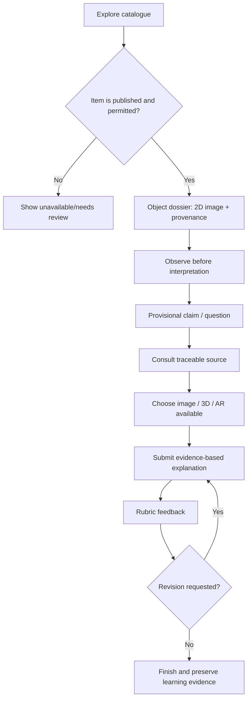
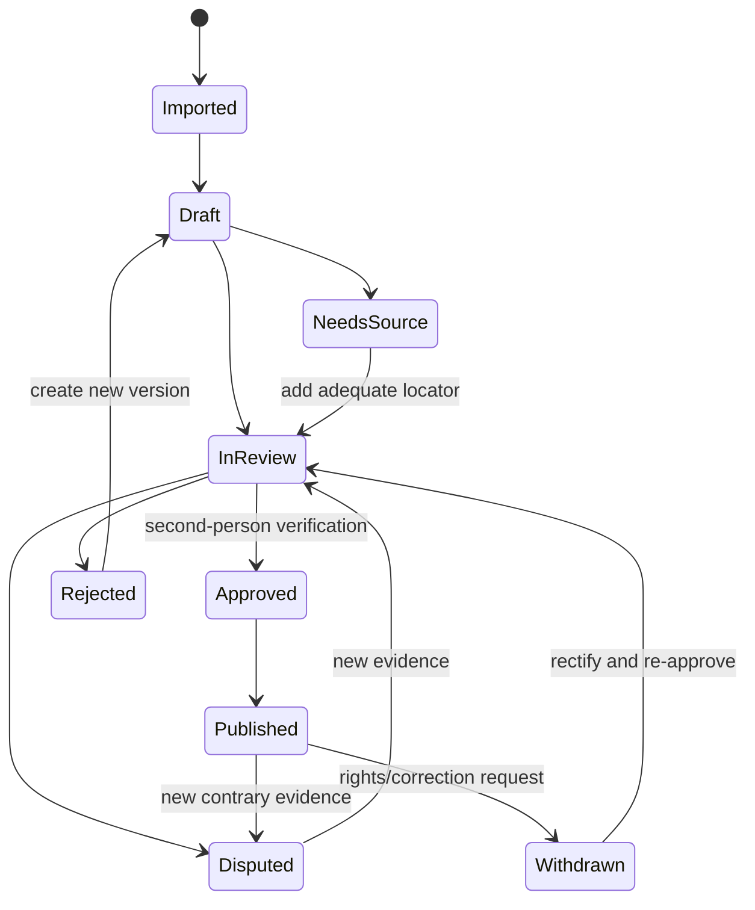
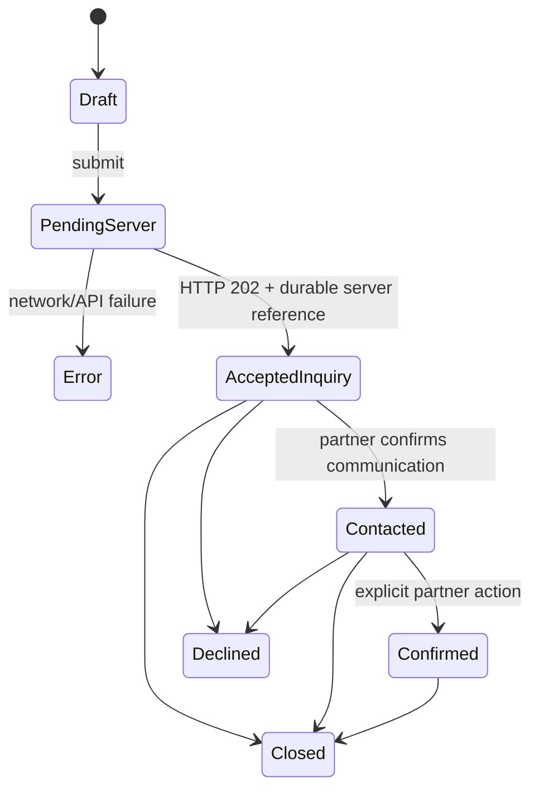

# V2 B2: source-derived engineering detail

> **Nguồn:** Trích không lược bỏ từ `LUU_NIEN_V5_PRODUCTION_COMPLETION_AND_NEW_FEATURES_GEMINI_FLASH_FULL_MASTER_SPEC.md` (`V2.B2`). **Nhận định mã nguồn trong V5 là audit tĩnh, chưa chứng minh production hoạt động.**
> **Dùng cho Gemini:** Chỉ mở tài liệu này với một ticket và tối đa 3–8 file source tương ứng.

## B2. PRODUCT FLOWS — CHUYỂN THÀNH STATE MACHINE VÀ TESTABLE ACCEPTANCE

### B2.1 Flow người học tìm hiểu một bản đúc nổi

**User journey acceptance:** bản đúc nổi chưa duyệt không bị lẫn trong bộ đã duyệt; với item duyệt, học sinh thấy ảnh 2D ngay cả khi WebGL lỗi; lời giải thích ghi `claim_id/source_id/lesson_version`; feedback có hướng cải thiện; giáo viên truy xuất được các lần sửa.

### B2.2 Flow người biên tập duyệt nguồn

**Business invariants:** Không dùng trực tiếp `historical_claims.verification_status` hiện tại như một state-machine đầy đủ khi chưa có policy; các state TARGET cần map sang enum legacy bằng adapter. Người tạo claim không tự duyệt claim; nguồn không có locator không được `expert_verified`; khi claim bị rút, bài học liên quan bị đánh dấu `needs_review`; AI index phải xóa/tái xây dựng theo revision mới.

### B2.3 Flow giáo viên tạo bài nguồn–chứng cứ

Bước 1 chọn khối/lớp/mục tiêu; bước 2 tìm 1–n hiện vật có trạng thái duyệt; bước 3 chọn nhận định và bộ nguồn ủng hộ/giới hạn; bước 4 chọn câu hỏi quan sát; bước 5 chọn dạng 2D/3D/AR tương đương; bước 6 gắn rubric và ví dụ đạt yêu cầu; bước 7 chạy preview impersonation an toàn; bước 8 gửi review; bước 9 publish version immutable; bước 10 phân công cho lớp. Không cho giáo viên publish bài sử dụng asset hết hạn license hoặc claim tranh cãi mà không có contextual disclosure.

**DoD:** giáo viên có thể xây dựng một ELLO hoàn chỉnh mà không sửa database thủ công; học sinh yếu thiết bị vẫn có route 2D; toàn bộ câu hỏi có stable ID; nếu source bị cập nhật, bài đang publish không âm thầm thay đổi nội dung đã chấm.

### B2.4 Flow người học làm bài và sửa bài

Trạng thái: `not_started → in_progress → submitted → feedback_ready → revision_requested → resubmitted → completed` (có `expired`, `voided`, `under_review` tùy protocol). Answer snapshot bất biến. Mỗi lần nộp có `attempt_number`, rubric version, lesson release snapshot. Nếu mất mạng, nháp offline không được tự đánh dấu `submitted`; reconcile dựa trên request idempotency, conflict resolution rõ.

### B2.5 Flow người dùng hỏi AI lịch sử

Input request → scope check → abuse safety → entity resolver → approved corpus search → claim evidence selection → confidence threshold → prompt assembly chỉ data → LLM draft → citation validator → unsupported claim detector → (a) answer with citations or (b) abstain + trusted reading suggestions → audit metadata không PII.

**Quy tắc trọng tâm:** Nếu không có source hợp lệ, trả `insufficient_evidence` thay vì tự điền chi tiết lịch sử từ prior của model; nếu query đòi nguồn Hán–Nôm chưa duyệt bản phiên, nói rõ chưa xác minh; câu trả lời không được đưa trích dẫn chỉ mang tính trang trí.

### B2.6 Flow yêu cầu trải nghiệm nghề truyền thống

**Đặc biệt:** Trong code hiện tại `frontend/src/lib/rbpc/inquiries.ts`, khi API 404/network error có thể sinh reference/token và trả trạng thái “new”, trong khi bản ghi chưa được tạo ở server. TARGET: prod phải trả lỗi “chưa gửi được yêu cầu”, hỗ trợ retry giữ idempotency key; mô phỏng chỉ hoạt động khi `DEMO_MODE=true` có banner demo và không gửi thông báo xác nhận thật. Status token là secret; không để trong URL được analytics bên thứ ba thu thập hoặc browser referrer lộ nếu không có biện pháp.

### B2.7 Flow thu hồi quyền media hoặc consent nghệ nhân

Event `withdrawn` -> block new publication immediately -> invalidate edge cache/3D embeds -> tombstone public endpoint with safe metadata -> notify editors and affected lesson owners -> recheck derived renditions / backups under retention/legal basis -> update evidence bundle -> optional re-enable only on new documented grant. Không xóa lịch sử việc từng xuất bản để bảo toàn audit trail; không tiếp tục hiển thị nội dung cần rút trên CDN.

---

