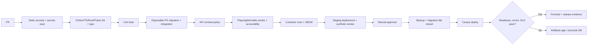

# V2 B9: source-derived engineering detail

> **Nguồn:** Trích không lược bỏ từ `LUU_NIEN_V5_PRODUCTION_COMPLETION_AND_NEW_FEATURES_GEMINI_FLASH_FULL_MASTER_SPEC.md` (`V2.B9`). **Nhận định mã nguồn trong V5 là audit tĩnh, chưa chứng minh production hoạt động.**
> **Dùng cho Gemini:** Chỉ mở tài liệu này với một ticket và tối đa 3–8 file source tương ứng.

## B9. SECURITY, PRIVACY, SRE VÀ DELIVERY SPEC CỤ THỂ

### B9.1 Threat model theo tài sản và đường tấn công

| Asset | Actor/entry | Threat | Mitigation TARGET | Verify |
|---|---|---|---|---|
| Học sinh (account/assignment) | user, classmate, attacker | IDOR, cross-class data leak | policy check every query, classroom scoping, audit | forged classroom_id test 403/404 |
| Mã trạng thái inquiry | anonymous URL/token holder | token leakage, brute-force | high entropy, no indexing, short retention, rate limit | enumerate attempts + access logs |
| Partner inbox | partner role | đọc inquiry của partner khác | provider_id tenant scoping server-side | 2 partners isolation integration tests |
| Historical claims | AI/user upload | poisoning, prompt injection | role-separated publishing, source allowlist, no LLM write | injected source cannot publish or direct AI |
| 3D/ảnh | public viewer/CDN | rights bypass via guessed URL | signed gated origin, short cache, revoke purge | URL access after revoke fails |
| Research responses | analyst + storage | exposure of minors, reidentification | research vault isolation, AES storage keys, pseudonym map split | role tests, export privacy review |
| Login/sessions | browser/mobile | XSS, CSRF, token theft | httpOnly secure cookies when possible, CSRF, CSP | ZAP/test scenarios |
| Deploy/migration | CI/SSH/environment | skipped schema migration + wrong readiness | fail-closed migration, approvals, rollback | deliberate migration failure blocks release |
| Content scope | Rust/Python gateway | scope contamination between Huế heritage and urns | canonical scope checks at DB/query and serializers | fuzz cross-scope IDs |
| AI results | LLM API | hallucination and fake citations | claim verifier, abstain, model/eval version | adversarial gold benchmark |

### B9.2 Authentication/session requirements

- Prefer server-managed sessions or short-lived tokens with rotation; do not store long-lived privileged tokens in `localStorage`; assess current auth route before migration.
- Roles alone insufficient: check object ownership, classroom membership, school/partner tenant, research study scope, consent authority.
- Student identifiers never in public URL labels, analytics properties, CSV report filenames, AI prompt logs.
- MFA for administrators/research custodians/publishers; reviewer separation for historical claims and commercial rights.
- Privileged actions require audit with actor, target, action, decision, UTC, IP digest only when justified; audit retention separate from customer data.

### B9.3 Rate limit và proxy

`backend/routers/rbpc.py` currently uses process-local dictionary `_inquiry_rate_limit_store` and reads the first `X-Forwarded-For` hop. In multi-worker/restart environments this cannot enforce a consistent global quota and accepting raw forwarded headers may let client spoof identity when proxy trust not configured. TARGET: trusted reverse-proxy chain mapping, centrally stored counters (Redis or DB atomic window), dimension by normalized IP plus additional abuse identifiers where privacy basis exists, tests across at least two workers. Không đưa địa chỉ IP nguyên văn vào `AppError.details` response public; log pseudonymous short retention.

### B9.4 Security headers và transport

- HTTPS only; HSTS after domain validated; `Secure`, `HttpOnly`, `SameSite` appropriately configured for cookies.
- `Content-Security-Policy` with approved script/iframe/connect endpoints, especially Sketchfab/3D/LiveKit; no blanket wildcard.
- `Referrer-Policy: strict-origin-when-cross-origin` or stricter for bearer status-token pages; `Permissions-Policy` restrict camera/mic outside AR/voice.
- `X-Content-Type-Options: nosniff`; CORS allow exact deployed origins; upload MIME sniff and size limits.
- External redirects reject open-redirect URLs; sanitize markdown/html before render, no untrusted `dangerouslySetInnerHTML`.
- Supply chain: lock files, dependency alerts, container base digest, SBOM + image scan, provenance attestation per release.

### B9.5 PII retention and deletion decision table (TARGET; policy owner must approve)

| Dataset | Minimum retention logic | Owner | Deletion action | Legal/ethical exception |
|---|---|---|---|---|
| Student LMS progress | policy per school agreement | data controller | export/delete by subject request where applicable | documented legal hold |
| Student drafts | until assignment lifecycle plus configured grace period | school/teacher | delete or anonymize | assessment records requirements |
| Google Forms raw | research protocol/consent | research custodian | cryptographic deletion of raw and map when due | ethics-approved archival rule |
| Inquiry contact | existing code default 90 days; policy requires signoff | RBPC operator | purge PII and retain aggregate audit | open legitimate dispute |
| Consent records | linked consent validity + audit retention | rights manager | preserve proof securely, revoke public content | lawful proof retention |
| AI usage | minimal telemetry with prompt redaction | AI operator | expire text logs | documented abuse investigation |
| CDN logs | short operational TTL | SRE | log rotation | incident freeze |

Không đưa thời hạn ở bảng thành cam kết pháp lý khi chưa có người phụ trách quyền riêng tư hoặc trường học phê duyệt.

### B9.6 Safe CI/CD pipeline

**Trạng thái EXISTING:** `.github/workflows/ci.yml` chạy push/PR vào `main`, backend pytest và frontend lint/build/playwright; `.github/workflows/deploy.yml` có tùy chọn `skip_tests`, và migration command `alembic upgrade head || true` — đây là đường phát hành cần sửa trước khi tăng quy mô. `backend-rust` và `mobile` chưa có parity rõ trong hai workflow này.

**TARGET ordered gates (không bypass bằng `skip_tests` cho production):**

Must-have job matrix: backend Python 3.11/3.12 as supported, Node 20 (match lockfile), Rust stable pinned, Flutter pinned SDK, Postgres same major as deployed, Redis where relevant, browser Chromium and one alternative (Firefox/WebKit depending budget). Verify version support via actual manifests; đừng tự tăng phiên bản chỉ để có bảng màu đẹp.

### B9.7 Migration safety runbook

Preflight: snapshot DB backup and restore verification; `alembic current/heads`; schema compatibility check; migration dry-run on snapshot sanitized data; expected row counts and estimate locks. During deploy: pause schema-dependent background jobs when required; run migration **without swallowing error**; run read/write smoke; only enable new app revision if schema version compatible; if migration fail, abort deployment and page operator. Rollback: down-migration chỉ nếu an toàn và thực sự được kiểm; mặc định app rollback + forward-fix DB for irreversible schema/data migrations. Chứng cứ lưu `schema_version`, migration log, commit, backup checksum.

### B9.8 Observability dashboard detail

| Dashboard | Panel/metric | Alert trigger đề xuất | On-call action |
|---|---|---|---|
| API | request p50/p95, 5xx, authz_denied, DB pool | 5xx > 1% trong 5 phút | triage by request_id; disable affected feature |
| Heritage | published vs reviewed counts, missing source, media rights expiry | permission breach = any | revoke asset immediately |
| Learning | submit success, draft sync errors, scoring exceptions | drop in submit > baseline | check network/DB/grade service |
| AI | abstain rate, invalid citations, latency, costs | citation violation in gold tests | disable generative mode |
| RBPC | inquiries accepted vs DB rows, status transitions, 429, partner access | accepted without DB receipt = any | P0 incident/disable form |
| Research | import counts, suppressed cells, export audit | unauthorized export = any | revoke access / incident protocol |
| XR | 3D load success, WebGL fallback, memory, asset 403 | high failure/device cohort | serve 2D fallback |
| Ops | DB backups/restores, schema drift, job DLQ, disk | failed restore test | hold deploy |

Targets là đề xuất và cần baseline từ production trước khi đưa vào SLA chính thức. Error budget cannot be claimed from local demo.

### B9.9 QA matrix — negative-path bắt buộc

| Case ID | Given | When | Expected | Automate |
|---|---|---|---|---|
| SEC-001 | student A in class X | GET assignment class Y | 403/404, no content leak | integration |
| SEC-002 | partner A | list partner B inquiries | 0 rows and access logged | integration |
| SEC-003 | unknown rights 3D | GET /media access | deny, `has_3d=false` | unit+API |
| SEC-004 | expired rights | CDN request after revoke | origin denied + purge | staging |
| SEC-005 | source unreviewed | request to publish factual question | 422 blocking error | API |
| SEC-006 | source text contains `ignore instructions` | history tutor ask | no instruction obedience | eval suite |
| SEC-007 | missing DB pool | readiness probe | not ready | deployment |
| SEC-008 | forced migration failure | deploy prod | pipeline blocked | CI simulation |
| SEC-009 | 2 parallel identical inquiry posts | idempotency same key | 1 DB row, same ref | integration concurrency |
| SEC-010 | duplicate key altered body | submit inquiry | 409, unchanged row | integration |
| SEC-011 | network down | submit inquiry client | error, no fake ref | Playwright |
| SEC-012 | 2 backend replicas | exceed global quota | shared 429 threshold | load test |
| SEC-013 | XFF supplied from untrusted peer | request | real trusted IP used | integration |
| SEC-014 | unconsented creator | public story/workshop | hidden/blocked | API |
| SEC-015 | school minor data | anonymous research export | no PII; small cells suppressed | integration |
| SEC-016 | local draft not synced | learner offline | says not submitted, safe retry | E2E |
| SEC-017 | historical claim revoked | AI ask about claim | no outdated citation | end-to-end |
| SEC-018 | optimistic update stale | PATCH claim/lesson | 412, no overwrite | integration |
| SEC-019 | image 404 | relief dossier | accessible placeholder | E2E |
| SEC-020 | WebGL unavailable | lesson includes 3D | accessible 2D equivalent | E2E |
| SEC-021 | unauthorized audit API call | GET research raw | no data, logged denial | integration |
| SEC-022 | file has malicious SVG/HTML | upload | blocked/sanitized | security |
| SEC-023 | source proof link broken | review claim | status cannot approve | unit |
| SEC-024 | no source for AI answer | ask fabricated detail | safe abstention | evaluation |
| SEC-025 | new historical claim version after assignment | inspect old attempt | exact old snapshot remains | integration |

### B9.10 Performance and reliability scenarios

`PERF-XR-01`: mobile low-memory 3D should gracefully downgrade before crash; `PERF-API-01`: catalog query paginated with DB index and query plan; `PERF-LESSON-01`: 100 simultaneous submissions produce exactly one receipt per key; `PERF-RESEARCH-01`: 1,502-row batch is deterministic when file order shuffled; `PERF-ASSET-01`: thumbnail CDN cache respects rights expiry; `PERF-AI-01`: AI 10 concurrent queries respect quota, timeouts and provider failure. Targets need measurement on agreed hardware/network, not fabricated benchmark numbers.

### B9.11 Disaster recovery and incident drill

- Backup DB encrypted + object store inventory + keys stored separately; automated restore monthly to disposable environment.
- Incident `historical false claim`: freeze content, mark contested, invalidate AI index and lesson publication, issue correction and reviewer notice, preserve audit history.
- Incident `PII leaked`: revoke keys/tokens, stop affected route, capture access traces with limited retention, conduct required legal/ethics notifications according to governing requirements.
- Incident `inquiry fake receipt`: disable form, investigate UI fallback vs DB, communicate transparently with impacted users without asserting booking took place.
- Incident `media rights dispute`: unpublish, CDN purge, collect rights records, legal review before restore.
- Incident `migration failure`: block promotion, restore service compatibility, validate dataset against backup; never silently continue.

---

