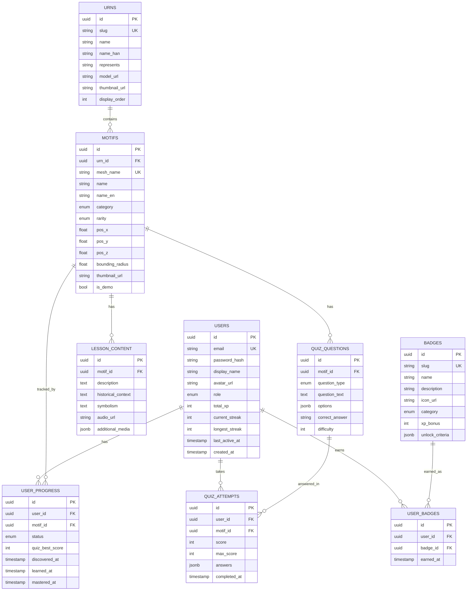

# Master Architecture Specification
## Lưu Niên Sử Kí - Gamified Heritage Exploration Platform

**Version:** 1.0.0  
**Date:** 2025-12-13  
**Status:** Implementation Ready  
**Tech Stack:** Next.js 15 | FastAPI | PostgreSQL | Three.js

---

## Table of Contents

1. [Product Requirements (PRD)](#1-product-requirements-prd)
2. [Database Schema (ERD)](#2-database-schema-erd)
3. [API Architecture](#3-api-architecture)
4. [Directory Structure](#4-directory-structure)
5. [Implementation Notes](#5-implementation-notes)

---

## 1. Product Requirements (PRD)

### 1.1 Product Vision

**Lưu Niên Sử Kí** is NOT a traditional LMS. It's a **Gamified Heritage Exploration Platform** where users discover Vietnamese history through interactive 3D exploration of the Nine Dynastic Urns (Cửu Đỉnh).

```
┌─────────────────────────────────────────────────────────────────────────────┐
│                         CORE GAMEPLAY LOOP                                  │
│                                                                              │
│    ┌──────────┐      ┌──────────┐      ┌──────────┐      ┌──────────┐      │
│    │  EXPLORE │      │   FIND   │      │  LEARN   │      │ COLLECT  │      │
│    │  3D Urn  │─────►│  Motif   │─────►│  Lesson  │─────►│  Badge   │      │
│    │          │      │  (Tap)   │      │  + Quiz  │      │  + XP    │      │
│    └──────────┘      └──────────┘      └──────────┘      └──────────┘      │
│         │                                                      │            │
│         └──────────────────────────────────────────────────────┘            │
│                              REPEAT                                          │
│                                                                              │
└─────────────────────────────────────────────────────────────────────────────┘
```

### 1.2 User Roles & Permissions

| Role | Description | Permissions |
|------|-------------|-------------|
| **Guest** | Unauthenticated visitor | View landing page, explore 1 demo urn, view 5 sample motifs |
| **Learner** | Registered user | Full 3D access, unlock motifs, take quizzes, earn badges, track progress |
| **Admin** | Content manager | All Learner permissions + CRUD motifs, quizzes, view analytics |
| **Super Admin** | System owner | All Admin permissions + user management, system config |

```
┌─────────────────────────────────────────────────────────────────────────────┐
│                         USER ROLE MATRIX                                    │
│                                                                              │
│  Feature                          Guest   Learner   Admin   SuperAdmin     │
│  ═══════════════════════════════════════════════════════════════════════   │
│  View Landing Page                  ✓        ✓        ✓         ✓          │
│  Explore Demo Urn (Cao Đỉnh)        ✓        ✓        ✓         ✓          │
│  View Sample Motifs (5)             ✓        ✓        ✓         ✓          │
│  ───────────────────────────────────────────────────────────────────────   │
│  Explore All 9 Urns                 ✗        ✓        ✓         ✓          │
│  Unlock Motifs                      ✗        ✓        ✓         ✓          │
│  Take Quizzes                       ✗        ✓        ✓         ✓          │
│  Earn XP & Badges                   ✗        ✓        ✓         ✓          │
│  View Leaderboard                   ✗        ✓        ✓         ✓          │
│  ───────────────────────────────────────────────────────────────────────   │
│  Create/Edit Motif Content          ✗        ✗        ✓         ✓          │
│  Create/Edit Quizzes                ✗        ✗        ✓         ✓          │
│  View Analytics Dashboard           ✗        ✗        ✓         ✓          │
│  ───────────────────────────────────────────────────────────────────────   │
│  Manage Users                       ✗        ✗        ✗         ✓          │
│  System Configuration               ✗        ✗        ✗         ✓          │
│                                                                              │
└─────────────────────────────────────────────────────────────────────────────┘
```

### 1.3 Collection System ("Motif Pokédex")

Users collect motifs like Pokémon. Each of the **162 motifs** can be in one of these states:

```
┌─────────────────────────────────────────────────────────────────────────────┐
│                      MOTIF COLLECTION STATES                                │
│                                                                              │
│  ┌─────────────┐     ┌─────────────┐     ┌─────────────┐     ┌───────────┐ │
│  │   HIDDEN    │────►│  DISCOVERED │────►│   LEARNED   │────►│ MASTERED  │ │
│  │             │     │             │     │             │     │           │ │
│  │  ┌───────┐  │     │  ┌───────┐  │     │  ┌───────┐  │     │ ┌───────┐ │ │
│  │  │  ???  │  │     │  │ 🐅    │  │     │  │ 🐅    │  │     │ │ 🐅⭐  │ │ │
│  │  │       │  │     │  │ Found │  │     │  │ Quiz  │  │     │ │ 100%  │ │ │
│  │  └───────┘  │     │  │ Not   │  │     │  │ Pass  │  │     │ └───────┘ │ │
│  │             │     │  │ Read  │  │     │  └───────┘  │     │           │ │
│  │  Silhouette │     │  └───────┘  │     │             │     │  Perfect  │ │
│  │  on 3D Urn  │     │             │     │  Content    │     │  Score    │ │
│  │             │     │  Tapped on  │     │  Completed  │     │  Achieved │ │
│  └─────────────┘     │  3D model   │     │  + Quiz ≥70%│     │           │ │
│                      └─────────────┘     └─────────────┘     └───────────┘ │
│                                                                              │
│  XP REWARDS:                                                                │
│  • Hidden → Discovered: +25 XP (first find)                                 │
│  • Discovered → Learned: +100 XP (complete lesson + pass quiz)              │
│  • Learned → Mastered: +50 XP (100% quiz score)                             │
│                                                                              │
└─────────────────────────────────────────────────────────────────────────────┘
```

#### Collection Progress UI

```
┌─────────────────────────────────────────────────────────────────────────────┐
│  BỘ SƯU TẬP CỦA BẠN (Your Collection)                                      │
│  ═══════════════════════════════════════════════════════════════════════   │
│                                                                              │
│  Overall Progress: ████████░░░░░░░░░░░░ 47/162 (29%)                        │
│                                                                              │
│  ┌─────────────────────────────────────────────────────────────────────┐   │
│  │  BY URN                                                             │   │
│  │  ─────                                                              │   │
│  │  Cao Đỉnh:    ██████████████████░░ 16/18                           │   │
│  │  Nhân Đỉnh:   ████████░░░░░░░░░░░░  8/18                           │   │
│  │  Chương Đỉnh: ██████░░░░░░░░░░░░░░  6/18                           │   │
│  │  Anh Đỉnh:    ████░░░░░░░░░░░░░░░░  4/18                           │   │
│  │  Nghị Đỉnh:   ██████░░░░░░░░░░░░░░  6/18                           │   │
│  │  Thuần Đỉnh:  ████░░░░░░░░░░░░░░░░  4/18                           │   │
│  │  Tuyên Đỉnh:  ██░░░░░░░░░░░░░░░░░░  2/18                           │   │
│  │  Dụ Đỉnh:     ░░░░░░░░░░░░░░░░░░░░  0/18                           │   │
│  │  Huyền Đỉnh:  ██░░░░░░░░░░░░░░░░░░  1/18                           │   │
│  └─────────────────────────────────────────────────────────────────────┘   │
│                                                                              │
│  ┌─────────────────────────────────────────────────────────────────────┐   │
│  │  BY CATEGORY                                                        │   │
│  │  ───────────                                                        │   │
│  │  🐉 Linh Thú (Sacred):    ████████████████████ 4/4   ★ COMPLETE    │   │
│  │  🐅 Động Vật (Animals):   ████████████░░░░░░░░ 15/25               │   │
│  │  🌸 Thảo Mộc (Flora):     ████████░░░░░░░░░░░░ 12/30               │   │
│  │  🏔️ Địa Lý (Geography):   ██████░░░░░░░░░░░░░░  6/20               │   │
│  │  ⚔️ Võ Bị (Military):     ████████░░░░░░░░░░░░  8/18               │   │
│  │  🌾 Nông Nghiệp (Agri):   ██░░░░░░░░░░░░░░░░░░  2/25               │   │
│  └─────────────────────────────────────────────────────────────────────┘   │
│                                                                              │
└─────────────────────────────────────────────────────────────────────────────┘
```

---

## 2. Database Schema (ERD)

### 2.1 Entity Relationship Diagram



### 2.2 SQL Schema Definition

```sql
-- ============================================================================
-- LUUNIENSUKI DATABASE SCHEMA
-- PostgreSQL 15+ with UUID extension
-- ============================================================================

-- Enable extensions
CREATE EXTENSION IF NOT EXISTS "uuid-ossp";
CREATE EXTENSION IF NOT EXISTS "pgcrypto";

-- ============================================================================
-- ENUMS
-- ============================================================================

CREATE TYPE user_role AS ENUM ('guest', 'learner', 'admin', 'super_admin');

CREATE TYPE motif_category AS ENUM (
    'linh_thu',      -- Sacred creatures (Dragon, Phoenix, etc.)
    'dong_vat',      -- Real animals
    'thao_moc',      -- Flora/plants
    'dia_ly',        -- Geography (mountains, rivers)
    'nong_nghiep',   -- Agriculture
    'vo_bi',         -- Military
    'giao_thuong',   -- Trade
    'thien_van',     -- Celestial
    'kien_truc'      -- Architecture
);

CREATE TYPE motif_rarity AS ENUM ('common', 'uncommon', 'rare', 'epic', 'legendary');

CREATE TYPE unlock_status AS ENUM ('hidden', 'discovered', 'learned', 'mastered');

CREATE TYPE question_type AS ENUM (
    'multiple_choice',
    'true_false',
    'image_select',
    'mesh_location'   -- Click on 3D model
);

CREATE TYPE badge_category AS ENUM ('quest', 'achievement', 'collection', 'special');

-- ============================================================================
-- CORE TABLES
-- ============================================================================

-- Users
CREATE TABLE users (
    id UUID PRIMARY KEY DEFAULT uuid_generate_v4(),
    email VARCHAR(255) UNIQUE NOT NULL,
    password_hash VARCHAR(255) NOT NULL,
    display_name VARCHAR(100) NOT NULL,
    avatar_url TEXT,
    role user_role DEFAULT 'learner',
    total_xp INT DEFAULT 0,
    current_streak INT DEFAULT 0,
    longest_streak INT DEFAULT 0,
    streak_freezes INT DEFAULT 0,
    last_active_at TIMESTAMPTZ,
    created_at TIMESTAMPTZ DEFAULT NOW(),
    updated_at TIMESTAMPTZ DEFAULT NOW()
);

-- Urns (The 9 Dynastic Urns)
CREATE TABLE urns (
    id UUID PRIMARY KEY DEFAULT uuid_generate_v4(),
    slug VARCHAR(50) UNIQUE NOT NULL,        -- e.g., "cao-dinh"
    name VARCHAR(100) NOT NULL,              -- e.g., "Cao Đỉnh"
    name_han VARCHAR(50),                    -- e.g., "高鼎"
    represents VARCHAR(255),                  -- e.g., "Emperor Gia Long"
    description TEXT,
    model_url TEXT NOT NULL,                 -- URL to .glb file
    thumbnail_url TEXT,
    display_order INT NOT NULL,              -- 1-9
    is_demo BOOLEAN DEFAULT FALSE,           -- Cao Đỉnh is demo
    created_at TIMESTAMPTZ DEFAULT NOW()
);

-- ============================================================================
-- MOTIFS TABLE (CRITICAL: 3D Mesh Mapping)
-- ============================================================================

CREATE TABLE motifs (
    id UUID PRIMARY KEY DEFAULT uuid_generate_v4(),
    urn_id UUID NOT NULL REFERENCES urns(id) ON DELETE CASCADE,

    -- ========================================================================
    -- 3D MESH MAPPING - CRITICAL FIELD
    -- This links the database record to the 3D model mesh name
    -- Must match EXACTLY the mesh name exported from Blender/Maya
    -- Example: "tiger_relief_01", "dragon_main_body", "lotus_flower_03"
    -- ========================================================================
    mesh_name VARCHAR(100) UNIQUE NOT NULL,

    -- Basic info
    name VARCHAR(255) NOT NULL,              -- "Hổ" (Tiger)
    name_en VARCHAR(255),                    -- "Tiger"
    category motif_category NOT NULL,
    rarity motif_rarity DEFAULT 'common',

    -- 3D Position (center of bounding sphere for hit detection)
    pos_x FLOAT NOT NULL,
    pos_y FLOAT NOT NULL,
    pos_z FLOAT NOT NULL,
    bounding_radius FLOAT NOT NULL,          -- Tap detection radius

    -- Camera focus position (where to move camera when selected)
    cam_pos_x FLOAT,
    cam_pos_y FLOAT,
    cam_pos_z FLOAT,
    cam_look_at_x FLOAT,
    cam_look_at_y FLOAT,
    cam_look_at_z FLOAT,

    -- Display
    thumbnail_url TEXT,
    silhouette_url TEXT,                     -- Shown when not yet discovered

    -- Flags
    is_demo BOOLEAN DEFAULT FALSE,           -- Viewable by guests
    is_active BOOLEAN DEFAULT TRUE,

    display_order INT,
    created_at TIMESTAMPTZ DEFAULT NOW(),
    updated_at TIMESTAMPTZ DEFAULT NOW()
);

-- Lesson content for each motif
CREATE TABLE lesson_content (
    id UUID PRIMARY KEY DEFAULT uuid_generate_v4(),
    motif_id UUID NOT NULL REFERENCES motifs(id) ON DELETE CASCADE,

    -- Content sections
    intro_text TEXT,                         -- Brief introduction
    description TEXT NOT NULL,               -- Main description
    historical_context TEXT,                 -- Historical significance
    symbolism TEXT,                          -- Cultural meaning
    fun_fact TEXT,                           -- Interesting tidbit

    -- Media
    audio_narration_url TEXT,
    additional_images JSONB,                 -- Array of image URLs
    video_url TEXT,

    -- AI-generated content flag
    is_ai_generated BOOLEAN DEFAULT FALSE,

    created_at TIMESTAMPTZ DEFAULT NOW(),
    updated_at TIMESTAMPTZ DEFAULT NOW(),

    UNIQUE(motif_id)  -- One lesson per motif
);

-- ============================================================================
-- USER PROGRESS & GAMIFICATION
-- ============================================================================

-- User's progress on each motif
CREATE TABLE user_progress (
    id UUID PRIMARY KEY DEFAULT uuid_generate_v4(),
    user_id UUID NOT NULL REFERENCES users(id) ON DELETE CASCADE,
    motif_id UUID NOT NULL REFERENCES motifs(id) ON DELETE CASCADE,

    status unlock_status DEFAULT 'hidden',

    -- Progress timestamps
    discovered_at TIMESTAMPTZ,              -- When user first tapped on 3D
    lesson_viewed_at TIMESTAMPTZ,           -- When user read the lesson
    learned_at TIMESTAMPTZ,                 -- When user passed quiz (≥70%)
    mastered_at TIMESTAMPTZ,                -- When user got 100%

    -- Quiz tracking
    quiz_attempts INT DEFAULT 0,
    quiz_best_score INT DEFAULT 0,          -- Percentage 0-100

    -- XP earned from this motif
    xp_earned INT DEFAULT 0,

    created_at TIMESTAMPTZ DEFAULT NOW(),
    updated_at TIMESTAMPTZ DEFAULT NOW(),

    UNIQUE(user_id, motif_id)
);

-- ============================================================================
-- QUIZ SYSTEM
-- ============================================================================

-- Quiz questions (linked to motifs)
CREATE TABLE quiz_questions (
    id UUID PRIMARY KEY DEFAULT uuid_generate_v4(),
    motif_id UUID NOT NULL REFERENCES motifs(id) ON DELETE CASCADE,

    question_type question_type NOT NULL,
    question_text TEXT NOT NULL,

    -- For multiple choice / true-false
    options JSONB,                           -- ["Option A", "Option B", ...]
    correct_answer VARCHAR(255) NOT NULL,    -- The correct option or "true"/"false"

    -- For mesh_location type (click on 3D)
    target_mesh_name VARCHAR(100),           -- Which mesh to click

    -- Metadata
    difficulty INT DEFAULT 1,                -- 1-3
    explanation TEXT,                        -- Shown after answer

    is_active BOOLEAN DEFAULT TRUE,
    created_at TIMESTAMPTZ DEFAULT NOW()
);

-- Quiz attempts
CREATE TABLE quiz_attempts (
    id UUID PRIMARY KEY DEFAULT uuid_generate_v4(),
    user_id UUID NOT NULL REFERENCES users(id) ON DELETE CASCADE,
    motif_id UUID NOT NULL REFERENCES motifs(id) ON DELETE CASCADE,

    score INT NOT NULL,                      -- Points earned
    max_score INT NOT NULL,                  -- Maximum possible points
    percentage INT NOT NULL,                 -- 0-100

    answers JSONB NOT NULL,                  -- [{question_id, user_answer, correct, points}]
    time_taken_seconds INT,

    completed_at TIMESTAMPTZ DEFAULT NOW()
);

-- ============================================================================
-- BADGES & ACHIEVEMENTS
-- ============================================================================

CREATE TABLE badges (
    id UUID PRIMARY KEY DEFAULT uuid_generate_v4(),
    slug VARCHAR(100) UNIQUE NOT NULL,
    name VARCHAR(255) NOT NULL,
    name_en VARCHAR(255),
    description TEXT,
    icon_url TEXT NOT NULL,

    category badge_category NOT NULL,
    xp_bonus INT DEFAULT 0,

    -- Unlock criteria (evaluated by backend)
    -- Examples:
    -- {"type": "motif_count", "category": "linh_thu", "count": 4}
    -- {"type": "streak", "days": 7}
    -- {"type": "quiz_perfect", "count": 10}
    unlock_criteria JSONB NOT NULL,

    is_secret BOOLEAN DEFAULT FALSE,         -- Hidden until earned
    is_active BOOLEAN DEFAULT TRUE,
    created_at TIMESTAMPTZ DEFAULT NOW()
);

CREATE TABLE user_badges (
    id UUID PRIMARY KEY DEFAULT uuid_generate_v4(),
    user_id UUID NOT NULL REFERENCES users(id) ON DELETE CASCADE,
    badge_id UUID NOT NULL REFERENCES badges(id) ON DELETE CASCADE,
    earned_at TIMESTAMPTZ DEFAULT NOW(),

    UNIQUE(user_id, badge_id)
);

-- ============================================================================
-- INDEXES
-- ============================================================================

-- Users
CREATE INDEX idx_users_email ON users(email);
CREATE INDEX idx_users_role ON users(role);

-- Motifs
CREATE INDEX idx_motifs_urn ON motifs(urn_id);
CREATE INDEX idx_motifs_mesh ON motifs(mesh_name);
CREATE INDEX idx_motifs_category ON motifs(category);
CREATE INDEX idx_motifs_rarity ON motifs(rarity);

-- User Progress
CREATE INDEX idx_progress_user ON user_progress(user_id);
CREATE INDEX idx_progress_motif ON user_progress(motif_id);
CREATE INDEX idx_progress_status ON user_progress(status);

-- Quizzes
CREATE INDEX idx_quiz_q_motif ON quiz_questions(motif_id);
CREATE INDEX idx_quiz_attempts_user ON quiz_attempts(user_id);
CREATE INDEX idx_quiz_attempts_motif ON quiz_attempts(motif_id);

-- Badges
CREATE INDEX idx_user_badges_user ON user_badges(user_id);
```

### 2.3 3D Mesh Name Convention

**CRITICAL**: The `mesh_name` field MUST match the mesh names exported from 3D software.

```
┌─────────────────────────────────────────────────────────────────────────────┐
│                    MESH NAMING CONVENTION                                   │
│                                                                              │
│  FORMAT: {category}_{subject}_{urn_code}_{index}                            │
│                                                                              │
│  EXAMPLES:                                                                  │
│  ─────────────────────────────────────────────────────────────────────────  │
│  │ Database Name │ mesh_name           │ Urn        │ Notes               │ │
│  │───────────────│─────────────────────│────────────│─────────────────────│ │
│  │ Rồng Cao Đỉnh │ linh_dragon_cao_01  │ Cao Đỉnh   │ Main dragon         │ │
│  │ Hổ Nhân Đỉnh  │ fauna_tiger_nhan_01 │ Nhân Đỉnh  │ Tiger relief        │ │
│  │ Sen           │ flora_lotus_cao_02  │ Cao Đỉnh   │ Second lotus        │ │
│  │ Núi Ngự Bình  │ geo_mountain_anh_01 │ Anh Đỉnh   │ Ngu Binh mountain   │ │
│  │ Súng Thần Công│ mil_cannon_nghi_03  │ Nghị Đỉnh  │ Third cannon        │ │
│  └─────────────────────────────────────────────────────────────────────────┘ │
│                                                                              │
│  CATEGORY PREFIXES:                                                         │
│  • linh_  → Linh thú (Sacred creatures)                                    │
│  • fauna_ → Động vật (Animals)                                             │
│  • flora_ → Thảo mộc (Plants)                                              │
│  • geo_   → Địa lý (Geography)                                             │
│  • agri_  → Nông nghiệp (Agriculture)                                      │
│  • mil_   → Võ bị (Military)                                               │
│  • trade_ → Giao thương (Trade)                                            │
│  • arch_  → Kiến trúc (Architecture)                                       │
│                                                                              │
│  URN CODES:                                                                 │
│  cao, nhan, chuong, anh, nghi, thuan, tuyen, du, huyen                     │
│                                                                              │
└─────────────────────────────────────────────────────────────────────────────┘
```

---

## 3. API Architecture

### 3.1 API Design Principles

| Principle | Implementation |
|-----------|----------------|
| **REST + SSE Hybrid** | REST for CRUD, SSE for real-time updates |
| **Versioned** | All endpoints prefixed with `/api/v1/` |
| **JSON Response** | Consistent response envelope |
| **JWT Authentication** | Bearer token in Authorization header |
| **Rate Limited** | 100 req/min for guests, 1000 for authenticated |

### 3.2 Response Envelope

```json
{
  "success": true,
  "data": { ... },
  "meta": {
    "timestamp": "2025-12-13T10:30:00Z",
    "request_id": "req_abc123"
  },
  "error": null
}
```

Error response:
```json
{
  "success": false,
  "data": null,
  "meta": { ... },
  "error": {
    "code": "MOTIF_NOT_FOUND",
    "message": "Motif with ID xxx does not exist",
    "details": {}
  }
}
```

### 3.3 API Endpoint Specification

#### Authentication

```yaml
# ============================================================================
# AUTHENTICATION ENDPOINTS
# ============================================================================

POST /api/v1/auth/register:
  description: Register new user
  body:
    email: string (required)
    password: string (required, min 8 chars)
    display_name: string (required)
  response:
    user: User
    access_token: string
    refresh_token: string

POST /api/v1/auth/login:
  description: Login with email/password
  body:
    email: string
    password: string
  response:
    user: User
    access_token: string
    refresh_token: string

POST /api/v1/auth/refresh:
  description: Refresh access token
  body:
    refresh_token: string
  response:
    access_token: string

POST /api/v1/auth/logout:
  description: Invalidate tokens
  auth: required

GET /api/v1/auth/me:
  description: Get current user profile
  auth: required
  response:
    user: User
    stats: UserStats
```

#### Urns

```yaml
# ============================================================================
# URNS ENDPOINTS
# ============================================================================

GET /api/v1/urns:
  description: List all 9 urns
  auth: optional (guests see demo only)
  query:
    include_progress: boolean  # Include user's progress if authenticated
  response:
    urns: Urn[]
    total: 9

GET /api/v1/urns/{urn_slug}:
  description: Get single urn details
  params:
    urn_slug: string  # e.g., "cao-dinh"
  auth: optional
  response:
    urn: Urn
    motifs: MotifPreview[]  # Basic info only
    model_url: string
    user_progress: UrnProgress  # If authenticated

GET /api/v1/urns/{urn_slug}/model:
  description: Get 3D model URL and metadata
  params:
    urn_slug: string
  response:
    model_url: string           # .glb file URL
    model_size_mb: number
    motif_meshes: MeshMapping[] # [{mesh_name, motif_id, bounding_box}]
```

#### Motifs

```yaml
# ============================================================================
# MOTIFS ENDPOINTS
# ============================================================================

GET /api/v1/motifs:
  description: List motifs (for collection view)
  auth: required
  query:
    urn_id: uuid           # Filter by urn
    category: string       # Filter by category
    status: string         # hidden|discovered|learned|mastered
    page: int
    limit: int (max 50)
  response:
    motifs: MotifWithProgress[]
    total: int
    page: int

GET /api/v1/motifs/{motif_id}:
  description: Get motif details + lesson content
  auth: required
  params:
    motif_id: uuid
  response:
    motif: Motif
    lesson: LessonContent
    user_progress: MotifProgress
    quiz_available: boolean

# ============================================================================
# MOTIF DISCOVERY (Core Gameplay)
# ============================================================================

POST /api/v1/motifs/{motif_id}/discover:
  description: User tapped on motif in 3D viewer
  auth: required
  params:
    motif_id: uuid
  body:
    mesh_name: string      # For validation
    position: {x, y, z}    # Tap position for analytics
  response:
    success: boolean
    xp_earned: int         # +25 XP for first discovery
    new_status: "discovered"
    achievement_unlocked: Badge | null

POST /api/v1/motifs/{motif_id}/complete-lesson:
  description: User finished reading lesson content
  auth: required
  params:
    motif_id: uuid
  body:
    time_spent_seconds: int
  response:
    success: boolean
    quiz_unlocked: boolean

GET /api/v1/motifs/by-mesh/{mesh_name}:
  description: Lookup motif by 3D mesh name (for tap detection)
  auth: required
  params:
    mesh_name: string  # e.g., "linh_dragon_cao_01"
  response:
    motif: MotifPreview
    is_discovered: boolean
```

#### Quizzes

```yaml
# ============================================================================
# QUIZ ENDPOINTS
# ============================================================================

GET /api/v1/motifs/{motif_id}/quiz:
  description: Get quiz questions for a motif
  auth: required
  params:
    motif_id: uuid
  response:
    quiz_id: uuid
    questions: QuizQuestion[]  # Options shuffled
    time_limit_seconds: int

POST /api/v1/quizzes/{quiz_id}/submit:
  description: Submit quiz answers
  auth: required
  body:
    answers: [{question_id, answer}]
    time_taken_seconds: int
  response:
    score: int
    max_score: int
    percentage: int
    passed: boolean           # ≥70%
    xp_earned: int
    new_status: "learned" | "mastered" | null
    results: QuizResult[]     # Per-question breakdown
    badge_earned: Badge | null
```

#### User Progress & Collection

```yaml
# ============================================================================
# USER PROGRESS ENDPOINTS
# ============================================================================

GET /api/v1/users/me/progress:
  description: Get user's overall progress
  auth: required
  response:
    total_xp: int
    rank: Rank
    xp_to_next_rank: int
    collection:
      total: 162
      discovered: int
      learned: int
      mastered: int
    by_urn: UrnProgress[]
    by_category: CategoryProgress[]

GET /api/v1/users/me/collection:
  description: Get user's motif collection (Pokédex view)
  auth: required
  query:
    status: string
    category: string
    urn_id: uuid
  response:
    motifs: CollectionItem[]
    stats: CollectionStats

GET /api/v1/users/me/badges:
  description: Get user's earned badges
  auth: required
  response:
    earned: Badge[]
    available: Badge[]  # Not yet earned, visible
    progress: BadgeProgress[]  # Progress toward each

GET /api/v1/users/me/streak:
  description: Get streak information
  auth: required
  response:
    current_streak: int
    longest_streak: int
    streak_freezes: int
    last_active_date: date
    today_completed: boolean
```

#### Leaderboard

```yaml
# ============================================================================
# LEADERBOARD ENDPOINTS
# ============================================================================

GET /api/v1/leaderboard:
  description: Get global leaderboard
  auth: required
  query:
    period: "weekly" | "monthly" | "all_time"
    limit: int (max 100)
  response:
    rankings: LeaderboardEntry[]
    user_rank: int
    user_entry: LeaderboardEntry

GET /api/v1/leaderboard/urn/{urn_slug}:
  description: Get leaderboard for specific urn
  auth: required
```

#### Admin Endpoints

```yaml
# ============================================================================
# ADMIN ENDPOINTS (role: admin, super_admin)
# ============================================================================

# Motif Management
GET    /api/v1/admin/motifs                    # List all with admin details
POST   /api/v1/admin/motifs                    # Create new motif
PUT    /api/v1/admin/motifs/{id}               # Update motif
DELETE /api/v1/admin/motifs/{id}               # Delete motif

# Lesson Content
PUT    /api/v1/admin/motifs/{id}/lesson        # Update lesson content

# Quiz Management
GET    /api/v1/admin/motifs/{id}/questions     # List questions
POST   /api/v1/admin/motifs/{id}/questions     # Add question
PUT    /api/v1/admin/questions/{id}            # Update question
DELETE /api/v1/admin/questions/{id}            # Delete question

# Analytics
GET    /api/v1/admin/analytics/overview        # Platform stats
GET    /api/v1/admin/analytics/motifs          # Per-motif engagement
GET    /api/v1/admin/analytics/users           # User activity

# User Management (super_admin only)
GET    /api/v1/admin/users                     # List users
PUT    /api/v1/admin/users/{id}/role           # Change role
DELETE /api/v1/admin/users/{id}                # Delete user
```

### 3.4 Real-Time Events (SSE)

For real-time updates (achievements, leaderboard changes):

```yaml
GET /api/v1/events/stream:
  description: Server-Sent Events stream
  auth: required
  events:
    - achievement_unlocked:
        badge: Badge
        xp_earned: int

    - rank_up:
        old_rank: Rank
        new_rank: Rank

    - streak_milestone:
        days: int
        reward: Reward

    - leaderboard_change:
        old_rank: int
        new_rank: int
```

---

## 4. Directory Structure

### 4.1 Monorepo Layout

```
luuniensuki-lms/
├── .github/
│   ├── workflows/
│   │   ├── ci.yml                    # Lint, test, build
│   │   ├── deploy-staging.yml
│   │   └── deploy-production.yml
│   └── CODEOWNERS
│
├── apps/
│   ├── web/                          # Next.js 15 Frontend
│   │   ├── public/
│   │   │   ├── models/               # 3D .glb files (or CDN links)
│   │   │   ├── images/
│   │   │   └── favicon.ico
│   │   ├── src/
│   │   │   ├── app/                  # App Router
│   │   │   │   ├── (auth)/
│   │   │   │   │   ├── login/page.tsx
│   │   │   │   │   └── register/page.tsx
│   │   │   │   ├── (main)/
│   │   │   │   │   ├── layout.tsx
│   │   │   │   │   ├── page.tsx           # Home/Dashboard
│   │   │   │   │   ├── explore/
│   │   │   │   │   │   ├── page.tsx       # Urn selection
│   │   │   │   │   │   └── [urnSlug]/
│   │   │   │   │   │       └── page.tsx   # 3D Urn Viewer
│   │   │   │   │   ├── collection/
│   │   │   │   │   │   └── page.tsx       # Motif Pokédex
│   │   │   │   │   ├── motif/
│   │   │   │   │   │   └── [motifId]/
│   │   │   │   │   │       ├── page.tsx   # Lesson view
│   │   │   │   │   │       └── quiz/page.tsx
│   │   │   │   │   ├── leaderboard/
│   │   │   │   │   │   └── page.tsx
│   │   │   │   │   └── profile/
│   │   │   │   │       └── page.tsx
│   │   │   │   ├── admin/
│   │   │   │   │   ├── layout.tsx
│   │   │   │   │   ├── page.tsx           # Admin dashboard
│   │   │   │   │   ├── motifs/
│   │   │   │   │   ├── quizzes/
│   │   │   │   │   └── users/
│   │   │   │   ├── api/                   # Route Handlers (BFF)
│   │   │   │   │   └── [...proxy]/route.ts
│   │   │   │   ├── layout.tsx
│   │   │   │   └── globals.css
│   │   │   ├── components/
│   │   │   │   ├── ui/                    # Shadcn/UI components
│   │   │   │   │   ├── button.tsx
│   │   │   │   │   ├── card.tsx
│   │   │   │   │   └── ...
│   │   │   │   ├── 3d/                    # Three.js components
│   │   │   │   │   ├── UrnViewer.tsx
│   │   │   │   │   ├── MotifHighlight.tsx
│   │   │   │   │   ├── CameraControls.tsx
│   │   │   │   │   └── MotifHotspot.tsx
│   │   │   │   ├── quiz/
│   │   │   │   │   ├── QuizContainer.tsx
│   │   │   │   │   ├── MultipleChoice.tsx
│   │   │   │   │   └── MeshLocationQuestion.tsx
│   │   │   │   ├── collection/
│   │   │   │   │   ├── MotifCard.tsx
│   │   │   │   │   ├── CollectionGrid.tsx
│   │   │   │   │   └── ProgressBar.tsx
│   │   │   │   └── layout/
│   │   │   │       ├── Header.tsx
│   │   │   │       ├── Sidebar.tsx
│   │   │   │       └── Footer.tsx
│   │   │   ├── hooks/
│   │   │   │   ├── useAuth.ts
│   │   │   │   ├── useProgress.ts
│   │   │   │   ├── useMotif.ts
│   │   │   │   └── use3DViewer.ts
│   │   │   ├── lib/
│   │   │   │   ├── api.ts                 # API client
│   │   │   │   ├── auth.ts
│   │   │   │   └── utils.ts
│   │   │   ├── stores/                    # Zustand stores
│   │   │   │   ├── authStore.ts
│   │   │   │   ├── progressStore.ts
│   │   │   │   └── viewerStore.ts
│   │   │   └── types/
│   │   │       ├── api.ts
│   │   │       ├── motif.ts
│   │   │       └── user.ts
│   │   ├── next.config.js
│   │   ├── tailwind.config.js
│   │   ├── tsconfig.json
│   │   └── package.json
│   │
│   └── api/                          # FastAPI Backend
│       ├── src/
│       │   ├── main.py               # FastAPI app entry
│       │   ├── config.py             # Settings
│       │   ├── database.py           # SQLAlchemy setup
│       │   ├── dependencies.py       # FastAPI dependencies
│       │   │
│       │   ├── models/               # SQLAlchemy models
│       │   │   ├── __init__.py
│       │   │   ├── user.py
│       │   │   ├── urn.py
│       │   │   ├── motif.py
│       │   │   ├── progress.py
│       │   │   ├── quiz.py
│       │   │   └── badge.py
│       │   │
│       │   ├── schemas/              # Pydantic schemas
│       │   │   ├── __init__.py
│       │   │   ├── user.py
│       │   │   ├── urn.py
│       │   │   ├── motif.py
│       │   │   ├── progress.py
│       │   │   ├── quiz.py
│       │   │   └── badge.py
│       │   │
│       │   ├── routers/              # API routes
│       │   │   ├── __init__.py
│       │   │   ├── auth.py
│       │   │   ├── urns.py
│       │   │   ├── motifs.py
│       │   │   ├── quizzes.py
│       │   │   ├── progress.py
│       │   │   ├── leaderboard.py
│       │   │   └── admin.py
│       │   │
│       │   ├── services/             # Business logic
│       │   │   ├── __init__.py
│       │   │   ├── auth_service.py
│       │   │   ├── progress_service.py
│       │   │   ├── quiz_service.py
│       │   │   ├── badge_service.py
│       │   │   └── xp_service.py
│       │   │
│       │   └── utils/
│       │       ├── security.py       # JWT, hashing
│       │       └── exceptions.py
│       │
│       ├── tests/
│       │   ├── conftest.py
│       │   ├── test_auth.py
│       │   ├── test_motifs.py
│       │   └── test_quizzes.py
│       │
│       ├── alembic/                  # Database migrations
│       │   ├── versions/
│       │   └── env.py
│       │
│       ├── alembic.ini
│       ├── requirements.txt
│       ├── pyproject.toml
│       └── Dockerfile
│
├── packages/                         # Shared packages
│   └── shared-types/                 # TypeScript types shared w/ frontend
│       ├── src/
│       │   ├── index.ts
│       │   ├── user.ts
│       │   ├── motif.ts
│       │   └── api.ts
│       ├── tsconfig.json
│       └── package.json
│
├── infrastructure/
│   ├── docker/
│   │   ├── docker-compose.yml        # Local dev
│   │   ├── docker-compose.prod.yml
│   │   └── nginx.conf
│   ├── terraform/                    # IaC (optional)
│   │   ├── main.tf
│   │   └── variables.tf
│   └── k8s/                          # Kubernetes manifests (optional)
│       ├── api-deployment.yml
│       └── web-deployment.yml
│
├── scripts/
│   ├── setup.sh                      # Initial setup
│   ├── seed-db.py                    # Seed database with motif data
│   └── generate-mesh-mapping.py      # Generate mesh_name mappings
│
├── docs/
│   ├── architecture/
│   │   ├── 01_Architecture_Spec.md   # THIS FILE
│   │   └── SYSTEM_DESIGN_ARCHITECTURE.md
│   ├── curriculum/
│   │   └── LMS_CURRICULUM_USER_JOURNEY.md
│   └── api/
│       └── openapi.yaml              # Generated OpenAPI spec
│
├── .env.example
├── .gitignore
├── README.md
├── package.json                      # Monorepo root (pnpm workspaces)
├── pnpm-workspace.yaml
└── turbo.json                        # Turborepo config
```

### 4.2 Key File Responsibilities

| File/Folder | Purpose |
|-------------|---------|
| `apps/web/src/components/3d/` | All Three.js/R3F components for 3D rendering |
| `apps/api/src/services/` | Business logic separated from routes |
| `apps/api/src/routers/` | FastAPI route definitions only |
| `packages/shared-types/` | TypeScript types synced between FE/BE |
| `scripts/seed-db.py` | Populate 9 urns + 162 motifs |
| `scripts/generate-mesh-mapping.py` | Extract mesh names from .glb files |

---

## 5. Implementation Notes

### 5.1 Tech Stack Summary

| Layer | Technology | Version | Notes |
|-------|------------|---------|-------|
| **Frontend** | Next.js | 15.x | App Router, Server Components |
| **3D Rendering** | Three.js + React Three Fiber | latest | R3F for React integration |
| **State** | Zustand | 4.x | Lightweight, no boilerplate |
| **Styling** | Tailwind CSS + Shadcn/UI | 3.4.x | Utility-first, accessible components |
| **Backend** | FastAPI | 0.110+ | Async, auto OpenAPI docs |
| **ORM** | SQLAlchemy | 2.x | Async support |
| **Database** | PostgreSQL | 15+ | uuid-ossp extension |
| **Cache** | Redis | 7.x | Session, rate limiting |
| **Auth** | JWT (python-jose) | - | Access + Refresh tokens |
| **Monorepo** | Turborepo + pnpm | - | Build caching, task orchestration |

### 5.2 3D Model Integration Workflow

```
┌─────────────────────────────────────────────────────────────────────────────┐
│                    3D ASSET PIPELINE                                        │
│                                                                              │
│  1. MODELING (Blender/Maya)                                                 │
│     ├── Each motif = separate mesh                                          │
│     ├── Mesh names follow convention: {category}_{subject}_{urn}_{index}   │
│     └── Export as .glb (Draco compressed)                                   │
│                                                                              │
│  2. POST-PROCESSING                                                         │
│     ├── Run: python scripts/generate-mesh-mapping.py                        │
│     ├── Extracts all mesh names from .glb                                   │
│     └── Generates SQL INSERT statements for motifs table                    │
│                                                                              │
│  3. FRONTEND INTEGRATION                                                    │
│     ├── Load .glb via @react-three/drei <GLTFLoader>                       │
│     ├── Traverse scene, find meshes matching motif mesh_names              │
│     ├── Attach onClick handlers to each motif mesh                         │
│     └── On click: call POST /api/v1/motifs/{id}/discover                   │
│                                                                              │
└─────────────────────────────────────────────────────────────────────────────┘
```

### 5.3 XP & Progression Formulas

```python
# XP Rewards
XP_DISCOVER = 25          # First time tapping motif
XP_LESSON_COMPLETE = 50   # Reading full lesson
XP_QUIZ_PASS = 100        # Score ≥ 70%
XP_QUIZ_PERFECT = 50      # Bonus for 100%
XP_STREAK_DAILY = 10      # Base daily streak

# Rank Thresholds
RANKS = [
    {"level": 1, "name": "Lính Mới", "xp": 0},
    {"level": 2, "name": "Thư Sinh", "xp": 500},
    {"level": 3, "name": "Tú Tài", "xp": 1500},
    {"level": 4, "name": "Cử Nhân", "xp": 3500},
    {"level": 5, "name": "Tiến Sĩ", "xp": 7000},
    {"level": 6, "name": "Thám Hoa", "xp": 12000},
    {"level": 7, "name": "Bảng Nhãn", "xp": 20000},
    {"level": 8, "name": "Trạng Nguyên", "xp": 35000},
    {"level": 9, "name": "Hàn Lâm", "xp": 55000},
    {"level": 10, "name": "Sử Quan", "xp": 80000},
]
```

### 5.4 Security Considerations

| Concern | Mitigation |
|---------|------------|
| **Cheating (fake discoveries)** | Validate mesh_name + position server-side |
| **Quiz answer scraping** | Don't send correct_answer to frontend until submitted |
| **Rate limiting** | Redis-based, 100/min guest, 1000/min auth |
| **XSS** | React auto-escapes, CSP headers |
| **CSRF** | SameSite cookies, no cookie auth (JWT only) |
| **SQL Injection** | SQLAlchemy parameterized queries |

### 5.5 Performance Targets

| Metric | Target | Measurement |
|--------|--------|-------------|
| **3D Model Load** | < 3s on 4G | Lighthouse, WebPageTest |
| **First Contentful Paint** | < 1.5s | Core Web Vitals |
| **API Response (p95)** | < 200ms | APM (Datadog/NewRelic) |
| **Database Query** | < 50ms | pg_stat_statements |
| **Frame Rate (3D)** | 60 FPS | Chrome DevTools |

### 5.6 Seed Data Requirements

Before launch, the database needs:

| Entity | Count | Source |
|--------|-------|--------|
| Urns | 9 | Manual entry |
| Motifs | 162 | Extracted from 3D models |
| Lesson Content | 162 | Content team / AI-assisted |
| Quiz Questions | ~500 (3+ per motif) | Content team |
| Badges | ~30 | Defined in PRD |

---

## 6. Quick Start Commands

```bash
# Clone and setup
git clone https://github.com/org/luuniensuki-lms.git
cd luuniensuki-lms
pnpm install

# Start local development
docker-compose -f infrastructure/docker/docker-compose.yml up -d  # DB, Redis
pnpm dev  # Starts both web (3000) and api (8000)

# Database migrations
cd apps/api
alembic upgrade head

# Seed data
python scripts/seed-db.py

# Run tests
pnpm test           # Frontend tests
cd apps/api && pytest  # Backend tests
```

---

## Document Control

| Version | Date | Author | Changes |
|---------|------|--------|---------|
| 1.0.0 | 2025-12-13 | Claude Opus 4.5 (CTO Agent) | Initial specification |

---

**END OF DOCUMENT**

---

*This document is the single source of truth for the Lưu Niên Sử Kí platform architecture. All development should reference this specification.*