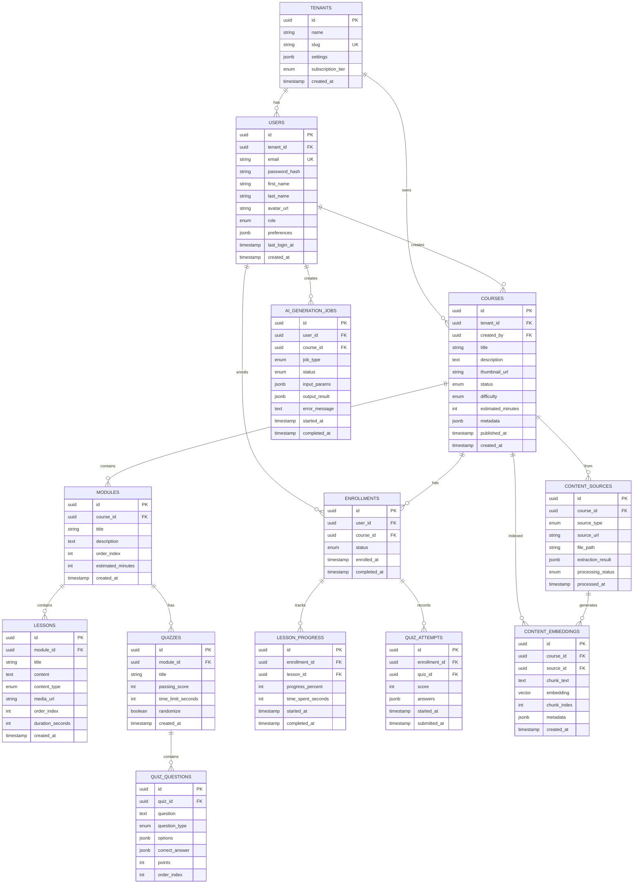

# System Design & Architecture Document (SDAD)
## Luuniensuki LMS - AI-Native Learning Management System

**Version:** 1.0.0  
**Date:** 2025-12-13  
**Author:** Architecture Team  
**Status:** Draft

---

## Table of Contents

1. [Executive Summary](#1-executive-summary)
2. [High-Level Architecture](#2-high-level-architecture)
3. [Tech Stack Recommendation](#3-tech-stack-recommendation)
4. [Core Feature: Smart Course Generator](#4-core-feature-smart-course-generator)
5. [Database Schema](#5-database-schema)
6. [API Contract Standards](#6-api-contract-standards)
7. [Security & Compliance](#7-security--compliance)
8. [Deployment Strategy](#8-deployment-strategy)

---

## 1. Executive Summary

### Vision
Luuniensuki LMS is an **AI-Native** learning platform where artificial intelligence is not an add-on feature but the foundational architecture principle. Every component is designed to leverage AI capabilities from content ingestion to personalized learning paths.

### Agent Team Responsibilities

| Agent | Role | Primary Responsibilities |
|-------|------|-------------------------|
| **Claude Opus 4.5** | The Brain | Architecture, System Design, Data Flow, Project Management |
| **GPT 5.1 Codex** | The Hands | Backend logic, algorithms, production code generation |
| **Gemini Advanced 3.0** | The Eyes & Ears | Multimodal ingestion, video/audio/image processing, context analysis |

### Key Design Principles

1. **AI-First, Not AI-Added** - Every feature considers AI integration from inception
2. **Asynchronous by Default** - Heavy AI workloads never block user experience
3. **Event-Driven Architecture** - Loose coupling enables independent scaling
4. **Multimodal Ready** - Native support for text, audio, video, and image content

---

## 2. High-Level Architecture

### 2.1 Architecture Decision: Modular Monolith → Microservices

We recommend a **Modular Monolith with Event-Driven Extraction Path** approach:

```
┌─────────────────────────────────────────────────────────────────────────────┐
│                              PHASE 1: MODULAR MONOLITH                       │
│                                                                              │
│  ┌─────────────────────────────────────────────────────────────────────┐    │
│  │                         API GATEWAY (Kong/Traefik)                   │    │
│  │                    Rate Limiting | Auth | Load Balancing             │    │
│  └─────────────────────────────────────────────────────────────────────┘    │
│                                      │                                       │
│         ┌────────────────────────────┼────────────────────────────┐         │
│         ▼                            ▼                            ▼         │
│  ┌─────────────┐            ┌─────────────┐            ┌─────────────┐      │
│  │   CORE LMS  │            │  LEARNING   │            │     AI      │      │
│  │   MODULE    │◄──────────►│   ENGINE    │◄──────────►│  PROCESSOR  │      │
│  │             │            │   MODULE    │            │   MODULE    │      │
│  │ • Auth      │            │ • Courses   │            │ • Ingestion │      │
│  │ • Users     │            │ • Progress  │            │ • Embedding │      │
│  │ • Roles     │            │ • Quizzes   │            │ • Generation│      │
│  │ • Tenants   │            │ • Certs     │            │ • RAG       │      │
│  └──────┬──────┘            └──────┬──────┘            └──────┬──────┘      │
│         │                          │                          │             │
│         └──────────────────────────┼──────────────────────────┘             │
│                                    ▼                                        │
│  ┌─────────────────────────────────────────────────────────────────────┐    │
│  │                    SHARED INFRASTRUCTURE LAYER                       │    │
│  │  PostgreSQL │ Redis │ Vector DB │ Object Storage │ Message Queue    │    │
│  └─────────────────────────────────────────────────────────────────────┘    │
└─────────────────────────────────────────────────────────────────────────────┘
```

### 2.2 Rationale: Why Start Modular Monolith?

| Aspect | Modular Monolith | Microservices |
|--------|------------------|---------------|
| **Initial Velocity** | ✅ Fast iteration | ❌ Infra overhead |
| **Team Size (3 agents)** | ✅ Perfect fit | ❌ Overkill |
| **Debugging** | ✅ Single process | ❌ Distributed tracing needed |
| **Scaling AI Workloads** | ⚠️ Requires async design | ✅ Native isolation |
| **Future Extraction** | ✅ Well-bounded modules | N/A |

**Decision:** Start modular, extract AI Processor as first microservice when load demands it.

### 2.3 Decoupling Strategy: Core LMS vs AI Processing Unit

The critical architectural boundary is between **synchronous user operations** and **asynchronous AI processing**:

```
┌─────────────────────────────────────────────────────────────────────────────┐
│                        DECOUPLING ARCHITECTURE                               │
│                                                                              │
│   SYNCHRONOUS DOMAIN                    ASYNCHRONOUS DOMAIN                 │
│   (Low Latency Required)                (High Compute, Variable Time)       │
│                                                                              │
│   ┌─────────────────────┐              ┌─────────────────────────────────┐  │
│   │     CORE LMS        │              │       AI PROCESSING UNIT        │  │
│   │                     │              │                                 │  │
│   │  ┌───────────────┐  │   Message    │  ┌─────────────────────────┐   │  │
│   │  │ Auth Service  │  │    Queue     │  │   INGESTION WORKERS     │   │  │
│   │  └───────────────┘  │   (Redis)    │  │                         │   │  │
│   │  ┌───────────────┐  │ ┌─────────┐  │  │  ┌─────────────────┐    │   │  │
│   │  │ User Service  │──┼─►│ Job     │──┼──►  │ Gemini 3.0      │    │   │  │
│   │  └───────────────┘  │ │ Queue   │  │  │  │ (Multimodal)    │    │   │  │
│   │  ┌───────────────┐  │ └─────────┘  │  │  └────────┬────────┘    │   │  │
│   │  │ Course CRUD   │  │              │  │           │             │   │  │
│   │  └───────────────┘  │ ┌─────────┐  │  │  ┌────────▼────────┐    │   │  │
│   │  ┌───────────────┐  │ │ Event   │  │  │  │ Vector Embedder │    │   │  │
│   │  │ Enrollment    │◄─┼─┤ Stream  │◄─┼──┤  │ (OpenAI/Cohere) │    │   │  │
│   │  └───────────────┘  │ └─────────┘  │  │  └────────┬────────┘    │   │  │
│   │                     │              │  │           │             │   │  │
│   └─────────────────────┘              │  │  ┌────────▼────────┐    │   │  │
│                                        │  │  │ GPT 5.1 Codex   │    │   │  │
│                                        │  │  │ (Structuring)   │    │   │  │
│                                        │  │  └─────────────────┘    │   │  │
│                                        │  └─────────────────────────┘   │  │
│                                        └─────────────────────────────────┘  │
│                                                                              │
│   Communication Patterns:                                                   │
│   ━━━━━━━━━━━━━━━━━━━━━                                                    │
│   → Request/Response (REST/GraphQL): User-facing operations                │
│   → Fire-and-Forget (Message Queue): AI job submissions                    │
│   → Event Stream (SSE/WebSocket): Real-time progress updates               │
│   → Callback/Webhook: AI job completion notifications                      │
│                                                                              │
└─────────────────────────────────────────────────────────────────────────────┘
```

### 2.4 Concurrency & Scaling Strategy

```
┌─────────────────────────────────────────────────────────────────────────────┐
│                         SCALING TIERS                                        │
│                                                                              │
│  TIER 1: API Layer (Horizontal)                                             │
│  ├── Kong/Traefik handles load balancing                                    │
│  ├── Stateless services scale with K8s HPA                                  │
│  └── Target: <100ms p99 latency                                             │
│                                                                              │
│  TIER 2: Worker Layer (Queue-Based)                                         │
│  ├── AI workers consume from priority queues                                │
│  ├── Auto-scale based on queue depth                                        │
│  ├── GPU workers for embedding generation                                   │
│  └── Target: Process within SLA (configurable per job type)                 │
│                                                                              │
│  TIER 3: Data Layer (Vertical + Read Replicas)                              │
│  ├── PostgreSQL: Primary + Read Replicas                                    │
│  ├── Redis: Cluster mode for queue durability                               │
│  ├── Vector DB: Sharded by tenant                                           │
│  └── Target: <10ms query latency                                            │
│                                                                              │
└─────────────────────────────────────────────────────────────────────────────┘
```

---

## 3. Tech Stack Recommendation

### 3.1 Backend Framework Decision

| Option | Pros | Cons | Verdict |
|--------|------|------|---------|
| **Python (FastAPI)** | Native AI/ML ecosystem, async support, type hints | GIL limits CPU-bound tasks | ✅ **PRIMARY** |
| **Go** | Excellent concurrency, fast compilation | Weaker AI library ecosystem | ✅ **SECONDARY** (Gateway/Workers) |
| **Node.js** | Great for real-time | Not ideal for AI workloads | ❌ Skip |

**Recommendation: Dual-Stack Approach**
- **Python/FastAPI**: Core LMS + AI Processing (leverages ML ecosystem)
- **Go**: API Gateway, high-throughput workers (optional optimization layer)

### 3.2 Complete Technology Stack

```
┌─────────────────────────────────────────────────────────────────────────────┐
│                         TECHNOLOGY STACK                                     │
│                                                                              │
│  ┌─────────────────────────────────────────────────────────────────────┐    │
│  │                        FRONTEND LAYER                                │    │
│  │  Next.js 15 (App Router) │ React 19 │ TypeScript │ TailwindCSS      │    │
│  │  Real-time: Socket.io │ Server-Sent Events (SSE)                     │    │
│  └─────────────────────────────────────────────────────────────────────┘    │
│                                      │                                       │
│  ┌─────────────────────────────────────────────────────────────────────┐    │
│  │                        API GATEWAY                                   │    │
│  │  Kong Gateway (OSS) or Traefik │ Rate Limiting │ JWT Validation      │    │
│  └─────────────────────────────────────────────────────────────────────┘    │
│                                      │                                       │
│  ┌─────────────────────────────────────────────────────────────────────┐    │
│  │                     BACKEND SERVICES                                 │    │
│  │                                                                      │    │
│  │   Python 3.12 + FastAPI                                              │    │
│  │   ├── Pydantic v2 (Validation)                                       │    │
│  │   ├── SQLAlchemy 2.0 (ORM)                                           │    │
│  │   ├── Alembic (Migrations)                                           │    │
│  │   ├── Celery + Redis (Task Queue)                                    │    │
│  │   ├── LangChain / LlamaIndex (AI Orchestration)                      │    │
│  │   └── Pytest + Coverage (Testing)                                    │    │
│  │                                                                      │    │
│  └─────────────────────────────────────────────────────────────────────┘    │
│                                      │                                       │
│  ┌─────────────────────────────────────────────────────────────────────┐    │
│  │                     AI SERVICE INTEGRATIONS                          │    │
│  │                                                                      │    │
│  │   ┌──────────────┐  ┌──────────────┐  ┌──────────────┐              │    │
│  │   │ Gemini 3.0   │  │ GPT 5.1      │  │ Embeddings   │              │    │
│  │   │ Advanced     │  │ Codex        │  │ API          │              │    │
│  │   │              │  │              │  │              │              │    │
│  │   │ • Video      │  │ • Curriculum │  │ • OpenAI     │              │    │
│  │   │ • Audio      │  │ • Code Gen   │  │ • Cohere     │              │    │
│  │   │ • Image      │  │ • Quizzes    │  │ • Voyage     │              │    │
│  │   │ • Context    │  │ • Summaries  │  │              │              │    │
│  │   └──────────────┘  └──────────────┘  └──────────────┘              │    │
│  │                                                                      │    │
│  └─────────────────────────────────────────────────────────────────────┘    │
│                                                                              │
└─────────────────────────────────────────────────────────────────────────────┘
```

### 3.3 Database Strategy: Hybrid Approach

```
┌─────────────────────────────────────────────────────────────────────────────┐
│                        DATABASE ARCHITECTURE                                 │
│                                                                              │
│  ┌─────────────────────────────────────────────────────────────────────┐    │
│  │                    PostgreSQL 16 (Primary)                           │    │
│  │                                                                      │    │
│  │   Purpose: Structured Data (ACID Compliance Required)                │    │
│  │   ├── Users, Roles, Permissions                                      │    │
│  │   ├── Courses, Modules, Lessons                                      │    │
│  │   ├── Enrollments, Progress                                          │    │
│  │   ├── Assessments, Grades                                            │    │
│  │   └── Audit Logs, Billing                                            │    │
│  │                                                                      │    │
│  │   Extensions:                                                        │    │
│  │   ├── pgvector (Vector similarity search - embedded option)          │    │
│  │   ├── pg_trgm (Full-text search)                                     │    │
│  │   └── timescaledb (Time-series for analytics)                        │    │
│  │                                                                      │    │
│  └─────────────────────────────────────────────────────────────────────┘    │
│                                                                              │
│  ┌─────────────────────────────────────────────────────────────────────┐    │
│  │                    Vector Database (RAG)                             │    │
│  │                                                                      │    │
│  │   ┌─────────────┐  ┌─────────────┐  ┌─────────────┐                 │    │
│  │   │  pgvector   │  │  Weaviate   │  │  Pinecone   │                 │    │
│  │   │  (Start)    │  │  (Scale)    │  │  (Managed)  │                 │    │
│  │   │             │  │             │  │             │                 │    │
│  │   │ ✅ Simple   │  │ ✅ Hybrid   │  │ ✅ Zero-ops │                 │    │
│  │   │ ✅ One DB   │  │ ✅ GraphQL  │  │ ✅ Fast     │                 │    │
│  │   │ ⚠️ Scale    │  │ ✅ Multi-   │  │ ⚠️ Vendor  │                 │    │
│  │   │    limits   │  │   tenant    │  │    lock-in │                 │    │
│  │   └─────────────┘  └─────────────┘  └─────────────┘                 │    │
│  │                                                                      │    │
│  │   Recommendation: Start pgvector → Migrate to Weaviate at scale     │    │
│  │                                                                      │    │
│  └─────────────────────────────────────────────────────────────────────┘    │
│                                                                              │
│  ┌─────────────────────────────────────────────────────────────────────┐    │
│  │                    Cache & Queue Layer                               │    │
│  │                                                                      │    │
│  │   Redis Stack 7.x                                                    │    │
│  │   ├── Caching: Session, API responses, rate limiting                 │    │
│  │   ├── Queue: Celery broker for AI jobs                               │    │
│  │   ├── Pub/Sub: Real-time notifications                               │    │
│  │   └── Streams: Event sourcing for audit trail                        │    │
│  │                                                                      │    │
│  │   Why Redis over Kafka?                                              │    │
│  │   ├── Simpler operations for team of 3                               │    │
│  │   ├── Celery native integration                                      │    │
│  │   ├── Sufficient for initial scale (100K users)                      │    │
│  │   └── Redis Streams provides Kafka-like semantics if needed          │    │
│  │                                                                      │    │
│  └─────────────────────────────────────────────────────────────────────┘    │
│                                                                              │
│  ┌─────────────────────────────────────────────────────────────────────┐    │
│  │                    Object Storage                                    │    │
│  │                                                                      │    │
│  │   MinIO (Self-hosted S3) or AWS S3                                   │    │
│  │   ├── Video uploads (pre-processing)                                 │    │
│  │   ├── PDF documents                                                  │    │
│  │   ├── Generated content                                              │    │
│  │   └── Course assets                                                  │    │
│  │                                                                      │    │
│  └─────────────────────────────────────────────────────────────────────┘    │
│                                                                              │
└─────────────────────────────────────────────────────────────────────────────┘
```

### 3.4 Queue System: AI Job Management

```python
# Celery Configuration for AI Jobs
CELERY_QUEUES = {
    'default': {'priority': 5},           # Standard operations
    'ai_ingestion': {'priority': 10},     # Gemini multimodal processing
    'ai_embedding': {'priority': 8},      # Vector embedding generation
    'ai_generation': {'priority': 7},     # GPT content structuring
    'ai_realtime': {'priority': 15},      # Chat/streaming responses
}

# Priority-based routing
CELERY_ROUTES = {
    'tasks.ingest_youtube': {'queue': 'ai_ingestion'},
    'tasks.ingest_pdf': {'queue': 'ai_ingestion'},
    'tasks.generate_embeddings': {'queue': 'ai_embedding'},
    'tasks.structure_curriculum': {'queue': 'ai_generation'},
    'tasks.chat_response': {'queue': 'ai_realtime'},
}
```

---

## 4. Core Feature: Smart Course Generator

### 4.1 Feature Overview

The **Smart Course Generator** is the flagship AI-Native feature that transforms raw content (YouTube videos, PDFs, documents) into structured, interactive courses with quizzes, summaries, and learning paths.

### 4.2 Complete Data Flow Architecture

```
┌─────────────────────────────────────────────────────────────────────────────┐
│                    SMART COURSE GENERATOR - DATA FLOW                        │
│                                                                              │
│  ┌──────────────────────────────────────────────────────────────────────┐   │
│  │  PHASE 1: INPUT & VALIDATION                                         │   │
│  │                                                                       │   │
│  │    User Input                                                         │   │
│  │    ┌─────────────┐   ┌─────────────┐   ┌─────────────┐               │   │
│  │    │ YouTube URL │   │ PDF Upload  │   │ Raw Text    │               │   │
│  │    └──────┬──────┘   └──────┬──────┘   └──────┬──────┘               │   │
│  │           │                 │                 │                       │   │
│  │           └─────────────────┼─────────────────┘                       │   │
│  │                             ▼                                         │   │
│  │                   ┌─────────────────┐                                 │   │
│  │                   │  API Gateway    │                                 │   │
│  │                   │  /api/v1/       │                                 │   │
│  │                   │  courses/       │                                 │   │
│  │                   │  generate       │                                 │   │
│  │                   └────────┬────────┘                                 │   │
│  │                            │                                          │   │
│  │                            ▼                                          │   │
│  │                   ┌─────────────────┐     ┌─────────────────┐         │   │
│  │                   │ Input Validator │────►│ S3/MinIO        │         │   │
│  │                   │ • URL format    │     │ (Store raw      │         │   │
│  │                   │ • File type     │     │  content)       │         │   │
│  │                   │ • Size limits   │     └─────────────────┘         │   │
│  │                   └────────┬────────┘                                 │   │
│  │                            │                                          │   │
│  │                            ▼                                          │   │
│  │                   ┌─────────────────┐                                 │   │
│  │                   │ Job Creator     │                                 │   │
│  │                   │ • Create UUID   │                                 │   │
│  │                   │ • Store meta    │                                 │   │
│  │                   │ • Queue job     │                                 │   │
│  │                   └────────┬────────┘                                 │   │
│  │                            │                                          │   │
│  │           ┌────────────────┴────────────────┐                        │   │
│  │           ▼                                 ▼                        │   │
│  │   ┌──────────────┐                 ┌──────────────┐                  │   │
│  │   │ Return       │                 │ Redis Queue  │                  │   │
│  │   │ Job ID +     │                 │ (ai_ingest)  │                  │   │
│  │   │ WebSocket    │                 │              │                  │   │
│  │   │ Channel      │                 │              │                  │   │
│  │   └──────────────┘                 └──────┬───────┘                  │   │
│  │                                           │                           │   │
│  └───────────────────────────────────────────┼───────────────────────────┘   │
│                                              │                               │
│  ┌───────────────────────────────────────────┼───────────────────────────┐   │
│  │  PHASE 2: MULTIMODAL EXTRACTION (Gemini 3.0 - The Eyes & Ears)       │   │
│  │                                           │                           │   │
│  │                                           ▼                           │   │
│  │                   ┌─────────────────────────────────────┐             │   │
│  │                   │        GEMINI 3.0 ADVANCED          │             │   │
│  │                   │                                     │             │   │
│  │                   │  ┌─────────────────────────────┐   │             │   │
│  │                   │  │ YouTube Processing          │   │             │   │
│  │                   │  │ • Download via yt-dlp       │   │             │   │
│  │                   │  │ • Extract audio track       │   │             │   │
│  │                   │  │ • Transcribe (Whisper/      │   │             │   │
│  │                   │  │   Gemini native)            │   │             │   │
│  │                   │  │ • Extract key frames        │   │             │   │
│  │                   │  │ • Analyze visual content    │   │             │   │
│  │                   │  └─────────────────────────────┘   │             │   │
│  │                   │                                     │             │   │
│  │                   │  ┌─────────────────────────────┐   │             │   │
│  │                   │  │ PDF Processing              │   │             │   │
│  │                   │  │ • OCR if scanned            │   │             │   │
│  │                   │  │ • Extract text blocks       │   │             │   │
│  │                   │  │ • Parse tables/charts       │   │             │   │
│  │                   │  │ • Identify structure        │   │             │   │
│  │                   │  └─────────────────────────────┘   │             │   │
│  │                   │                                     │             │   │
│  │                   └──────────────┬──────────────────────┘             │   │
│  │                                  │                                    │   │
│  │                                  ▼                                    │   │
│  │                   ┌─────────────────────────────────────┐             │   │
│  │                   │      EXTRACTED CONTENT              │             │   │
│  │                   │                                     │             │   │
│  │                   │  {                                  │             │   │
│  │                   │    "transcript": "...",             │             │   │
│  │                   │    "key_frames": [...],             │             │   │
│  │                   │    "topics_detected": [...],        │             │   │
│  │                   │    "duration": 3600,                │             │   │
│  │                   │    "difficulty_estimate": "medium", │             │   │
│  │                   │    "language": "en"                 │             │   │
│  │                   │  }                                  │             │   │
│  │                   │                                     │             │   │
│  │                   └──────────────┬──────────────────────┘             │   │
│  │                                  │                                    │   │
│  │                      [Publish to: ai_embedding queue]                │   │
│  │                                  │                                    │   │
│  └──────────────────────────────────┼────────────────────────────────────┘   │
│                                     │                                        │
└─────────────────────────────────────┼────────────────────────────────────────┘
                                      │
                                      ▼
```

```
┌─────────────────────────────────────────────────────────────────────────────┐
│  PHASE 3: EMBEDDING & VECTOR STORAGE                                        │
│                                                                              │
│                   ┌─────────────────────────────────────┐                   │
│                   │      EMBEDDING WORKER               │                   │
│                   │                                     │                   │
│                   │  1. Chunk content intelligently     │                   │
│                   │     • Semantic boundaries           │                   │
│                   │     • 512-1024 token chunks         │                   │
│                   │     • Overlap: 50 tokens            │                   │
│                   │                                     │                   │
│                   │  2. Generate embeddings             │                   │
│                   │     • OpenAI text-embedding-3-large │                   │
│                   │     • Dimension: 3072               │                   │
│                   │     • Batch processing              │                   │
│                   │                                     │                   │
│                   │  3. Store with metadata             │                   │
│                   │     • course_id, chunk_index        │                   │
│                   │     • source_type, timestamps       │                   │
│                   │                                     │                   │
│                   └──────────────┬──────────────────────┘                   │
│                                  │                                          │
│                                  ▼                                          │
│   ┌─────────────────────────────────────────────────────────────────────┐   │
│   │                     VECTOR DATABASE (pgvector)                      │   │
│   │                                                                     │   │
│   │   content_embeddings                                                │   │
│   │   ┌────────────────────────────────────────────────────────────┐   │   │
│   │   │ id │ course_id │ chunk_text │ embedding │ metadata       │   │   │
│   │   ├────┼───────────┼────────────┼───────────┼────────────────┤   │   │
│   │   │ 1  │ uuid      │ "In this..│ [0.02,..] │ {src: youtube} │   │   │
│   │   │ 2  │ uuid      │ "Next we..│ [0.01,..] │ {timestamp: 5} │   │   │
│   │   └────────────────────────────────────────────────────────────┘   │   │
│   │                                                                     │   │
│   │   Index: HNSW (Hierarchical Navigable Small World)                  │   │
│   │   Distance: Cosine Similarity                                       │   │
│   │                                                                     │   │
│   └─────────────────────────────────────────────────────────────────────┘   │
│                                                                              │
│                      [Publish to: ai_generation queue]                      │
│                                  │                                          │
└──────────────────────────────────┼──────────────────────────────────────────┘
                                   │
                                   ▼
┌─────────────────────────────────────────────────────────────────────────────┐
│  PHASE 4: CURRICULUM STRUCTURING (GPT 5.1 Codex - The Hands)               │
│                                                                              │
│                   ┌─────────────────────────────────────┐                   │
│                   │        GPT 5.1 CODEX                │                   │
│                   │                                     │                   │
│                   │  Input:                             │                   │
│                   │  • Raw extracted content            │                   │
│                   │  • Topic analysis from Gemini       │                   │
│                   │  • Embedding clusters               │                   │
│                   │  • User preferences (if any)        │                   │
│                   │                                     │                   │
│                   │  Processing:                        │                   │
│                   │  ┌─────────────────────────────┐   │                   │
│                   │  │ 1. Identify Learning        │   │                   │
│                   │  │    Objectives               │   │                   │
│                   │  │                             │   │                   │
│                   │  │ 2. Create Module Structure  │   │                   │
│                   │  │    • Logical grouping       │   │                   │
│                   │  │    • Progressive difficulty │   │                   │
│                   │  │                             │   │                   │
│                   │  │ 3. Generate for each module:│   │                   │
│                   │  │    • Title & Description    │   │                   │
│                   │  │    • Summary                │   │                   │
│                   │  │    • Key Concepts           │   │                   │
│                   │  │    • Quiz Questions (MCQ)   │   │                   │
│                   │  │    • Discussion Prompts     │   │                   │
│                   │  │                             │   │                   │
│                   │  │ 4. Create Assessment        │   │                   │
│                   │  │    • Final exam questions   │   │                   │
│                   │  │    • Practical exercises    │   │                   │
│                   │  │                             │   │                   │
│                   │  │ 5. Estimate Time to         │   │                   │
│                   │  │    Complete                 │   │                   │
│                   │  └─────────────────────────────┘   │                   │
│                   │                                     │                   │
│                   └──────────────┬──────────────────────┘                   │
│                                  │                                          │
│                                  ▼                                          │
│                   ┌─────────────────────────────────────┐                   │
│                   │      STRUCTURED OUTPUT              │                   │
│                   │                                     │                   │
│                   │  {                                  │                   │
│                   │    "course": {                      │                   │
│                   │      "title": "...",                │                   │
│                   │      "description": "...",          │                   │
│                   │      "estimated_hours": 4,          │                   │
│                   │      "difficulty": "intermediate",  │                   │
│                   │      "modules": [                   │                   │
│                   │        {                            │                   │
│                   │          "title": "...",            │                   │
│                   │          "lessons": [...],          │                   │
│                   │          "quiz": {...}              │                   │
│                   │        }                            │                   │
│                   │      ],                             │                   │
│                   │      "final_assessment": {...}      │                   │
│                   │    }                                │                   │
│                   │  }                                  │                   │
│                   │                                     │                   │
│                   └──────────────┬──────────────────────┘                   │
│                                  │                                          │
└──────────────────────────────────┼──────────────────────────────────────────┘
                                   │
                                   ▼
┌─────────────────────────────────────────────────────────────────────────────┐
│  PHASE 5: PERSISTENCE & NOTIFICATION                                        │
│                                                                              │
│   ┌─────────────────┐     ┌─────────────────┐     ┌─────────────────┐       │
│   │   PostgreSQL    │     │   WebSocket     │     │   Email/Push    │       │
│   │                 │     │                 │     │                 │       │
│   │ • courses       │     │ Broadcast to    │     │ Notify user     │       │
│   │ • modules       │     │ subscribed      │     │ course is       │       │
│   │ • lessons       │     │ channel         │     │ ready           │       │
│   │ • quizzes       │     │                 │     │                 │       │
│   └─────────────────┘     └─────────────────┘     └─────────────────┘       │
│                                                                              │
│   Status Updates via WebSocket:                                             │
│   ──────────────────────────────                                            │
│   {status: "EXTRACTING", progress: 25, message: "Processing video..."}      │
│   {status: "EMBEDDING", progress: 50, message: "Creating embeddings..."}    │
│   {status: "STRUCTURING", progress: 75, message: "Building curriculum..."}  │
│   {status: "COMPLETE", progress: 100, course_id: "uuid"}                    │
│                                                                              │
└─────────────────────────────────────────────────────────────────────────────┘
```

### 4.3 API Endpoints for Smart Course Generator

```python
# Course Generation Endpoints
POST   /api/v1/courses/generate          # Submit generation job
GET    /api/v1/courses/generate/{job_id} # Poll job status (fallback)
WS     /ws/courses/generate/{job_id}     # Real-time status stream

# Request Schema
{
    "source_type": "youtube" | "pdf" | "text",
    "source_url": "https://youtube.com/...",  # or null for uploads
    "file_id": "uuid",                         # for uploaded files
    "preferences": {
        "target_audience": "beginner" | "intermediate" | "advanced",
        "language": "en",
        "include_quizzes": true,
        "module_duration_minutes": 15
    }
}

# Response Schema
{
    "job_id": "uuid",
    "status": "QUEUED",
    "websocket_url": "wss://api.luuniensuki.com/ws/courses/generate/uuid",
    "estimated_time_seconds": 120
}
```

---

## 5. Database Schema

### 5.1 Entity Relationship Diagram (Mermaid)



### 5.2 SQL Schema (Key Tables)

```sql
-- Enable required extensions
CREATE EXTENSION IF NOT EXISTS "uuid-ossp";
CREATE EXTENSION IF NOT EXISTS "vector";
CREATE EXTENSION IF NOT EXISTS "pg_trgm";

-- =============================================
-- ENUMS
-- =============================================

CREATE TYPE subscription_tier AS ENUM ('free', 'starter', 'pro', 'enterprise');
CREATE TYPE user_role AS ENUM ('student', 'instructor', 'admin', 'super_admin');
CREATE TYPE course_status AS ENUM ('draft', 'review', 'published', 'archived');
CREATE TYPE difficulty_level AS ENUM ('beginner', 'intermediate', 'advanced', 'expert');
CREATE TYPE content_type AS ENUM ('text', 'video', 'audio', 'interactive', 'pdf');
CREATE TYPE question_type AS ENUM ('multiple_choice', 'true_false', 'short_answer', 'code');
CREATE TYPE enrollment_status AS ENUM ('active', 'completed', 'dropped', 'expired');
CREATE TYPE source_type AS ENUM ('youtube', 'pdf', 'url', 'text', 'upload');
CREATE TYPE job_status AS ENUM ('queued', 'processing', 'completed', 'failed', 'cancelled');
CREATE TYPE job_type AS ENUM ('course_generation', 'quiz_generation', 'summary', 'embedding');

-- =============================================
-- CORE TABLES
-- =============================================

CREATE TABLE tenants (
    id UUID PRIMARY KEY DEFAULT uuid_generate_v4(),
    name VARCHAR(255) NOT NULL,
    slug VARCHAR(100) UNIQUE NOT NULL,
    settings JSONB DEFAULT '{}',
    subscription_tier subscription_tier DEFAULT 'free',
    created_at TIMESTAMPTZ DEFAULT NOW(),
    updated_at TIMESTAMPTZ DEFAULT NOW()
);

CREATE TABLE users (
    id UUID PRIMARY KEY DEFAULT uuid_generate_v4(),
    tenant_id UUID NOT NULL REFERENCES tenants(id) ON DELETE CASCADE,
    email VARCHAR(255) NOT NULL,
    password_hash VARCHAR(255) NOT NULL,
    first_name VARCHAR(100),
    last_name VARCHAR(100),
    avatar_url TEXT,
    role user_role DEFAULT 'student',
    preferences JSONB DEFAULT '{}',
    email_verified_at TIMESTAMPTZ,
    last_login_at TIMESTAMPTZ,
    created_at TIMESTAMPTZ DEFAULT NOW(),
    updated_at TIMESTAMPTZ DEFAULT NOW(),
    UNIQUE(tenant_id, email)
);

CREATE TABLE courses (
    id UUID PRIMARY KEY DEFAULT uuid_generate_v4(),
    tenant_id UUID NOT NULL REFERENCES tenants(id) ON DELETE CASCADE,
    created_by UUID NOT NULL REFERENCES users(id),
    title VARCHAR(500) NOT NULL,
    description TEXT,
    thumbnail_url TEXT,
    status course_status DEFAULT 'draft',
    difficulty difficulty_level DEFAULT 'beginner',
    estimated_minutes INT,
    metadata JSONB DEFAULT '{}',
    published_at TIMESTAMPTZ,
    created_at TIMESTAMPTZ DEFAULT NOW(),
    updated_at TIMESTAMPTZ DEFAULT NOW()
);

-- =============================================
-- VECTOR EMBEDDINGS TABLE
-- =============================================

CREATE TABLE content_embeddings (
    id UUID PRIMARY KEY DEFAULT uuid_generate_v4(),
    course_id UUID NOT NULL REFERENCES courses(id) ON DELETE CASCADE,
    source_id UUID REFERENCES content_sources(id) ON DELETE SET NULL,
    chunk_text TEXT NOT NULL,
    embedding vector(3072) NOT NULL,  -- OpenAI text-embedding-3-large dimension
    chunk_index INT NOT NULL,
    metadata JSONB DEFAULT '{}',
    created_at TIMESTAMPTZ DEFAULT NOW()
);

-- Create HNSW index for fast similarity search
CREATE INDEX ON content_embeddings
    USING hnsw (embedding vector_cosine_ops)
    WITH (m = 16, ef_construction = 64);

-- Partition by tenant for multi-tenancy at scale
-- (Implement when needed)

-- =============================================
-- AI JOB TRACKING
-- =============================================

CREATE TABLE ai_generation_jobs (
    id UUID PRIMARY KEY DEFAULT uuid_generate_v4(),
    user_id UUID NOT NULL REFERENCES users(id),
    course_id UUID REFERENCES courses(id),
    job_type job_type NOT NULL,
    status job_status DEFAULT 'queued',
    input_params JSONB NOT NULL,
    output_result JSONB,
    error_message TEXT,
    progress_percent INT DEFAULT 0,
    started_at TIMESTAMPTZ,
    completed_at TIMESTAMPTZ,
    created_at TIMESTAMPTZ DEFAULT NOW()
);

CREATE INDEX idx_jobs_status ON ai_generation_jobs(status);
CREATE INDEX idx_jobs_user ON ai_generation_jobs(user_id);
```

### 5.3 Vector Search Query Example

```sql
-- Find similar content for RAG
WITH query_embedding AS (
    SELECT $1::vector(3072) AS embedding  -- Passed from application
)
SELECT
    ce.id,
    ce.chunk_text,
    ce.metadata,
    1 - (ce.embedding <=> qe.embedding) AS similarity_score
FROM content_embeddings ce
CROSS JOIN query_embedding qe
WHERE ce.course_id = $2  -- Optional: scope to specific course
ORDER BY ce.embedding <=> qe.embedding
LIMIT 10;
```

---

## 6. API Contract Standards

### 6.1 Protocol Decision Matrix

| Consideration | REST | GraphQL | Verdict |
|--------------|------|---------|---------|
| **Learning Curve** | ✅ Simple | ⚠️ Schema overhead | REST wins |
| **Mobile Efficiency** | ⚠️ Over-fetching | ✅ Precise queries | GraphQL wins |
| **Real-time/Streaming** | ❌ Needs WebSocket | ⚠️ Subscriptions complex | Neither |
| **Caching** | ✅ HTTP cache | ⚠️ Custom caching | REST wins |
| **AI Streaming** | ❌ Not native | ❌ Not native | Need SSE |

**Decision: REST + Server-Sent Events (SSE) Hybrid**

```
┌─────────────────────────────────────────────────────────────────────────────┐
│                        API ARCHITECTURE                                      │
│                                                                              │
│   ┌─────────────────────────────────────────────────────────────────────┐   │
│   │                     PUBLIC API SURFACE                              │   │
│   │                                                                     │   │
│   │   REST Endpoints (CRUD Operations)                                  │   │
│   │   ━━━━━━━━━━━━━━━━━━━━━━━━━━━━━━━━                                 │   │
│   │   GET/POST/PUT/DELETE /api/v1/*                                     │   │
│   │   • JSON request/response                                           │   │
│   │   • OpenAPI 3.1 documented                                          │   │
│   │   • Rate limited per tier                                           │   │
│   │                                                                     │   │
│   │   SSE Endpoints (Streaming)                                         │   │
│   │   ━━━━━━━━━━━━━━━━━━━━━━━━━                                        │   │
│   │   GET /api/v1/stream/*                                              │   │
│   │   • AI generation progress                                          │   │
│   │   • Chat completions                                                │   │
│   │   • Real-time notifications                                         │   │
│   │                                                                     │   │
│   │   WebSocket (Bidirectional)                                         │   │
│   │   ━━━━━━━━━━━━━━━━━━━━━━━━                                         │   │
│   │   WS /ws/*                                                          │   │
│   │   • Collaborative features                                          │   │
│   │   • Live session sync                                               │   │
│   │                                                                     │   │
│   └─────────────────────────────────────────────────────────────────────┘   │
│                                                                              │
└─────────────────────────────────────────────────────────────────────────────┘
```

### 6.2 REST API Conventions

```yaml
# Base URL Structure
Production: https://api.luuniensuki.com/v1
Staging:    https://api-staging.luuniensuki.com/v1
Local:      http://localhost:8000/api/v1

# Request Headers (Required)
Authorization: Bearer <jwt_token>
X-Tenant-ID: <tenant_uuid>
Content-Type: application/json
Accept: application/json

# Response Format (Success)
{
    "success": true,
    "data": { ... },
    "meta": {
        "request_id": "uuid",
        "timestamp": "2025-12-13T10:00:00Z"
    }
}

# Response Format (Error)
{
    "success": false,
    "error": {
        "code": "VALIDATION_ERROR",
        "message": "Human-readable message",
        "details": [
            {"field": "email", "message": "Invalid email format"}
        ]
    },
    "meta": {
        "request_id": "uuid",
        "timestamp": "2025-12-13T10:00:00Z"
    }
}

# Pagination (Cursor-based for scale)
GET /api/v1/courses?cursor=eyJpZCI6MTAwfQ&limit=20

{
    "data": [...],
    "meta": {
        "has_more": true,
        "next_cursor": "eyJpZCI6MTIwfQ",
        "total_count": 500  // Optional, expensive
    }
}
```

### 6.3 API Endpoints Overview

```
┌─────────────────────────────────────────────────────────────────────────────┐
│                        REST ENDPOINT STRUCTURE                               │
│                                                                              │
│  AUTH                                                                        │
│  ━━━━                                                                        │
│  POST   /auth/register              # User registration                      │
│  POST   /auth/login                 # Login, returns JWT                     │
│  POST   /auth/refresh               # Refresh access token                   │
│  POST   /auth/logout                # Invalidate tokens                      │
│  POST   /auth/forgot-password       # Password reset request                 │
│  POST   /auth/reset-password        # Password reset confirm                 │
│                                                                              │
│  USERS                                                                       │
│  ━━━━━                                                                       │
│  GET    /users/me                   # Current user profile                   │
│  PUT    /users/me                   # Update profile                         │
│  GET    /users/{id}                 # Get user (admin)                       │
│  GET    /users                      # List users (admin)                     │
│                                                                              │
│  COURSES                                                                     │
│  ━━━━━━━                                                                     │
│  GET    /courses                    # List courses                           │
│  POST   /courses                    # Create course                          │
│  GET    /courses/{id}               # Get course details                     │
│  PUT    /courses/{id}               # Update course                          │
│  DELETE /courses/{id}               # Archive course                         │
│  POST   /courses/{id}/publish       # Publish course                         │
│  POST   /courses/{id}/enroll        # Enroll current user                    │
│                                                                              │
│  AI GENERATION                                                               │
│  ━━━━━━━━━━━━━                                                               │
│  POST   /courses/generate           # Start AI course generation             │
│  GET    /courses/generate/{job_id}  # Poll job status                        │
│  DELETE /courses/generate/{job_id}  # Cancel job                             │
│                                                                              │
│  LEARNING (Student)                                                          │
│  ━━━━━━━━━━━━━━━━━                                                           │
│  GET    /enrollments                # My enrolled courses                    │
│  GET    /enrollments/{id}           # Enrollment details + progress          │
│  POST   /lessons/{id}/progress      # Update lesson progress                 │
│  POST   /quizzes/{id}/attempt       # Submit quiz attempt                    │
│                                                                              │
│  AI ASSISTANT                                                                │
│  ━━━━━━━━━━━━                                                                │
│  POST   /ai/chat                    # General AI chat                        │
│  POST   /ai/explain                 # Explain concept                        │
│  POST   /ai/quiz/generate           # Generate practice quiz                 │
│                                                                              │
└─────────────────────────────────────────────────────────────────────────────┘
```

### 6.4 Streaming API for AI Responses (SSE)

```python
# FastAPI SSE Endpoint Example
from fastapi import FastAPI
from fastapi.responses import StreamingResponse
from sse_starlette.sse import EventSourceResponse

@router.post("/ai/chat")
async def ai_chat_stream(request: ChatRequest):
    async def generate():
        async for chunk in openai_stream(request.message):
            yield {
                "event": "message",
                "data": json.dumps({
                    "type": "delta",
                    "content": chunk
                })
            }
        yield {
            "event": "done",
            "data": json.dumps({"type": "complete"})
        }

    return EventSourceResponse(generate())

# Frontend Consumption (JavaScript)
const eventSource = new EventSource('/api/v1/ai/chat', {
    headers: { 'Authorization': `Bearer ${token}` }
});

eventSource.onmessage = (event) => {
    const data = JSON.parse(event.data);
    if (data.type === 'delta') {
        appendToUI(data.content);
    }
};

eventSource.addEventListener('done', () => {
    eventSource.close();
});
```

### 6.5 Authentication & Authorization

```
┌─────────────────────────────────────────────────────────────────────────────┐
│                        AUTH FLOW                                             │
│                                                                              │
│   ┌──────────┐       ┌──────────┐       ┌──────────┐       ┌──────────┐    │
│   │  Client  │──────►│   API    │──────►│  Auth    │──────►│  Redis   │    │
│   │          │       │  Gateway │       │  Service │       │  (Token) │    │
│   └──────────┘       └──────────┘       └──────────┘       └──────────┘    │
│        │                   │                  │                  │          │
│        │ 1. Login          │ 2. Validate      │ 3. Generate      │          │
│        │    (email/pwd)    │    credentials   │    tokens        │          │
│        │                   │                  │                  │          │
│        │                   │                  │ 4. Store refresh │          │
│        │                   │                  │    token hash    │          │
│        │                   │                  │                  │          │
│        │◄──────────────────┴──────────────────┤                  │          │
│        │ 5. Return JWT (access) + Refresh     │                  │          │
│        │                                      │                  │          │
│                                                                              │
│   JWT Structure:                                                            │
│   ━━━━━━━━━━━━━━                                                            │
│   Header: { "alg": "RS256", "typ": "JWT" }                                  │
│   Payload: {                                                                │
│       "sub": "user_uuid",                                                   │
│       "tid": "tenant_uuid",                                                 │
│       "role": "instructor",                                                 │
│       "permissions": ["course:create", "course:read"],                      │
│       "exp": 1702500000,                                                    │
│       "iat": 1702496400                                                     │
│   }                                                                         │
│                                                                              │
│   Token Lifetimes:                                                          │
│   ━━━━━━━━━━━━━━━━                                                          │
│   Access Token:  15 minutes                                                 │
│   Refresh Token: 7 days (sliding)                                           │
│                                                                              │
└─────────────────────────────────────────────────────────────────────────────┘
```

---

## 7. Security & Compliance

### 7.1 Security Architecture

```
┌─────────────────────────────────────────────────────────────────────────────┐
│                        SECURITY LAYERS                                       │
│                                                                              │
│  Layer 1: Edge Security                                                     │
│  ━━━━━━━━━━━━━━━━━━━━━                                                      │
│  • Cloudflare/AWS WAF for DDoS protection                                   │
│  • TLS 1.3 everywhere (A+ SSL rating)                                       │
│  • Geographic restrictions (if needed)                                       │
│                                                                              │
│  Layer 2: API Gateway                                                       │
│  ━━━━━━━━━━━━━━━━━━━                                                        │
│  • Rate limiting per tenant/user                                            │
│  • JWT validation before routing                                            │
│  • Request/response sanitization                                            │
│  • CORS enforcement                                                         │
│                                                                              │
│  Layer 3: Application                                                       │
│  ━━━━━━━━━━━━━━━━━━                                                         │
│  • Input validation (Pydantic)                                              │
│  • SQL injection prevention (parameterized queries)                         │
│  • XSS prevention (output encoding)                                         │
│  • CSRF tokens for stateful operations                                      │
│                                                                              │
│  Layer 4: Data                                                              │
│  ━━━━━━━━━━━                                                                │
│  • Encryption at rest (AES-256)                                             │
│  • Encryption in transit (TLS)                                              │
│  • PII masking in logs                                                      │
│  • Database row-level security (RLS)                                        │
│                                                                              │
└─────────────────────────────────────────────────────────────────────────────┘
```

### 7.2 Multi-Tenancy Security

```sql
-- Row-Level Security for Multi-Tenancy
ALTER TABLE courses ENABLE ROW LEVEL SECURITY;

CREATE POLICY tenant_isolation ON courses
    USING (tenant_id = current_setting('app.tenant_id')::uuid);

-- Set tenant context at connection level
SET app.tenant_id = 'tenant-uuid-here';
```

### 7.3 Compliance Considerations

| Requirement | Implementation |
|------------|----------------|
| **GDPR** | Data export API, deletion workflows, consent management |
| **SOC 2** | Audit logging, access controls, encryption |
| **FERPA** (Education) | Student data protection, parental consent |
| **Accessibility (WCAG 2.1)** | Frontend compliance, alt text for AI-generated content |

---

## 8. Deployment Strategy

### 8.1 Infrastructure Overview

```
┌─────────────────────────────────────────────────────────────────────────────┐
│                        DEPLOYMENT ARCHITECTURE                               │
│                                                                              │
│  ┌─────────────────────────────────────────────────────────────────────┐    │
│  │                    KUBERNETES CLUSTER (EKS/GKE)                     │    │
│  │                                                                     │    │
│  │   ┌─────────────────┐   ┌─────────────────┐   ┌─────────────────┐  │    │
│  │   │    Ingress      │   │   API Pods      │   │  Worker Pods    │  │    │
│  │   │   Controller    │   │   (FastAPI)     │   │  (Celery)       │  │    │
│  │   │                 │   │                 │   │                 │  │    │
│  │   │  • TLS Term     │   │  • HPA: 2-20    │   │  • HPA: 1-10    │  │    │
│  │   │  • Rate Limit   │   │  • CPU: 500m    │   │  • CPU: 1000m   │  │    │
│  │   │  • Routing      │   │  • Mem: 1Gi     │   │  • Mem: 2Gi     │  │    │
│  │   └─────────────────┘   └─────────────────┘   └─────────────────┘  │    │
│  │                                                                     │    │
│  │   ┌─────────────────┐   ┌─────────────────┐   ┌─────────────────┐  │    │
│  │   │  GPU Workers    │   │   Frontend      │   │  Monitoring     │  │    │
│  │   │  (Optional)     │   │   (Next.js)     │   │  Stack          │  │    │
│  │   │                 │   │                 │   │                 │  │    │
│  │   │  • Embedding    │   │  • CDN-backed   │   │  • Prometheus   │  │    │
│  │   │  • Local LLM    │   │  • SSR/ISR      │   │  • Grafana      │  │    │
│  │   │                 │   │                 │   │  • Loki         │  │    │
│  │   └─────────────────┘   └─────────────────┘   └─────────────────┘  │    │
│  │                                                                     │    │
│  └─────────────────────────────────────────────────────────────────────┘    │
│                                                                              │
│  ┌─────────────────────────────────────────────────────────────────────┐    │
│  │                    MANAGED SERVICES                                 │    │
│  │                                                                     │    │
│  │   ┌────────────┐ ┌────────────┐ ┌────────────┐ ┌────────────┐      │    │
│  │   │ RDS        │ │ ElastiCache│ │ S3         │ │ CloudFront │      │    │
│  │   │ (Postgres) │ │ (Redis)    │ │ (Storage)  │ │ (CDN)      │      │    │
│  │   └────────────┘ └────────────┘ └────────────┘ └────────────┘      │    │
│  │                                                                     │    │
│  └─────────────────────────────────────────────────────────────────────┘    │
│                                                                              │
└─────────────────────────────────────────────────────────────────────────────┘
```

### 8.2 CI/CD Pipeline

```yaml
# GitHub Actions Workflow (Simplified)
name: Deploy

on:
  push:
    branches: [main, staging]

jobs:
  test:
    runs-on: ubuntu-latest
    steps:
      - uses: actions/checkout@v4
      - name: Run Tests
        run: |
          pytest --cov=app tests/
          npm run test -- --coverage

  build:
    needs: test
    runs-on: ubuntu-latest
    steps:
      - name: Build & Push Docker
        run: |
          docker build -t luuniensuki-api:${{ github.sha }} .
          docker push registry/luuniensuki-api:${{ github.sha }}

  deploy:
    needs: build
    runs-on: ubuntu-latest
    steps:
      - name: Deploy to K8s
        run: |
          kubectl set image deployment/api \
            api=registry/luuniensuki-api:${{ github.sha }}
          kubectl rollout status deployment/api
```

### 8.3 Environment Configuration

| Environment | Purpose | AI Model Tier | Database |
|------------|---------|---------------|----------|
| **Local** | Development | Mock/Cheap models | SQLite/Docker Postgres |
| **Staging** | Testing | Full models, limited quota | Shared RDS |
| **Production** | Live | Full models, high quota | Dedicated RDS Multi-AZ |

---

## 9. Next Steps & Implementation Roadmap

### Phase 1: Foundation (Weeks 1-4)
- [ ] Set up repository structure with modular architecture
- [ ] Implement authentication system (JWT + refresh tokens)
- [ ] Create database schema and migrations
- [ ] Basic CRUD APIs for courses, users
- [ ] Set up CI/CD pipeline

### Phase 2: AI Integration (Weeks 5-8)
- [ ] Implement Celery workers and queue system
- [ ] Integrate Gemini 3.0 for multimodal processing
- [ ] Set up pgvector and embedding pipeline
- [ ] Integrate GPT 5.1 for curriculum structuring
- [ ] Build Smart Course Generator MVP

### Phase 3: Learning Experience (Weeks 9-12)
- [ ] Student progress tracking
- [ ] Quiz and assessment system
- [ ] AI-powered tutoring chat
- [ ] Real-time notifications

### Phase 4: Scale & Polish (Weeks 13-16)
- [ ] Performance optimization
- [ ] Multi-tenancy hardening
- [ ] Admin dashboard
- [ ] Analytics and reporting

---

## Appendix A: Development Team Guidelines

### Agent Collaboration Protocol

```
┌─────────────────────────────────────────────────────────────────────────────┐
│                    AGENT COLLABORATION WORKFLOW                              │
│                                                                              │
│   Claude Opus 4.5 (Brain)                                                   │
│   ━━━━━━━━━━━━━━━━━━━━━━                                                    │
│   • Reviews all PRs for architectural compliance                            │
│   • Designs data flows before implementation                                │
│   • Manages task breakdown and priorities                                   │
│   • Documents decisions in ADRs (Architecture Decision Records)            │
│                                                                              │
│   GPT 5.1 Codex (Hands)                                                     │
│   ━━━━━━━━━━━━━━━━━━━━━                                                     │
│   • Implements backend services and APIs                                    │
│   • Writes unit and integration tests                                       │
│   • Generates boilerplate and migrations                                    │
│   • Optimizes database queries                                              │
│                                                                              │
│   Gemini Advanced 3.0 (Eyes & Ears)                                         │
│   ━━━━━━━━━━━━━━━━━━━━━━━━━━━━━━━━━                                         │
│   • Processes all multimodal inputs                                         │
│   • Performs large-context analysis                                         │
│   • Real-time search and context retrieval                                  │
│   • Video/audio transcription and analysis                                  │
│                                                                              │
│   Handoff Format:                                                           │
│   ───────────────                                                           │
│   {                                                                         │
│     "from": "claude",                                                       │
│     "to": "gpt5",                                                           │
│     "task": "Implement /api/v1/courses/generate endpoint",                  │
│     "context": "See SDAD Section 4.3",                                      │
│     "inputs": ["OpenAPI spec", "Pydantic models"],                          │
│     "outputs": ["Working endpoint", "Unit tests", "Integration tests"]      │
│   }                                                                         │
│                                                                              │
└─────────────────────────────────────────────────────────────────────────────┘
```

---

## Document Control

| Version | Date | Author | Changes |
|---------|------|--------|---------|
| 1.0.0 | 2025-12-13 | Claude Opus 4.5 | Initial document creation |

---

**End of Document**