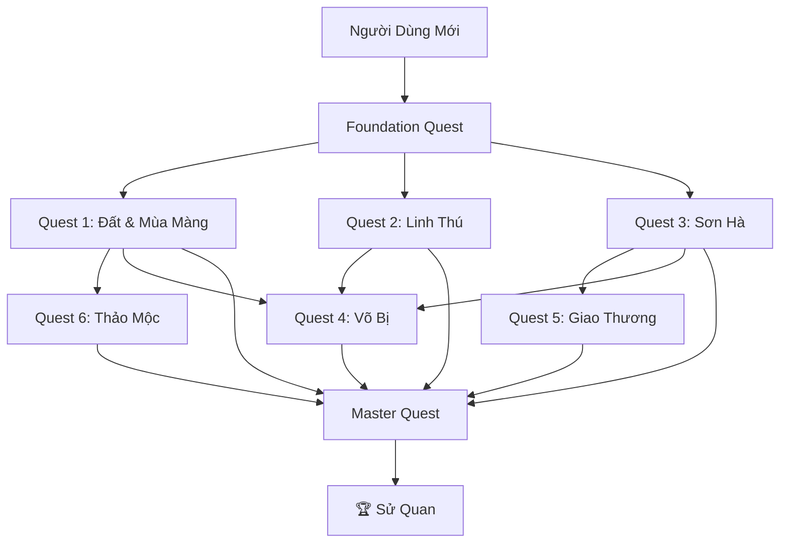

# LMS Curriculum & User Journey Design
## Lưu Niên Sử Kí - Interactive Heritage Learning Platform

**Version:** 1.0.0  
**Date:** 2025-12-13 (status reviewed: 2026-05-20)  
**Author:** Instructional Design Team  
**Status:** Design vision (instructional design) — see note below

> **Note (2026-05-20):** This is the original **instructional-design vision**, not an as-built spec. Since v1.0, the platform has shipped the core gamified loop it describes: quests, daily missions, XP/ranks, badges, streaks (with repair/comeback/friend), leaderboard, hearts, urn exams + certificates, learning paths, spaced-repetition review (SM-2), an AI tutor (DeepSeek RAG), live AI-teacher classrooms (LiveKit), plus Heritage Trails and a historical Timeline. The **API endpoint names in §6.2 are illustrative and do not all match the implemented API** (e.g. lesson completion is `POST /api/v1/progress/complete-lesson`, quiz submit is `POST /api/v1/motifs/{id}/quiz/submit`, daily challenges ship as "daily missions"). For the implemented contract see `docs/architecture/` and the backend route definitions. Quest themes/motif counts below remain the content-design reference.

---

## Table of Contents

1. [Executive Summary](#1-executive-summary)
2. [The Knowledge Graph: Thematic Quests](#2-the-knowledge-graph-thematic-quests)
3. [Interactive Lesson Template](#3-interactive-lesson-template)
4. [Gamification System](#4-gamification-system)
5. [User Journey Map](#5-user-journey-map)
6. [Technical Integration Notes](#6-technical-integration-notes)

---

## 1. Executive Summary

### Platform Vision

**Lưu Niên Sử Kí** (流年史記 - Chronicles of Flowing Years) transforms the study of the **Cửu Đỉnh** (Nine Dynastic Urns) from passive reading into an **active exploration experience**. Users don't just learn about the 162 motifs—they **discover** them through 3D interaction, like archaeologists uncovering history.

### The Nine Urns (Cửu Đỉnh)

| Urn Name | Vietnamese | Represents | Est. Motifs |
|----------|------------|------------|-------------|
| **Cao Đỉnh** | 高鼎 | Emperor Gia Long | 18 |
| **Nhân Đỉnh** | 仁鼎 | Emperor Minh Mạng | 18 |
| **Chương Đỉnh** | 章鼎 | Emperor Thiệu Trị | 18 |
| **Anh Đỉnh** | 英鼎 | Emperor Tự Đức | 18 |
| **Nghị Đỉnh** | 毅鼎 | Royal Virtue | 18 |
| **Thuần Đỉnh** | 純鼎 | Royal Virtue | 18 |
| **Tuyên Đỉnh** | 宣鼎 | Royal Virtue | 18 |
| **Dụ Đỉnh** | 裕鼎 | Royal Virtue | 18 |
| **Huyền Đỉnh** | 玄鼎 | Royal Virtue | 18 |

### Core Design Principles

```
┌─────────────────────────────────────────────────────────────────────────────┐
│                     INSTRUCTIONAL DESIGN PHILOSOPHY                         │
│                                                                              │
│   ❌ AVOID                              ✅ EMBRACE                          │
│   ━━━━━━━                               ━━━━━━━━                            │
│   • Linear video lectures              • Exploration-based discovery        │
│   • Passive scrolling                  • Interactive 3D manipulation        │
│   • Text-heavy content                 • Visual-first, text-supported       │
│   • Single path learning               • Non-linear quest system            │
│   • Generic quizzes                    • "Find it on the Urn" challenges    │
│   • Abstract concepts                  • Tangible artifact collection       │
│                                                                              │
│   Learning Motto: "Nhìn - Tìm - Hiểu - Nhớ"                                │
│                    (See - Seek - Understand - Remember)                     │
│                                                                              │
└─────────────────────────────────────────────────────────────────────────────┘
```

---

## 2. The Knowledge Graph: Thematic Quests

### 2.1 Quest Structure Overview

Instead of presenting 162 motifs linearly, we organize them into **7 Thematic Quests** (Hành Trình). Each quest is a self-contained learning journey that crosses multiple urns.

```
┌─────────────────────────────────────────────────────────────────────────────┐
│                        QUEST MAP (Bản Đồ Hành Trình)                        │
│                                                                              │
│                           ┌─────────────────┐                               │
│                           │   FOUNDATION    │                               │
│                           │   QUEST (Intro) │                               │
│                           └────────┬────────┘                               │
│                                    │                                         │
│            ┌───────────────────────┼───────────────────────┐                │
│            │                       │                       │                │
│            ▼                       ▼                       ▼                │
│   ┌─────────────────┐    ┌─────────────────┐    ┌─────────────────┐        │
│   │  🌾 QUEST 1     │    │  🐅 QUEST 2     │    │  🏔️ QUEST 3     │        │
│   │  Đất & Mùa Màng │    │  Linh Thú       │    │  Sơn Hà Xã Tắc  │        │
│   │  (Land & Harvest│    │  (Sacred        │    │  (Mountains &   │        │
│   └────────┬────────┘    │   Creatures)    │    │   Rivers)       │        │
│            │             └────────┬────────┘    └────────┬────────┘        │
│            │                      │                      │                  │
│            └──────────────────────┼──────────────────────┘                  │
│                                   │                                          │
│            ┌───────────────────────┼───────────────────────┐                │
│            │                       │                       │                │
│            ▼                       ▼                       ▼                │
│   ┌─────────────────┐    ┌─────────────────┐    ┌─────────────────┐        │
│   │  ⚔️ QUEST 4     │    │  🚢 QUEST 5     │    │  🎋 QUEST 6     │        │
│   │  Võ Bị & Phòng  │    │  Giao Thương    │    │  Thảo Mộc       │        │
│   │  Thủ (Military) │    │  (Trade Routes) │    │  (Flora)        │        │
│   └────────┬────────┘    └────────┬────────┘    └────────┬────────┘        │
│            │                      │                      │                  │
│            └──────────────────────┼──────────────────────┘                  │
│                                   │                                          │
│                                   ▼                                          │
│                        ┌─────────────────────┐                              │
│                        │  👑 MASTER QUEST    │                              │
│                        │  Triều Đại & Đế Vương│                              │
│                        │  (Dynasty & Emperors)│                              │
│                        └─────────────────────┘                              │
│                                                                              │
└─────────────────────────────────────────────────────────────────────────────┘
```

### 2.2 Detailed Quest Breakdown

---

#### 🏛️ FOUNDATION QUEST: Nhập Môn Cửu Đỉnh (Gateway to the Nine Urns)

**Prerequisite:** None (Entry point for all users)
**Estimated Time:** 30-45 minutes
**Motifs Covered:** 0 (Contextual Introduction)

| Lesson | Title | Objective |
|--------|-------|-----------|
| F.1 | Cửu Đỉnh Là Gì? | Understand purpose of the Nine Urns |
| F.2 | Kinh Đô Huế | Explore the Imperial City context |
| F.3 | Nghệ Thuật Đúc Đồng | Learn bronze casting techniques |
| F.4 | Hướng Dẫn Khám Phá 3D | Tutorial: How to navigate 3D models |

**Completion Reward:** 🏅 Badge "Người Nhập Môn" (The Initiate)

---

#### 🌾 QUEST 1: Đất & Mùa Màng (Land & Harvest)

**Theme:** Agriculture, food production, prosperity of the realm
**Prerequisite:** Foundation Quest
**Estimated Time:** 60-90 minutes
**Motifs Covered:** ~25

```
┌─────────────────────────────────────────────────────────────────────────────┐
│  QUEST 1: ĐẤT & MÙA MÀNG                                                    │
│                                                                              │
│  Narrative Hook:                                                            │
│  "Triều Nguyễn coi nông nghiệp là nền tảng quốc gia. Các họa tiết trên     │
│   Cửu Đỉnh ca ngợi sự phong phú của đất Việt..."                           │
│                                                                              │
│  ┌─────────────────────────────────────────────────────────────────────┐   │
│  │  MOTIFS INCLUDED                                                    │   │
│  │                                                                     │   │
│  │  Crops (Cây Lương Thực)          Fruits (Hoa Quả)                  │   │
│  │  ├── Lúa (Rice)                  ├── Chuối (Banana)                │   │
│  │  ├── Ngô (Corn)                  ├── Xoài (Mango)                  │   │
│  │  ├── Khoai (Potato)              ├── Dừa (Coconut)                 │   │
│  │  └── Đậu (Beans)                 ├── Mít (Jackfruit)               │   │
│  │                                  └── Na (Custard Apple)            │   │
│  │  Tools (Nông Cụ)                                                   │   │
│  │  ├── Cày (Plow)                  Seasons (Mùa)                     │   │
│  │  ├── Liềm (Sickle)               ├── Xuân (Spring symbols)         │   │
│  │  └── Gầu (Water bucket)          └── Thu (Autumn symbols)          │   │
│  │                                                                     │   │
│  └─────────────────────────────────────────────────────────────────────┘   │
│                                                                              │
│  Lessons:                                                                   │
│  1.1  Lúa Gạo - Linh Hồn Việt Nam (Rice - Soul of Vietnam)                 │
│  1.2  Cây Trái Miền Nhiệt Đới (Tropical Fruits)                            │
│  1.3  Nông Cụ Thời Nguyễn (Farming Tools)                                  │
│  1.4  Tìm Kiếm Thử Thách: "Đỉnh Nào Có Lúa?" (Find the Rice!)              │
│                                                                              │
│  Boss Challenge: "Nhà Nông Giỏi" - Identify 10 agriculture motifs          │
│  Completion Reward: 🌾 Badge "Nông Dân Tri Thức"                            │
│                                                                              │
└─────────────────────────────────────────────────────────────────────────────┘
```

---

#### 🐅 QUEST 2: Linh Thú & Tứ Linh (Sacred Creatures)

**Theme:** Mythical and real animals, their symbolism in Vietnamese culture
**Prerequisite:** Foundation Quest
**Estimated Time:** 90-120 minutes
**Motifs Covered:** ~35

```
┌─────────────────────────────────────────────────────────────────────────────┐
│  QUEST 2: LINH THÚ & TỨ LINH                                               │
│                                                                              │
│  Narrative Hook:                                                            │
│  "Trên mỗi đỉnh đồng, các linh thú canh giữ sự thịnh vượng của vương      │
│   triều. Từ Rồng thiêng đến Hổ mạnh..."                                    │
│                                                                              │
│  ┌─────────────────────────────────────────────────────────────────────┐   │
│  │  MOTIFS INCLUDED                                                    │   │
│  │                                                                     │   │
│  │  Tứ Linh (Four Sacred)           Thú Rừng (Forest)                 │   │
│  │  ├── 🐉 Long (Dragon)            ├── 🐅 Hổ (Tiger)                 │   │
│  │  ├── 🐢 Quy (Tortoise)           ├── 🦌 Nai (Deer)                 │   │
│  │  ├── 🦅 Phượng (Phoenix)         ├── 🐗 Lợn Rừng (Wild Boar)       │   │
│  │  └── 🦁 Lân (Unicorn)            └── 🐒 Khỉ (Monkey)               │   │
│  │                                                                     │   │
│  │  Thủy Tộc (Aquatic)              Chim Muông (Birds)                │   │
│  │  ├── 🐟 Cá Chép (Carp)           ├── 🦚 Công (Peacock)             │   │
│  │  ├── 🐊 Cá Sấu (Crocodile)       ├── 🦢 Hạc (Crane)                │   │
│  │  ├── 🦐 Tôm (Shrimp)             ├── 🦜 Vẹt (Parrot)               │   │
│  │  └── 🐚 Ốc (Snail)               └── 🦆 Vịt (Duck)                 │   │
│  │                                                                     │   │
│  └─────────────────────────────────────────────────────────────────────┘   │
│                                                                              │
│  Lessons:                                                                   │
│  2.1  Rồng - Biểu Tượng Hoàng Gia (Dragon - Royal Symbol)                  │
│  2.2  Tứ Linh Và Ý Nghĩa (Four Sacred Creatures)                           │
│  2.3  Động Vật Có Thật (Real Animals)                                       │
│  2.4  Chim Trong Văn Hóa Cung Đình (Birds in Court Culture)                │
│  2.5  Thử Thách: "Săn Tìm Tứ Linh" (Hunt for the Four)                     │
│                                                                              │
│  Boss Challenge: Match each creature to its urn location (3D search)        │
│  Completion Reward: 🐉 Badge "Người Thuần Linh Thú"                         │
│                                                                              │
└─────────────────────────────────────────────────────────────────────────────┘
```

---

#### 🏔️ QUEST 3: Sơn Hà Xã Tắc (Mountains, Rivers & Territory)

**Theme:** Geography, natural landmarks, territorial symbols
**Prerequisite:** Foundation Quest
**Estimated Time:** 75-90 minutes
**Motifs Covered:** ~20

| Lesson | Title | Key Motifs |
|--------|-------|------------|
| 3.1 | Núi Thiêng | Mountains as sacred symbols |
| 3.2 | Sông Ngòi | Rivers and waterways |
| 3.3 | Biển Đông | Ocean and maritime symbols |
| 3.4 | Bản Đồ Trên Đỉnh | Geographic features on urns |

**Featured Motifs:**
- Núi (Mountains) - Multiple representations
- Sông Hương (Perfume River)
- Biển (Ocean waves)
- Mây (Cloud patterns)
- Mặt Trời (Sun)
- Mặt Trăng (Moon)

**Boss Challenge:** "Địa Lý Gia" - Navigate the 3D urn to find all geographical motifs
**Completion Reward:** 🏔️ Badge "Người Giữ Sơn Hà"

---

#### ⚔️ QUEST 4: Võ Bị & Phòng Thủ (Military & Defense)

**Theme:** Weapons, warfare, military strength of the dynasty
**Prerequisite:** Quest 1 OR Quest 2 OR Quest 3
**Estimated Time:** 60-75 minutes
**Motifs Covered:** ~18

```
┌─────────────────────────────────────────────────────────────────────────────┐
│  QUEST 4: VÕ BỊ & PHÒNG THỦ                                                │
│                                                                              │
│  Narrative Hook:                                                            │
│  "Triều Nguyễn xây dựng quân đội hùng mạnh để bảo vệ bờ cõi.               │
│   Vũ khí và chiến thuyền được khắc họa như lời nhắc nhở..."                │
│                                                                              │
│  MOTIFS INCLUDED:                                                           │
│  ┌───────────────────────┐  ┌───────────────────────┐                       │
│  │  Vũ Khí (Weapons)     │  │  Phương Tiện (Vehicles)│                      │
│  │  • Súng thần công     │  │  • Thuyền chiến       │                       │
│  │  • Kiếm              │  │  • Xe kéo pháo         │                       │
│  │  • Cung tên          │  │  • Voi chiến           │                       │
│  │  • Giáo mác          │  │                        │                       │
│  └───────────────────────┘  └───────────────────────┘                       │
│                                                                              │
│  Lessons:                                                                   │
│  4.1  Súng Thần Công - Hỏa Lực Triều Nguyễn                                │
│  4.2  Chiến Thuyền Và Đường Thủy                                           │
│  4.3  Vũ Khí Lạnh Thời Phong Kiến                                          │
│  4.4  Thử Thách: "Tìm Vũ Khí Bí Mật"                                       │
│                                                                              │
│  Boss Challenge: Identify all 9 cannons across all urns                     │
│  Completion Reward: ⚔️ Badge "Võ Tướng"                                     │
│                                                                              │
└─────────────────────────────────────────────────────────────────────────────┘
```

---

#### 🚢 QUEST 5: Giao Thương & Ngoại Giao (Trade & Diplomacy)

**Theme:** Maritime trade, foreign relations, cultural exchange
**Prerequisite:** Quest 3 (Geography knowledge needed)
**Estimated Time:** 60-75 minutes
**Motifs Covered:** ~15

| Lesson | Title | Key Motifs |
|--------|-------|------------|
| 5.1 | Con Đường Tơ Lụa Biển | Maritime Silk Road symbols |
| 5.2 | Thương Thuyền | Trading vessels |
| 5.3 | Sản Vật Giao Thương | Trade goods depicted |
| 5.4 | Ảnh Hưởng Ngoại Lai | Foreign influences in motifs |

**Featured Motifs:**
- Thuyền buồm (Sailing ships)
- Hải sản (Marine products)
- Lụa (Silk)
- Sứ (Porcelain)
- Trầm hương (Agarwood)

**Boss Challenge:** Trace a trade route using motif locations
**Completion Reward:** 🚢 Badge "Thương Gia"

---

#### 🎋 QUEST 6: Thảo Mộc & Dược Liệu (Flora & Medicine)

**Theme:** Plants, flowers, medicinal herbs, natural beauty
**Prerequisite:** Quest 1 (Agriculture context)
**Estimated Time:** 90-100 minutes
**Motifs Covered:** ~30

```
┌─────────────────────────────────────────────────────────────────────────────┐
│  QUEST 6: THẢO MỘC & DƯỢC LIỆU                                             │
│                                                                              │
│  MOTIFS INCLUDED:                                                           │
│                                                                              │
│  Hoa (Flowers)              Cây Cổ Thụ (Trees)      Dược Liệu (Medicine)   │
│  ├── 🌸 Sen (Lotus)         ├── Tùng (Pine)         ├── Sâm (Ginseng)      │
│  ├── 🌺 Mai (Apricot)       ├── Trúc (Bamboo)       ├── Quế (Cinnamon)     │
│  ├── 🌻 Cúc (Chrysanthemum) ├── Đa (Banyan)         ├── Hồi (Star Anise)   │
│  ├── 🌹 Hồng (Rose)         └── Liễu (Willow)       └── Cam Thảo           │
│  └── 🌼 Lan (Orchid)                                                        │
│                                                                              │
│  Lessons:                                                                   │
│  6.1  Tứ Quý - Mai, Lan, Cúc, Trúc                                         │
│  6.2  Sen - Quốc Hoa Việt Nam                                              │
│  6.3  Cây Thuốc Trong Y Học Cổ Truyền                                      │
│  6.4  Biểu Tượng Hoa Trong Cung Đình                                       │
│  6.5  Thử Thách: "Vườn Ngự Uyển 3D"                                        │
│                                                                              │
│  Boss Challenge: Create a "virtual garden" by finding all flora motifs      │
│  Completion Reward: 🎋 Badge "Thảo Dược Sư"                                 │
│                                                                              │
└─────────────────────────────────────────────────────────────────────────────┘
```

---

#### 👑 MASTER QUEST: Triều Đại & Đế Vương (Dynasty & Emperors)

**Theme:** The Nguyễn Dynasty, emperors, historical context
**Prerequisite:** Complete ALL 6 previous quests
**Estimated Time:** 120-150 minutes
**Motifs Covered:** Comprehensive synthesis + Emperor-specific details

```
┌─────────────────────────────────────────────────────────────────────────────┐
│  👑 MASTER QUEST: TRIỀU ĐẠI & ĐẾ VƯƠNG                                     │
│                                                                              │
│  This is the FINAL QUEST - unlocked only after completing all others        │
│                                                                              │
│  Lessons:                                                                   │
│  M.1  Lịch Sử Triều Nguyễn (1802-1945)                                     │
│  M.2  Gia Long - Người Sáng Lập (Cao Đỉnh)                                 │
│  M.3  Minh Mạng - Người Cải Cách (Nhân Đỉnh)                               │
│  M.4  Thiệu Trị & Tự Đức (Chương Đỉnh, Anh Đỉnh)                           │
│  M.5  Ý Nghĩa Của Việc Đúc Cửu Đỉnh                                        │
│  M.6  Di Sản UNESCO & Bảo Tồn                                               │
│                                                                              │
│  FINAL EXAM:                                                                │
│  "Đại Khảo Thí Sử Quan" - Comprehensive 3D examination                     │
│  • 30 questions across all quests                                           │
│  • Must identify motifs directly on 3D models                               │
│  • Time limit: 45 minutes                                                   │
│  • Passing score: 80%                                                       │
│                                                                              │
│  ULTIMATE REWARD:                                                           │
│  👑 Title: "Sử Quan Cửu Đỉnh" (Official Historian of the Nine Urns)        │
│  🏆 Certificate: Downloadable & Shareable                                   │
│  🎖️ Profile Badge: Golden Urn                                              │
│                                                                              │
└─────────────────────────────────────────────────────────────────────────────┘
```

### 2.3 Quest Prerequisites & Unlocking Flow



---

## 3. Interactive Lesson Template

### 3.1 Lesson Structure Overview

Every lesson follows the **"Nhìn - Tìm - Hiểu - Nhớ"** (See - Seek - Understand - Remember) framework. This is NOT a passive video experience—users must actively engage with 3D models.

```
┌─────────────────────────────────────────────────────────────────────────────┐
│                    INTERACTIVE LESSON FLOW                                  │
│                                                                              │
│  ┌─────────────────────────────────────────────────────────────────────┐   │
│  │  PHASE 1: NHÌN (SEE) - Introduction                    ⏱️ 2-3 min   │   │
│  │  ━━━━━━━━━━━━━━━━━━━━━━━━━━━━━━━━━━━━━━━━━━━━━━━━━━━━━━━━━━━━━━━━━  │   │
│  │  • Hook: Engaging question or story                                 │   │
│  │  • Context: Why this motif matters                                  │   │
│  │  • Preview: Show the motif (blurred/partial)                        │   │
│  │                                                                     │   │
│  │  UI: Full-screen image/video with text overlay                      │   │
│  └─────────────────────────────────────────────────────────────────────┘   │
│                                      │                                       │
│                                      ▼                                       │
│  ┌─────────────────────────────────────────────────────────────────────┐   │
│  │  PHASE 2: TÌM (SEEK) - 3D Exploration Challenge        ⏱️ 3-5 min   │   │
│  │  ━━━━━━━━━━━━━━━━━━━━━━━━━━━━━━━━━━━━━━━━━━━━━━━━━━━━━━━━━━━━━━━━━  │   │
│  │  • Task: "Find the [motif] on [Urn Name]"                           │   │
│  │  • User rotates, zooms, explores the 3D model                       │   │
│  │  • Hint system: Progressive hints after 30s, 60s, 90s               │   │
│  │  • Success: Motif highlights, celebration animation                 │   │
│  │                                                                     │   │
│  │  UI: Full 3D viewer with touch/mouse controls                       │   │
│  │  Accessibility: "Skip to location" option for motor impairments     │   │
│  └─────────────────────────────────────────────────────────────────────┘   │
│                                      │                                       │
│                                      ▼                                       │
│  ┌─────────────────────────────────────────────────────────────────────┐   │
│  │  PHASE 3: HIỂU (UNDERSTAND) - Deep Dive Content        ⏱️ 5-8 min   │   │
│  │  ━━━━━━━━━━━━━━━━━━━━━━━━━━━━━━━━━━━━━━━━━━━━━━━━━━━━━━━━━━━━━━━━━  │   │
│  │  • Detailed explanation of the motif                                │   │
│  │  • Historical context and symbolism                                 │   │
│  │  • Comparison with similar motifs on other urns                     │   │
│  │  • Audio narration option (Vietnamese/English)                      │   │
│  │  • "Did You Know?" expandable sections                              │   │
│  │                                                                     │   │
│  │  UI: Split view - 3D model (left) + Content (right)                 │   │
│  │  Interactive: Click hotspots on 3D model for more info              │   │
│  └─────────────────────────────────────────────────────────────────────┘   │
│                                      │                                       │
│                                      ▼                                       │
│  ┌─────────────────────────────────────────────────────────────────────┐   │
│  │  PHASE 4: NHỚ (REMEMBER) - Mini Quiz                   ⏱️ 2-3 min   │   │
│  │  ━━━━━━━━━━━━━━━━━━━━━━━━━━━━━━━━━━━━━━━━━━━━━━━━━━━━━━━━━━━━━━━━━  │   │
│  │  • 3-5 questions per lesson                                         │   │
│  │  • Mix of question types (see 3.3)                                  │   │
│  │  • Immediate feedback with explanations                             │   │
│  │  • Retry allowed (max 3 attempts)                                   │   │
│  │                                                                     │   │
│  │  Passing: 70% to unlock next lesson                                 │   │
│  │  Perfect: 100% earns bonus XP                                       │   │
│  └─────────────────────────────────────────────────────────────────────┘   │
│                                      │                                       │
│                                      ▼                                       │
│  ┌─────────────────────────────────────────────────────────────────────┐   │
│  │  PHASE 5: REWARD - Completion & Collection             ⏱️ 30 sec    │   │
│  │  ━━━━━━━━━━━━━━━━━━━━━━━━━━━━━━━━━━━━━━━━━━━━━━━━━━━━━━━━━━━━━━━━━  │   │
│  │  • XP awarded based on performance                                  │   │
│  │  • Artifact unlocked (if applicable)                                │   │
│  │  • Progress bar update                                              │   │
│  │  • "Share your achievement" option                                  │   │
│  │  • Teaser for next lesson                                           │   │
│  └─────────────────────────────────────────────────────────────────────┘   │
│                                                                              │
└─────────────────────────────────────────────────────────────────────────────┘
```

### 3.2 Detailed Phase Specifications

#### Phase 2: TÌM (SEEK) - 3D Exploration Mechanics

```
┌─────────────────────────────────────────────────────────────────────────────┐
│                    3D EXPLORATION INTERFACE                                 │
│                                                                              │
│  ┌─────────────────────────────────────────────────────────────────────┐   │
│  │                                                                     │   │
│  │                    ┌─────────────────────┐                          │   │
│  │                    │                     │                          │   │
│  │                    │    3D URN MODEL     │                          │   │
│  │                    │                     │                          │   │
│  │                    │   [Rotatable]       │                          │   │
│  │                    │   [Zoomable]        │                          │   │
│  │                    │   [Pannable]        │                          │   │
│  │                    │                     │                          │   │
│  │                    └─────────────────────┘                          │   │
│  │                                                                     │   │
│  │  ┌──────────────────────────────────────────────────────────────┐  │   │
│  │  │  🎯 MISSION: Tìm hình con Rồng trên Cao Đỉnh                 │  │   │
│  │  │     Find the Dragon motif on Cao Đỉnh                        │  │   │
│  │  └──────────────────────────────────────────────────────────────┘  │   │
│  │                                                                     │   │
│  │  ┌────────┐  ┌────────┐  ┌────────┐  ┌────────────────────────┐   │   │
│  │  │ 🔄     │  │ 🔍+    │  │ 🔍-    │  │ 💡 Gợi ý (Hint)        │   │   │
│  │  │ Reset  │  │ Zoom+  │  │ Zoom-  │  │ [Available in 30s]     │   │   │
│  │  └────────┘  └────────┘  └────────┘  └────────────────────────┘   │   │
│  │                                                                     │   │
│  └─────────────────────────────────────────────────────────────────────┘   │
│                                                                              │
│  HINT SYSTEM:                                                               │
│  ├── Hint 1 (30s): General direction ("Phía trên đỉnh" / "Near the top")   │
│  ├── Hint 2 (60s): More specific ("Bên trái, gần quai" / "Left, near handle")│
│  └── Hint 3 (90s): Highlight region (area glows softly)                     │
│                                                                              │
│  DETECTION:                                                                 │
│  • User taps/clicks on suspected motif location                             │
│  • System checks if click is within motif bounding box                      │
│  • Correct: Celebration animation + proceed                                 │
│  • Incorrect: "Thử lại!" (Try again!) + hint countdown accelerates          │
│                                                                              │
└─────────────────────────────────────────────────────────────────────────────┘
```

#### Phase 3: HIỂU (UNDERSTAND) - Content Layout

```
┌─────────────────────────────────────────────────────────────────────────────┐
│                    DEEP DIVE CONTENT LAYOUT                                 │
│                                                                              │
│  ┌────────────────────────────┬────────────────────────────────────────┐   │
│  │                            │                                        │   │
│  │    3D MODEL (Focused)      │   CONTENT PANEL                        │   │
│  │                            │                                        │   │
│  │    ┌──────────────────┐    │   ┌────────────────────────────────┐  │   │
│  │    │                  │    │   │ 🐉 RỒNG (Dragon)               │  │   │
│  │    │   [Motif         │    │   │                                │  │   │
│  │    │    Highlighted]  │    │   │ Rồng là biểu tượng của hoàng   │  │   │
│  │    │                  │    │   │ đế và quyền lực tối cao...     │  │   │
│  │    │   🔊 Audio       │    │   │                                │  │   │
│  │    │                  │    │   │ ▼ Lịch sử (History)            │  │   │
│  │    └──────────────────┘    │   │ ▼ Ý nghĩa (Symbolism)          │  │   │
│  │                            │   │ ▼ So sánh (Comparison)         │  │   │
│  │    [Hotspot 1] [Hotspot 2] │   │                                │  │   │
│  │                            │   │ 💡 Bạn có biết?                │  │   │
│  │                            │   │ "Rồng Việt Nam có 4 móng..."   │  │   │
│  │                            │   │                                │  │   │
│  └────────────────────────────┴────────────────────────────────────────┘   │
│                                                                              │
│  CONTENT STRUCTURE:                                                         │
│  ├── Main Description (always visible, 100-150 words)                       │
│  ├── Expandable Sections:                                                   │
│  │   ├── Lịch sử (Historical context)                                       │
│  │   ├── Ý nghĩa (Symbolic meaning)                                         │
│  │   ├── So sánh (Compare with other urns)                                  │
│  │   └── Kỹ thuật (Craftsmanship details)                                   │
│  ├── "Did You Know?" fun facts                                              │
│  └── Related Motifs (links to other lessons)                                │
│                                                                              │
└─────────────────────────────────────────────────────────────────────────────┘
```

### 3.3 Quiz Question Types

```
┌─────────────────────────────────────────────────────────────────────────────┐
│                    QUIZ QUESTION TYPES                                      │
│                                                                              │
│  TYPE 1: MULTIPLE CHOICE (Trắc Nghiệm)                                     │
│  ━━━━━━━━━━━━━━━━━━━━━━━━━━━━━━━━━━━━━━                                     │
│  Q: Rồng trên Cửu Đỉnh có bao nhiêu móng?                                  │
│     A) 3 móng    B) 4 móng ✓    C) 5 móng    D) 6 móng                     │
│                                                                              │
│  ─────────────────────────────────────────────────────────────────────────  │
│                                                                              │
│  TYPE 2: 3D LOCATION (Tìm Vị Trí)                                          │
│  ━━━━━━━━━━━━━━━━━━━━━━━━━━━━━━━━━━                                         │
│  Q: Chạm vào vị trí của hình Hổ trên Nhân Đỉnh                             │
│     [3D Model displayed - user must tap correct location]                   │
│                                                                              │
│  ─────────────────────────────────────────────────────────────────────────  │
│                                                                              │
│  TYPE 3: MATCHING (Ghép Đôi)                                               │
│  ━━━━━━━━━━━━━━━━━━━━━━━━━━━━━                                              │
│  Q: Ghép mỗi linh thú với ý nghĩa của nó                                   │
│     Rồng ──────── Sức mạnh                                                  │
│     Phượng ────── Quyền lực ✓                                              │
│     Quy ─────────  Vẻ đẹp                                                   │
│     Lân ─────────  Trường thọ                                               │
│                                                                              │
│  ─────────────────────────────────────────────────────────────────────────  │
│                                                                              │
│  TYPE 4: TRUE/FALSE (Đúng/Sai)                                             │
│  ━━━━━━━━━━━━━━━━━━━━━━━━━━━━━━                                             │
│  Q: Cao Đỉnh là đỉnh lớn nhất trong Cửu Đỉnh                               │
│     ✓ Đúng    ○ Sai                                                        │
│                                                                              │
│  ─────────────────────────────────────────────────────────────────────────  │
│                                                                              │
│  TYPE 5: IMAGE COMPARISON (So Sánh Hình)                                   │
│  ━━━━━━━━━━━━━━━━━━━━━━━━━━━━━━━━━━━━━━━                                    │
│  Q: Hình nào dưới đây là Rồng trên Cao Đỉnh?                               │
│     [Image A] [Image B ✓] [Image C] [Image D]                              │
│                                                                              │
│  ─────────────────────────────────────────────────────────────────────────  │
│                                                                              │
│  TYPE 6: FILL IN THE BLANK (Điền Khuyết)                                   │
│  ━━━━━━━━━━━━━━━━━━━━━━━━━━━━━━━━━━━━━━━                                    │
│  Q: Cửu Đỉnh được đúc vào năm _______ dưới triều vua _______.              │
│     Answer: 1835, Minh Mạng                                                 │
│                                                                              │
└─────────────────────────────────────────────────────────────────────────────┘
```

### 3.4 Sample Lesson: Complete Example

```
┌─────────────────────────────────────────────────────────────────────────────┐
│  LESSON 2.1: RỒNG - BIỂU TƯỢNG HOÀNG GIA                                   │
│  Quest: Linh Thú & Tứ Linh | Duration: 12-15 minutes                       │
│                                                                              │
│  ═══════════════════════════════════════════════════════════════════════   │
│                                                                              │
│  PHASE 1: NHÌN (Introduction)                                              │
│  ───────────────────────────                                                │
│  [Full-screen image of dragon motif, slightly blurred]                      │
│                                                                              │
│  "Trong suốt hàng ngàn năm, Rồng là biểu tượng thiêng liêng nhất của       │
│   hoàng gia Việt Nam. Nhưng Rồng Việt Nam có gì khác biệt so với           │
│   Rồng Trung Hoa? Hãy cùng khám phá..."                                    │
│                                                                              │
│  [Button: Bắt Đầu Khám Phá →]                                              │
│                                                                              │
│  ═══════════════════════════════════════════════════════════════════════   │
│                                                                              │
│  PHASE 2: TÌM (3D Exploration)                                             │
│  ─────────────────────────────                                              │
│  Mission: "Tìm hình Rồng trên Cao Đỉnh"                                    │
│                                                                              │
│  [3D Model: Cao Đỉnh - fully rotatable]                                    │
│                                                                              │
│  Hints:                                                                     │
│  • 30s: "Rồng thường ở vị trí trang trọng nhất"                            │
│  • 60s: "Hãy nhìn phần thân chính của đỉnh"                                │
│  • 90s: [Highlight glows on correct region]                                 │
│                                                                              │
│  [User taps correct location → Celebration animation]                       │
│                                                                              │
│  ═══════════════════════════════════════════════════════════════════════   │
│                                                                              │
│  PHASE 3: HIỂU (Deep Dive)                                                 │
│  ─────────────────────────                                                  │
│  [Split view: 3D model (left) + Content (right)]                           │
│                                                                              │
│  🐉 RỒNG VIỆT NAM                                                          │
│                                                                              │
│  Rồng trên Cửu Đỉnh mang đặc trưng riêng của nghệ thuật Nguyễn:            │
│  • Thân uốn lượn mềm mại theo hình chữ S                                   │
│  • 4 móng (khác với rồng Trung Hoa 5 móng)                                 │
│  • Bờm và râu bay ngược gió                                                │
│  • Vảy được chạm khắc tỉ mỉ từng chi tiết                                  │
│                                                                              │
│  ▼ Lịch sử Rồng Việt Nam                                                   │
│  ▼ Ý nghĩa trong văn hóa cung đình                                         │
│  ▼ So sánh Rồng trên 9 đỉnh                                                │
│                                                                              │
│  💡 Bạn có biết?                                                           │
│  "Rồng Việt Nam có 4 móng để phân biệt với Rồng Hoàng đế Trung Hoa         │
│   (5 móng), thể hiện sự độc lập văn hóa của Đại Việt."                     │
│                                                                              │
│  ═══════════════════════════════════════════════════════════════════════   │
│                                                                              │
│  PHASE 4: NHỚ (Quiz)                                                       │
│  ───────────────────                                                        │
│  Q1: Rồng Việt Nam có bao nhiêu móng? [Multiple Choice]                    │
│  Q2: Chạm vào vị trí Rồng trên Nhân Đỉnh [3D Location]                     │
│  Q3: Đúng hay Sai: Rồng chỉ xuất hiện trên Cao Đỉnh [True/False]           │
│                                                                              │
│  ═══════════════════════════════════════════════════════════════════════   │
│                                                                              │
│  PHASE 5: REWARD                                                           │
│  ───────────────                                                            │
│  🎉 Hoàn thành! +150 XP                                                    │
│  🐉 Artifact Unlocked: "Rồng Cao Đỉnh"                                     │
│  📊 Progress: Quest 2 - 20% complete                                       │
│                                                                              │
│  [Share] [Next Lesson: Tứ Linh Và Ý Nghĩa →]                               │
│                                                                              │
└─────────────────────────────────────────────────────────────────────────────┘
```

---

## 4. Gamification System

### 4.1 Core Gamification Philosophy

```
┌─────────────────────────────────────────────────────────────────────────────┐
│                    GAMIFICATION DESIGN PRINCIPLES                           │
│                                                                              │
│  ┌─────────────────────────────────────────────────────────────────────┐   │
│  │  MOTIVATION FRAMEWORK: Self-Determination Theory                    │   │
│  │                                                                     │   │
│  │  ┌─────────────┐  ┌─────────────┐  ┌─────────────┐                 │   │
│  │  │  AUTONOMY   │  │ COMPETENCE  │  │ RELATEDNESS │                 │   │
│  │  │             │  │             │  │             │                 │   │
│  │  │ • Choose    │  │ • Skill     │  │ • Share     │                 │   │
│  │  │   quest     │  │   mastery   │  │   progress  │                 │   │
│  │  │   order     │  │ • Clear     │  │ • Compare   │                 │   │
│  │  │ • Skip      │  │   feedback  │  │   with      │                 │   │
│  │  │   lessons   │  │ • Visible   │  │   friends   │                 │   │
│  │  │ • Set pace  │  │   growth    │  │ • Community │                 │   │
│  │  │             │  │             │  │             │                 │   │
│  │  └─────────────┘  └─────────────┘  └─────────────┘                 │   │
│  │                                                                     │   │
│  └─────────────────────────────────────────────────────────────────────┘   │
│                                                                              │
│  AVOID:                                                                     │
│  ❌ Pay-to-win mechanics                                                    │
│  ❌ Punitive systems (losing progress)                                      │
│  ❌ Artificial time gates                                                   │
│  ❌ Excessive notifications                                                 │
│                                                                              │
└─────────────────────────────────────────────────────────────────────────────┘
```

### 4.2 Rank System (Hệ Thống Cấp Bậc)

Users progress through **10 ranks** inspired by the Vietnamese imperial examination system and court hierarchy.

```
┌─────────────────────────────────────────────────────────────────────────────┐
│                    RANK PROGRESSION SYSTEM                                  │
│                                                                              │
│  RANK                    TITLE                    XP REQUIRED   UNLOCKS     │
│  ════════════════════════════════════════════════════════════════════════   │
│                                                                              │
│  ┌─────┐                                                                    │
│  │  1  │  LÍNH MỚI (Recruit)                     0 XP          Entry       │
│  └──┬──┘  "Người mới bắt đầu hành trình"                                   │
│     │                                                                        │
│  ┌──▼──┐                                                                    │
│  │  2  │  THƯ SINH (Scholar Student)             500 XP        Profile     │
│  └──┬──┘  "Đã bước vào cửa tri thức"                          customization│
│     │                                                                        │
│  ┌──▼──┐                                                                    │
│  │  3  │  TÚ TÀI (Bachelor)                      1,500 XP      Hint boost  │
│  └──┬──┘  "Đã vượt qua kỳ thi đầu tiên"                       (extra hints)│
│     │                                                                        │
│  ┌──▼──┐                                                                    │
│  │  4  │  CỬ NHÂN (Licentiate)                   3,500 XP      Audio       │
│  └──┬──┘  "Đã chứng minh năng lực học vấn"                    narration    │
│     │                                                                        │
│  ┌──▼──┐                                                                    │
│  │  5  │  TIẾN SĨ (Doctor)                       7,000 XP      AR mode     │
│  └──┬──┘  "Đã đạt học vị cao quý"                             (if available)│
│     │                                                                        │
│  ┌──▼──┐                                                                    │
│  │  6  │  THÁM HOA (Third-Place Graduate)        12,000 XP     Exclusive   │
│  └──┬──┘  "Đứng trong hàng ngũ xuất sắc"                      content      │
│     │                                                                        │
│  ┌──▼──┐                                                                    │
│  │  7  │  BẢNG NHÃN (Second-Place Graduate)      20,000 XP     Leaderboard │
│  └──┬──┘  "Gần đỉnh cao vinh quang"                           visibility   │
│     │                                                                        │
│  ┌──▼──┐                                                                    │
│  │  8  │  TRẠNG NGUYÊN (First-Place Graduate)    35,000 XP     Special     │
│  └──┬──┘  "Đỗ đầu thiên hạ"                                   avatar frame │
│     │                                                                        │
│  ┌──▼──┐                                                                    │
│  │  9  │  HÀN LÂM (Imperial Academy Member)      55,000 XP     Beta        │
│  └──┬──┘  "Được mời vào Viện Hàn Lâm"                         features     │
│     │                                                                        │
│  ┌──▼──┐                                                                    │
│  │ 10  │  SỬ QUAN (Official Historian)           80,000 XP     All content │
│  └─────┘  "Người gìn giữ lịch sử Cửu Đỉnh"                    + Certificate│
│                                                                              │
│  ═══════════════════════════════════════════════════════════════════════   │
│                                                                              │
│  XP EARNING RATES:                                                          │
│  • Complete lesson: 100-200 XP (based on quiz score)                        │
│  • Perfect quiz (100%): +50 XP bonus                                        │
│  • Complete quest: 500 XP                                                   │
│  • First attempt success: +25 XP                                            │
│  • Daily login streak: 10-50 XP                                             │
│  • Find hidden motif: 75 XP                                                 │
│                                                                              │
└─────────────────────────────────────────────────────────────────────────────┘
```

### 4.3 Artifact Collection (Bộ Sưu Tập Cổ Vật)

When users complete lessons about specific motifs, they **unlock digital artifacts** for their collection.

```
┌─────────────────────────────────────────────────────────────────────────────┐
│                    ARTIFACT COLLECTION SYSTEM                               │
│                                                                              │
│  ┌─────────────────────────────────────────────────────────────────────┐   │
│  │  USER PROFILE: Nguyễn Văn A                                         │   │
│  │  Rank: Tiến Sĩ (Level 5) | XP: 8,234                                │   │
│  │                                                                     │   │
│  │  ┌─────────────────────────────────────────────────────────────┐   │   │
│  │  │  BỘ SƯU TẬP CỔ VẬT (Artifact Collection)                    │   │   │
│  │  │  Collected: 47/162 (29%)                                    │   │   │
│  │  │                                                             │   │   │
│  │  │  ┌─────────┐ ┌─────────┐ ┌─────────┐ ┌─────────┐           │   │   │
│  │  │  │  🐉     │ │  🐅     │ │  🌸     │ │  ⚔️     │           │   │   │
│  │  │  │  Rồng   │ │  Hổ     │ │  Sen    │ │  Kiếm   │           │   │   │
│  │  │  │ ★★★★★  │ │ ★★★★☆  │ │ ★★★☆☆  │ │ ★★★★☆  │           │   │   │
│  │  │  │ LEGEND │ │  EPIC   │ │  RARE   │ │  EPIC   │           │   │   │
│  │  │  └─────────┘ └─────────┘ └─────────┘ └─────────┘           │   │   │
│  │  │                                                             │   │   │
│  │  │  ┌─────────┐ ┌─────────┐ ┌─────────┐ ┌─────────┐           │   │   │
│  │  │  │  🌾     │ │  🏔️     │ │  ❓     │ │  ❓     │           │   │   │
│  │  │  │  Lúa    │ │  Núi    │ │ LOCKED  │ │ LOCKED  │           │   │   │
│  │  │  │ ★★☆☆☆  │ │ ★★★☆☆  │ │         │ │         │           │   │   │
│  │  │  │ COMMON │ │  RARE   │ │         │ │         │           │   │   │
│  │  │  └─────────┘ └─────────┘ └─────────┘ └─────────┘           │   │   │
│  │  │                                                             │   │   │
│  │  └─────────────────────────────────────────────────────────────┘   │   │
│  │                                                                     │   │
│  └─────────────────────────────────────────────────────────────────────┘   │
│                                                                              │
│  ARTIFACT RARITY TIERS:                                                     │
│  ════════════════════════                                                   │
│  ★☆☆☆☆  COMMON    - Basic motifs (crops, common plants)                   │
│  ★★☆☆☆  UNCOMMON  - Regional symbols (rivers, mountains)                  │
│  ★★★☆☆  RARE      - Cultural symbols (flowers, birds)                     │
│  ★★★★☆  EPIC      - Significant motifs (weapons, sacred animals)          │
│  ★★★★★  LEGENDARY - Tứ Linh (Dragon, Phoenix, Tortoise, Unicorn)          │
│                                                                              │
│  ARTIFACT DETAILS (when clicked):                                           │
│  ┌─────────────────────────────────────────────────────────────────────┐   │
│  │  🐉 RỒNG CAO ĐỈNH                                                   │   │
│  │  ─────────────────                                                  │   │
│  │  Rarity: ★★★★★ LEGENDARY                                           │   │
│  │  Urn: Cao Đỉnh (高鼎)                                               │   │
│  │  Unlocked: 2025-12-10                                               │   │
│  │                                                                     │   │
│  │  "Rồng trên Cao Đỉnh là biểu tượng của Hoàng đế Gia Long,          │   │
│  │   người sáng lập triều Nguyễn..."                                   │   │
│  │                                                                     │   │
│  │  [View in 3D] [Share] [Set as Profile]                              │   │
│  │                                                                     │   │
│  └─────────────────────────────────────────────────────────────────────┘   │
│                                                                              │
└─────────────────────────────────────────────────────────────────────────────┘
```

### 4.4 Badge System (Huy Hiệu)

Badges are awarded for **achievements** beyond just completing lessons.

```
┌─────────────────────────────────────────────────────────────────────────────┐
│                    BADGE CATEGORIES                                         │
│                                                                              │
│  CATEGORY 1: QUEST COMPLETION BADGES                                       │
│  ════════════════════════════════════                                       │
│  ┌──────────┐ ┌──────────┐ ┌──────────┐ ┌──────────┐ ┌──────────┐          │
│  │ 🏛️       │ │ 🌾       │ │ 🐅       │ │ 🏔️       │ │ ⚔️       │          │
│  │ Người    │ │ Nông Dân │ │ Người    │ │ Người    │ │ Võ       │          │
│  │ Nhập Môn │ │ Tri Thức │ │ Thuần    │ │ Giữ      │ │ Tướng    │          │
│  │          │ │          │ │ Linh Thú │ │ Sơn Hà   │ │          │          │
│  └──────────┘ └──────────┘ └──────────┘ └──────────┘ └──────────┘          │
│  ┌──────────┐ ┌──────────┐ ┌──────────┐                                    │
│  │ 🚢       │ │ 🎋       │ │ 👑       │                                    │
│  │ Thương   │ │ Thảo     │ │ Sử Quan  │                                    │
│  │ Gia      │ │ Dược Sư  │ │ Cửu Đỉnh │                                    │
│  │          │ │          │ │          │                                    │
│  └──────────┘ └──────────┘ └──────────┘                                    │
│                                                                              │
│  ─────────────────────────────────────────────────────────────────────────  │
│                                                                              │
│  CATEGORY 2: ACHIEVEMENT BADGES                                            │
│  ═══════════════════════════════                                            │
│                                                                              │
│  🔍 Thám Tử Giỏi        - Find 10 motifs without using hints               │
│  ⚡ Tốc Độ Ánh Sáng     - Complete a lesson in under 5 minutes             │
│  💯 Hoàn Hảo            - Get 100% on 10 quizzes in a row                  │
│  📚 Học Giả Chăm Chỉ    - Complete lessons 7 days in a row                 │
│  🌙 Cú Đêm              - Study between 10 PM and 6 AM                     │
│  🌅 Chim Sớm            - Study before 7 AM                                │
│  🔄 Kiên Trì            - Retry a failed quiz and pass                     │
│  🎯 Bách Phát Bách Trúng - Find 50 motifs on first attempt                 │
│                                                                              │
│  ─────────────────────────────────────────────────────────────────────────  │
│                                                                              │
│  CATEGORY 3: COLLECTION BADGES                                             │
│  ═════════════════════════════                                              │
│                                                                              │
│  🐉 Tứ Linh Đại Sư      - Collect all 4 Tứ Linh artifacts                  │
│  🌸 Vườn Ngự Uyển       - Collect all flora artifacts                      │
│  ⚔️ Kho Vũ Khí          - Collect all weapon artifacts                     │
│  🏔️ Sơn Hà Toàn Đồ      - Collect all geography artifacts                 │
│  🎖️ Bộ Sưu Tập Hoàn Chỉnh - Collect all 162 artifacts                     │
│                                                                              │
│  ─────────────────────────────────────────────────────────────────────────  │
│                                                                              │
│  CATEGORY 4: SPECIAL/SECRET BADGES                                         │
│  ═════════════════════════════════                                          │
│                                                                              │
│  🥚 Easter Egg          - Find a hidden motif not in any lesson            │
│  🎂 Sinh Nhật Vui Vẻ    - Log in on your birthday                          │
│  🏆 Người Tiên Phong    - Be among first 100 users to complete all quests  │
│  🌟 Ngôi Sao Cộng Đồng  - Share 10 achievements on social media            │
│                                                                              │
└─────────────────────────────────────────────────────────────────────────────┘
```

### 4.5 Streak & Daily Engagement

```
┌─────────────────────────────────────────────────────────────────────────────┐
│                    DAILY ENGAGEMENT SYSTEM                                  │
│                                                                              │
│  ┌─────────────────────────────────────────────────────────────────────┐   │
│  │  DAILY STREAK: 🔥 7 ngày liên tiếp                                  │   │
│  │                                                                     │   │
│  │  ┌─────┐ ┌─────┐ ┌─────┐ ┌─────┐ ┌─────┐ ┌─────┐ ┌─────┐          │   │
│  │  │ T2  │ │ T3  │ │ T4  │ │ T5  │ │ T6  │ │ T7  │ │ CN  │          │   │
│  │  │ ✓   │ │ ✓   │ │ ✓   │ │ ✓   │ │ ✓   │ │ ✓   │ │ ✓   │          │   │
│  │  │ 10  │ │ 15  │ │ 20  │ │ 25  │ │ 30  │ │ 40  │ │ 50  │          │   │
│  │  └─────┘ └─────┘ └─────┘ └─────┘ └─────┘ └─────┘ └─────┘          │   │
│  │                                                                     │   │
│  │  Tuần này: +190 XP từ streak                                       │   │
│  │  Streak dài nhất: 23 ngày                                          │   │
│  │                                                                     │   │
│  └─────────────────────────────────────────────────────────────────────┘   │
│                                                                              │
│  STREAK REWARDS:                                                            │
│  • Day 1-6: 10-40 XP (increasing)                                           │
│  • Day 7: 50 XP + "Tuần Lễ Chăm Chỉ" badge                                 │
│  • Day 14: 100 XP + Hint token                                              │
│  • Day 30: 200 XP + "Tháng Kiên Trì" badge + Profile frame                 │
│  • Day 100: 500 XP + "Bách Nhật" legendary badge                           │
│                                                                              │
│  STREAK PROTECTION:                                                         │
│  • 1 "Streak Freeze" earned every 14 days                                   │
│  • Can store up to 3 freezes                                                │
│  • Freeze auto-applies if user misses a day                                 │
│                                                                              │
└─────────────────────────────────────────────────────────────────────────────┘
```

### 4.6 Leaderboard (Bảng Xếp Hạng)

```
┌─────────────────────────────────────────────────────────────────────────────┐
│                    LEADERBOARD SYSTEM                                       │
│                                                                              │
│  ┌─────────────────────────────────────────────────────────────────────┐   │
│  │  BẢNG XẾP HẠNG                                                      │   │
│  │  ─────────────                                                      │   │
│  │  [Tuần Này] [Tháng Này] [Mọi Thời Đại]                             │   │
│  │                                                                     │   │
│  │  #   Người Dùng           Cấp Bậc          XP Tuần Này             │   │
│  │  ══════════════════════════════════════════════════════════════    │   │
│  │  🥇  Trần Minh Anh        Trạng Nguyên     2,450 XP                │   │
│  │  🥈  Lê Hoàng Nam         Bảng Nhãn        2,180 XP                │   │
│  │  🥉  Nguyễn Thu Hà        Thám Hoa         1,920 XP                │   │
│  │  4   Phạm Văn Đức         Tiến Sĩ          1,750 XP                │   │
│  │  5   Hoàng Thị Mai        Tiến Sĩ          1,680 XP                │   │
│  │  ...                                                                │   │
│  │  47  Bạn (Nguyễn Văn A)   Tiến Sĩ          890 XP                  │   │
│  │                                                                     │   │
│  │  [Xem thêm]                                                        │   │
│  │                                                                     │   │
│  └─────────────────────────────────────────────────────────────────────┘   │
│                                                                              │
│  LEADERBOARD TYPES:                                                         │
│  • Global: All users                                                        │
│  • Friends: Only connected friends                                          │
│  • School/Organization: If using institutional accounts                     │
│  • Quest-specific: Top performers per quest                                 │
│                                                                              │
│  PRIVACY:                                                                   │
│  • Users can opt-out of public leaderboards                                 │
│  • Display name can be anonymized                                           │
│                                                                              │
└─────────────────────────────────────────────────────────────────────────────┘
```

---

## 5. User Journey Map

### 5.1 Complete User Journey (First-Time User)

```
┌─────────────────────────────────────────────────────────────────────────────┐
│                    USER JOURNEY: FIRST-TIME LEARNER                         │
│                                                                              │
│  STAGE 1: DISCOVERY & ONBOARDING                                           │
│  ════════════════════════════════                                           │
│                                                                              │
│  ┌─────────┐    ┌─────────────┐    ┌─────────────┐    ┌─────────────┐      │
│  │ Landing │───►│ Sign Up     │───►│ Profile     │───►│ Onboarding  │      │
│  │ Page    │    │ (Email/SSO) │    │ Setup       │    │ Tutorial    │      │
│  └─────────┘    └─────────────┘    └─────────────┘    └─────────────┘      │
│                                                                              │
│  Onboarding Tutorial (3 minutes):                                           │
│  • Welcome video: "Chào mừng đến với Cửu Đỉnh"                             │
│  • 3D controls tutorial (rotate, zoom, tap)                                 │
│  • First mini-challenge: Find any motif on demo urn                         │
│  • Reward: First XP + "Người Nhập Môn" badge                               │
│                                                                              │
│  ─────────────────────────────────────────────────────────────────────────  │
│                                                                              │
│  STAGE 2: FOUNDATION QUEST                                                 │
│  ═════════════════════════                                                  │
│                                                                              │
│  ┌─────────────┐    ┌─────────────┐    ┌─────────────┐    ┌───────────┐    │
│  │ Quest Map   │───►│ Foundation  │───►│ Complete    │───►│ Choose    │    │
│  │ Overview    │    │ Quest       │    │ Foundation  │    │ Next Quest│    │
│  └─────────────┘    │ (4 lessons) │    │ ✓           │    └───────────┘    │
│                     └─────────────┘    └─────────────┘                      │
│                                                                              │
│  User learns:                                                               │
│  • What are the Nine Urns                                                   │
│  • Historical context of Huế                                                │
│  • How to navigate 3D models                                                │
│  • How quizzes work                                                         │
│                                                                              │
│  ─────────────────────────────────────────────────────────────────────────  │
│                                                                              │
│  STAGE 3: EXPLORATION PHASE                                                │
│  ══════════════════════════                                                 │
│                                                                              │
│  User chooses their own path through Quests 1-6:                            │
│                                                                              │
│       ┌─────────────────────────────────────────────────────────┐           │
│       │                    QUEST MAP                            │           │
│       │                                                         │           │
│       │    [Quest 1]     [Quest 2]     [Quest 3]               │           │
│       │    Đất & Mùa     Linh Thú      Sơn Hà                  │           │
│       │    ████░░░░      ░░░░░░░░      ░░░░░░░░                │           │
│       │    40%           Locked        Locked                   │           │
│       │                                                         │           │
│       │    [Quest 4]     [Quest 5]     [Quest 6]               │           │
│       │    Võ Bị         Giao Thương   Thảo Mộc                │           │
│       │    ░░░░░░░░      ░░░░░░░░      ░░░░░░░░                │           │
│       │    Locked        Locked        Locked                   │           │
│       │                                                         │           │
│       └─────────────────────────────────────────────────────────┘           │
│                                                                              │
│  ─────────────────────────────────────────────────────────────────────────  │
│                                                                              │
│  STAGE 4: MASTERY                                                          │
│  ════════════════                                                           │
│                                                                              │
│  ┌─────────────┐    ┌─────────────┐    ┌─────────────┐    ┌───────────┐    │
│  │ Complete    │───►│ Unlock      │───►│ Final       │───►│ Sử Quan   │    │
│  │ All 6       │    │ Master      │    │ Exam        │    │ Title     │    │
│  │ Quests      │    │ Quest       │    │ (30 Q's)    │    │ Earned!   │    │
│  └─────────────┘    └─────────────┘    └─────────────┘    └───────────┘    │
│                                                                              │
│  Final Rewards:                                                             │
│  • 👑 "Sử Quan Cửu Đỉnh" title                                             │
│  • 🏆 Downloadable certificate                                              │
│  • 🎖️ Golden Urn profile badge                                             │
│  • 📱 Shareable achievement card                                            │
│                                                                              │
└─────────────────────────────────────────────────────────────────────────────┘
```

### 5.2 Returning User Journey

```
┌─────────────────────────────────────────────────────────────────────────────┐
│                    USER JOURNEY: RETURNING LEARNER                          │
│                                                                              │
│  ┌─────────────┐    ┌─────────────────────────────────────────────────┐    │
│  │ Login       │───►│ PERSONALIZED DASHBOARD                          │    │
│  └─────────────┘    │                                                 │    │
│                     │  ┌─────────────────────────────────────────┐   │    │
│                     │  │ 🔥 Streak: 7 ngày | XP hôm nay: 0       │   │    │
│                     │  └─────────────────────────────────────────┘   │    │
│                     │                                                 │    │
│                     │  ┌─────────────────────────────────────────┐   │    │
│                     │  │ 📚 TIẾP TỤC HỌC                         │   │    │
│                     │  │ Quest 2: Linh Thú - Lesson 2.3          │   │    │
│                     │  │ [Tiếp tục →]                            │   │    │
│                     │  └─────────────────────────────────────────┘   │    │
│                     │                                                 │    │
│                     │  ┌─────────────────────────────────────────┐   │    │
│                     │  │ 🎯 THÁCH THỨC HÀNG NGÀY                 │   │    │
│                     │  │ "Tìm 3 loại hoa trên Chương Đỉnh"       │   │    │
│                     │  │ Reward: +100 XP                         │   │    │
│                     │  │ [Bắt đầu]                               │   │    │
│                     │  └─────────────────────────────────────────┘   │    │
│                     │                                                 │    │
│                     │  ┌─────────────────────────────────────────┐   │    │
│                     │  │ 🏆 TIẾN ĐỘ                              │   │    │
│                     │  │ Rank: Cử Nhân (4,200/7,000 XP)          │   │    │
│                     │  │ Artifacts: 47/162                       │   │    │
│                     │  │ Quests: 2/7 complete                    │   │    │
│                     │  └─────────────────────────────────────────┘   │    │
│                     │                                                 │    │
│                     └─────────────────────────────────────────────────┘    │
│                                                                              │
└─────────────────────────────────────────────────────────────────────────────┘
```

---

## 6. Technical Integration Notes

### 6.1 Data Models for Developers

```typescript
// Core Entities for Gamification

interface User {
  id: string;
  email: string;
  displayName: string;
  rank: Rank;
  totalXP: number;
  currentStreak: number;
  longestStreak: number;
  streakFreezes: number;
  createdAt: Date;
  lastActiveAt: Date;
}

interface Rank {
  level: 1 | 2 | 3 | 4 | 5 | 6 | 7 | 8 | 9 | 10;
  name: string;           // e.g., "Tiến Sĩ"
  nameEn: string;         // e.g., "Doctor"
  xpRequired: number;
  xpForNext: number;
  unlocks: string[];      // Feature unlocks at this rank
}

interface Quest {
  id: string;
  slug: string;           // e.g., "linh-thu"
  name: string;           // e.g., "Linh Thú & Tứ Linh"
  description: string;
  iconEmoji: string;
  prerequisites: string[]; // Quest IDs
  lessons: Lesson[];
  bossChallenge: Quiz;
  completionBadge: Badge;
  estimatedMinutes: number;
}

interface Lesson {
  id: string;
  questId: string;
  orderIndex: number;
  title: string;
  phases: {
    introduction: IntroPhase;
    exploration: ExplorationPhase;
    deepDive: DeepDivePhase;
    quiz: QuizPhase;
  };
  motifsCovered: Motif[];
  xpReward: number;
  artifactReward?: Artifact;
}

interface Motif {
  id: string;
  name: string;
  nameEn: string;
  urnId: string;          // Which urn it's on
  position3D: {           // Bounding box for detection
    x: number;
    y: number;
    z: number;
    radius: number;
  };
  category: MotifCategory;
  rarity: 'common' | 'uncommon' | 'rare' | 'epic' | 'legendary';
  description: string;
  historicalContext: string;
  symbolism: string;
  imageUrl: string;
  audioNarrationUrl?: string;
}

interface Artifact {
  id: string;
  motifId: string;
  name: string;
  rarity: 'common' | 'uncommon' | 'rare' | 'epic' | 'legendary';
  imageUrl: string;
  model3DUrl?: string;
  unlockedAt?: Date;
}

interface Badge {
  id: string;
  name: string;
  description: string;
  iconUrl: string;
  category: 'quest' | 'achievement' | 'collection' | 'special';
  xpBonus: number;
  earnedAt?: Date;
}

interface UserProgress {
  userId: string;
  questId: string;
  status: 'locked' | 'in_progress' | 'completed';
  lessonsCompleted: string[];
  currentLessonId?: string;
  quizAttempts: QuizAttempt[];
  startedAt?: Date;
  completedAt?: Date;
}

interface QuizAttempt {
  id: string;
  lessonId: string;
  userId: string;
  score: number;
  maxScore: number;
  answers: QuizAnswer[];
  attemptNumber: number;
  startedAt: Date;
  completedAt: Date;
}
```

### 6.2 API Endpoints Required

```yaml
# Gamification API Endpoints

# User Progress
GET    /api/v1/users/{userId}/progress          # Overall progress
GET    /api/v1/users/{userId}/quests            # Quest statuses
GET    /api/v1/users/{userId}/artifacts         # Collected artifacts
GET    /api/v1/users/{userId}/badges            # Earned badges
GET    /api/v1/users/{userId}/streak            # Streak info
POST   /api/v1/users/{userId}/streak/freeze     # Use streak freeze

# Quests & Lessons
GET    /api/v1/quests                           # All quests with status
GET    /api/v1/quests/{questId}                 # Quest details
GET    /api/v1/quests/{questId}/lessons         # Lessons in quest
GET    /api/v1/lessons/{lessonId}               # Lesson content
POST   /api/v1/lessons/{lessonId}/start         # Start lesson
POST   /api/v1/lessons/{lessonId}/complete      # Complete lesson

# 3D Exploration
GET    /api/v1/urns/{urnId}/model               # 3D model URL
GET    /api/v1/urns/{urnId}/motifs              # Motifs on urn
POST   /api/v1/motifs/{motifId}/found           # User found motif
GET    /api/v1/lessons/{lessonId}/hints         # Get hints

# Quizzes
GET    /api/v1/lessons/{lessonId}/quiz          # Quiz questions
POST   /api/v1/quizzes/{quizId}/submit          # Submit answers
GET    /api/v1/quizzes/{quizId}/results         # Quiz results

# Leaderboard
GET    /api/v1/leaderboard/global               # Global rankings
GET    /api/v1/leaderboard/weekly               # Weekly rankings
GET    /api/v1/leaderboard/quest/{questId}      # Quest-specific

# Daily Challenges
GET    /api/v1/challenges/daily                 # Today's challenge
POST   /api/v1/challenges/{challengeId}/complete # Complete challenge
```

### 6.3 3D Model Integration Requirements

```
┌─────────────────────────────────────────────────────────────────────────────┐
│                    3D MODEL TECHNICAL REQUIREMENTS                          │
│                                                                              │
│  FORMAT:                                                                    │
│  • Primary: glTF 2.0 (.glb) - optimized for web                            │
│  • Fallback: USDZ for iOS AR                                               │
│  • Textures: 2K resolution, compressed (WebP/KTX2)                         │
│                                                                              │
│  PERFORMANCE TARGETS:                                                       │
│  • Model size: <10MB per urn (compressed)                                   │
│  • Load time: <3 seconds on 4G                                              │
│  • Frame rate: 60fps on mid-range devices                                   │
│                                                                              │
│  MOTIF METADATA:                                                            │
│  Each motif must have:                                                      │
│  • Unique ID                                                                │
│  • Bounding box coordinates (for tap detection)                             │
│  • Camera position for "focus" view                                         │
│  • Highlight material/shader                                                │
│                                                                              │
│  VIEWER LIBRARY:                                                            │
│  Recommended: Three.js + React Three Fiber                                  │
│  Alternative: Babylon.js                                                    │
│                                                                              │
│  FEATURES NEEDED:                                                           │
│  • Orbit controls (rotate, zoom, pan)                                       │
│  • Tap/click detection on mesh                                              │
│  • Highlight shader for selected motifs                                     │
│  • Camera animation (smooth focus on motif)                                 │
│  • Progressive loading (low-res → high-res)                                 │
│                                                                              │
└─────────────────────────────────────────────────────────────────────────────┘
```

### 6.4 Database Schema Additions

```sql
-- Additional tables for gamification (extends SDAD schema)

-- Quests
CREATE TABLE quests (
    id UUID PRIMARY KEY DEFAULT uuid_generate_v4(),
    slug VARCHAR(100) UNIQUE NOT NULL,
    name VARCHAR(255) NOT NULL,
    name_en VARCHAR(255),
    description TEXT,
    icon_emoji VARCHAR(10),
    order_index INT NOT NULL,
    estimated_minutes INT,
    created_at TIMESTAMPTZ DEFAULT NOW()
);

-- Quest Prerequisites (many-to-many)
CREATE TABLE quest_prerequisites (
    quest_id UUID REFERENCES quests(id) ON DELETE CASCADE,
    prerequisite_quest_id UUID REFERENCES quests(id) ON DELETE CASCADE,
    PRIMARY KEY (quest_id, prerequisite_quest_id)
);

-- Urns
CREATE TABLE urns (
    id UUID PRIMARY KEY DEFAULT uuid_generate_v4(),
    name VARCHAR(100) NOT NULL,          -- e.g., "Cao Đỉnh"
    name_han VARCHAR(50),                -- e.g., "高鼎"
    represents VARCHAR(255),             -- e.g., "Emperor Gia Long"
    model_url TEXT NOT NULL,
    thumbnail_url TEXT,
    created_at TIMESTAMPTZ DEFAULT NOW()
);

-- Motifs
CREATE TABLE motifs (
    id UUID PRIMARY KEY DEFAULT uuid_generate_v4(),
    urn_id UUID REFERENCES urns(id) ON DELETE CASCADE,
    name VARCHAR(255) NOT NULL,
    name_en VARCHAR(255),
    category VARCHAR(50) NOT NULL,       -- flora, fauna, geography, etc.
    rarity VARCHAR(20) DEFAULT 'common',
    position_x FLOAT,
    position_y FLOAT,
    position_z FLOAT,
    bounding_radius FLOAT,
    description TEXT,
    historical_context TEXT,
    symbolism TEXT,
    image_url TEXT,
    audio_url TEXT,
    created_at TIMESTAMPTZ DEFAULT NOW()
);

-- User Artifacts (collected)
CREATE TABLE user_artifacts (
    id UUID PRIMARY KEY DEFAULT uuid_generate_v4(),
    user_id UUID REFERENCES users(id) ON DELETE CASCADE,
    motif_id UUID REFERENCES motifs(id) ON DELETE CASCADE,
    unlocked_at TIMESTAMPTZ DEFAULT NOW(),
    UNIQUE(user_id, motif_id)
);

-- Badges
CREATE TABLE badges (
    id UUID PRIMARY KEY DEFAULT uuid_generate_v4(),
    slug VARCHAR(100) UNIQUE NOT NULL,
    name VARCHAR(255) NOT NULL,
    description TEXT,
    icon_url TEXT,
    category VARCHAR(50) NOT NULL,
    xp_bonus INT DEFAULT 0,
    created_at TIMESTAMPTZ DEFAULT NOW()
);

-- User Badges (earned)
CREATE TABLE user_badges (
    id UUID PRIMARY KEY DEFAULT uuid_generate_v4(),
    user_id UUID REFERENCES users(id) ON DELETE CASCADE,
    badge_id UUID REFERENCES badges(id) ON DELETE CASCADE,
    earned_at TIMESTAMPTZ DEFAULT NOW(),
    UNIQUE(user_id, badge_id)
);

-- User Streaks
CREATE TABLE user_streaks (
    id UUID PRIMARY KEY DEFAULT uuid_generate_v4(),
    user_id UUID REFERENCES users(id) ON DELETE CASCADE UNIQUE,
    current_streak INT DEFAULT 0,
    longest_streak INT DEFAULT 0,
    streak_freezes INT DEFAULT 0,
    last_activity_date DATE,
    updated_at TIMESTAMPTZ DEFAULT NOW()
);

-- Daily Challenges
CREATE TABLE daily_challenges (
    id UUID PRIMARY KEY DEFAULT uuid_generate_v4(),
    date DATE UNIQUE NOT NULL,
    title VARCHAR(255) NOT NULL,
    description TEXT,
    challenge_type VARCHAR(50) NOT NULL,
    target_data JSONB,                   -- e.g., {"motif_ids": [...], "count": 3}
    xp_reward INT DEFAULT 100,
    created_at TIMESTAMPTZ DEFAULT NOW()
);

-- User Challenge Completions
CREATE TABLE user_challenge_completions (
    id UUID PRIMARY KEY DEFAULT uuid_generate_v4(),
    user_id UUID REFERENCES users(id) ON DELETE CASCADE,
    challenge_id UUID REFERENCES daily_challenges(id) ON DELETE CASCADE,
    completed_at TIMESTAMPTZ DEFAULT NOW(),
    UNIQUE(user_id, challenge_id)
);

-- Indexes
CREATE INDEX idx_motifs_urn ON motifs(urn_id);
CREATE INDEX idx_motifs_category ON motifs(category);
CREATE INDEX idx_user_artifacts_user ON user_artifacts(user_id);
CREATE INDEX idx_user_badges_user ON user_badges(user_id);
CREATE INDEX idx_user_streaks_user ON user_streaks(user_id);
```

---

## 7. Implementation Roadmap

### Phase 1: Core Learning Experience (Weeks 1-4)
- [ ] Set up 3D viewer component with Three.js
- [ ] Implement basic lesson flow (5 phases)
- [ ] Create Foundation Quest content
- [ ] Basic quiz system (multiple choice, true/false)

### Phase 2: Gamification Layer (Weeks 5-8)
- [ ] XP and rank system
- [ ] Artifact collection
- [ ] Badge system
- [ ] Streak tracking

### Phase 3: Advanced Features (Weeks 9-12)
- [ ] 3D location quiz type
- [ ] Leaderboards
- [ ] Daily challenges
- [ ] Social sharing

### Phase 4: Content Population (Weeks 13-16)
- [ ] All 7 quests content
- [ ] 162 motif data entry
- [ ] Audio narration recording
- [ ] Quiz question bank

---

## 8. Appendix: Motif Categories Reference

| Category | Vietnamese | Count (Est.) | Example Motifs |
|----------|------------|--------------|----------------|
| Flora | Thảo Mộc | 30 | Sen, Mai, Trúc, Tùng |
| Fauna - Sacred | Linh Thú | 10 | Rồng, Phượng, Quy, Lân |
| Fauna - Real | Động Vật | 25 | Hổ, Nai, Cá, Chim |
| Geography | Địa Lý | 20 | Núi, Sông, Biển, Mây |
| Agriculture | Nông Nghiệp | 25 | Lúa, Ngô, Cày, Liềm |
| Military | Võ Bị | 18 | Súng, Kiếm, Thuyền |
| Trade | Giao Thương | 15 | Thuyền buồm, Lụa |
| Celestial | Thiên Văn | 10 | Mặt Trời, Mặt Trăng, Sao |
| Architecture | Kiến Trúc | 9 | Cổng, Đền, Thành |

---

## Document History

| Version | Date | Author | Changes |
|---------|------|--------|---------|
| 1.0.0 | 2025-12-13 | Claude Opus 4.5 | Initial document creation |

---

**End of Document**