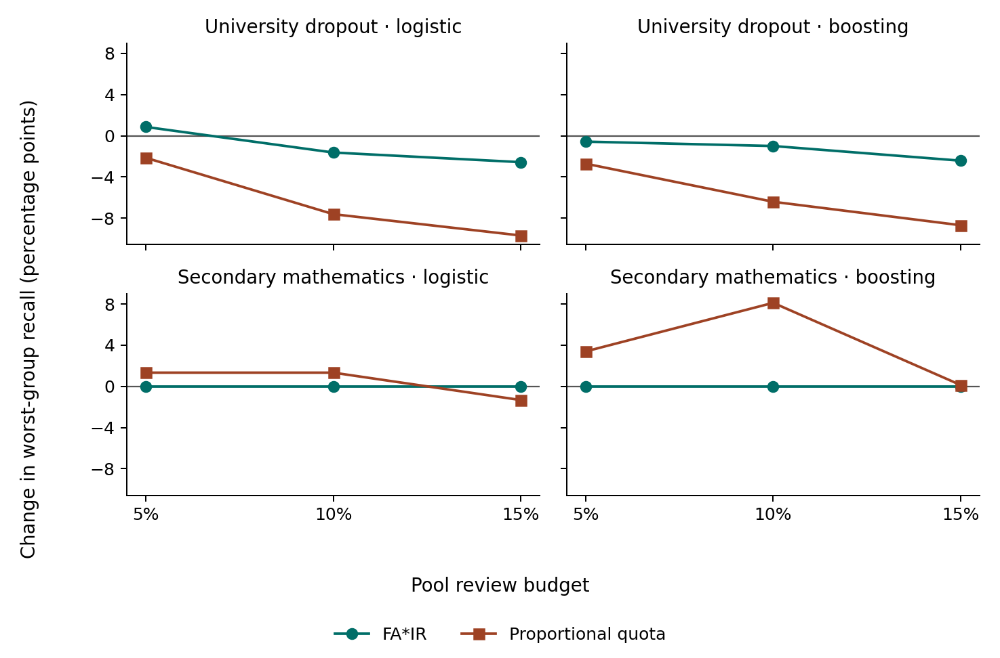

# When does fair re-ranking change who gets reviewed? A fixed-budget replay in two education datasets

**Abstract.** A representation requirement can change the order of a review list, its membership, or both. We measured those effects separately by replaying FA*IR, proportional quotas, and unrestricted risk ranking on two published cohorts. With a 10% course budget and logistic scores, FA*IR repaired 141 failing prefixes across 10 university courses, exchanged 15 of 357 places, and captured 344 of 1,421 recorded dropouts, one fewer than unrestricted ranking. The lower of the two group recalls fell from 24.0% to 22.4%. Proportional quotas exchanged 60 places and reduced that recall to 16.4%. In secondary mathematics, FA*IR repaired two failing logistic prefixes at 10% capacity with zero places exchanged. The effects of ranked representation on access to a review therefore depended on both the score distribution and the cutoff.

## Study design

The unit of allocation was a course or school. The primary question was how many people would enter a fixed review set under a prefix representation requirement, and how the change would redistribute capture of recorded cases. The 10% university quota comparison was already known when we specified this extension. We fixed the additional budgets, protected category, score models, transfer task and metrics before running FA*IR. [Analysis specification](design.md)

The university cohort comprises 3,630 of 4,424 students across 17 Portuguese undergraduate courses. We retained the 1,421 records labeled Dropout and 2,209 labeled Graduate. Excluding the 794 still enrolled conditions the analysis on resolved outcomes. Of 2,381 students coded female, 720 dropped out (30.2%). Of 1,249 coded male, 701 dropped out (56.1%). For each held-out course we refitted standardized logistic regression and histogram gradient boosting on all other courses. Inputs were admission grade, previous qualification grade, application order and four first-semester measures covering units enrolled, units approved, grades and evaluations. These scores require first-semester information. [Realinho et al., UCI dataset 697](https://doi.org/10.24432/C5MC89)

The transfer cohort comprises all 395 mathematics records from two Portuguese secondary schools. We used the mathematics file alone because the companion language file contains overlapping pupils. The outcome was a published final grade G3 below 10 on the 0–20 scale (75/208 female students and 55/187 male students). We fitted each model using first- and second-period grades and past failures at one school and scored the other, in both directions. The smaller training school had only 46 records, making model-dependent comparisons particularly sensitive to score ties. This transfers the allocation procedure across institutions and outcomes with models refitted locally. [Cortez and Silva, UCI dataset 320](https://doi.org/10.24432/C5TG7T)

## Policies and measurements

Within each pool, all policies used the same risk order, resolving ties using a permutation seeded at 42. Each selected the greater of one and the floor of 5%, 10% or 15% of pool size. Unrestricted ranking took the first k. Proportional allocation assigned places by group population share and largest remainders, then took the highest scores in each group. For prefix diagnostics we ordered quota recipients by their original risk rank.

FA*IR protects one category. We used the recorded female category throughout, with target proportion equal to its share of the candidate pool. At every rank i, the algorithm checks a lower count from the binomial quantile for i draws at that proportion. It takes the highest-ranked remaining protected candidate when needed to meet the bound and otherwise takes the highest-ranked remaining candidate. We used the adjusted table generator and greedy ranker in fairsearchcore 1.0.4 with nominal list-level alpha 0.10. The two-value demographic fields limit which groups this audit can describe. [Zehlike et al., CIKM 2017](https://doi.org/10.1145/3132847.3132938) · [Pinned implementation](https://pypi.org/project/fairsearchcore/1.0.4/)

We counted a place exchanged once per newly selected person. Case capture is the count of selected people with the recorded outcome. We divided each group's captures by all its cases across pools and reported the smaller recall. A prefix violation occurs when a list contains fewer protected candidates than required at a given position. Multiple violations can occur in one list. These are paired, finite-cohort measurements. No observed review capacity, contact, or treatment response enters the calculation.

## Results

At the primary 10% budget the logistic university ranking had 141 failing positions across 10 courses. FA*IR repaired all positions, changing membership in eight courses. Its net loss of one captured case comprised **14 more female cases and 15 fewer male cases**. Under boosting, FA*IR repaired 82 positions across seven courses, changed membership in five, and preserved the total of 348 cases captured. The redistribution under proportional quotas was larger for both models.

| University model | Policy | Female places / 357 | Female cases / 720 | Male cases / 701 | Places exchanged | Worst recall |
|---|---|---:|---:|---:|---:|---:|
| Logistic | Risk | 178 | 173 | 172 | 0 | 24.0% |
| Logistic | FA*IR | 193 | 187 | 157 | 15 | 22.4% |
| Logistic | Quota | 234 | 224 | 115 | 60 | 16.4% |
| Boosting | Risk | 186 | 183 | 165 | 0 | 23.5% |
| Boosting | FA*IR | 194 | 190 | 158 | 8 | 22.5% |
| Boosting | Quota | 234 | 225 | 120 | 50 | 17.1% |

The direction of the recall change depended on capacity. At 5%, university logistic FA*IR increased worst-group recall from 10.7% to 11.6% with 11 of 175 places exchanged. At 15%, it reduced recall from 34.2% to 31.7% with 19 of 536 places exchanged. At 5% the female group had the lower unrestricted recall. Transferring places first narrowed the disparity, then made male recall the lower value. At 10% and 15%, the transfer pushed male recall below the previous minimum.

In mathematics, FA*IR exchanged **zero places** at every budget under both models. The unrestricted logistic list still violated four prefixes at 5%, two at 10%, and one at 15%. Reordering people who were already selected sufficed. The unrestricted boosting lists satisfied every prefix. At 10%, 19 of 38 logistic places went to female students and each group contributed 17 captured cases. Under boosting, 26 places went to female students, with 23 female and eight male cases captured. Proportional quotas exchanged three logistic and six boosting places. Boosting quotas preserved total capture at 31 and raised the lower group recall from 14.5% to 22.7%. [All 36 policy contrasts and baselines](results.csv) · [Course and school counts](pool_counts.csv)

## Implementation fidelity and limitations

The runner checks every adjusted threshold against its binomial quantile, every greedy choice against the eligible remaining candidates, capacity, uniqueness and prefix feasibility. It reproduces the original course-level allocations at 10%. All 19 upstream tests of ranking and thresholds passed after converting a NumPy integer cache hash to the native Python integer required by the interpreter. The single-place course uses the same lower-level generator and ranker as the other pools. Its adjusted minimum is zero at every tested budget.

The published library targets a nominal crossing probability for discrete tables. An independent Bernoulli recursion that includes the final position gave exact crossing probabilities from 0 to 0.1291 across the 57 pool–budget tables. Of these, 32 exceeded 0.10 and 15 had fewer than 10 places, below the library's usual tested range. Thus the empirical results describe the realized library thresholds. A strict 10% upper bound would require separate calibration. [Complete tables and crossing probabilities](thresholds.json)

The comparison identifies who changes places under each algorithm in these cohorts. Small school samples, binary recorded categories, a single tie seed, and different outcome horizons limit transfer to other populations. Ranking a student for hypothetical review supplies no evidence that review improves their outcome. An institution evaluating a review policy would need its own objective, capacity and evidence of benefit. [Source provenance and reproduction](reproduce.md)

## Prospective comparison of bootstrap and point-estimate thresholds

At day zero in OULAD, 973 simulated review places covered 9,767 eligible learners. Optimizing the tenth percentile of worst-group expected recall across training bootstraps and optimizing the point estimate both captured 179 female and 287 other withdrawal cases. Their realized worst-group recall was 16.26%. FA*IR captured 253 and 206 cases respectively, yielding 12.54% worst-group recall. The bootstrap policy gained 3.72 percentage points over FA*IR (paired 95% interval 1.05–5.37) and tied the point-estimate threshold. Its precision difference against unrestricted selection had a lower bound of −1.20 percentage points, below the prespecified −1-point tolerance. On UCI 856 the bootstrap and point policies filled the same five seats among 58 students, capturing three female cases and zero other cases. A proportional quota captured two and one. The comparisons fail the prespecified joint criterion. Missing OULAD registration dates are encoded as question marks and were parsed as missing before eligibility filtering. [Protocol](confirmatory/protocol.md) · [Results](confirmatory/run/results.csv) · [Paired intervals](confirmatory/run/contrasts.csv)
