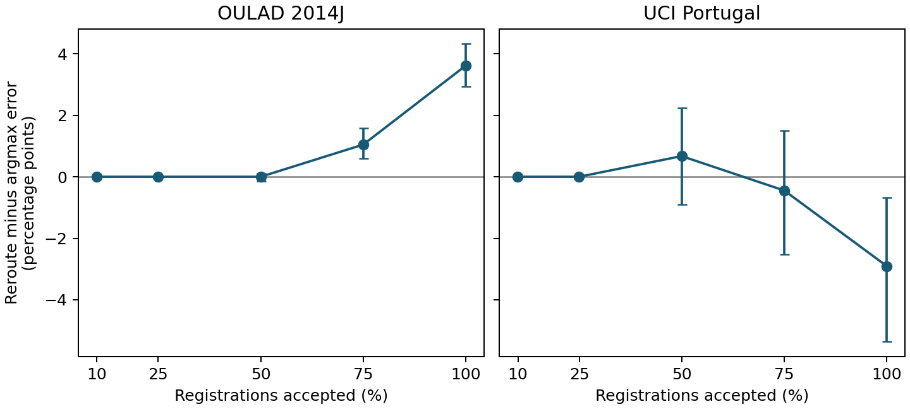

# Separating case selection from label changes in selective course-outcome prediction

**Abstract.** A course-outcome classifier can increase its reported accuracy by declining difficult cases, even when its label rule adds nothing. We evaluated a released four-class gate that first accepts confident predictions and then can change an accepted label to Fail. On a frozen OULAD temporal split, the rule cost 86 correct decisions on 1,167 accepted registrations. On a strictly later presentation, the refitted gate and confidence-only classifier labeled exactly the same 552 registrations identically. Selection accounted for the entire 12.85 percentage-point accuracy gain over unrestricted prediction. A secondary three-class Portuguese cohort showed the same mechanism at its calibration threshold. At wider coverage the effect of changing labels differed across cohorts.

## Question and estimands

Suppose a registrar can score a fraction of learners and refer the rest. Does a gate improve the labels issued at that capacity? Maximum class probability supplies a published, executable ranking baseline. A previous OULAD study considers selective prediction for withdrawal. Our contribution is an empirical audit of case selection and label changes for a released multiclass policy, including a future-presentation test. [Maximum-confidence baseline](https://openreview.net/forum?id=Hkg4TI9xl) · [OULAD withdrawal study](https://doi.org/10.1371/journal.pone.0352867)

The closest OULAD studies also condition decisions on the active enrollment set and quantify top-budget alert workload. The label-switching analysis tests the effect of assigning a different class on exactly the same accepted IDs. [Three 2026 OULAD designs compared](../COMPETITION.md)

Write A for the accepted cases, U for all eligible cases, g for the gate labels and b for logistic argmax labels. Gate accuracy on A minus baseline accuracy on U is exactly the sum of two differences:

1. **Label effect** = accuracy(g, A) − accuracy(b, A). Replaying both labels on identical IDs isolates the contribution of rerouting.
2. **Selection effect relative to full coverage** = accuracy(b, A) − accuracy(b, U). This describes the difficulty of the accepted population for the same classifier.

For a capacity-matched comparison, replace U in the second term with the top |A| baseline scores. The released confidence test accepts when the largest probability exceeds or equals its threshold. Thus, at its observed capacity its acceptance set must equal the top-ranked set under the same unrounded probabilities. We verified the identities of the selected registrations. Risk is the fraction of accepted labels that are wrong. This estimand assigns equal costs to all wrong labels.

## Frozen evidence

We replayed the released G and T predictions by unique registration ID. G holds out learner groups. T includes training registrations from the latest presentation.

| Frozen split | Accepted / total | Correct gate / same-case argmax | Reroutes repairing / spoiling a correct decision | Changes with both labels wrong |
|---|---:|---:|---:|---:|
| G | 503 / 3,150 | 368 / 370 | 1 / 3 | 0 |
| T | 1,167 / 3,228 | 675 / 761 | 17 / 103 | 9 |

On T, the gate achieved 57.84% accuracy, the same-case baseline 65.21%, and unrestricted argmax 55.36%. Label changes cost 7.37 points while selection gained 9.85 points. Both global and within-course capacity matching yielded 761 correct predictions. The global selector returned the same IDs on both frozen splits. [Archived evaluator](evaluate.py) · [Frozen results](result.json) · [Prediction archive](../../../research_artifacts_v3/runs/p01/)

## Secondary future-presentation evaluation

We refitted the released feature encoder, multinomial logistic learner and RC-STG decision rule using OULAD 2013B and 2013J alone. We assigned learners to train (9,062 registrations) or calibration (2,286) by hash. We omitted 2014B so all development presentations had finished before 2014J began. Of 11,260 registrations in 2014J, 8,815 had registered by day 60 with no recorded withdrawal by that day. Removing 1,291 registrations of learners seen in an earlier presentation left 7,524 registrations of 7,238 learners across seven modules. One module, CCC, contributed 1,166 test registrations and had no 2013 presentation. Sixty-seven test registrations eventually labeled Withdrawn lacked a withdrawal date, so their status at the landmark could not be independently confirmed. We applied the same availability rule to every outcome. [OULAD source](https://doi.org/10.1038/sdata.2017.171)

We used registration attributes and clicks from days 0–60 inclusive. The released “active sites” variable counts site/day activity records. Only training data contributed categories, centering, scaling and weights. On calibration data the method estimated two order statistics, the 80th percentile of maximum probabilities among correct predictions and the 70th percentile of Fail probabilities among non-Fail registrations. The implementation uses the ceiling of the quantile level times (n+1), bounded by sample size. These cutoffs were 0.639 and 0.321. The gate first tests confidence, then predicts Fail if the second cutoff is met. The comparator applies the same confidence cutoff and retains argmax. [Released method](../../../research_v3/methods/p01/METHOD.md)

## Independent educational cohort

The Portuguese higher-education dataset supplies three outcomes at the end of normal course duration, Dropout, Enrolled and Graduate. We retained all 4,424 records, hash-split by source row into 2,654 training, 875 calibration and 895 test students. We used four enrollment features (admission grade, previous qualification grade, age and application order), training-standardized logistic regression, and applied the same quantile and rerouting rules with Dropout as the target. Calibration cutoffs were 0.606 and 0.296. This analysis tests the rule on a different probability model and endpoint. The source has no student-level dates supporting temporal validation. [Dataset and attribution](https://doi.org/10.24432/C5MC89)

## Transport of the acceptance threshold

We exchanged the frozen acceptance cutoffs between countries while retaining each local classifier and its label rule. On OULAD the Portuguese cutoff increased acceptance from 552 to 1,012 of 7,524 registrations (+6.11 percentage points, simultaneous 95% interval 5.40 to 6.88). On the Portuguese cohort the UK cutoff reduced acceptance from 159 to 81 of 895 (−8.72 points, −11.28 to −6.59). Differences in accepted argmax error were +2.24 and −1.79 points, respectively; both intervals include zero. An imported cutoff materially changed automated workload on these archived cohorts. The countries, decision dates, labels and classifier dimensions differ, and the base models were fitted locally. Run the evaluator in the scientific Python environment and compare stdout to the saved JSON. [Protocol](threshold_transfer/protocol.md) · [Evaluator](threshold_transfer/evaluate.py) · [Paired results](threshold_transfer/results.json)

## Results

| Secondary cohort | Accepted / eligible | Coverage (95% interval) | Errors, gate / same-case argmax | Gate risk (95% interval) | Selection gain vs unrestricted (points, 95% interval) |
|---|---:|---:|---:|---:|---:|
| OULAD 2014J | 552 / 7,524 | 7.34% (6.74–7.92) | 202 / 202 | 36.59% (32.84–40.65) | +12.85 (+8.85 to +16.54) |
| UCI Portugal | 159 / 895 | 17.77% (15.30–20.34) | 48 / 48 | 30.19% (22.93–37.67) | +12.05 (+4.84 to +18.55) |

Both calibrated policies had zero label disagreements with the confidence-only baseline. The label effect and the difference in selection at matched capacity were exactly zero in both samples. The unrestricted baselines made 3,720 and 378 errors respectively. No test-label search or test-capacity adjustment was needed to operate either calibrated policy.

### How the label rule behaves as more cases are accepted

Holding the rerouting cutoff fixed, we accepted the highest-confidence cases at successive review capacities. Values are error percentages. At intermediate capacities, integer case counts were rounded down.

| Target coverage | OULAD argmax | OULAD reroute | UCI argmax | UCI reroute |
|---:|---:|---:|---:|---:|
| 10% | 38.30 | 38.30 | 26.97 | 26.97 |
| 25% | 40.99 | 40.99 | 28.25 | 28.25 |
| 50% | 44.18 | 44.18 | 34.23 | 34.90 |
| 75% | 46.52 | 47.56 | 37.56 | 37.11 |
| 100% | 49.44 | 53.06 | 42.23 | 39.33 |



Figure 1. Each bar shows a pointwise 95% paired bootstrap interval. Positive values indicate additional errors from rerouting.

At full coverage, the rerouting rule increased OULAD risk by 3.62 points (95% interval +2.94 to +4.33) and reduced Portuguese risk by 2.91 points (−5.36 to −0.67). These descriptive contrasts compare different endpoints and student populations. At each capacity we computed pointwise percentile intervals from 2,000 paired test-learner bootstrap samples, refilling the confidence-ranked capacity within each draw. At the calibrated point we kept the fitted decision thresholds fixed. [All estimates and intervals](secondary_run/results.json)

## Scope and reproducibility

The frozen T deficit did not persist at the later presentation's calibrated operating point. This gate accepted just one registration in fourteen there. Deferral workload, downstream outcomes and the relative cost of missing a Fail outcome were unmeasured. Resampling conditions on the fitted models, calibration sets and observed presentations. With zero observed disagreements, a pairs bootstrap necessarily returns a zero-width interval for label effects and cannot exclude rare disagreements in new data. One future OULAD presentation and one random Portuguese holdout do not establish stability across years or institutions.

The secondary analyses use previously explored public datasets. They have separate predictions and results from the original frozen release. Source-row indices in the CSV files are zero-based. The learner-cluster column permits paired reanalysis without including student identifiers. From the repository root, use Python 3.12 and the pinned dependencies. The final two commands recompute the frozen replay and check the saved outputs.

```bash
python -m pip install -r research_v4_2/external/requirements.txt
python research_v4_2/external/fetch.py private_data/raw --study landmark --study dropout
python -m research_v4_2.external.coverage.secondary
python research_v4_2/external/coverage/evaluate.py research_artifacts_v3/runs/p01
python -m pytest -q research_v4_2/external/coverage/test_secondary.py
```

The two secondary fits reproduced both prediction files and the full results JSON byte for byte on a second execution. Regenerate Figure 1 with `uv run --script research_v4_2/external/coverage/figure.py`.

[Secondary protocol](protocol.md) · [Evaluator](secondary.py) · [OULAD decisions](secondary_run/oulad_predictions.csv) · [Portuguese decisions](secondary_run/uci_predictions.csv)

## External development screen on recorded knowledge levels

On the UCI User Knowledge Modeling dataset we retained the original .02 AURC improvement threshold and held the publisher's test sheet in reserve. A confidence score averaging neighborhood correctness and an out-of-fold error detector had the lowest mean AURC across five development folds (.02186 on 258 examples). Temperature scaling yielded .02709. The .00523 gain missed the threshold. Of six comparisons, only the one against neighborhood class agreement cleared .02. The labels are the publisher's modeled categories for electrical-machine knowledge. [Data, results and replay](knowledge/README.md)
