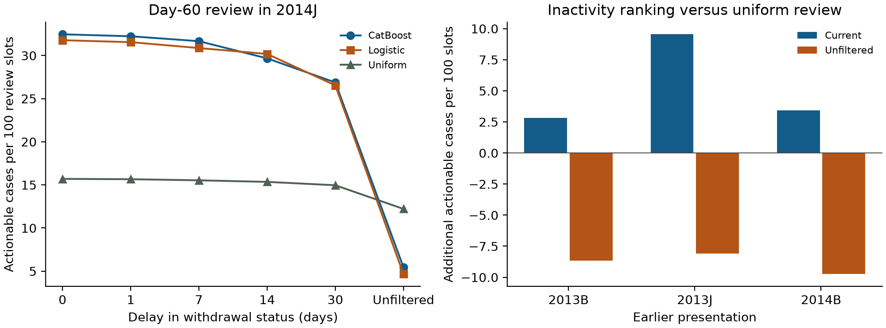
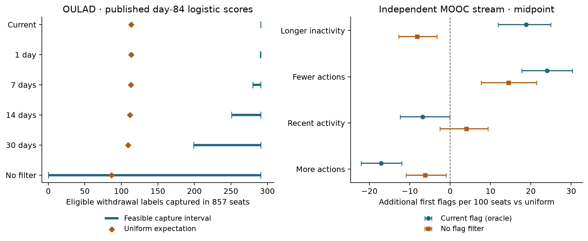

# How does delayed enrollment status change a fixed-capacity withdrawal alert queue?

**Abstract.** How many students who can still receive support reach a review queue when enrollment updates arrive late? We held risk scores and review capacity fixed and varied the delay in removing recorded exits from the Open University Learning Analytics Dataset. At day 60, a CatBoost ranking captured 285 eligible eventual withdrawals in 878 seats with a current register, 236 under a simulated 30-day delay, and 47.73 in expectation with no status filter. Uniform review on the unfiltered roster would capture 107.23. We also replayed eight published day-84 forecasts at the authors’ 857-seat budget. For assessment logistic regression, all completions of missing stale-roster scores put capture between 199 and 291 at a 30-day delay, above the 109.37 expected under uniform review. Without a filter the bounds widened to 0–291. On a separate MOOC stream the reversal against uniform recurred for ranking by inactivity, while ranking by fewest actions retained its advantage. The MOOC release defines exits from final observed actions, so its current-status condition requires hindsight. These results measure retrospective queue composition under simulated delays.

## Question and design

A feature recorded by day 60 can satisfy a temporal cutoff and still describe the consequences of an earlier withdrawal. Zero recent clicks are particularly ambiguous. They could signal an active student's impending withdrawal or simply reflect that a former student has stopped participating. We measure capture of eligible eventual withdrawals at fixed review capacity. To connect that decision to the benchmark, we also measure discrimination among registrations still eligible at the decision date.

We linked registration, outcome and virtual learning environment tables by module, presentation and learner. We included dated registrations that began by day 60. The risk set additionally required an absent withdrawal date or a date strictly greater than 60. Calendar dates are relative to the module start. The outcome was the released final status “Withdrawn.” We aggregated click count, distinct active days, recency and distinct resources from day 0 through day 60. Registration end dates determined eligibility only. We reserved presentation 2014J for testing and excluded its learners from earlier training presentations. OULAD records daily activity rather than the exact time of a teacher's decision. [Dataset descriptor](https://doi.org/10.1038/sdata.2017.171)

## Closest published decisions

Kovari already measured landmark versus all-registered discrimination in OULAD. Sánchez Trujillo and colleagues evaluated future withdrawal on eligible day-28, 56 and 84 rosters, including fixed-capacity alerts and a 2014J holdout. Wu and colleagues evaluated calibrated boosting, risk–coverage and top-fraction alerts on grouped OULAD presentations. Our measured contribution is the change in actionable case capture when the same ranking and review budget receive progressively older enrollment status. Published absolute precision values use different horizons, features and populations. [Side-by-side designs and comparator results](../COMPETITION.md) · [Kovari](https://doi.org/10.3390/computers15090560) · [Sánchez Trujillo et al.](https://doi.org/10.3390/data11110281) · [Wu et al.](https://doi.org/10.1371/journal.pone.0352867)

Zhao and colleagues already separated withdrawals resolved before each landmark from future withdrawals and scored each group against the same eligible negatives. Zhang and Duan already evaluated prospective withdrawal at day 60 (AUC .736), compared it with retrospective scoring, and measured alert budgets and lead time. We use the event-time comparison to explain the composition of our day-60 AUC. Our subsequent queue experiment holds forecasts and seats fixed while changing which exits an adviser could see. The day-84 replay additionally bounds capture when the published forecasts cover only the current roster. We compare these two prior studies from their reports. [Zhao et al., §3 and Fig. 3](https://doi.org/10.54097/m3389688) · [Zhang and Duan, prospective alerts](https://doi.org/10.1038/s41598-026-68508-4)

## Experiment and results

We fit fixed logistic and CatBoost models to all training registrations and repeated fitting on the eligible subset. The full and eligible training sets contained 19,500 and 16,063 registrations. The corresponding test sets contained 11,249 and 8,815. We resampled learners jointly across the nested test populations to quantify uncertainty in the primary contrast. [CatBoost, NeurIPS 2018](https://proceedings.neurips.cc/paper_files/paper/2018/hash/14491b756b3a51daac41c24863285549-Abstract.html)

| Training population and model | All test registrations | Eligible test registrations |
|---|---:|---:|
| All, logistic | 0.832 | 0.621 |
| All, CatBoost | 0.834 | 0.623 |
| Eligible, logistic | 0.800 | 0.599 |
| Eligible, CatBoost | 0.671 | 0.595 |

Each cell is AUC. The first two rows isolate evaluation membership by holding predictions fixed. The last two ask a different question about training on eligible registrations. Restricting training did not recover the discrimination seen on the broader test population.

## Which comparisons produce the gap?

AUC gives the probability that a randomly chosen positive scores above a randomly chosen negative, counting a tie as half correct. Partition the pairs by eligibility of both members. Pooled AUC is the sum of the stratum AUCs weighted by their shares of all pairs. In this release all registrations removed at day 60 have a positive withdrawal outcome. The negatives therefore stay fixed. The entire pooled-minus-eligible gap is the fraction of pairs involving an exited positive multiplied by the difference between the two stratum AUCs.

Among 28,371,558 day-60 withdrawal pairs, 18,087,054 involved an exited positive and 10,284,504 involved an active positive. CatBoost's stratum AUCs were respectively 0.9533 and 0.6228. Their weighted average reconstructs 0.8335. The resulting 0.2107 gap reflects both the prevalence of a comparison unavailable to a day-60 intervention and the model's ability to win that comparison. The identity holds for any fixed scores. The shares and stratum AUCs are empirical.

## Sensitivity to time and outcome definition

A published OULAD study compared all-registered and landmark cohorts at days 14 and 56, predicting unsuccessful completion (Fail or Withdrawn). Its pooled day-56 AUCs were 0.856 and 0.776. It used richer covariates, different estimators and year/period matching. We adopted its two horizons and composite target in a secondary factorial analysis. For each horizon and target, we retrained the same two models on the earlier presentations, excluding test learners, and then held all predictions fixed during the population comparison. This isolates the paired comparisons within our design. It does not reproduce the other study's numerical estimates. [Prior OULAD comparison, sections 3.6 and 4.3](https://doi.org/10.3390/computers15090560)

| Day | Target | All / eligible registrations | CatBoost AUC, all / eligible | Share of pairs with an exited positive | AUC within those pairs |
|---:|---|---:|---:|---:|---:|
| 14 | Withdrawal | 11,221 / 9,330 | .727 / .587 | 49.7% | .869 |
| 14 | Fail or Withdrawn | 11,221 / 9,330 | .740 / .662 | 32.7% | .899 |
| 56 | Withdrawal | 11,249 / 8,876 | .825 / .620 | 62.1% | .949 |
| 56 | Fail or Withdrawn | 11,249 / 8,876 | .817 / .710 | 41.0% | .971 |
| 60 | Withdrawal | 11,249 / 8,815 | .834 / .623 | 63.8% | .953 |
| 60 | Fail or Withdrawn | 11,249 / 8,815 | .824 / .714 | 42.0% | .976 |

Adding students who ultimately failed to the positive class reduces the weight of already-exited positives. At day 56 this cut the CatBoost gap from .204 to .107 even though the model ranked the exited positives more accurately under the broader target. Logistic regression showed the same direction at every horizon. The sensitivity estimates reuse registrations across horizons and are descriptive. [Factorial evaluator](horizons.py) · [All model cells and pair counts](run/horizons.json)

## Interpretation

For a day-60 early-warning decision, the relevant AUC among eligible students is about .62. A retrospective population can still be a legitimate target for another question, such as classifying the final outcomes of everyone originally registered. The analysis distinguishes these questions and quantifies which pairs change the answer. We did not observe support decisions, subsequent intervention effects or predictive performance at a different institution. Missing registration dates exclude some students from both populations.

[Protocol](protocol.md) · [Evaluator](evaluate.py) · [Results](run/result.json) · [Predictions](run/predictions.csv.gz)

## External course-exit forecasting

A second dataset supplies an action-level target on an independently released MOOC stream and supports a temporally ordered model comparison. Of 41,175 future MOOC actions, 369 carried a recorded exit. A tree–recurrent blend raised AUC from .679 for a current-action tree to .809. The gain over the full recurrent model was .0040 (simultaneous 95% interval −.0023 to .0117), below the prespecified .01. The blend also had lower average precision than the recurrent model. The aligned comparison did not pass its first stage. [Protocol, source audit, results and replay](interaction/README.md)

## What the eligibility gap means for a fixed review queue

We allocated 878 hypothetical review slots on the day-60 cohort at equal module-specific budgets across status policies. CatBoost with a current register selected 285 active students who subsequently withdrew. With a seven-day reporting delay it selected 278 and spent 35 slots on previous withdrawals. A 30-day delay reduced actionable cases to 236. With no eligibility filter the ranking selected only 47.73 actionable cases in expectation, fewer than the 107.23 from uniform selection on the same unfiltered roster. With a current register the corresponding uniform benchmark was 137.83. Fractional values average within ties at the cutoff. These simulated delays quantify the extent to which retrospective discrimination can reverse the value of a review ranking for this roster. The release provides recorded exit dates but no timestamps for delivery of those dates to an advising team. [Fixed-budget experiment, all controls and independent verifier](status_lag/README.md)

In three additional presentations we ranked learners by two training-free signals, time since last recorded activity and total clicks. Both rules showed the same reversal against uniform selection in all three presentations. In 2013J, inactivity recency selected 167.02 subsequent withdrawals against 96.29 for random review with a current register. On the unfiltered register it selected 20.08 against 79.93. Eligibility information thus affected both model-based and simple activity-based queues. [Transport design and 36 term-level comparisons](status_lag/transport_run/transport_terms.csv)

Resampling learners and rebuilding the fixed-budget lists gave a CatBoost advantage over random review of 16.76 actionable cases per 100 seats with current status (simultaneous 95% interval 13.13 to 20.07). With unfiltered status the difference was −6.78 cases (−8.30 to −5.26). This retrospective uncertainty analysis conditions on the trained scores and service budget. [Bootstrap and reproduction](status_lag/README.md)

## Replay of the nearest published capacity benchmark

Using the source authors’ predictions we reproduced the day-84 top-decile queue on the identical 8,566 OULAD enrollments. Assessment logistic regression captured 291 of 1,134 labeled withdrawals in 857 seats, random forest 288 and XGBoost 280. Random forest had the highest AUC, while logistic regression captured the most cases at this budget. Eight model exports agreed on eligibility and outcome by enrollment key. The assessment models use the recorded scores; OULAD lacks timestamps for when marks became visible. The risk set includes 87 labeled withdrawals without a dated exit. [Primary paper](https://doi.org/10.3390/data11110281) · [Matched replay and all eight controls](published_capacity/README.md)

The published models omit scores for 320 learners who would enter under a 30-day status delay. Treating every missing score as unconstrained, the assessment logistic queue could capture 199–291 actionable cases, above the 109.37 expected for random selection throughout this range. With no filter, the corresponding 0–291 range spans the uniform result of 86.39. This identifies how much of the register effect the independent research group's exports can establish. Both analyses use one university. [Sharp bounds for six delays and eight models](status_bounds/README.md)

## External transfer of the review rules

We applied the same two training-free rankings to the independently released SNAP MOOC action stream. The midpoint queue had 375 seats. With a current status feed, longer inactivity captured 18.82 more first flagged events per 100 seats than uniform review (simultaneous 95% interval 11.88 to 24.94). Removing the filter reversed this to −8.19 (−12.74 to −3.31). Fewer-actions-first stayed above uniform, +23.99 and +14.45 per 100 seats. Thus only the inactivity reversal traveled across sources. A MOOC flag occurs at the learner's final observed activity timestamp, while OULAD supplies an administrative status. The MOOC publisher defines the flag using the last action. Knowing that an action is terminal requires looking ahead, so current MOOC status is an oracle condition. This external trace tests whether the ranking consequence recurs under a different endpoint; it cannot validate a real-time university exit feed. Neither source measures the effect of contacting a learner. [External protocol, rankings and independent SQL check](mooc_queue/README.md)

At left, each segment spans all capture totals consistent with the missing OULAD forecasts. Diamonds mark expected capture under uniform review of the corresponding roster. At right, whiskers are simultaneous 95% learner-bootstrap intervals on the MOOC stream. Each estimate compares a ranking with uniform review of the same roster. Current-flag filtering assumes that the terminal flag is available immediately. [Figure source](mooc_queue/figure.py)
